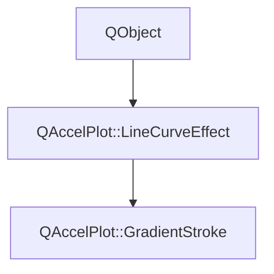

# Class QAccelPlot::GradientStroke


[**ClassList**](annotated.md) **>** [**QAccelPlot**](namespaceQAccelPlot.md) **>** [**GradientStroke**](classQAccelPlot_1_1GradientStroke.md)


_A_ [_**LineCurve**_](classQAccelPlot_1_1LineCurve.md) _effect that replaces the solid line color with a color gradient._[More...](#detailed-description)

* `#include <GradientStroke.hpp>`


Inherits the following classes: [QAccelPlot::LineCurveEffect](classQAccelPlot_1_1LineCurveEffect.md)


## Inheritance diagram




## Public Properties

| Type | Name |
| ---: | :--- |
| property [**Colormap**](classQAccelPlot_1_1Colormap.md) \* | [**colormap**](classQAccelPlot_1_1GradientStroke.md#property-colormap-12)  <br>[_**Colormap**_](classQAccelPlot_1_1Colormap.md) _supplying the color stops. Overrides_`gradient` _when set._ |
| property Qt::Orientation | [**direction**](classQAccelPlot_1_1GradientStroke.md#property-direction-12)  <br>[_**Axis**_](classQAccelPlot_1_1Axis.md) _along which the gradient color varies:_`Qt.Horizontal` _for X values,_`Qt.Vertical` _for Y values. Default:_`Qt.Horizontal` _._ |
| property QObject \* | [**gradient**](classQAccelPlot_1_1GradientStroke.md#property-gradient-12)  <br>_A Qt_ `Gradient` _(or compatible) object supplying the color stops._ |
| property qreal | [**valueMax**](classQAccelPlot_1_1GradientStroke.md#property-valuemax-12)  <br>_Data-space value that maps to gradient position 1.0. Only used when valueMaxSource is Fixed._  |
| property [**GradientValueSource**](namespaceQAccelPlot_1_1GradientValueSourceNS.md#enum-source) | [**valueMaxSource**](classQAccelPlot_1_1GradientStroke.md#property-valuemaxsource-12)  <br>_How the gradient normalization maximum is determined; see_ `GradientValueSource` _._ |
| property qreal | [**valueMin**](classQAccelPlot_1_1GradientStroke.md#property-valuemin-12)  <br>_Data-space value that maps to gradient position 0.0. Only used when valueMinSource is Fixed._  |
| property [**GradientValueSource**](namespaceQAccelPlot_1_1GradientValueSourceNS.md#enum-source) | [**valueMinSource**](classQAccelPlot_1_1GradientStroke.md#property-valueminsource-12)  <br>_How the gradient normalization minimum is determined; see_ `GradientValueSource` _._ |


## Public Properties inherited from QAccelPlot::LineCurveEffect

See [QAccelPlot::LineCurveEffect](classQAccelPlot_1_1LineCurveEffect.md)

| Type | Name |
| ---: | :--- |
| property QML\_ANONYMOUSbool | [**enabled**](classQAccelPlot_1_1LineCurveEffect.md#property-enabled-12)  <br>_Whether this effect is active. Disabled effects are ignored during rendering._  |


## Public Signals

| Type | Name |
| ---: | :--- |
| signal void | [**colormapChanged**](classQAccelPlot_1_1GradientStroke.md#signal-colormapchanged)  <br>_Emitted when the colormap property changes._  |
| signal void | [**directionChanged**](classQAccelPlot_1_1GradientStroke.md#signal-directionchanged)  <br>_Emitted when the direction property changes._  |
| signal void | [**gradientChanged**](classQAccelPlot_1_1GradientStroke.md#signal-gradientchanged)  <br>_Emitted when the gradient property changes._  |
| signal void | [**valueMaxChanged**](classQAccelPlot_1_1GradientStroke.md#signal-valuemaxchanged)  <br>_Emitted when the valueMax property changes._  |
| signal void | [**valueMaxSourceChanged**](classQAccelPlot_1_1GradientStroke.md#signal-valuemaxsourcechanged)  <br>_Emitted when the valueMaxSource property changes._  |
| signal void | [**valueMinChanged**](classQAccelPlot_1_1GradientStroke.md#signal-valueminchanged)  <br>_Emitted when the valueMin property changes._  |
| signal void | [**valueMinSourceChanged**](classQAccelPlot_1_1GradientStroke.md#signal-valueminsourcechanged)  <br>_Emitted when the valueMinSource property changes._  |


## Public Signals inherited from QAccelPlot::LineCurveEffect

See [QAccelPlot::LineCurveEffect](classQAccelPlot_1_1LineCurveEffect.md)

| Type | Name |
| ---: | :--- |
| signal void | [**effectChanged**](classQAccelPlot_1_1LineCurveEffect.md#signal-effectchanged)  <br>_Emitted when any effect property changes, requesting a curve redraw._  |
| signal void | [**enabledChanged**](classQAccelPlot_1_1LineCurveEffect.md#signal-enabledchanged)  <br>_Emitted when the enabled property changes._  |


## Public Functions

| Type | Name |
| ---: | :--- |
|   | [**GradientStroke**](#function-gradientstroke) (QObject \* parent=nullptr) <br>_Constructs a_ [_**GradientStroke**_](classQAccelPlot_1_1GradientStroke.md) _with the given__parent_ _._ |
|  [**Colormap**](classQAccelPlot_1_1Colormap.md) \* | [**colormap**](#function-colormap-22) () const<br>_Returns the colormap supplying color stops, or_ `nullptr` _when_`gradient` _supplies them._ |
|  Qt::Orientation | [**direction**](#function-direction-22) () const<br>_Returns the gradient direction._  |
|  QObject \* | [**gradient**](#function-gradient-22) () const<br>_Returns the Qt Gradient object supplying color stops._  |
|  const [**GradientColorPayload**](structQAccelPlot_1_1GradientColorPayload.md) & | [**payload**](#function-payload) () const<br>_Returns a snapshot of all stroke parameters, updated on the GUI thread when the effect changes._  |
| virtual void | [**refresh**](#function-refresh) () override<br>_Re-reads the_ `gradient` _stops, which can change without a notification, and emits_`effectChanged()` _if they differ from the snapshot._ |
|  void | [**setColormap**](#function-setcolormap) ([**Colormap**](classQAccelPlot_1_1Colormap.md) \* colormap) <br>_Sets the colormap to_ _colormap_ _. Pass_`nullptr` _to take the stops from_`gradient` _._ |
|  void | [**setDirection**](#function-setdirection) (Qt::Orientation direction) <br>_Sets the gradient direction to_ _direction_ _._ |
|  void | [**setGradient**](#function-setgradient) (QObject \* gradient) <br>_Sets the Qt Gradient object to_ _gradient_ _._ |
|  void | [**setValueMax**](#function-setvaluemax) (qreal value) <br>_Sets the maximum data value for gradient normalization to_ _value_ _._ |
|  void | [**setValueMaxSource**](#function-setvaluemaxsource) ([**GradientValueSource**](namespaceQAccelPlot_1_1GradientValueSourceNS.md#enum-source) source) <br>_Sets the gradient normalization maximum source to_ _source_ _._ |
|  void | [**setValueMin**](#function-setvaluemin) (qreal value) <br>_Sets the minimum data value for gradient normalization to_ _value_ _._ |
|  void | [**setValueMinSource**](#function-setvalueminsource) ([**GradientValueSource**](namespaceQAccelPlot_1_1GradientValueSourceNS.md#enum-source) source) <br>_Sets the gradient normalization minimum source to_ _source_ _._ |
|  qreal | [**valueMax**](#function-valuemax-22) () const<br>_Returns the maximum data value for gradient normalization._  |
|  [**GradientValueSource**](namespaceQAccelPlot_1_1GradientValueSourceNS.md#enum-source) | [**valueMaxSource**](#function-valuemaxsource-22) () const<br>_Returns how the gradient normalization maximum is determined._  |
|  qreal | [**valueMin**](#function-valuemin-22) () const<br>_Returns the minimum data value for gradient normalization._  |
|  [**GradientValueSource**](namespaceQAccelPlot_1_1GradientValueSourceNS.md#enum-source) | [**valueMinSource**](#function-valueminsource-22) () const<br>_Returns how the gradient normalization minimum is determined._  |


## Public Functions inherited from QAccelPlot::LineCurveEffect

See [QAccelPlot::LineCurveEffect](classQAccelPlot_1_1LineCurveEffect.md)

| Type | Name |
| ---: | :--- |
|   | [**LineCurveEffect**](classQAccelPlot_1_1LineCurveEffect.md#function-linecurveeffect) (QObject \* parent=nullptr) <br>_Constructs an_ [_**LineCurveEffect**_](classQAccelPlot_1_1LineCurveEffect.md) _with the given__parent_ _._ |
|  bool | [**enabled**](classQAccelPlot_1_1LineCurveEffect.md#function-enabled-22) () const<br>_Returns_ `true` _if the effect is active._ |
| virtual void | [**refresh**](classQAccelPlot_1_1LineCurveEffect.md#function-refresh) () <br>_Re-reads inputs that can change without a notification and emits_ `effectChanged()` _if they did._ |
|  void | [**setEnabled**](classQAccelPlot_1_1LineCurveEffect.md#function-setenabled) (bool enabled) <br>_Sets the effect's enabled state to_ _enabled_ _._ |


## Detailed Description


Attach to `LineCurve::effects` to color the line with a gradient. The color stops come from `colormap` when set, otherwise from a Qt `Gradient` assigned to `gradient`. The gradient can run horizontally (along X data values) or vertically (along Y data values).


**See also:** [**GradientFill**](classQAccelPlot_1_1GradientFill.md), [**Colormap**](classQAccelPlot_1_1Colormap.md), [**LineCurveEffect**](classQAccelPlot_1_1LineCurveEffect.md), [**LineCurve**](classQAccelPlot_1_1LineCurve.md) 


    
## Public Properties Documentation


### property colormap {#property-colormap-12}

[_**Colormap**_](classQAccelPlot_1_1Colormap.md) _supplying the color stops. Overrides_`gradient` _when set._
```C++
Colormap* QAccelPlot::GradientStroke::colormap;
```


Only the ramp is used. `Colormap::min`, `Colormap::max`, and `Colormap::norm` are ignored; `valueMin` and `valueMax` place the ramp instead. 


        

<hr>


### property direction {#property-direction-12}

[_**Axis**_](classQAccelPlot_1_1Axis.md) _along which the gradient color varies:_`Qt.Horizontal` _for X values,_`Qt.Vertical` _for Y values. Default:_`Qt.Horizontal` _._
```C++
Qt::Orientation QAccelPlot::GradientStroke::direction;
```


<hr>


### property gradient {#property-gradient-12}

_A Qt_ `Gradient` _(or compatible) object supplying the color stops._
```C++
QObject* QAccelPlot::GradientStroke::gradient;
```


<hr>


### property valueMax {#property-valuemax-12}

_Data-space value that maps to gradient position 1.0. Only used when valueMaxSource is Fixed._ 
```C++
qreal QAccelPlot::GradientStroke::valueMax;
```


<hr>


### property valueMaxSource {#property-valuemaxsource-12}

_How the gradient normalization maximum is determined; see_ `GradientValueSource` _._
```C++
GradientValueSource QAccelPlot::GradientStroke::valueMaxSource;
```


<hr>


### property valueMin {#property-valuemin-12}

_Data-space value that maps to gradient position 0.0. Only used when valueMinSource is Fixed._ 
```C++
qreal QAccelPlot::GradientStroke::valueMin;
```


<hr>


### property valueMinSource {#property-valueminsource-12}

_How the gradient normalization minimum is determined; see_ `GradientValueSource` _._
```C++
GradientValueSource QAccelPlot::GradientStroke::valueMinSource;
```


<hr>
## Public Signals Documentation


### signal colormapChanged {#signal-colormapchanged}

_Emitted when the colormap property changes._ 
```C++
void QAccelPlot::GradientStroke::colormapChanged;
```


<hr>


### signal directionChanged {#signal-directionchanged}

_Emitted when the direction property changes._ 
```C++
void QAccelPlot::GradientStroke::directionChanged;
```


<hr>


### signal gradientChanged {#signal-gradientchanged}

_Emitted when the gradient property changes._ 
```C++
void QAccelPlot::GradientStroke::gradientChanged;
```


<hr>


### signal valueMaxChanged {#signal-valuemaxchanged}

_Emitted when the valueMax property changes._ 
```C++
void QAccelPlot::GradientStroke::valueMaxChanged;
```


<hr>


### signal valueMaxSourceChanged {#signal-valuemaxsourcechanged}

_Emitted when the valueMaxSource property changes._ 
```C++
void QAccelPlot::GradientStroke::valueMaxSourceChanged;
```


<hr>


### signal valueMinChanged {#signal-valueminchanged}

_Emitted when the valueMin property changes._ 
```C++
void QAccelPlot::GradientStroke::valueMinChanged;
```


<hr>


### signal valueMinSourceChanged {#signal-valueminsourcechanged}

_Emitted when the valueMinSource property changes._ 
```C++
void QAccelPlot::GradientStroke::valueMinSourceChanged;
```


<hr>
## Public Functions Documentation


### function GradientStroke {#function-gradientstroke}

_Constructs a_ [_**GradientStroke**_](classQAccelPlot_1_1GradientStroke.md) _with the given__parent_ _._
```C++
explicit QAccelPlot::GradientStroke::GradientStroke (
    QObject * parent=nullptr
) 
```


<hr>


### function colormap {#function-colormap-22}

_Returns the colormap supplying color stops, or_ `nullptr` _when_`gradient` _supplies them._
```C++
Colormap * QAccelPlot::GradientStroke::colormap () const
```


<hr>


### function direction {#function-direction-22}

_Returns the gradient direction._ 
```C++
Qt::Orientation QAccelPlot::GradientStroke::direction () const
```


<hr>


### function gradient {#function-gradient-22}

_Returns the Qt Gradient object supplying color stops._ 
```C++
QObject * QAccelPlot::GradientStroke::gradient () const
```


<hr>


### function payload {#function-payload}

_Returns a snapshot of all stroke parameters, updated on the GUI thread when the effect changes._ 
```C++
const GradientColorPayload & QAccelPlot::GradientStroke::payload () const
```


Does not read the QML gradient, so `updatePaintNode()` can call it on the render thread. 


        

<hr>


### function refresh {#function-refresh}

_Re-reads the_ `gradient` _stops, which can change without a notification, and emits_`effectChanged()` _if they differ from the snapshot._
```C++
virtual void QAccelPlot::GradientStroke::refresh () override
```


Implements [*QAccelPlot::LineCurveEffect::refresh*](classQAccelPlot_1_1LineCurveEffect.md#function-refresh)


<hr>


### function setColormap {#function-setcolormap}

_Sets the colormap to_ _colormap_ _. Pass_`nullptr` _to take the stops from_`gradient` _._
```C++
void QAccelPlot::GradientStroke::setColormap (
    Colormap * colormap
) 
```


<hr>


### function setDirection {#function-setdirection}

_Sets the gradient direction to_ _direction_ _._
```C++
void QAccelPlot::GradientStroke::setDirection (
    Qt::Orientation direction
) 
```


<hr>


### function setGradient {#function-setgradient}

_Sets the Qt Gradient object to_ _gradient_ _._
```C++
void QAccelPlot::GradientStroke::setGradient (
    QObject * gradient
) 
```


<hr>


### function setValueMax {#function-setvaluemax}

_Sets the maximum data value for gradient normalization to_ _value_ _._
```C++
void QAccelPlot::GradientStroke::setValueMax (
    qreal value
) 
```


<hr>


### function setValueMaxSource {#function-setvaluemaxsource}

_Sets the gradient normalization maximum source to_ _source_ _._
```C++
void QAccelPlot::GradientStroke::setValueMaxSource (
    GradientValueSource source
) 
```


<hr>


### function setValueMin {#function-setvaluemin}

_Sets the minimum data value for gradient normalization to_ _value_ _._
```C++
void QAccelPlot::GradientStroke::setValueMin (
    qreal value
) 
```


<hr>


### function setValueMinSource {#function-setvalueminsource}

_Sets the gradient normalization minimum source to_ _source_ _._
```C++
void QAccelPlot::GradientStroke::setValueMinSource (
    GradientValueSource source
) 
```


<hr>


### function valueMax {#function-valuemax-22}

_Returns the maximum data value for gradient normalization._ 
```C++
qreal QAccelPlot::GradientStroke::valueMax () const
```


<hr>


### function valueMaxSource {#function-valuemaxsource-22}

_Returns how the gradient normalization maximum is determined._ 
```C++
GradientValueSource QAccelPlot::GradientStroke::valueMaxSource () const
```


<hr>


### function valueMin {#function-valuemin-22}

_Returns the minimum data value for gradient normalization._ 
```C++
qreal QAccelPlot::GradientStroke::valueMin () const
```


<hr>


### function valueMinSource {#function-valueminsource-22}

_Returns how the gradient normalization minimum is determined._ 
```C++
GradientValueSource QAccelPlot::GradientStroke::valueMinSource () const
```


<hr>

------------------------------
The documentation for this class was generated from the following file `QAccelPlot/src/QAccelPlot/effects/GradientStroke.hpp`

