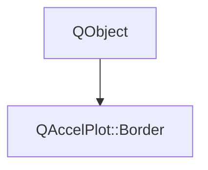

# Class QAccelPlot::Border


[**ClassList**](annotated.md) **>** [**QAccelPlot**](namespaceQAccelPlot.md) **>** [**Border**](classQAccelPlot_1_1Border.md)


_Outline color and width, exposed as a_ `border` _grouped property, for example_`border.width: 1` _._[More...](#detailed-description)

* `#include <Border.hpp>`


Inherits the following classes: QObject


## Inheritance diagram




## Public Properties

| Type | Name |
| ---: | :--- |
| property QML\_ANONYMOUSQColor | [**color**](classQAccelPlot_1_1Border.md#property-color-12)  <br>_Outline color._  |
| property qreal | [**width**](classQAccelPlot_1_1Border.md#property-width-12)  <br>_Outline width in pixels, clamped to at least 0. 0 draws no outline._  |


## Public Signals

| Type | Name |
| ---: | :--- |
| signal void | [**colorChanged**](classQAccelPlot_1_1Border.md#signal-colorchanged)  <br>_Emitted when the color property changes._  |
| signal void | [**widthChanged**](classQAccelPlot_1_1Border.md#signal-widthchanged)  <br>_Emitted when the width property changes._  |


## Public Functions

| Type | Name |
| ---: | :--- |
|   | [**Border**](#function-border) (const QColor & color, qreal width, QObject \* parent=nullptr) <br>_Constructs a border with the given default_ _color_ _and__width_ _, owned by__parent_ _._ |
|  QColor | [**color**](#function-color-22) () const<br>_Returns the outline color._  |
|  void | [**setColor**](#function-setcolor) (const QColor & color) <br>_Sets the outline color to_ _color_ _._ |
|  void | [**setWidth**](#function-setwidth) (qreal width) <br>_Sets the outline width to_ _width_ _pixels. Negative values are clamped to 0._ |
|  qreal | [**width**](#function-width-22) () const<br>_Returns the outline width in pixels._  |


## Detailed Description


Used by `PlotView`, `RectangleSeries`, `BarSeries`, `PlotView.rectangleZoom`, `SelectionTool`, and `ColorBar`. Each owner documents its defaults and where the outline is drawn. 


    
## Public Properties Documentation


### property color {#property-color-12}

_Outline color._ 
```C++
QML_ANONYMOUSQColor QAccelPlot::Border::color;
```


<hr>


### property width {#property-width-12}

_Outline width in pixels, clamped to at least 0. 0 draws no outline._ 
```C++
qreal QAccelPlot::Border::width;
```


<hr>
## Public Signals Documentation


### signal colorChanged {#signal-colorchanged}

_Emitted when the color property changes._ 
```C++
void QAccelPlot::Border::colorChanged;
```


<hr>


### signal widthChanged {#signal-widthchanged}

_Emitted when the width property changes._ 
```C++
void QAccelPlot::Border::widthChanged;
```


<hr>
## Public Functions Documentation


### function Border {#function-border}

_Constructs a border with the given default_ _color_ _and__width_ _, owned by__parent_ _._
```C++
explicit QAccelPlot::Border::Border (
    const QColor & color,
    qreal width,
    QObject * parent=nullptr
) 
```


<hr>


### function color {#function-color-22}

_Returns the outline color._ 
```C++
QColor QAccelPlot::Border::color () const
```


<hr>


### function setColor {#function-setcolor}

_Sets the outline color to_ _color_ _._
```C++
void QAccelPlot::Border::setColor (
    const QColor & color
) 
```


<hr>


### function setWidth {#function-setwidth}

_Sets the outline width to_ _width_ _pixels. Negative values are clamped to 0._
```C++
void QAccelPlot::Border::setWidth (
    qreal width
) 
```


<hr>


### function width {#function-width-22}

_Returns the outline width in pixels._ 
```C++
qreal QAccelPlot::Border::width () const
```


<hr>

------------------------------
The documentation for this class was generated from the following file `QAccelPlot/src/QAccelPlot/Border.hpp`

