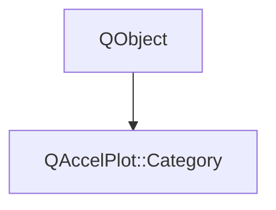

# Class QAccelPlot::Category


[**ClassList**](annotated.md) **>** [**QAccelPlot**](namespaceQAccelPlot.md) **>** [**Category**](classQAccelPlot_1_1Category.md)


_One category of a_ `BarSeries` _or_`RectangleSeries :` _a value, a name, and a fill color._[More...](#detailed-description)

* `#include <Category.hpp>`


Inherits the following classes: QObject


## Inheritance diagram




## Public Properties

| Type | Name |
| ---: | :--- |
| property QColor | [**color**](classQAccelPlot_1_1Category.md#property-color-12)  <br>_Fill color. Default: an invalid color, which uses the series_ `color` _._ |
| property QString | [**name**](classQAccelPlot_1_1Category.md#property-name-12)  <br>_Name for the legend,_ `categoryName` _, and QML data. Default: empty._ |
| property int | [**value**](classQAccelPlot_1_1Category.md#property-value-12)  <br>_Value that data points carry as their_ `category` _. Default: 0._ |


## Public Signals

| Type | Name |
| ---: | :--- |
| signal void | [**colorChanged**](classQAccelPlot_1_1Category.md#signal-colorchanged)  <br>_Emitted when the color property changes._  |
| signal void | [**nameChanged**](classQAccelPlot_1_1Category.md#signal-namechanged)  <br>_Emitted when the name property changes._  |
| signal void | [**valueChanged**](classQAccelPlot_1_1Category.md#signal-valuechanged)  <br>_Emitted when the value property changes._  |


## Public Functions

| Type | Name |
| ---: | :--- |
|   | [**Category**](#function-category-12) (QObject \* parent=nullptr) <br>_Constructs a category with value 0, no name, and no color, owned by_ _parent_ _._ |
|   | [**Category**](#function-category-22) (int value, QString name, const QColor & color, QObject \* parent=nullptr) <br>_Constructs a category with_ _value_ _,__name_ _, and__color_ _, owned by__parent_ _._ |
|  QColor | [**color**](#function-color-22) () const<br>_Returns the fill color._  |
|  QString | [**name**](#function-name-22) () const<br>_Returns the name._  |
|  void | [**setColor**](#function-setcolor) (const QColor & color) <br>_Sets the fill color to_ _color_ _. An invalid color uses the series_`color` _._ |
|  void | [**setName**](#function-setname) (const QString & name) <br>_Sets the name to_ _name_ _._ |
|  void | [**setValue**](#function-setvalue) (int value) <br>_Sets the value data points carry to_ _value_ _._ |
|  int | [**value**](#function-value-22) () const<br>_Returns the value data points carry._  |


## Detailed Description


Data points carry the category `value` as their `category`. The `name` labels the category in the legend and in `barAt()` / `rectangleAt()`, and QML data can use it instead of the value.


```C++
QAccelPlot.RectangleSeries {
    categories: [
        QAccelPlot.Category { value: 0; name: "Running"; color: "seagreen" },
        QAccelPlot.Category { value: 1; name: "Alarm"; color: "firebrick" }
    ]
}
```


**See also:** [**BarSeries::categories**](classQAccelPlot_1_1BarSeries.md#property-categories-12), [**RectangleSeries::categories**](classQAccelPlot_1_1RectangleSeries.md#property-categories-12) 


    
## Public Properties Documentation


### property color {#property-color-12}

_Fill color. Default: an invalid color, which uses the series_ `color` _._
```C++
QColor QAccelPlot::Category::color;
```


<hr>


### property name {#property-name-12}

_Name for the legend,_ `categoryName` _, and QML data. Default: empty._
```C++
QString QAccelPlot::Category::name;
```


<hr>


### property value {#property-value-12}

_Value that data points carry as their_ `category` _. Default: 0._
```C++
int QAccelPlot::Category::value;
```


<hr>
## Public Signals Documentation


### signal colorChanged {#signal-colorchanged}

_Emitted when the color property changes._ 
```C++
void QAccelPlot::Category::colorChanged;
```


<hr>


### signal nameChanged {#signal-namechanged}

_Emitted when the name property changes._ 
```C++
void QAccelPlot::Category::nameChanged;
```


<hr>


### signal valueChanged {#signal-valuechanged}

_Emitted when the value property changes._ 
```C++
void QAccelPlot::Category::valueChanged;
```


<hr>
## Public Functions Documentation


### function Category {#function-category-12}

_Constructs a category with value 0, no name, and no color, owned by_ _parent_ _._
```C++
explicit QAccelPlot::Category::Category (
    QObject * parent=nullptr
) 
```


<hr>


### function Category {#function-category-22}

_Constructs a category with_ _value_ _,__name_ _, and__color_ _, owned by__parent_ _._
```C++
QAccelPlot::Category::Category (
    int value,
    QString name,
    const QColor & color,
    QObject * parent=nullptr
) 
```


<hr>


### function color {#function-color-22}

_Returns the fill color._ 
```C++
QColor QAccelPlot::Category::color () const
```


<hr>


### function name {#function-name-22}

_Returns the name._ 
```C++
QString QAccelPlot::Category::name () const
```


<hr>


### function setColor {#function-setcolor}

_Sets the fill color to_ _color_ _. An invalid color uses the series_`color` _._
```C++
void QAccelPlot::Category::setColor (
    const QColor & color
) 
```


<hr>


### function setName {#function-setname}

_Sets the name to_ _name_ _._
```C++
void QAccelPlot::Category::setName (
    const QString & name
) 
```


<hr>


### function setValue {#function-setvalue}

_Sets the value data points carry to_ _value_ _._
```C++
void QAccelPlot::Category::setValue (
    int value
) 
```


<hr>


### function value {#function-value-22}

_Returns the value data points carry._ 
```C++
int QAccelPlot::Category::value () const
```


<hr>

------------------------------
The documentation for this class was generated from the following file `QAccelPlot/src/QAccelPlot/series/Category.hpp`

