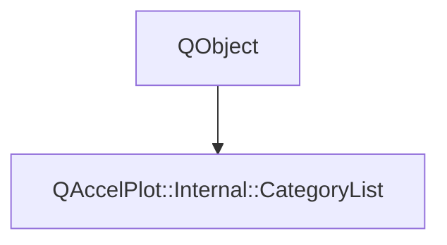

# Class QAccelPlot::Internal::CategoryList


[**ClassList**](annotated.md) **>** [**QAccelPlot**](namespaceQAccelPlot.md) **>** [**Internal**](namespaceQAccelPlot_1_1Internal.md) **>** [**CategoryList**](classQAccelPlot_1_1Internal_1_1CategoryList.md)


_The_ `categories` _list of a series: the_`Category` _objects and a lookup table that follows their edits._[More...](#detailed-description)

* `#include <CategoryList.hpp>`


Inherits the following classes: QObject


## Inheritance diagram




## Public Signals

| Type | Name |
| ---: | :--- |
| signal void | [**changed**](classQAccelPlot_1_1Internal_1_1CategoryList.md#signal-changed)  <br>_Emitted when a category is added, removed, or edited._  |


## Public Functions

| Type | Name |
| ---: | :--- |
|   | [**CategoryList**](#function-categorylist) (const char \* seriesName, QObject \* parent=nullptr) <br>_Constructs an empty list whose warnings name_ _seriesName_ _._ |
|  QQmlListProperty&lt; [**Category**](classQAccelPlot_1_1Category.md) &gt; | [**listProperty**](#function-listproperty) (QObject \* owner) <br>_Returns the list as a QML list property of_ _owner_ _._ |
|  void | [**setCategories**](#function-setcategories) (const QList&lt; [**Category**](classQAccelPlot_1_1Category.md) \* &gt; & categories) <br>_Replaces the categories with_ _categories_ _. Does not take ownership._ |
|  const [**CategoryTable**](classQAccelPlot_1_1Internal_1_1CategoryTable.md) & | [**table**](#function-table) () const<br>_Returns the lookup table of the current categories._  |


## Detailed Description


The table updates on every change, quietly. Duplicate values and names are reported once the event loop runs, after QML bindings of newly declared categories have been evaluated. 


    
## Public Signals Documentation


### signal changed {#signal-changed}

_Emitted when a category is added, removed, or edited._ 
```C++
void QAccelPlot::Internal::CategoryList::changed;
```


<hr>
## Public Functions Documentation


### function CategoryList {#function-categorylist}

_Constructs an empty list whose warnings name_ _seriesName_ _._
```C++
explicit QAccelPlot::Internal::CategoryList::CategoryList (
    const char * seriesName,
    QObject * parent=nullptr
) 
```


<hr>


### function listProperty {#function-listproperty}

_Returns the list as a QML list property of_ _owner_ _._
```C++
QQmlListProperty< Category > QAccelPlot::Internal::CategoryList::listProperty (
    QObject * owner
) 
```


<hr>


### function setCategories {#function-setcategories}

_Replaces the categories with_ _categories_ _. Does not take ownership._
```C++
void QAccelPlot::Internal::CategoryList::setCategories (
    const QList< Category * > & categories
) 
```


<hr>


### function table {#function-table}

_Returns the lookup table of the current categories._ 
```C++
const CategoryTable & QAccelPlot::Internal::CategoryList::table () const
```


<hr>

------------------------------
The documentation for this class was generated from the following file `QAccelPlot/src/QAccelPlot/series/internal/CategoryList.hpp`

