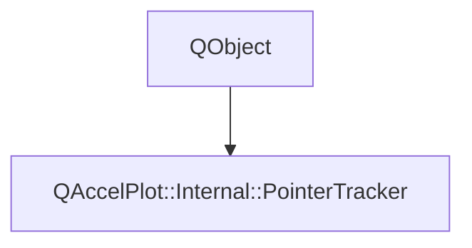

# Class QAccelPlot::Internal::PointerTracker


[**ClassList**](annotated.md) **>** [**QAccelPlot**](namespaceQAccelPlot.md) **>** [**Internal**](namespaceQAccelPlot_1_1Internal.md) **>** [**PointerTracker**](classQAccelPlot_1_1Internal_1_1PointerTracker.md)


_Tracks the pointer over a plot from the plot's mouse and hover events._ [More...](#detailed-description)

* `#include <PointerTracker.hpp>`


Inherits the following classes: QObject


## Inheritance diagram




## Public Signals

| Type | Name |
| ---: | :--- |
| signal void | [**changed**](classQAccelPlot_1_1Internal_1_1PointerTracker.md#signal-changed)  <br>_Emitted when the pointer moves, appears, or leaves._  |


## Public Functions

| Type | Name |
| ---: | :--- |
|   | [**PointerTracker**](#function-pointertracker) (QObject \* parent=nullptr) <br>_Constructs a tracker owned by_ _parent_ _._ |
|  void | [**hoverEnter**](#function-hoverenter) (const QHoverEvent & event) <br>_Places the pointer where the hover enters, unless a touch is in progress._  |
|  void | [**hoverLeave**](#function-hoverleave) () <br>_Removes the pointer when the mouse leaves; a touch pointer stays._  |
|  void | [**hoverMove**](#function-hovermove) (const QHoverEvent & event) <br>_Places the pointer at a hover move, which always comes from the mouse._  |
|  void | [**mouseMove**](#function-mousemove) (const QMouseEvent & event) <br>_Places the pointer at a move, except the button-less move Qt Quick sends after a touch release._  |
|  std::optional&lt; QPointF &gt; | [**position**](#function-position) () const<br>_Returns the pointer position in plot-local logical pixels, or nothing while no pointer is over the plot._  |
|  void | [**press**](#function-press) (const QMouseEvent & event) <br>_Places the pointer at a mouse or touch press._  |
|  void | [**release**](#function-release) () <br>_Ends a press, on release or when the plot loses its grab._  |


## Detailed Description


A touch places the pointer where the finger is and leaves it there after the release, until the next tap or mouse movement. 


    
## Public Signals Documentation


### signal changed {#signal-changed}

_Emitted when the pointer moves, appears, or leaves._ 
```C++
void QAccelPlot::Internal::PointerTracker::changed;
```


<hr>
## Public Functions Documentation


### function PointerTracker {#function-pointertracker}

_Constructs a tracker owned by_ _parent_ _._
```C++
explicit QAccelPlot::Internal::PointerTracker::PointerTracker (
    QObject * parent=nullptr
) 
```


<hr>


### function hoverEnter {#function-hoverenter}

_Places the pointer where the hover enters, unless a touch is in progress._ 
```C++
void QAccelPlot::Internal::PointerTracker::hoverEnter (
    const QHoverEvent & event
) 
```


<hr>


### function hoverLeave {#function-hoverleave}

_Removes the pointer when the mouse leaves; a touch pointer stays._ 
```C++
void QAccelPlot::Internal::PointerTracker::hoverLeave () 
```


<hr>


### function hoverMove {#function-hovermove}

_Places the pointer at a hover move, which always comes from the mouse._ 
```C++
void QAccelPlot::Internal::PointerTracker::hoverMove (
    const QHoverEvent & event
) 
```


<hr>


### function mouseMove {#function-mousemove}

_Places the pointer at a move, except the button-less move Qt Quick sends after a touch release._ 
```C++
void QAccelPlot::Internal::PointerTracker::mouseMove (
    const QMouseEvent & event
) 
```


<hr>


### function position {#function-position}

_Returns the pointer position in plot-local logical pixels, or nothing while no pointer is over the plot._ 
```C++
std::optional< QPointF > QAccelPlot::Internal::PointerTracker::position () const
```


<hr>


### function press {#function-press}

_Places the pointer at a mouse or touch press._ 
```C++
void QAccelPlot::Internal::PointerTracker::press (
    const QMouseEvent & event
) 
```


<hr>


### function release {#function-release}

_Ends a press, on release or when the plot loses its grab._ 
```C++
void QAccelPlot::Internal::PointerTracker::release () 
```


<hr>

------------------------------
The documentation for this class was generated from the following file `QAccelPlot/src/QAccelPlot/internal/PointerTracker.hpp`

