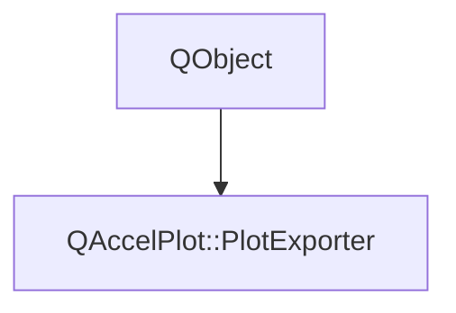

# Class QAccelPlot::PlotExporter


[**ClassList**](annotated.md) **>** [**QAccelPlot**](namespaceQAccelPlot.md) **>** [**PlotExporter**](classQAccelPlot_1_1PlotExporter.md)


_Exports a plot as a raster image: to a file, to the clipboard, or as a_ `QImage` _._[More...](#detailed-description)

* `#include <PlotExporter.hpp>`


Inherits the following classes: QObject


## Inheritance diagram




## Public Properties

| Type | Name |
| ---: | :--- |
| property bool | [**busy**](classQAccelPlot_1_1PlotExporter.md#property-busy-12)  <br>_True from a request until its_ `finished()` _signal._ |
| property qreal | [**dpi**](classQAccelPlot_1_1PlotExporter.md#property-dpi-12)  <br>_Resolution stored in saved files, in dots per inch; 0 stores 96 times the effective scale. Default: 0._  |
| property [**PlotView**](classQAccelPlot_1_1PlotView.md) \* | [**plot**](classQAccelPlot_1_1PlotExporter.md#property-plot-12)  <br>_Plot to export; null once the plot is destroyed._  |
| property int | [**quality**](classQAccelPlot_1_1PlotExporter.md#property-quality-12)  <br>_Encoder quality from 0 to 100 passed to_ `QImageWriter` _; -1 uses the format's default. Default: -1._ |
| property qreal | [**scale**](classQAccelPlot_1_1PlotExporter.md#property-scale-12)  <br>_Image pixels per logical pixel; 0 uses the window's device pixel ratio. Default: 0._  |
| property bool | [**transparentBackground**](classQAccelPlot_1_1PlotExporter.md#property-transparentbackground-12)  <br>_Leaves out the plot's_ `axesAreaColor` _and_`plotAreaColor` _backgrounds. Default: false._ |


## Public Signals

| Type | Name |
| ---: | :--- |
| signal void | [**busyChanged**](classQAccelPlot_1_1PlotExporter.md#signal-busychanged)  <br>_Emitted when the busy property changes._  |
| signal void | [**dpiChanged**](classQAccelPlot_1_1PlotExporter.md#signal-dpichanged)  <br>_Emitted when the dpi property changes._  |
| signal void | [**finished**](classQAccelPlot_1_1PlotExporter.md#signal-finished) (bool ok, const QString & path, const QString & error) <br>_Emitted when a request ends;_ _path_ _is the saved file, empty for other requests._ |
| signal void | [**imageReady**](classQAccelPlot_1_1PlotExporter.md#signal-imageready) (const QImage & image) <br>_Emitted with the captured_ _image_ _before_`finished()` _for a_`grabImage()` _request._ |
| signal void | [**plotChanged**](classQAccelPlot_1_1PlotExporter.md#signal-plotchanged)  <br>_Emitted when the plot property changes._  |
| signal void | [**qualityChanged**](classQAccelPlot_1_1PlotExporter.md#signal-qualitychanged)  <br>_Emitted when the quality property changes._  |
| signal void | [**scaleChanged**](classQAccelPlot_1_1PlotExporter.md#signal-scalechanged)  <br>_Emitted when the scale property changes._  |
| signal void | [**transparentBackgroundChanged**](classQAccelPlot_1_1PlotExporter.md#signal-transparentbackgroundchanged)  <br>_Emitted when the transparentBackground property changes._  |


## Public Functions

| Type | Name |
| ---: | :--- |
|   | [**PlotExporter**](#function-plotexporter-13) (QObject \* parent=nullptr) <br>_Constructs an exporter without a plot._  |
|   | [**PlotExporter**](#function-plotexporter-23) (const [**PlotExporter**](classQAccelPlot_1_1PlotExporter.md) &) = delete<br> |
|   | [**PlotExporter**](#function-plotexporter-33) ([**PlotExporter**](classQAccelPlot_1_1PlotExporter.md) &&) = delete<br> |
|  bool | [**busy**](#function-busy-22) () const<br>_Returns true while a request is in progress._  |
|  Q\_INVOKABLE bool | [**copyToClipboard**](#function-copytoclipboard) () <br>_Copies the plot image to the clipboard; returns false when the request fails immediately._  |
|  qreal | [**dpi**](#function-dpi-22) () const<br>_Returns the resolution stored in saved files; 0 means 96 times the effective scale._  |
|  Q\_INVOKABLE bool | [**grabImage**](#function-grabimage) () <br>_Captures the plot and emits_ `imageReady()` _; returns false when the request fails immediately._ |
|  [**PlotExporter**](classQAccelPlot_1_1PlotExporter.md) & | [**operator=**](#function-operator) (const [**PlotExporter**](classQAccelPlot_1_1PlotExporter.md) &) = delete<br> |
|  [**PlotExporter**](classQAccelPlot_1_1PlotExporter.md) & | [**operator=**](#function-operator_1) ([**PlotExporter**](classQAccelPlot_1_1PlotExporter.md) &&) = delete<br> |
|  [**PlotView**](classQAccelPlot_1_1PlotView.md) \* | [**plot**](#function-plot-22) () const<br>_Returns the plot to export._  |
|  int | [**quality**](#function-quality-22) () const<br>_Returns the encoder quality._  |
|  Q\_INVOKABLE bool | [**save**](#function-save) (const QString & path) <br>_Saves the plot to_ _path_ _in the format its suffix names._ |
|  qreal | [**scale**](#function-scale-22) () const<br>_Returns the image pixels per logical pixel; 0 means the window's device pixel ratio._  |
|  void | [**setDpi**](#function-setdpi) (qreal dpi) <br>_Sets the stored resolution; negative and nonfinite values are ignored with a warning._  |
|  void | [**setPlot**](#function-setplot) ([**PlotView**](classQAccelPlot_1_1PlotView.md) \* plot) <br>_Sets the plot to export; a request in progress keeps its plot._  |
|  void | [**setQuality**](#function-setquality) (int quality) <br>_Sets the encoder quality; values outside -1 to 100 are ignored with a warning._  |
|  void | [**setScale**](#function-setscale) (qreal scale) <br>_Sets the image pixels per logical pixel; negative and nonfinite values are ignored with a warning._  |
|  void | [**setTransparentBackground**](#function-settransparentbackground) (bool transparent) <br>_Sets whether the image leaves out the plot's backgrounds._  |
|  bool | [**transparentBackground**](#function-transparentbackground-22) () const<br>_Returns whether the image leaves out the plot's backgrounds._  |
|   | [**~PlotExporter**](#function-plotexporter) () override<br>_Restores the plot's appearance if a capture is in progress._  |


## Public Static Functions

| Type | Name |
| ---: | :--- |
|  Q\_INVOKABLE QStringList | [**supportedFormats**](#function-supportedformats) () <br>_Returns the lowercase file suffixes_ `save()` _accepts on this system, such as_`png` _and_`jpg` _._ |


## Detailed Description


The capture contains the plot item and everything drawn inside its bounds, as on screen: series, axes, legend, overlays, and any child items. Children outside the bounds are clipped. The plot must be visible in a window that is shown, not minimized, and renders through a hardware scene graph backend.


Every request is asynchronous and ends with exactly one `finished()` signal, except one made while `busy:` it returns false with a warning and leaves `finished()` to the request in progress. A request for a plot another exporter is capturing fails. The capture is taken on the next frame, and fails when the window is hidden, minimized, or destroyed first; encoding and writing a file run on a worker thread.


**
**


```C++
PlotExporter {
    id: exporter
    plot: myPlot
    scale: 2
    onFinished: (ok, path, error) => console.log(ok ? "Saved " + path : error)
}
Button { text: "Save"; onClicked: exporter.save("plot.png") }
```


**See also:** [**PlotView**](classQAccelPlot_1_1PlotView.md) 


    
## Public Properties Documentation


### property busy {#property-busy-12}

_True from a request until its_ `finished()` _signal._
```C++
bool QAccelPlot::PlotExporter::busy;
```


<hr>


### property dpi {#property-dpi-12}

_Resolution stored in saved files, in dots per inch; 0 stores 96 times the effective scale. Default: 0._ 
```C++
qreal QAccelPlot::PlotExporter::dpi;
```


The default makes documents place the image at its on-screen size. 


        

<hr>


### property plot {#property-plot-12}

_Plot to export; null once the plot is destroyed._ 
```C++
PlotView* QAccelPlot::PlotExporter::plot;
```


<hr>


### property quality {#property-quality-12}

_Encoder quality from 0 to 100 passed to_ `QImageWriter` _; -1 uses the format's default. Default: -1._
```C++
int QAccelPlot::PlotExporter::quality;
```


Lossy formats (JPEG, WebP) trade file size for artifacts. PNG stays lossless and only trades file size for encoding time. Other formats ignore it. 


        

<hr>


### property scale {#property-scale-12}

_Image pixels per logical pixel; 0 uses the window's device pixel ratio. Default: 0._ 
```C++
qreal QAccelPlot::PlotExporter::scale;
```


At a device pixel ratio other than 1, Qt 6.3 and later cannot render every image size, so a side can be a pixel shorter or longer than the plot's size times the scale. 


        

<hr>


### property transparentBackground {#property-transparentbackground-12}

_Leaves out the plot's_ `axesAreaColor` _and_`plotAreaColor` _backgrounds. Default: false._
```C++
bool QAccelPlot::PlotExporter::transparentBackground;
```


[**Grid**](classQAccelPlot_1_1Grid.md), series, axes, and child items such as the legend are drawn as usual. Formats without an alpha channel, such as JPEG, composite the image over white. The plot shows no background for the frame it is captured in. 


        

<hr>
## Public Signals Documentation


### signal busyChanged {#signal-busychanged}

_Emitted when the busy property changes._ 
```C++
void QAccelPlot::PlotExporter::busyChanged;
```


<hr>


### signal dpiChanged {#signal-dpichanged}

_Emitted when the dpi property changes._ 
```C++
void QAccelPlot::PlotExporter::dpiChanged;
```


<hr>


### signal finished {#signal-finished}

_Emitted when a request ends;_ _path_ _is the saved file, empty for other requests._
```C++
void QAccelPlot::PlotExporter::finished;
```


_ok_ is false when the request failed, and _error_ describes why. 


        

<hr>


### signal imageReady {#signal-imageready}

_Emitted with the captured_ _image_ _before_`finished()` _for a_`grabImage()` _request._
```C++
void QAccelPlot::PlotExporter::imageReady;
```


<hr>


### signal plotChanged {#signal-plotchanged}

_Emitted when the plot property changes._ 
```C++
void QAccelPlot::PlotExporter::plotChanged;
```


<hr>


### signal qualityChanged {#signal-qualitychanged}

_Emitted when the quality property changes._ 
```C++
void QAccelPlot::PlotExporter::qualityChanged;
```


<hr>


### signal scaleChanged {#signal-scalechanged}

_Emitted when the scale property changes._ 
```C++
void QAccelPlot::PlotExporter::scaleChanged;
```


<hr>


### signal transparentBackgroundChanged {#signal-transparentbackgroundchanged}

_Emitted when the transparentBackground property changes._ 
```C++
void QAccelPlot::PlotExporter::transparentBackgroundChanged;
```


<hr>
## Public Functions Documentation


### function PlotExporter {#function-plotexporter-13}

_Constructs an exporter without a plot._ 
```C++
explicit QAccelPlot::PlotExporter::PlotExporter (
    QObject * parent=nullptr
) 
```


<hr>


### function PlotExporter {#function-plotexporter-23}

```C++
QAccelPlot::PlotExporter::PlotExporter (
    const PlotExporter &
) = delete
```


<hr>


### function PlotExporter {#function-plotexporter-33}

```C++
QAccelPlot::PlotExporter::PlotExporter (
    PlotExporter &&
) = delete
```


<hr>


### function busy {#function-busy-22}

_Returns true while a request is in progress._ 
```C++
bool QAccelPlot::PlotExporter::busy () const
```


<hr>


### function copyToClipboard {#function-copytoclipboard}

_Copies the plot image to the clipboard; returns false when the request fails immediately._ 
```C++
Q_INVOKABLE bool QAccelPlot::PlotExporter::copyToClipboard () 
```


<hr>


### function dpi {#function-dpi-22}

_Returns the resolution stored in saved files; 0 means 96 times the effective scale._ 
```C++
qreal QAccelPlot::PlotExporter::dpi () const
```


<hr>


### function grabImage {#function-grabimage}

_Captures the plot and emits_ `imageReady()` _; returns false when the request fails immediately._
```C++
Q_INVOKABLE bool QAccelPlot::PlotExporter::grabImage () 
```


<hr>


### function operator= {#function-operator}

```C++
PlotExporter & QAccelPlot::PlotExporter::operator= (
    const PlotExporter &
) = delete
```


<hr>


### function operator= {#function-operator_1}

```C++
PlotExporter & QAccelPlot::PlotExporter::operator= (
    PlotExporter &&
) = delete
```


<hr>


### function plot {#function-plot-22}

_Returns the plot to export._ 
```C++
PlotView * QAccelPlot::PlotExporter::plot () const
```


<hr>


### function quality {#function-quality-22}

_Returns the encoder quality._ 
```C++
int QAccelPlot::PlotExporter::quality () const
```


<hr>


### function save {#function-save}

_Saves the plot to_ _path_ _in the format its suffix names._
```C++
Q_INVOKABLE bool QAccelPlot::PlotExporter::save (
    const QString & path
) 
```


_path_ may be a local file path or a `file:` URL. An existing file is replaced only when the new one is written completely. Returns false when the request fails immediately, after emitting `finished()` unless the exporter is `busy`. 


        

<hr>


### function scale {#function-scale-22}

_Returns the image pixels per logical pixel; 0 means the window's device pixel ratio._ 
```C++
qreal QAccelPlot::PlotExporter::scale () const
```


<hr>


### function setDpi {#function-setdpi}

_Sets the stored resolution; negative and nonfinite values are ignored with a warning._ 
```C++
void QAccelPlot::PlotExporter::setDpi (
    qreal dpi
) 
```


<hr>


### function setPlot {#function-setplot}

_Sets the plot to export; a request in progress keeps its plot._ 
```C++
void QAccelPlot::PlotExporter::setPlot (
    PlotView * plot
) 
```


<hr>


### function setQuality {#function-setquality}

_Sets the encoder quality; values outside -1 to 100 are ignored with a warning._ 
```C++
void QAccelPlot::PlotExporter::setQuality (
    int quality
) 
```


<hr>


### function setScale {#function-setscale}

_Sets the image pixels per logical pixel; negative and nonfinite values are ignored with a warning._ 
```C++
void QAccelPlot::PlotExporter::setScale (
    qreal scale
) 
```


<hr>


### function setTransparentBackground {#function-settransparentbackground}

_Sets whether the image leaves out the plot's backgrounds._ 
```C++
void QAccelPlot::PlotExporter::setTransparentBackground (
    bool transparent
) 
```


<hr>


### function transparentBackground {#function-transparentbackground-22}

_Returns whether the image leaves out the plot's backgrounds._ 
```C++
bool QAccelPlot::PlotExporter::transparentBackground () const
```


<hr>


### function ~PlotExporter {#function-plotexporter}

_Restores the plot's appearance if a capture is in progress._ 
```C++
QAccelPlot::PlotExporter::~PlotExporter () override
```


<hr>
## Public Static Functions Documentation


### function supportedFormats {#function-supportedformats}

_Returns the lowercase file suffixes_ `save()` _accepts on this system, such as_`png` _and_`jpg` _._
```C++
static Q_INVOKABLE QStringList QAccelPlot::PlotExporter::supportedFormats () 
```


<hr>

------------------------------
The documentation for this class was generated from the following file `QAccelPlot/src/QAccelPlot/export/PlotExporter.hpp`

