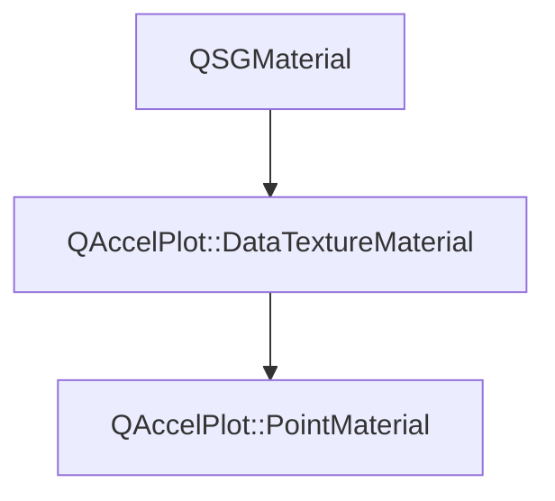

# Class QAccelPlot::PointMaterial


[**ClassList**](annotated.md) **>** [**QAccelPlot**](namespaceQAccelPlot.md) **>** [**PointMaterial**](classQAccelPlot_1_1PointMaterial.md)


_QSGMaterial for_ `LineCurve` _marker rendering._[More...](#detailed-description)

* `#include <PointMaterial.hpp>`


Inherits the following classes: [QAccelPlot::DataTextureMaterial](classQAccelPlot_1_1DataTextureMaterial.md)


## Inheritance diagram




## Public Attributes

| Type | Name |
| ---: | :--- |
|  float | [**antialiasingEnabled**](#variable-antialiasingenabled)   = `{1.0f}`<br>_1.0 when GPU anti-aliasing is active._  |
|  float | [**antialiasingFeather**](#variable-antialiasingfeather)   = `{1.0f}`<br>_Anti-aliasing feather width in pixels._  |
|  float | [**gradientDirection**](#variable-gradientdirection)   = `{0.0f}`<br>_0.0 for a horizontal gradient, 1.0 for a vertical one._  |
|  [**GradientTexture**](classQAccelPlot_1_1GradientTexture.md) | [**gradientTexture**](#variable-gradienttexture)  <br>_Gradient lookup texture sampled at binding 2._  |
|  float | [**gradientValueMax**](#variable-gradientvaluemax)   = `{1.0f}`<br>_Render-space data value at gradient position 1._  |
|  float | [**gradientValueMin**](#variable-gradientvaluemin)   = `{0.0f}`<br>_Render-space data value at gradient position 0._  |
|  float | [**markerFilled**](#variable-markerfilled)   = `{1.0f}`<br>_1.0 for filled markers, 0.0 for hollow outlines._  |
|  float | [**markerSize**](#variable-markersize)   = `{4.0f}`<br>_Marker radius in pixels._  |
|  float | [**markerStrokeWidth**](#variable-markerstrokewidth)   = `{1.0f}`<br>_Outline width in pixels for hollow markers._  |
|  int | [**shapeType**](#variable-shapetype)   = `{0}`<br>_Marker shape:_ `MarkerShape` _value minus one (0 = Circle)._ |


## Public Attributes inherited from QAccelPlot::DataTextureMaterial

See [QAccelPlot::DataTextureMaterial](classQAccelPlot_1_1DataTextureMaterial.md)

| Type | Name |
| ---: | :--- |
|  QColor | [**color**](classQAccelPlot_1_1DataTextureMaterial.md#variable-color)   = `{Qt::blue}`<br>_Line/fill color uniform._  |
|  std::shared\_ptr&lt; [**DataTexture**](classQAccelPlot_1_1DataTexture.md) &gt; | [**dataTexture**](classQAccelPlot_1_1DataTextureMaterial.md#variable-datatexture)  <br>_Data texture sampled by the shader. Materials drawing the same samples may share one._  |
|  QVector2D | [**domainMax**](classQAccelPlot_1_1DataTextureMaterial.md#variable-domainmax)   = `{1.0f, 1.0f}`<br>_Maximum data-space coordinate._  |
|  QVector2D | [**domainMin**](classQAccelPlot_1_1DataTextureMaterial.md#variable-domainmin)   = `{0.0f, 0.0f}`<br>_Minimum data-space coordinate._  |
|  float | [**logScaleX**](classQAccelPlot_1_1DataTextureMaterial.md#variable-logscalex)   = `{0.0f}`<br>_1.0 when the X axis uses log scale (float for std140 UBO compatibility)._  |
|  float | [**logScaleY**](classQAccelPlot_1_1DataTextureMaterial.md#variable-logscaley)   = `{0.0f}`<br>_1.0 when the Y axis uses log scale (float for std140 UBO compatibility)._  |
|  float | [**useVertexColor**](classQAccelPlot_1_1DataTextureMaterial.md#variable-usevertexcolor)   = `{0.0f}`<br>_1.0 when per-vertex color overrides_ `color` _(float for std140 UBO compatibility)._ |
|  QVector2D | [**viewportSize**](classQAccelPlot_1_1DataTextureMaterial.md#variable-viewportsize)   = `{800.0f, 600.0f}`<br>_Viewport size in pixels._  |


## Public Functions

| Type | Name |
| ---: | :--- |
|   | [**PointMaterial**](#function-pointmaterial) () <br>_Constructs a_ [_**PointMaterial**_](classQAccelPlot_1_1PointMaterial.md) _with default uniform values._ |
|  QSGMaterialShader \* | [**createShader**](#function-createshader) (QSGRendererInterface::RenderMode) override const<br>_Creates and returns the point shader program._  |
|  QSGMaterialType \* | [**type**](#function-type) () override const<br>_Returns the unique material type identifier for this class._  |


## Public Functions inherited from QAccelPlot::DataTextureMaterial

See [QAccelPlot::DataTextureMaterial](classQAccelPlot_1_1DataTextureMaterial.md)

| Type | Name |
| ---: | :--- |
|   | [**DataTextureMaterial**](classQAccelPlot_1_1DataTextureMaterial.md#function-datatexturematerial) () <br>_Constructs an empty_ [_**DataTextureMaterial**_](classQAccelPlot_1_1DataTextureMaterial.md) _._ |
|  int | [**compare**](classQAccelPlot_1_1DataTextureMaterial.md#function-compare) (const QSGMaterial \* other) override const<br>_Compares shared uniform fields; delegates type-specific fields to_ `compareExtra()` _._ |
|  QSGTexture \* | [**sampledTexture**](classQAccelPlot_1_1DataTextureMaterial.md#function-sampledtexture) () const<br>_Returns the texture the shader samples, or_ `nullptr` _before_`dataTexture` _holds an upload._ |
|  void | [**uploadTexture**](classQAccelPlot_1_1DataTextureMaterial.md#function-uploadtexture) (QQuickWindow \* window, const float \* data, int floatCount) <br>_Uploads_ _floatCount_ _raw floats from__data_ _into_`dataTexture` _, creating it when it is_`nullptr` _._ |
|   | [**~DataTextureMaterial**](classQAccelPlot_1_1DataTextureMaterial.md#function-datatexturematerial) () override<br> |


## Public Static Functions inherited from QAccelPlot::DataTextureMaterial

See [QAccelPlot::DataTextureMaterial](classQAccelPlot_1_1DataTextureMaterial.md)

| Type | Name |
| ---: | :--- |
|  const QSGGeometry::AttributeSet & | [**attributeSet**](classQAccelPlot_1_1DataTextureMaterial.md#function-attributeset) () <br>_Returns the shared vertex attribute set:_ `{float` _id, float param, uchar4 color} (12 bytes)._ |
|  void | [**commitTexture**](classQAccelPlot_1_1DataTextureMaterial.md#function-committexture) (QSGMaterialShader::RenderState & state, int binding, QSGTexture \*\* texture, const [**DataTexture**](classQAccelPlot_1_1DataTexture.md) \* data) <br>_Commits the texture of_ _data_ _to sampler__binding_ _(call from_`updateSampledImage` _). Does nothing before an upload._ |
|  const QSGGeometry::AttributeSet & | [**vertexIndexAttributeSet**](classQAccelPlot_1_1DataTextureMaterial.md#function-vertexindexattributeset) () <br>_Returns the attribute set of marker quads: one ignored_ `uchar4` _placeholder (4 bytes)._ |
|  bool | [**writeCommonUniforms**](classQAccelPlot_1_1DataTextureMaterial.md#function-writecommonuniforms) (char \* buf, int bufSize, const QMatrix4x4 & matrix, const [**DataTextureMaterial**](classQAccelPlot_1_1DataTextureMaterial.md) \* mat) <br>_Writes the shared UBO prefix (transform + color + domain + flags) into_ _buf_ _._ |


## Protected Functions

| Type | Name |
| ---: | :--- |
| virtual int | [**compareExtra**](#function-compareextra) (const QSGMaterial \* other) override const<br>_Compares marker-specific uniforms and the gradient texture identity._  |


## Protected Functions inherited from QAccelPlot::DataTextureMaterial

See [QAccelPlot::DataTextureMaterial](classQAccelPlot_1_1DataTextureMaterial.md)

| Type | Name |
| ---: | :--- |
| virtual int | [**compareExtra**](classQAccelPlot_1_1DataTextureMaterial.md#function-compareextra) (const QSGMaterial \* other) const<br>_Subclass hook for_ `compare()` _— called after the shared fields compare equal._ |


## Detailed Description


Marker positions are read from the inherited data texture as interleaved XY floats, so the vertex buffer depends only on the point count. With `useVertexColor` == 1 the markers take their color from `gradientTexture` at their position along `gradientDirection`. 


    
## Public Attributes Documentation


### variable antialiasingEnabled {#variable-antialiasingenabled}

_1.0 when GPU anti-aliasing is active._ 
```C++
float QAccelPlot::PointMaterial::antialiasingEnabled;
```


<hr>


### variable antialiasingFeather {#variable-antialiasingfeather}

_Anti-aliasing feather width in pixels._ 
```C++
float QAccelPlot::PointMaterial::antialiasingFeather;
```


<hr>


### variable gradientDirection {#variable-gradientdirection}

_0.0 for a horizontal gradient, 1.0 for a vertical one._ 
```C++
float QAccelPlot::PointMaterial::gradientDirection;
```


<hr>


### variable gradientTexture {#variable-gradienttexture}

_Gradient lookup texture sampled at binding 2._ 
```C++
GradientTexture QAccelPlot::PointMaterial::gradientTexture;
```


<hr>


### variable gradientValueMax {#variable-gradientvaluemax}

_Render-space data value at gradient position 1._ 
```C++
float QAccelPlot::PointMaterial::gradientValueMax;
```


<hr>


### variable gradientValueMin {#variable-gradientvaluemin}

_Render-space data value at gradient position 0._ 
```C++
float QAccelPlot::PointMaterial::gradientValueMin;
```


<hr>


### variable markerFilled {#variable-markerfilled}

_1.0 for filled markers, 0.0 for hollow outlines._ 
```C++
float QAccelPlot::PointMaterial::markerFilled;
```


<hr>


### variable markerSize {#variable-markersize}

_Marker radius in pixels._ 
```C++
float QAccelPlot::PointMaterial::markerSize;
```


<hr>


### variable markerStrokeWidth {#variable-markerstrokewidth}

_Outline width in pixels for hollow markers._ 
```C++
float QAccelPlot::PointMaterial::markerStrokeWidth;
```


<hr>


### variable shapeType {#variable-shapetype}

_Marker shape:_ `MarkerShape` _value minus one (0 = Circle)._
```C++
int QAccelPlot::PointMaterial::shapeType;
```


<hr>
## Public Functions Documentation


### function PointMaterial {#function-pointmaterial}

_Constructs a_ [_**PointMaterial**_](classQAccelPlot_1_1PointMaterial.md) _with default uniform values._
```C++
QAccelPlot::PointMaterial::PointMaterial () 
```


<hr>


### function createShader {#function-createshader}

_Creates and returns the point shader program._ 
```C++
QSGMaterialShader * QAccelPlot::PointMaterial::createShader (
    QSGRendererInterface::RenderMode
) override const
```


<hr>


### function type {#function-type}

_Returns the unique material type identifier for this class._ 
```C++
QSGMaterialType * QAccelPlot::PointMaterial::type () override const
```


<hr>
## Protected Functions Documentation


### function compareExtra {#function-compareextra}

_Compares marker-specific uniforms and the gradient texture identity._ 
```C++
virtual int QAccelPlot::PointMaterial::compareExtra (
    const QSGMaterial * other
) override const
```


Implements [*QAccelPlot::DataTextureMaterial::compareExtra*](classQAccelPlot_1_1DataTextureMaterial.md#function-compareextra)


<hr>

------------------------------
The documentation for this class was generated from the following file `QAccelPlot/src/QAccelPlot/materials/PointMaterial.hpp`

