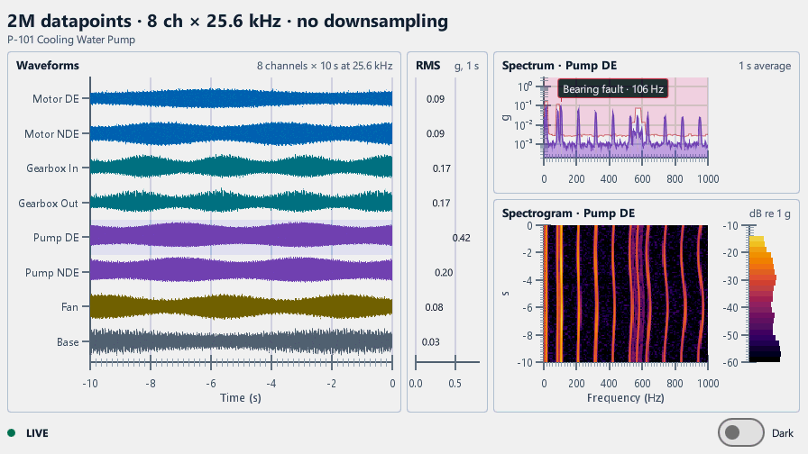

# QAccelPlot

<p align="left">
  <a href="https://github.com/michalgrabarczyk/QAccelPlot/actions/workflows/ci.yml"></a>
  <a href="https://michalgrabarczyk.github.io/QAccelPlot/coverage/"></a>
  <a href="https://michalgrabarczyk.github.io/QAccelPlot/"></a>
  
  
  <a href="#licensing"></a>
</p>

**QAccelPlot** is a high-performance, interactive 2D plotting library for
**Qt Quick (QML & C++)**. It renders through the Qt Scene Graph with GPU shaders and replaces
and draws **millions of points per frame at 60 FPS** without downsampling or
level-of-detail (LOD) reduction.

---

<div align="center">
  <picture>
    <source media="(prefers-color-scheme: dark)" srcset="docs/guide/assets/vibration_monitoring_dark.gif" />
    
  </picture>
  <br />
  <sub><a href="examples/showcases/vibration_monitoring/">Vibration Monitoring example</a>: 2M samples replaced every frame</sub>
</div>

## ⚡ Highlights

- **GPU rendering**: Lines, markers, dashes, and gradients are drawn by shaders on OpenGL, OpenGL ES, Direct3D 11/12, Vulkan, and Metal.
- **Series types**: Line curves, point clouds, heatmaps, bars, histograms, bands, error bars, and rectangle spans.
- **Interactive at full data size**: Pan, cursor-centered zoom, per-axis zoom, and double-click rescale work out of the box. Hover hit testing uses cached block bounds, so it stays responsive on large curves.
- **Fast data paths**: Move interleaved `float` buffers into a curve, or hand buffers off from worker threads with `postData()`. Data ranges are computed only when needed.
- **QML-native**: Plots, axes, and series are `QQuickItem`/`QObject` types that compose with Qt Quick layouts and bindings.
- **Invalid data points**: `NaN`, `±Inf`, and non-positive log-axis values render as gaps or are connected across.

---

## 📊 Performance

QAccelPlot draws every sample, with no downsampling or level-of-detail
reduction. About 1–10M points can be replaced and drawn every frame at 60 FPS.

Exact performance depends on the GPU, the series type, the styling (line width,
markers, gradients), and how the data is passed in. See the
[Performance guide](https://michalgrabarczyk.github.io/QAccelPlot/performance/)
for what each option costs, and run the
[Performance Lab](examples/showcases/performance/) to measure your hardware.

---

## 🎨 Examples

Browse examples in the
[example gallery](https://michalgrabarczyk.github.io/QAccelPlot/main/examples/).

- **[Quickstart](examples/quickstart/)**: a minimal plot.
- **[Realtime](examples/data/realtime/)**: a scrolling signal updated every frame.
- **[Performance Lab](examples/showcases/performance/)**: stream up to 10M points and compare
  performance across settings.
- **[Vibration Monitoring](examples/showcases/vibration_monitoring/)**: stream eight accelerometer
  channels with spectrum, spectrogram, and RMS panels.

Build them with `-DQACCELPLOT_BUILD_EXAMPLES=ON` (see Building from Source).

---

## 📖 Documentation

- 🚀 **[Getting Started](https://michalgrabarczyk.github.io/QAccelPlot/getting-started/)** — CMake integration and a first plot.
- 🏗️ **[Concepts](https://michalgrabarczyk.github.io/QAccelPlot/concepts/)** — Axes, series, gaps, overlays, and threading.
- ⚡ **[Performance Guide](https://michalgrabarczyk.github.io/QAccelPlot/performance/)** — Data paths, worker handoff, and benchmarking.
- 🍳 **[Cookbook](https://michalgrabarczyk.github.io/QAccelPlot/cookbook/)** — Short recipes for common tasks, each linked to a runnable example.
- 🎨 **[Example gallery](https://michalgrabarczyk.github.io/QAccelPlot/main/examples/)** — Every example at a glance, grouped by topic.
- ❓ **[FAQ](https://michalgrabarczyk.github.io/QAccelPlot/faq/)** — Threading, licensing, and backends.
- 📚 **[API Reference](https://michalgrabarczyk.github.io/QAccelPlot/api/)** — Classes, properties, and methods.

---

## 🚀 Using QAccelPlot

### 1. Declare the Plot in QML

```qml
import QtQuick
import QAccelPlot as QAccelPlot

QAccelPlot.Plot {
    id: plot
    anchors.fill: parent

    xAxis: QAccelPlot.Axis {
        viewportMin: 0; viewportMax: 10
        label: "Time (s)"
    }

    yAxis: QAccelPlot.Axis {
        viewportMin: -1.2; viewportMax: 1.2
        label: "Amplitude"
    }

    QAccelPlot.LineCurve {
        objectName: "curve"
        xAxis: plot.xAxis
        yAxis: plot.yAxis
        color: "darkorange"
        lineWidth: 2
    }
}
```

Panning, zooming, and rescaling need no extra code.

### 2. Set Data from C++

```cpp
auto* curve = root->findChild<QAccelPlot::LineCurve*>("curve");
const std::vector<double> times { 0, 2.5, 5, 7.5, 10 };
const std::vector<double> amplitudes { 0, 0.8, -0.6, 0.4, 0 };
curve->setData(times, amplitudes);
```

`setData()` suits small data sets. For large or streaming data, see the
[Performance guide](https://michalgrabarczyk.github.io/QAccelPlot/performance/).
For CMake integration, see
[Getting Started](https://michalgrabarczyk.github.io/QAccelPlot/getting-started/).

> [!NOTE]
> **Pre-1.0 (v0.4):** The API may change between minor releases until 1.0.

---

## 🧪 Testing

[Unit tests](.github/workflows/build-and-test.yml) run on Qt 6.2, 6.8, and
6.11 across Linux, Windows, and macOS, with OpenGL, OpenGL ES, Vulkan,
Direct3D 11/12, and Metal.

---

## 🛠️ Building from Source

### Requirements

- **CMake** 3.16 or newer
- **C++17** compatible compiler
- **Qt 6.2 or newer** with `Core`, `Gui`, `Quick`, and `ShaderTools`
- Optional: the matching `QuickPrivate` component for faster live-data texture
  updates
- A hardware Qt Quick Scene Graph backend (OpenGL, OpenGL ES, Direct3D 11/12, Vulkan, or Metal)

QAccelPlot builds as a static library.

```sh
# Configure with examples enabled
cmake -S . -B build -DCMAKE_BUILD_TYPE=Release -DQACCELPLOT_BUILD_EXAMPLES=ON

# Build library and examples
cmake --build build --config Release

# Build every compiled test executable
cmake --build build --config Release --target QAccelPlotTests

# Run tests
ctest --test-dir build --output-on-failure
```

| Option | Default | Effect |
| :--- | :--- | :--- |
| `QACCELPLOT_USE_QT_PRIVATE_API` | `ON` if `QuickPrivate` is found | In-place data texture updates; `OFF` uses public Qt API only. See [texture upload modes](docs/guide/performance.md#select-the-texture-upload-mode). |
| `QACCELPLOT_BUILD_VISUAL_TESTS` | `OFF` | Screenshot and visual validation tests. Requires examples and tests. |
| `QACCELPLOT_FORCE_ASSERTS` | `OFF` | Keeps `Q_ASSERT` active in Release builds. CI turns it on. |
| `QACCELPLOT_WARNINGS_AS_ERRORS` | `OFF` | Builds with `-Wall -Wextra -Werror`, or `/W4 /WX` on MSVC. CI turns it on for one job per compiler. |

---

## 🗺️ Road to 1.0

Planned before 1.0:

- [x] Gaps for invalid data (`NaN`, `±Inf`, non-positive log values).
- [x] Point clouds with colormaps and color bars.
- [x] Bar charts and histograms.
- [x] Bands, error bars, and step lines.
- [x] Data inspection: crosshair, tooltips, and selection.
- [x] Heatmaps.
- [x] Image export.
- [ ] SVG export.
- [ ] Touch panning and pinch zoom.

---

## 🤝 Contributing & Feedback

Report bugs, feature requests, and compatibility notes through
[GitHub Issues](https://github.com/michalgrabarczyk/QAccelPlot/issues). Pull
requests are not accepted; see [CONTRIBUTING.md](CONTRIBUTING.md).

---

## 📄 Licensing

QAccelPlot is available under a **dual-licensing model**:

1. **Open-Source License:** GNU General Public License v3.0 only with the **Universal FOSS Exception**. Qualifying applications distributed under an OSI-approved or FSF-free software license (e.g. MIT, BSD, Apache 2.0, LGPL) may link with QAccelPlot while retaining their own open-source license.
2. **Commercial License:** Separate commercial terms for embedding QAccelPlot in proprietary or closed-source commercial applications without GPL requirements.

📧 For commercial licensing inquiries, contact: **[qaccelplot@gmail.com](mailto:qaccelplot@gmail.com)**

For common situations and links to the full license texts, see
[LICENSING.md](LICENSING.md).
