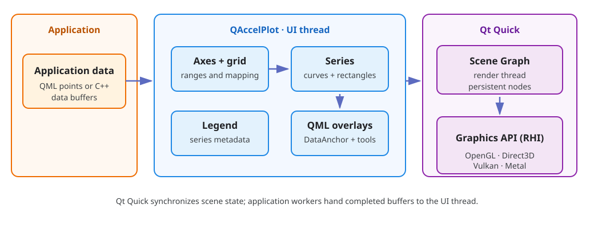

<!--
SPDX-FileCopyrightText: 2026 Michal Grabarczyk
SPDX-License-Identifier: GPL-3.0-only WITH Universal-FOSS-exception-1.0
-->

# Concepts and architecture



## Plot and PlotView

`PlotView` is the C++ plot item. It lays out axes, converts between data and
pixel coordinates, handles pan and zoom, and collects child series.

`Plot` is the QML wrapper most applications use. It adds a `Legend`,
`legendModel`, and `legendVisible` to the full `PlotView` interface.

[`plotRect`][plot-rect] is the data area, excluding axes and padding. Use it to
place clipped overlays and custom tools.

## Axes and ranges

An `Axis` has two related ranges:

- The **viewport range** ([`viewportMin`][viewport-min], [`viewportMax`][viewport-max]) is visible.
- The **data range** ([`dataMin`][data-min], [`dataMax`][data-max]) is the extent reported by
  attached series.

Panning and zooming change the viewport. [`rescaleToData()`][rescale-to-data]
sets the viewport to fit the data range, and [`autoRescale`][auto-rescale]
does so on every data update. A series reports its extent to the
axes set in its [`xAxis`][series-x-axis] and [`yAxis`][series-y-axis] properties.
The extent is
[computed on demand](performance.md#data-ranges-are-computed-on-demand).

| Plot property | Side |
| --- | --- |
| [`xAxis`][plot-x-axis] | Bottom |
| [`x2Axis`][plot-x2-axis] | Top |
| [`yAxis`][plot-y-axis] | Left |
| [`y2Axis`][plot-y2-axis] | Right |
| [`extraAxes`][extra-axes] | Set by each axis's `side` |

Each series selects its own axes.

`AxisTicker` controls tick count, subticks, lengths, colors, fonts, rotation,
and label formatting. Built-in formatters cover numeric, date/time,
logarithmic, and categorical labels; `TickLabelFormatter` also accepts a
JavaScript callback.

## Series

`PlotSeries` holds properties shared by all series: name, axes, plot rectangle,
legend symbol, `hoverEnabled`, and `count`, the number of stored records. `legendEntry()` describes how a legend draws the series;
`LegendModel` lists the entries of the visible series that have one. Only the
topmost series under the mouse pointer is hovered; `hoverEnabled: false` leaves
hover to the series beneath.

`LineCurve` renders lines, markers, line styles, gradients, and fills. It
accepts data from QML or C++ buffers, as doubles or as interleaved floats.
It reports `hovered` within `hoverRadius` pixels of the line or over a marker.
Set `hoverRadius: 0` on a line drawn over another series to leave hover to the
series beneath.

`PointCloud` renders unconnected points as markers, colored uniformly or by a
per-point value through a `Colormap`. It reports the hovered point index.

`HeatmapSeries` renders a uniform grid of values as cells colored through a
`Colormap`, placed by the outer edges of the grid. `PointCloud` and
`HeatmapSeries` derive from `ColormappedSeries`, which resolves the value range
that a `ColorBar` shows.

`BandSeries` fills the area between a low and a high value at each X, such as
confidence intervals and envelopes. It stores `(x, low, high)` triples and
can draw lines along both edges.

`ErrorBarSeries` draws a capped line from a low to a high bound at each data
point, along the Y axis or, with `orientation: Qt.Horizontal`, the X axis. It
stores `(x, y, low, high)` quadruples and does not draw the values.

`RectangleSeries` renders many data-space rectangles in one item, such as event
spans and state timelines. Infinite edges reach the plot edge, and a
per-rectangle category selects the fill color. It reports the hovered
rectangle index.

`BarSeries` renders bar charts from (position, value) pairs. `barWidth`,
`barOffset`, and `baselineValue` shape the bars in the shader, and
`orientation` selects vertical or horizontal bars. Ranged bars carry their
own extent as (from, to, value), e.g. the bins of a histogram.

## Invalid data points and gaps

`LineCurve` applies one invalid-data-point contract to rendering, gradient fills,
dash patterns, transitions, auto-ranging, and hover hit testing. For the other
series, see [bands](cookbook/bands.md#invalid-data-points),
[error bars](cookbook/error-bars.md#invalid-data-points),
[point clouds](cookbook/point-clouds.md#invalid-points), and
[bars](cookbook/bar-charts.md#invalid-bars).

A data point is **invalid** when its X or Y coordinate is `NaN` or `±Inf`, or when a
coordinate is zero or negative on a logarithmic axis. Mark missing data by
inserting a data point with a `NaN` coordinate. JavaScript `null` and `undefined`
are not gap markers.

Gap rendering is configured through the curve's [`gaps`][line-curve] grouped
property. `gaps.nanMode` selects how the line and fill treat invalid data points:

```qml
QAccelPlot.LineCurve {
    gaps.nanMode: QAccelPlot.NanGapMode.Connect
}
```

| `gaps.nanMode` | Behavior |
| --- | --- |
| `NanGapMode.Break` (default) | No segment or fill is drawn to or from an invalid data point. Valid neighbors end squarely, and a valid data point isolated between two invalid data points draws no line. With a [step mode](cookbook/styling.md#step-lines), a value still holds up to the X of an invalid neighbor when that X is finite. |
| `NanGapMode.Connect` | Invalid data points are skipped and the line, fill, and hit test join the nearest valid data points. |

Despite its name, `nanMode` applies to every invalid data point, including `±Inf`
and non-positive log-axis values.

In both modes:

- **Markers** are never drawn for invalid data points.
- **Auto-ranging** judges each coordinate on its own. A data point with a valid X
  and an invalid Y still extends the X range, so a dropout keeps its timestamp.
  If a dimension has no valid coordinate, the series clears that range.
- **Dash patterns** continue across a gap; the gap contributes no dash length.
- **`MorphTransition`** shows a data point that becomes invalid as a gap
  immediately, and a data point that becomes valid jumps to its target instead of
  animating from `NaN`.
- **Hover** never reports a hit on an invalid data point or across a break.

## Composition and overlays

Ordinary QML items can be placed above the grid and series. `DataAnchor` maps
one or two data coordinates to a QML item's geometry, so labels, event lines,
regions, and drag handles follow the data while panning and zooming.

For custom tools, `PlotView` provides [`dataToPixelX()`][data-to-pixel-x],
[`dataToPixelY()`][data-to-pixel-y], [`pixelToDataX()`][pixel-to-data-x],
[`pixelToDataY()`][pixel-to-data-y], and [`isInsidePlotArea()`][is-inside-plot-area].
Accepting a plot mouse event suppresses the default pan.

## Rendering and threads

QML objects and setters run on the UI thread; Qt synchronizes their state to
the Scene Graph render thread. Curve renderers keep persistent Scene Graph
nodes and use precompiled shaders for the active graphics API. The software
backend cannot run these shaders.

Produce data on a worker thread if needed, but never mutate UI objects from it.
Use [`LineCurve::postData()`][post-data] or a queued call. See
[Background data production](cookbook/background-data.md).

[plot-rect]: api/classQAccelPlot_1_1QAccelPlot.md#property-plotrect-12
[viewport-min]: api/classQAccelPlot_1_1Axis.md#property-viewportmin-12
[viewport-max]: api/classQAccelPlot_1_1Axis.md#property-viewportmax-12
[data-min]: api/classQAccelPlot_1_1Axis.md#property-datamin-12
[data-max]: api/classQAccelPlot_1_1Axis.md#property-datamax-12
[rescale-to-data]: api/classQAccelPlot_1_1Axis.md#function-rescaletodata
[auto-rescale]: api/classQAccelPlot_1_1Axis.md#property-autorescale-12
[series-x-axis]: api/classQAccelPlot_1_1PlotSeries.md#property-xaxis-12
[series-y-axis]: api/classQAccelPlot_1_1PlotSeries.md#property-yaxis-12
[plot-x-axis]: api/classQAccelPlot_1_1QAccelPlot.md#property-xaxis-12
[plot-y-axis]: api/classQAccelPlot_1_1QAccelPlot.md#property-yaxis-12
[plot-x2-axis]: api/classQAccelPlot_1_1QAccelPlot.md#property-x2axis-12
[plot-y2-axis]: api/classQAccelPlot_1_1QAccelPlot.md#property-y2axis-12
[extra-axes]: api/classQAccelPlot_1_1QAccelPlot.md#property-extraaxes-12
[data-to-pixel-x]: api/classQAccelPlot_1_1QAccelPlot.md#function-datatopixelx
[data-to-pixel-y]: api/classQAccelPlot_1_1QAccelPlot.md#function-datatopixely
[pixel-to-data-x]: api/classQAccelPlot_1_1QAccelPlot.md#function-pixeltodatax
[pixel-to-data-y]: api/classQAccelPlot_1_1QAccelPlot.md#function-pixeltodatay
[is-inside-plot-area]: api/classQAccelPlot_1_1QAccelPlot.md#function-isinsideplotarea
[post-data]: api/classQAccelPlot_1_1LineCurve.md#function-postdata-22
[line-curve]: api/classQAccelPlot_1_1LineCurve.md
