<!--
SPDX-FileCopyrightText: 2026 Michal Grabarczyk
SPDX-License-Identifier: GPL-3.0-only WITH Universal-FOSS-exception-1.0
-->

# Example gallery

Every example is a complete application in the
[`examples/`](https://github.com/michalgrabarczyk/QAccelPlot/tree/main/examples)
directory. Build them with `-DQACCELPLOT_BUILD_EXAMPLES=ON`:

```sh
cmake -S . -B build -DCMAKE_BUILD_TYPE=Release -DQACCELPLOT_BUILD_EXAMPLES=ON
cmake --build build --config Release
```

Each executable is named after its example, for example
`QAccelPlotExampleVibrationMonitoring`.

## Showcases

<div class="grid cards" markdown>

-   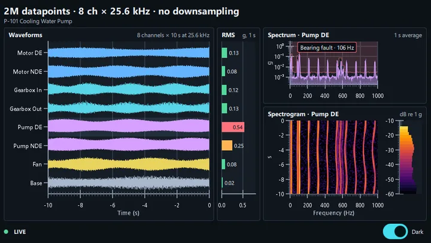

    **[Vibration Monitoring](https://github.com/michalgrabarczyk/QAccelPlot/tree/main/examples/showcases/vibration_monitoring)**

    Condition-monitoring dashboard: eight accelerometers streaming 2M samples into scrolling
    waveforms, RMS bars, a spectrum with a bearing-fault peak, and a spectrogram.

-   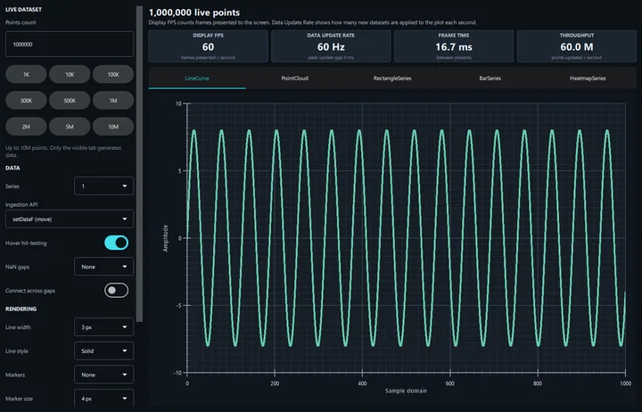

    **[Performance Lab](https://github.com/michalgrabarczyk/QAccelPlot/tree/main/examples/showcases/performance)**

    Stream up to 10M points, rectangles, or bars, or 100M heatmap cells, per tab and compare the
    cost of series count, ingestion API, and rendering options.

-   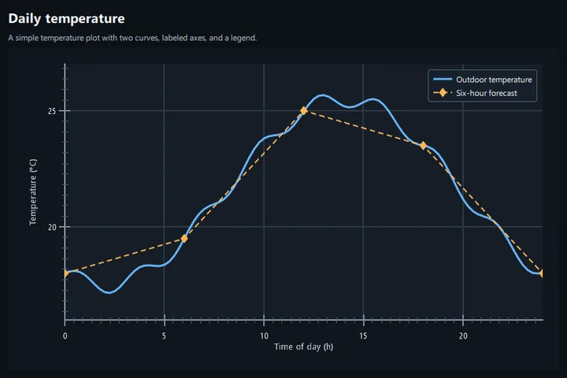

    **[Quickstart](https://github.com/michalgrabarczyk/QAccelPlot/tree/main/examples/quickstart)**

    Minimal plot setup. Recipe: [Basic static plot](cookbook/basic-plot.md).

</div>

## Plot types

<div class="grid cards" markdown>

-   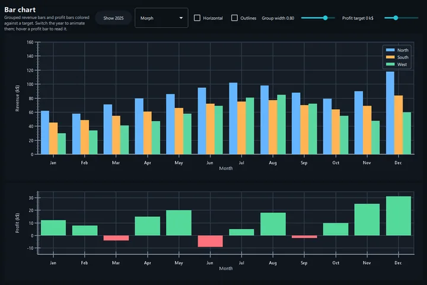

    **[Bar Chart](https://github.com/michalgrabarczyk/QAccelPlot/tree/main/examples/plot_types/bar_chart)**

    Grouped monthly revenue with a horizontal toggle, profit bars colored against a target
    baseline, and animated updates. Recipe: [Bar charts](cookbook/bar-charts.md).

-   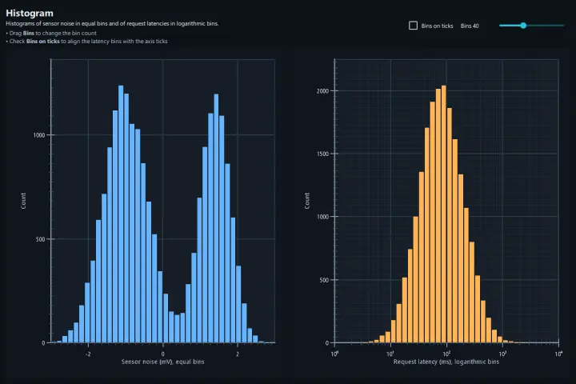

    **[Histogram](https://github.com/michalgrabarczyk/QAccelPlot/tree/main/examples/plot_types/histogram)**

    Sensor noise in equal bins, and request latencies in logarithmic bins or as density in one bin
    per axis tick. Recipe: [Histograms](cookbook/histograms.md).

-   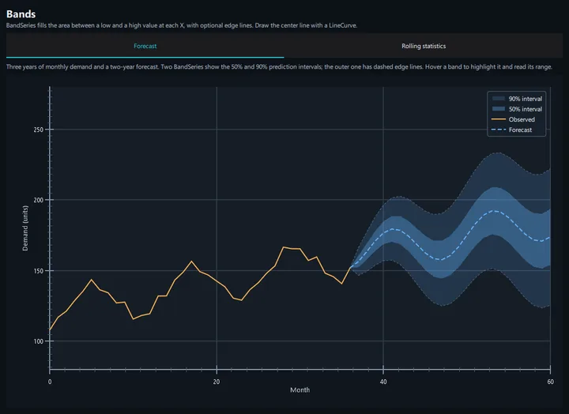

    **[Bands](https://github.com/michalgrabarczyk/QAccelPlot/tree/main/examples/plot_types/bands)**

    Forecast with nested prediction intervals, and a rolling mean ± 2σ band over a simulated
    sensor signal. Recipe: [Bands](cookbook/bands.md).

-   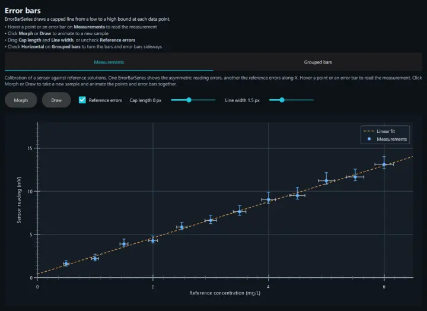

    **[Error Bars](https://github.com/michalgrabarczyk/QAccelPlot/tree/main/examples/plot_types/error_bars)**

    Calibration measurements with asymmetric errors, animated between samples, and error bars on
    grouped bars. Recipe: [Error bars](cookbook/error-bars.md).

-   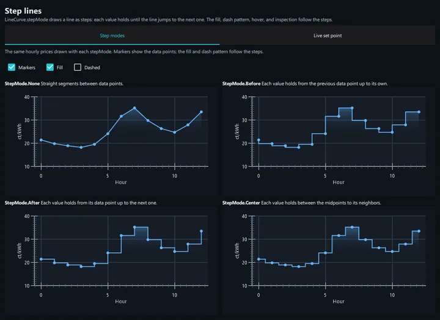

    **[Step Lines](https://github.com/michalgrabarczyk/QAccelPlot/tree/main/examples/plot_types/step_lines)**

    Hourly prices drawn with each step mode, and a live heater set point held as steps over the
    measured temperature.

-   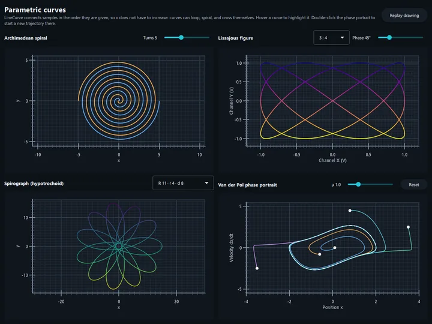

    **[Parametric Curves](https://github.com/michalgrabarczyk/QAccelPlot/tree/main/examples/plot_types/parametric_curves)**

    Spiral, Lissajous figure, spirograph, and Van der Pol phase portrait: curves that loop and
    cross themselves.

-   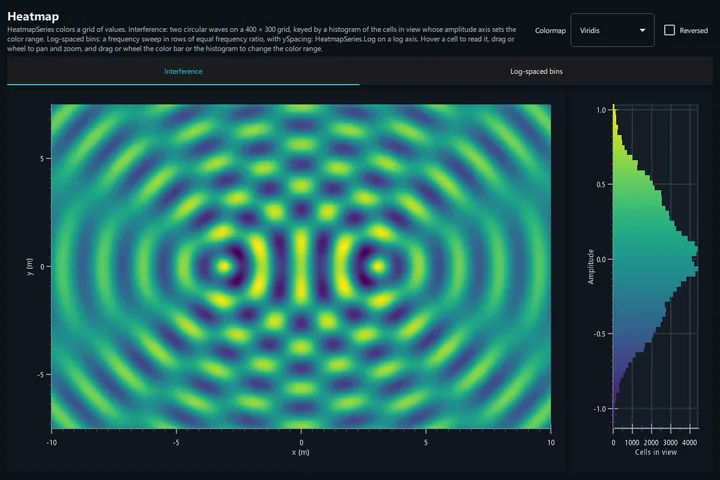

    **[Heatmap](https://github.com/michalgrabarczyk/QAccelPlot/tree/main/examples/plot_types/heatmap)**

    Two-source wave interference on a 400 × 300 grid, keyed by a histogram of the cells in view,
    with colormap presets and an interactive color bar. Recipe: [Heatmaps](cookbook/heatmaps.md).

-   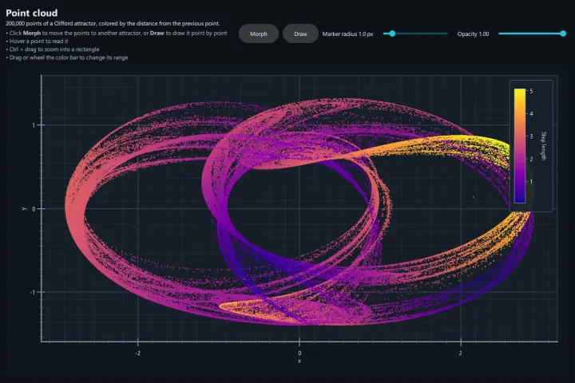

    **[Point Cloud](https://github.com/michalgrabarczyk/QAccelPlot/tree/main/examples/plot_types/point_cloud)**

    200K-point scatter colored by value, with a hover tooltip, rectangle zoom, and transitions
    between datasets. Recipe: [Point clouds](cookbook/point-clouds.md).

-   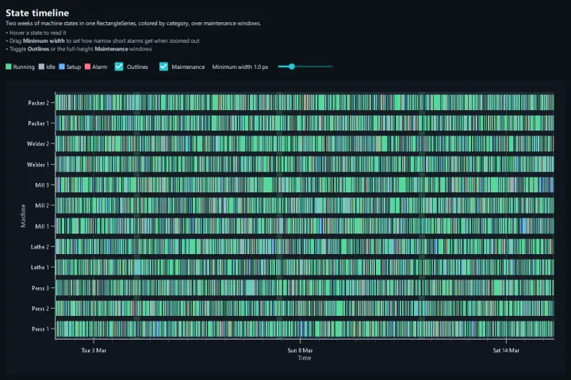

    **[State Timeline](https://github.com/michalgrabarczyk/QAccelPlot/tree/main/examples/plot_types/state_timeline)**

    Two weeks of machine states in one `RectangleSeries`, colored by category, over full-height
    maintenance windows.

</div>

## Styling

<div class="grid cards" markdown>

-   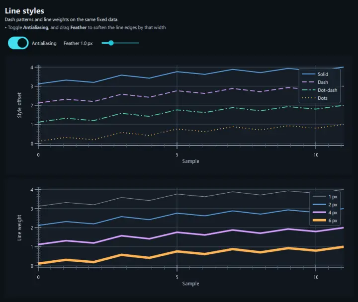

    **[Line Styles](https://github.com/michalgrabarczyk/QAccelPlot/tree/main/examples/styling/line_styles)**

    Dash patterns, line weights, and antialiasing. Recipe: [Styling](cookbook/styling.md).

-   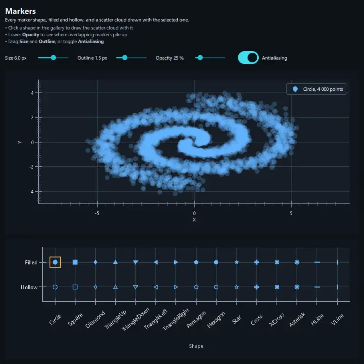

    **[Markers](https://github.com/michalgrabarczyk/QAccelPlot/tree/main/examples/styling/markers)**

    Every marker shape, filled and hollow; click one to draw a scatter plot with it.

-   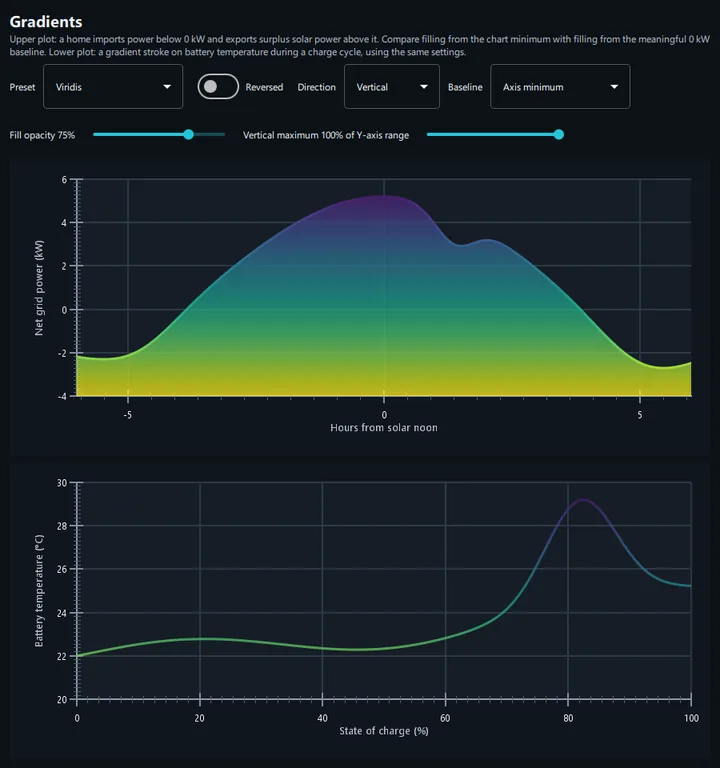

    **[Gradients](https://github.com/michalgrabarczyk/QAccelPlot/tree/main/examples/styling/gradients)**

    Gradient area fills and strokes with presets, direction, and baseline.

-   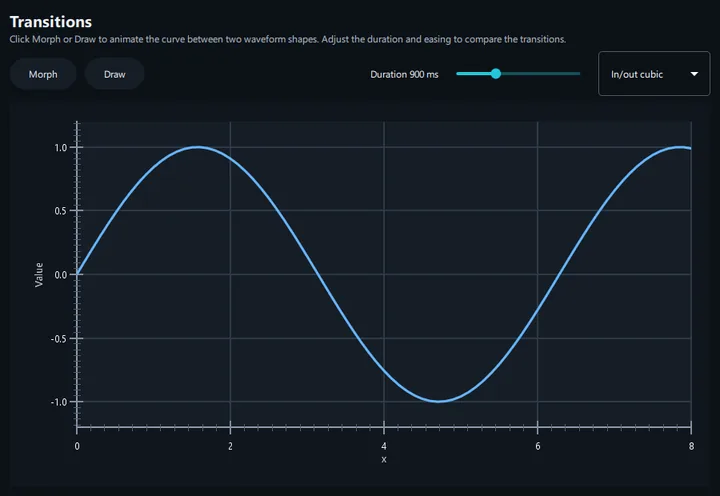

    **[Transitions](https://github.com/michalgrabarczyk/QAccelPlot/tree/main/examples/styling/transitions)**

    Morph and draw animations between datasets.

-   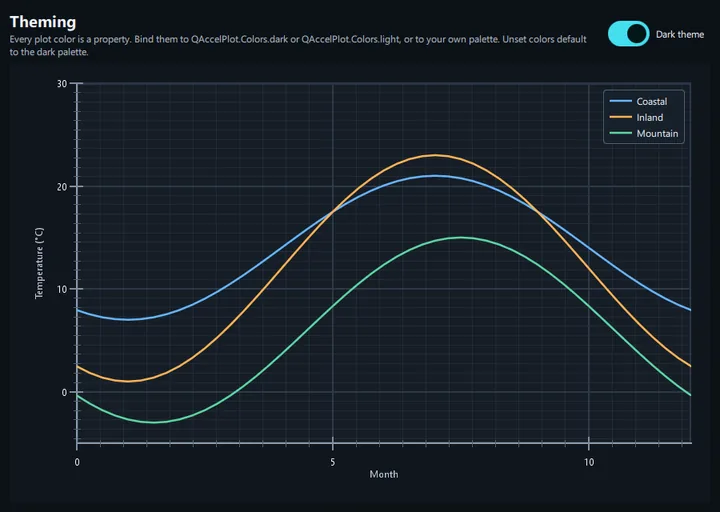

    **[Theming](https://github.com/michalgrabarczyk/QAccelPlot/tree/main/examples/styling/theming)**

    Plot, axis, grid, legend, and series colors bound to the dark or light palette.

</div>

## Axes

<div class="grid cards" markdown>

-   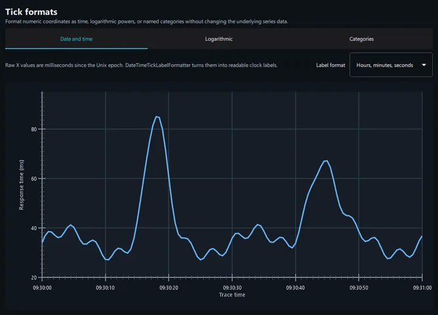

    **[Tick Formats](https://github.com/michalgrabarczyk/QAccelPlot/tree/main/examples/axes/tick_formats)**

    Category, logarithmic, and date/time tick labels. Recipe: [Axis formats](cookbook/axis-formats.md).

-   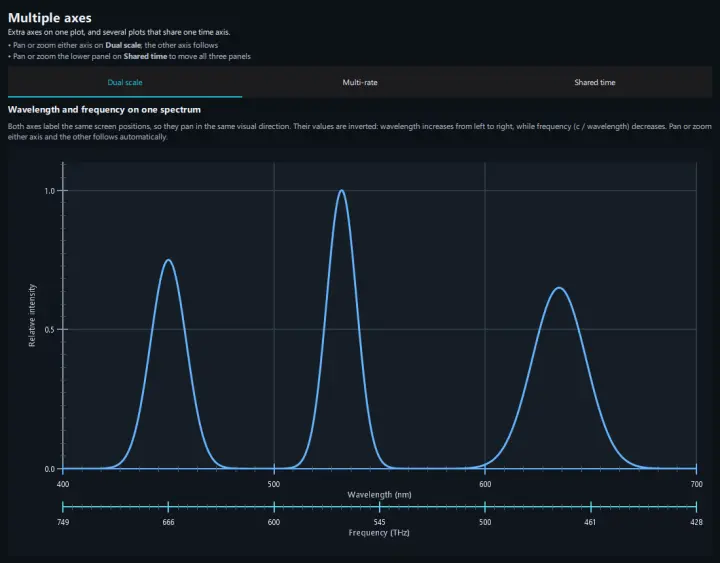

    **[Multiple Axes](https://github.com/michalgrabarczyk/QAccelPlot/tree/main/examples/axes/multiple_axes)**

    Dual wavelength/frequency scale, multi-rate time axes, and ECG panels sharing one time axis.
    Recipe: [Multiple axes](cookbook/multiple-axes.md).

</div>

## Data

<div class="grid cards" markdown>

-   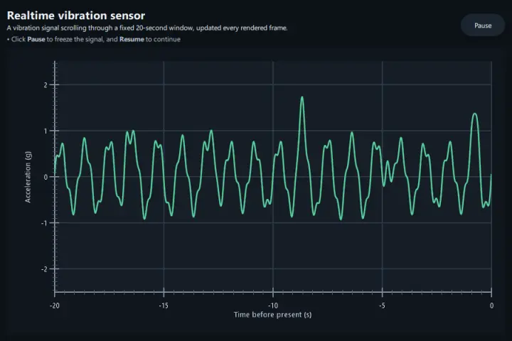

    **[Realtime](https://github.com/michalgrabarczyk/QAccelPlot/tree/main/examples/data/realtime)**

    Scrolling vibration signal in a 20-second window, updated every frame. Recipe:
    [Real-time scrolling data](cookbook/realtime.md).

-   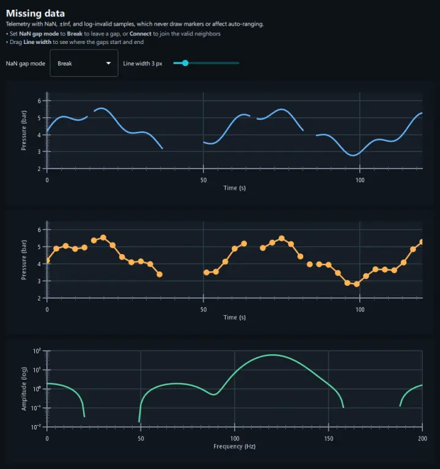

    **[Missing Data](https://github.com/michalgrabarczyk/QAccelPlot/tree/main/examples/data/missing_data)**

    `NaN`, `±Inf`, and log-invalid data points drawn as gaps or connected.

-   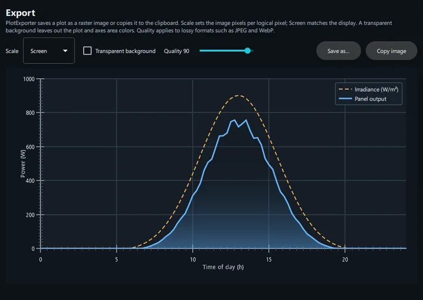

    **[Export](https://github.com/michalgrabarczyk/QAccelPlot/tree/main/examples/data/export)**

    Save a plot as PNG, JPEG, WebP, or TIFF at a chosen scale and background, or copy it to the
    clipboard. Recipe: [Exporting images](cookbook/export.md).

</div>

## Interaction

<div class="grid cards" markdown>

-   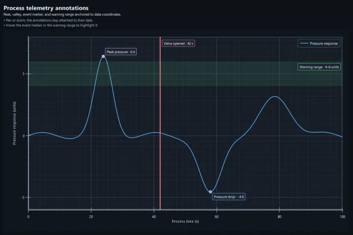

    **[Annotations](https://github.com/michalgrabarczyk/QAccelPlot/tree/main/examples/interaction/annotations)**

    QML overlays anchored to data coordinates. Recipe: [Annotations and tools](cookbook/annotations.md).

-   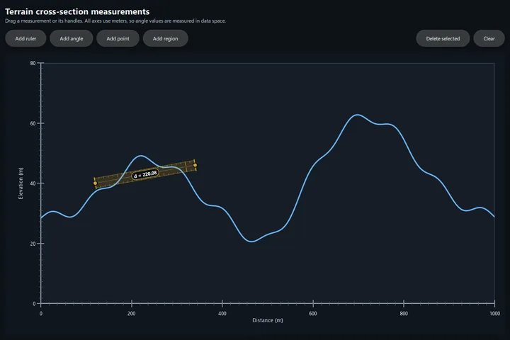

    **[Measurement Tools](https://github.com/michalgrabarczyk/QAccelPlot/tree/main/examples/interaction/measurement_tools)**

    Distance ruler, angle tool, rectangular selection, and point markers.

-   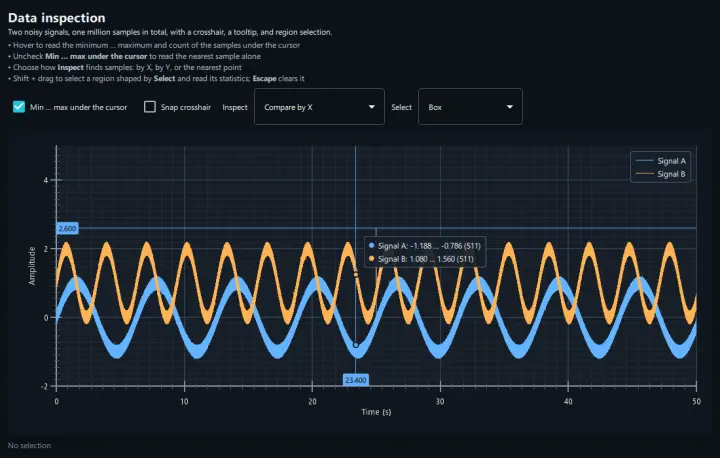

    **[Data Inspection](https://github.com/michalgrabarczyk/QAccelPlot/tree/main/examples/interaction/data_inspection)**

    Crosshair, per-series tooltip, and region selection with statistics over one million data
    points. Recipe: [Data inspection](cookbook/data-inspection.md).

</div>
