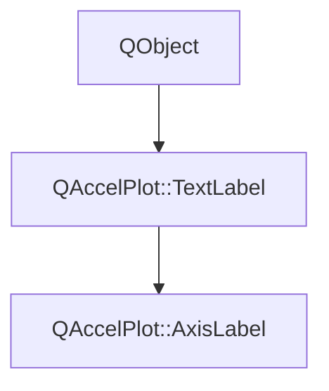

# Class QAccelPlot::AxisLabel


[**ClassList**](annotated.md) **>** [**QAccelPlot**](namespaceQAccelPlot.md) **>** [**AxisLabel**](classQAccelPlot_1_1AxisLabel.md)


[_**Axis**_](classQAccelPlot_1_1Axis.md) _title and its placement, grouped as the_[_**Axis**_](classQAccelPlot_1_1Axis.md) __`label` _property, e.g._`label.text: "Time (s)"` _._[More...](#detailed-description)

* `#include <AxisLabel.hpp>`


Inherits the following classes: [QAccelPlot::TextLabel](classQAccelPlot_1_1TextLabel.md)


## Inheritance diagram




## Public Properties

| Type | Name |
| ---: | :--- |
| property QML\_ANONYMOUSAxis::LabelAlignment | [**alignment**](classQAccelPlot_1_1AxisLabel.md#property-alignment-12)  <br>_Position of the title along the axis. Default:_ `Axis.Center` _._ |
| property QQmlComponent \* | [**delegate**](classQAccelPlot_1_1AxisLabel.md#property-delegate-12)  <br>_Optional component that replaces the painted title. Default:_ `null` _._ |
| property QPointF | [**offset**](classQAccelPlot_1_1AxisLabel.md#property-offset-12)  <br>_Pixel offset added to the title position after alignment and padding. Default: (0, 0)._  |
| property qreal | [**rotation**](classQAccelPlot_1_1AxisLabel.md#property-rotation-12)  <br>_Clockwise rotation of the title in degrees._  |


## Public Properties inherited from QAccelPlot::TextLabel

See [QAccelPlot::TextLabel](classQAccelPlot_1_1TextLabel.md)

| Type | Name |
| ---: | :--- |
| property QColor | [**color**](classQAccelPlot_1_1TextLabel.md#property-color-12)  <br>_Title color. Default:_ `Colors.dark.axisLine` _on a_[_**ColorBar**_](classQAccelPlot_1_1ColorBar.md) _; on an_[_**Axis**_](classQAccelPlot_1_1Axis.md) _, an invalid color that follows_`baselineColor` _._ |
| property QFont | [**font**](classQAccelPlot_1_1TextLabel.md#property-font-12)  <br>_Title font. Default: application default font._  |
| property qreal | [**padding**](classQAccelPlot_1_1TextLabel.md#property-padding-12)  <br>_Gap in pixels between the title and the axis or color strip. Default: 30 on an_ [_**Axis**_](classQAccelPlot_1_1Axis.md) _, 6 on a_[_**ColorBar**_](classQAccelPlot_1_1ColorBar.md) _._ |
| property QML\_ANONYMOUSQString | [**text**](classQAccelPlot_1_1TextLabel.md#property-text-12)  <br>_Title text. Default: empty, which draws no title._  |


## Public Signals

| Type | Name |
| ---: | :--- |
| signal void | [**alignmentChanged**](classQAccelPlot_1_1AxisLabel.md#signal-alignmentchanged)  <br>_Emitted when the alignment property changes._  |
| signal void | [**delegateChanged**](classQAccelPlot_1_1AxisLabel.md#signal-delegatechanged)  <br>_Emitted when the delegate property changes._  |
| signal void | [**offsetChanged**](classQAccelPlot_1_1AxisLabel.md#signal-offsetchanged)  <br>_Emitted when the offset property changes._  |
| signal void | [**rotationChanged**](classQAccelPlot_1_1AxisLabel.md#signal-rotationchanged)  <br>_Emitted when the rotation property changes._  |


## Public Signals inherited from QAccelPlot::TextLabel

See [QAccelPlot::TextLabel](classQAccelPlot_1_1TextLabel.md)

| Type | Name |
| ---: | :--- |
| signal void | [**colorChanged**](classQAccelPlot_1_1TextLabel.md#signal-colorchanged)  <br>_Emitted when the color property changes._  |
| signal void | [**fontChanged**](classQAccelPlot_1_1TextLabel.md#signal-fontchanged)  <br>_Emitted when the font property changes._  |
| signal void | [**paddingChanged**](classQAccelPlot_1_1TextLabel.md#signal-paddingchanged)  <br>_Emitted when the padding property changes._  |
| signal void | [**textChanged**](classQAccelPlot_1_1TextLabel.md#signal-textchanged)  <br>_Emitted when the text property changes._  |


## Public Functions

| Type | Name |
| ---: | :--- |
|   | [**AxisLabel**](#function-axislabel) (QObject \* parent=nullptr) <br>_Constructs an axis label owned by_ _parent_ _._ |
|  [**Axis::LabelAlignment**](classQAccelPlot_1_1Axis.md#enum-labelalignment) | [**alignment**](#function-alignment-22) () const<br>_Returns the position of the title along the axis._  |
|  QQmlComponent \* | [**delegate**](#function-delegate-22) () const<br>_Returns the component that replaces the painted title, or_ `nullptr` _._ |
|  QPointF | [**offset**](#function-offset-22) () const<br>_Returns the pixel offset of the title._  |
|  void | [**resetRotation**](#function-resetrotation) () <br>_Restores the side's default title rotation._  |
|  qreal | [**rotation**](#function-rotation-22) () const<br>_Returns the title rotation in degrees, including the side's default rotation._  |
|  void | [**setAlignment**](#function-setalignment) ([**Axis::LabelAlignment**](classQAccelPlot_1_1Axis.md#enum-labelalignment) alignment) <br>_Sets the position of the title along the axis to_ _alignment_ _._ |
|  void | [**setDefaultRotation**](#function-setdefaultrotation) (qreal degrees) <br>_Sets the rotation used while none is set to_ _degrees_ _. Called by the owning_[_**Axis**_](classQAccelPlot_1_1Axis.md) _when its side changes._ |
|  void | [**setDelegate**](#function-setdelegate) (QQmlComponent \* delegate) <br>_Sets the component that replaces the painted title to_ _delegate_ _._`nullptr` _restores the painted title._ |
|  void | [**setOffset**](#function-setoffset) (const QPointF & offset) <br>_Sets the pixel offset of the title to_ _offset_ _._ |
|  void | [**setRotation**](#function-setrotation) (qreal degrees) <br>_Sets the title rotation to_ _degrees_ _. A non-finite value restores the side's default rotation._ |


## Public Functions inherited from QAccelPlot::TextLabel

See [QAccelPlot::TextLabel](classQAccelPlot_1_1TextLabel.md)

| Type | Name |
| ---: | :--- |
|   | [**TextLabel**](classQAccelPlot_1_1TextLabel.md#function-textlabel) (const QColor & color={}, qreal padding=0.0, QObject \* parent=nullptr) <br>_Constructs a label with the default_ _color_ _and__padding_ _, owned by__parent_ _._ |
|  QColor | [**color**](classQAccelPlot_1_1TextLabel.md#function-color-22) () const<br>_Returns the title color._  |
|  QFont | [**font**](classQAccelPlot_1_1TextLabel.md#function-font-22) () const<br>_Returns the title font._  |
|  qreal | [**padding**](classQAccelPlot_1_1TextLabel.md#function-padding-22) () const<br>_Returns the gap between the title and the axis or color strip in pixels._  |
|  void | [**setColor**](classQAccelPlot_1_1TextLabel.md#function-setcolor) (const QColor & color) <br>_Sets the title color to_ _color_ _._ |
|  void | [**setFont**](classQAccelPlot_1_1TextLabel.md#function-setfont) (const QFont & font) <br>_Sets the title font to_ _font_ _._ |
|  void | [**setPadding**](classQAccelPlot_1_1TextLabel.md#function-setpadding) (qreal padding) <br>_Sets the gap between the title and the axis or color strip to_ _padding_ _pixels._ |
|  void | [**setText**](classQAccelPlot_1_1TextLabel.md#function-settext) (const QString & text) <br>_Sets the title text to_ _text_ _._ |
|  QString | [**text**](classQAccelPlot_1_1TextLabel.md#function-text-22) () const<br>_Returns the title text._  |


## Detailed Description


The title is painted inside the axis item and clipped to it. `delegate` replaces it with a QML item.


**See also:** [**Axis**](classQAccelPlot_1_1Axis.md) 


    
## Public Properties Documentation


### property alignment {#property-alignment-12}

_Position of the title along the axis. Default:_ `Axis.Center` _._
```C++
QML_ANONYMOUSAxis::LabelAlignment QAccelPlot::AxisLabel::alignment;
```


<hr>


### property delegate {#property-delegate-12}

_Optional component that replaces the painted title. Default:_ `null` _._
```C++
QQmlComponent* QAccelPlot::AxisLabel::delegate;
```


The axis creates one instance as its child item, so `parent` is the axis and anchors, `x`, `y`, and `rotation` position it. The instance may extend beyond the axis. While a delegate is set, the axis paints no title and ignores `alignment`, `rotation`, `offset`, and `padding`. 


        

<hr>


### property offset {#property-offset-12}

_Pixel offset added to the title position after alignment and padding. Default: (0, 0)._ 
```C++
QPointF QAccelPlot::AxisLabel::offset;
```


<hr>


### property rotation {#property-rotation-12}

_Clockwise rotation of the title in degrees._ 
```C++
qreal QAccelPlot::AxisLabel::rotation;
```


Defaults to the side's rotation: 0 on horizontal axes, -90 on the left, and 90 on the right. Assign `undefined` to return to it. 


        

<hr>
## Public Signals Documentation


### signal alignmentChanged {#signal-alignmentchanged}

_Emitted when the alignment property changes._ 
```C++
void QAccelPlot::AxisLabel::alignmentChanged;
```


<hr>


### signal delegateChanged {#signal-delegatechanged}

_Emitted when the delegate property changes._ 
```C++
void QAccelPlot::AxisLabel::delegateChanged;
```


<hr>


### signal offsetChanged {#signal-offsetchanged}

_Emitted when the offset property changes._ 
```C++
void QAccelPlot::AxisLabel::offsetChanged;
```


<hr>


### signal rotationChanged {#signal-rotationchanged}

_Emitted when the rotation property changes._ 
```C++
void QAccelPlot::AxisLabel::rotationChanged;
```


<hr>
## Public Functions Documentation


### function AxisLabel {#function-axislabel}

_Constructs an axis label owned by_ _parent_ _._
```C++
explicit QAccelPlot::AxisLabel::AxisLabel (
    QObject * parent=nullptr
) 
```


<hr>


### function alignment {#function-alignment-22}

_Returns the position of the title along the axis._ 
```C++
Axis::LabelAlignment QAccelPlot::AxisLabel::alignment () const
```


<hr>


### function delegate {#function-delegate-22}

_Returns the component that replaces the painted title, or_ `nullptr` _._
```C++
QQmlComponent * QAccelPlot::AxisLabel::delegate () const
```


<hr>


### function offset {#function-offset-22}

_Returns the pixel offset of the title._ 
```C++
QPointF QAccelPlot::AxisLabel::offset () const
```


<hr>


### function resetRotation {#function-resetrotation}

_Restores the side's default title rotation._ 
```C++
void QAccelPlot::AxisLabel::resetRotation () 
```


<hr>


### function rotation {#function-rotation-22}

_Returns the title rotation in degrees, including the side's default rotation._ 
```C++
qreal QAccelPlot::AxisLabel::rotation () const
```


<hr>


### function setAlignment {#function-setalignment}

_Sets the position of the title along the axis to_ _alignment_ _._
```C++
void QAccelPlot::AxisLabel::setAlignment (
    Axis::LabelAlignment alignment
) 
```


<hr>


### function setDefaultRotation {#function-setdefaultrotation}

_Sets the rotation used while none is set to_ _degrees_ _. Called by the owning_[_**Axis**_](classQAccelPlot_1_1Axis.md) _when its side changes._
```C++
void QAccelPlot::AxisLabel::setDefaultRotation (
    qreal degrees
) 
```


<hr>


### function setDelegate {#function-setdelegate}

_Sets the component that replaces the painted title to_ _delegate_ _._`nullptr` _restores the painted title._
```C++
void QAccelPlot::AxisLabel::setDelegate (
    QQmlComponent * delegate
) 
```


<hr>


### function setOffset {#function-setoffset}

_Sets the pixel offset of the title to_ _offset_ _._
```C++
void QAccelPlot::AxisLabel::setOffset (
    const QPointF & offset
) 
```


<hr>


### function setRotation {#function-setrotation}

_Sets the title rotation to_ _degrees_ _. A non-finite value restores the side's default rotation._
```C++
void QAccelPlot::AxisLabel::setRotation (
    qreal degrees
) 
```


<hr>

------------------------------
The documentation for this class was generated from the following file `QAccelPlot/src/QAccelPlot/axis/AxisLabel.hpp`

