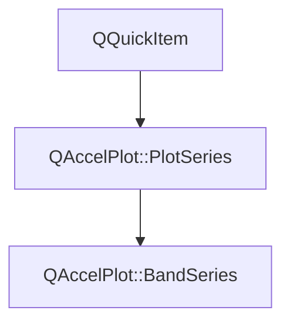

# Class QAccelPlot::BandSeries


[**ClassList**](annotated.md) **>** [**QAccelPlot**](namespaceQAccelPlot.md) **>** [**BandSeries**](classQAccelPlot_1_1BandSeries.md)


_A hardware-accelerated QML item that fills the area between a low and a high value at each X._ [More...](#detailed-description)

* `#include <BandSeries.hpp>`


Inherits the following classes: [QAccelPlot::PlotSeries](classQAccelPlot_1_1PlotSeries.md)


## Inheritance diagram




## Public Types inherited from QAccelPlot::PlotSeries

See [QAccelPlot::PlotSeries](classQAccelPlot_1_1PlotSeries.md)

| Type | Name |
| ---: | :--- |
| enum  | [**LegendSymbol**](classQAccelPlot_1_1PlotSeries.md#enum-legendsymbol)  <br>_Supported default legend symbols._  |


## Public Properties

| Type | Name |
| ---: | :--- |
| property QColor | [**color**](classQAccelPlot_1_1BandSeries.md#property-color-12)  <br>_Fill color. Default:_ `Colors.dark.seriesPrimary` _with alpha 64._ |
| property [**BandEdges**](classQAccelPlot_1_1BandEdges.md) \* | [**edges**](classQAccelPlot_1_1BandSeries.md#property-edges-12)  <br>_Grouped edge line settings, e.g._ `edges.width` _and_`edges.lineStyle` _. No edge lines by default._ |


## Public Properties inherited from QAccelPlot::PlotSeries

See [QAccelPlot::PlotSeries](classQAccelPlot_1_1PlotSeries.md)

| Type | Name |
| ---: | :--- |
| property int | [**count**](classQAccelPlot_1_1PlotSeries.md#property-count-12)  <br>_Read-only: number of records stored, including invalid ones._  |
| property quint64 | [**dataRevision**](classQAccelPlot_1_1PlotSeries.md#property-datarevision-12)  <br>_Revision incremented by every accepted change of the series' records._  |
| property bool | [**hoverEnabled**](classQAccelPlot_1_1PlotSeries.md#property-hoverenabled-12)  <br>_Whether the series reacts to the mouse cursor. Default:_ `true` _._ |
| property bool | [**hovered**](classQAccelPlot_1_1PlotSeries.md#property-hovered-12)  <br>_Read-only:_ `true` _while the mouse cursor is over the series._ |
| property [**QAccelPlot::SeriesInspection**](classQAccelPlot_1_1SeriesInspection.md) \* | [**inspection**](classQAccelPlot_1_1PlotSeries.md#property-inspection-12)  <br>_Read-only constant: data queries for this series._  |
| property [**LegendSymbol**](classQAccelPlot_1_1PlotSeries.md#enum-legendsymbol) | [**legendSymbol**](classQAccelPlot_1_1PlotSeries.md#property-legendsymbol-12)  <br>_Symbol style requested from the default legend._  |
| property QString | [**name**](classQAccelPlot_1_1PlotSeries.md#property-name-12)  <br>_Identifying name used by the default legend._  |
| property QRectF | [**plotRect**](classQAccelPlot_1_1PlotSeries.md#property-plotrect-12)  <br>_Plot area in parent-item coordinates, assigned by_ `PlotView` _._ |
| property [**Axis**](classQAccelPlot_1_1Axis.md) \* | [**xAxis**](classQAccelPlot_1_1PlotSeries.md#property-xaxis-12)  <br>_Horizontal axis used for data-to-pixel coordinate mapping._  |
| property [**Axis**](classQAccelPlot_1_1Axis.md) \* | [**yAxis**](classQAccelPlot_1_1PlotSeries.md#property-yaxis-12)  <br>_Vertical axis used for data-to-pixel coordinate mapping._  |


## Public Signals

| Type | Name |
| ---: | :--- |
| signal void | [**colorChanged**](classQAccelPlot_1_1BandSeries.md#signal-colorchanged)  <br>_Emitted when the color property changes._  |


## Public Signals inherited from QAccelPlot::PlotSeries

See [QAccelPlot::PlotSeries](classQAccelPlot_1_1PlotSeries.md)

| Type | Name |
| ---: | :--- |
| signal void | [**countChanged**](classQAccelPlot_1_1PlotSeries.md#signal-countchanged)  <br>_Emitted when the number of records changes._  |
| signal void | [**dataRevisionChanged**](classQAccelPlot_1_1PlotSeries.md#signal-datarevisionchanged)  <br>_Emitted when the dataRevision property changes._  |
| signal void | [**hoverEnabledChanged**](classQAccelPlot_1_1PlotSeries.md#signal-hoverenabledchanged)  <br>_Emitted when the hoverEnabled property changes._  |
| signal void | [**hoveredChanged**](classQAccelPlot_1_1PlotSeries.md#signal-hoveredchanged)  <br>_Emitted when the hovered property changes._  |
| signal void | [**legendEntryChanged**](classQAccelPlot_1_1PlotSeries.md#signal-legendentrychanged)  <br>_Emitted when the result of_ `legendEntry()` _changes._ |
| signal void | [**legendSymbolChanged**](classQAccelPlot_1_1PlotSeries.md#signal-legendsymbolchanged)  <br> |
| signal void | [**nameChanged**](classQAccelPlot_1_1PlotSeries.md#signal-namechanged)  <br> |
| signal void | [**plotRectChanged**](classQAccelPlot_1_1PlotSeries.md#signal-plotrectchanged)  <br> |
| signal void | [**xAxisChanged**](classQAccelPlot_1_1PlotSeries.md#signal-xaxischanged)  <br> |
| signal void | [**yAxisChanged**](classQAccelPlot_1_1PlotSeries.md#signal-yaxischanged)  <br> |


## Public Functions

| Type | Name |
| ---: | :--- |
|   | [**BandSeries**](#function-bandseries) (QQuickItem \* parent=nullptr) <br>_Constructs a_ [_**BandSeries**_](classQAccelPlot_1_1BandSeries.md) _with the given__parent_ _._ |
|  Q\_INVOKABLE void | [**appendData**](#function-appenddata) (qreal x, qreal low, qreal high) <br>_Appends the data point (_ _x_ _,__low_ _,__high_ _). Triggers a redraw._ |
| virtual Q\_INVOKABLE void | [**clearData**](#function-cleardata) () override<br>_Removes all data points._  |
|  QColor | [**color**](#function-color-22) () const<br>_Returns the fill color._  |
|  bool | [**contains**](#function-contains) (const QPointF & point) override const<br>_Returns_ `true` _when item position__point_ _lies inside the band or on an edge line._ |
|  [**BandEdges**](classQAccelPlot_1_1BandEdges.md) \* | [**edges**](#function-edges-22) () const<br>_Returns the grouped edge line settings. The object is owned by the series._  |
| virtual std::optional&lt; [**LegendEntry**](structQAccelPlot_1_1LegendEntry.md) &gt; | [**legendEntry**](#function-legendentry) () override const<br>_Returns the legend entry: the symbol and color of the band._  |
|  void | [**setColor**](#function-setcolor) (const QColor & color) <br>_Sets the fill color to_ _color_ _._ |
|  Q\_INVOKABLE void | [**setData**](#function-setdata-16) (const QList&lt; qreal &gt; & xs, const QList&lt; qreal &gt; & lows, const QList&lt; qreal &gt; & highs) <br>_Replaces the data points with_ _xs_ _,__lows_ _, and__highs_ _. If the sizes differ, the shortest length is used._ |
|  void | [**setData**](#function-setdata-26) (const std::vector&lt; double &gt; & xs, const std::vector&lt; double &gt; & lows, const std::vector&lt; double &gt; & highs) <br>_Replaces the data points with_ _xs_ _,__lows_ _, and__highs_ _. If the sizes differ, the shortest length is used._ |
|  void | [**setData**](#function-setdata-36) (const double \* data, int count) <br>_Replaces the series data with_ _count_ _data points copied from an interleaved double array._ |
|  void | [**setData**](#function-setdata-46) (std::vector&lt; double &gt; && data, int count) <br>_Replaces the series data by moving an interleaved double buffer._  |
|  void | [**setData**](#function-setdata-56) (const double \* data, int count, const [**DataBounds**](structQAccelPlot_1_1PlotSeries_1_1DataBounds.md) & bounds) <br>_Like_ `setData` _(__data_ _,__count_ _), with the data extents given as__bounds_ _instead of scanned for._ |
|  void | [**setData**](#function-setdata-66) (std::vector&lt; double &gt; && data, int count, const [**DataBounds**](structQAccelPlot_1_1PlotSeries_1_1DataBounds.md) & bounds) <br>_Like_ `setData` _(__data_ _,__count_ _), with the data extents given as__bounds_ _instead of scanned for._ |
|  void | [**setDataF**](#function-setdataf-14) (const float \* data, int count) <br>_Replaces the series data with_ _count_ _data points copied from an interleaved float array._ |
|  void | [**setDataF**](#function-setdataf-24) (std::vector&lt; float &gt; && data, int count) <br>_Replaces the series data by moving an interleaved float buffer._  |
|  void | [**setDataF**](#function-setdataf-34) (const float \* data, int count, const [**DataBounds**](structQAccelPlot_1_1PlotSeries_1_1DataBounds.md) & bounds) <br>_Like_ `setDataF` _(__data_ _,__count_ _), with the data extents given as__bounds_ _instead of scanned for._ |
|  void | [**setDataF**](#function-setdataf-44) (std::vector&lt; float &gt; && data, int count, const [**DataBounds**](structQAccelPlot_1_1PlotSeries_1_1DataBounds.md) & bounds) <br>_Like_ `setDataF` _(__data_ _,__count_ _), with the data extents given as__bounds_ _instead of scanned for._ |
|  Q\_INVOKABLE QVariantMap | [**valueAt**](#function-valueat) (qreal x) const<br>_Returns the band at data coordinate_ _x_ _as an object with_`x` _,_`low` _, and_`high` _properties._ |


## Public Functions inherited from QAccelPlot::PlotSeries

See [QAccelPlot::PlotSeries](classQAccelPlot_1_1PlotSeries.md)

| Type | Name |
| ---: | :--- |
|   | [**PlotSeries**](classQAccelPlot_1_1PlotSeries.md#function-plotseries-12) (QQuickItem \* parent=nullptr) <br> |
| virtual void | [**clearData**](classQAccelPlot_1_1PlotSeries.md#function-cleardata) () <br>_Removes all data points from the series._  |
| virtual int | [**count**](classQAccelPlot_1_1PlotSeries.md#function-count-22) () const<br>_Returns the number of records stored. The default is the number of stored data points._  |
|  quint64 | [**dataRevision**](classQAccelPlot_1_1PlotSeries.md#function-datarevision-22) () const<br>_Returns the current data revision._  |
|  bool | [**hoverEnabled**](classQAccelPlot_1_1PlotSeries.md#function-hoverenabled-22) () const<br>_Returns whether the series reacts to the mouse cursor._  |
|  bool | [**hovered**](classQAccelPlot_1_1PlotSeries.md#function-hovered-22) () const<br>_Returns whether the mouse cursor is over the series._  |
|  [**SeriesInspection**](classQAccelPlot_1_1SeriesInspection.md) \* | [**inspection**](classQAccelPlot_1_1PlotSeries.md#function-inspection-22) () const<br>_Returns the data queries for this series; created on first use and owned by the series._  |
| virtual std::optional&lt; [**LegendEntry**](structQAccelPlot_1_1LegendEntry.md) &gt; | [**legendEntry**](classQAccelPlot_1_1PlotSeries.md#function-legendentry) () const<br>_Returns how a legend draws the series, or_ `std::nullopt` _for no legend entry. Default: no entry._ |
|  [**LegendSymbol**](classQAccelPlot_1_1PlotSeries.md#enum-legendsymbol) | [**legendSymbol**](classQAccelPlot_1_1PlotSeries.md#function-legendsymbol-22) () const<br> |
|  QString | [**name**](classQAccelPlot_1_1PlotSeries.md#function-name-22) () const<br> |
|  QRectF | [**plotRect**](classQAccelPlot_1_1PlotSeries.md#function-plotrect-22) () const<br> |
|  void | [**postData**](classQAccelPlot_1_1PlotSeries.md#function-postdata-12) (std::vector&lt; double &gt; && data, int count) <br>_Queues a moved double buffer for assignment on the series' thread._  |
|  void | [**postData**](classQAccelPlot_1_1PlotSeries.md#function-postdata-22) (std::vector&lt; float &gt; && data, int count) <br>_Queues a moved float buffer for assignment on the series' thread._  |
|  void | [**setData**](classQAccelPlot_1_1PlotSeries.md#function-setdata-14) (const double \* data, int count) <br>_Replaces the series data with_ _count_ _data points copied from an interleaved double array._ |
|  void | [**setData**](classQAccelPlot_1_1PlotSeries.md#function-setdata-24) (std::vector&lt; double &gt; && data, int count) <br>_Replaces the series data by moving an interleaved double buffer._  |
|  void | [**setData**](classQAccelPlot_1_1PlotSeries.md#function-setdata-34) (const double \* data, int count, const [**DataBounds**](structQAccelPlot_1_1PlotSeries_1_1DataBounds.md) & bounds) <br>_Like_ `setData` _(__data_ _,__count_ _), with the data extents given as__bounds_ _instead of scanned for._ |
|  void | [**setData**](classQAccelPlot_1_1PlotSeries.md#function-setdata-44) (std::vector&lt; double &gt; && data, int count, const [**DataBounds**](structQAccelPlot_1_1PlotSeries_1_1DataBounds.md) & bounds) <br>_Like_ `setData` _(__data_ _,__count_ _), with the data extents given as__bounds_ _instead of scanned for._ |
|  void | [**setDataF**](classQAccelPlot_1_1PlotSeries.md#function-setdataf-14) (const float \* data, int count) <br>_Replaces the series data with_ _count_ _data points copied from an interleaved float array._ |
|  void | [**setDataF**](classQAccelPlot_1_1PlotSeries.md#function-setdataf-24) (std::vector&lt; float &gt; && data, int count) <br>_Replaces the series data by moving an interleaved float buffer._  |
|  void | [**setDataF**](classQAccelPlot_1_1PlotSeries.md#function-setdataf-34) (const float \* data, int count, const [**DataBounds**](structQAccelPlot_1_1PlotSeries_1_1DataBounds.md) & bounds) <br>_Like_ `setDataF` _(__data_ _,__count_ _), with the data extents given as__bounds_ _instead of scanned for._ |
|  void | [**setDataF**](classQAccelPlot_1_1PlotSeries.md#function-setdataf-44) (std::vector&lt; float &gt; && data, int count, const [**DataBounds**](structQAccelPlot_1_1PlotSeries_1_1DataBounds.md) & bounds) <br>_Like_ `setDataF` _(__data_ _,__count_ _), with the data extents given as__bounds_ _instead of scanned for._ |
|  void | [**setHoverEnabled**](classQAccelPlot_1_1PlotSeries.md#function-sethoverenabled) (bool enabled) <br>_Sets whether the series reacts to the mouse cursor to_ _enabled_ _._ |
|  void | [**setLegendSymbol**](classQAccelPlot_1_1PlotSeries.md#function-setlegendsymbol) ([**LegendSymbol**](classQAccelPlot_1_1PlotSeries.md#enum-legendsymbol) symbol) <br> |
|  void | [**setName**](classQAccelPlot_1_1PlotSeries.md#function-setname) (const QString & name) <br> |
|  void | [**setPlotRect**](classQAccelPlot_1_1PlotSeries.md#function-setplotrect) (const QRectF & rect) <br>_Updates the series geometry to exactly cover_ _rect_ _._ |
|  void | [**setXAxis**](classQAccelPlot_1_1PlotSeries.md#function-setxaxis) ([**Axis**](classQAccelPlot_1_1Axis.md) \* axis) <br> |
|  void | [**setYAxis**](classQAccelPlot_1_1PlotSeries.md#function-setyaxis) ([**Axis**](classQAccelPlot_1_1Axis.md) \* axis) <br> |
|  [**Axis**](classQAccelPlot_1_1Axis.md) \* | [**xAxis**](classQAccelPlot_1_1PlotSeries.md#function-xaxis-22) () const<br> |
|  std::optional&lt; [**DataExtent**](structQAccelPlot_1_1PlotSeries_1_1DataExtent.md) &gt; | [**xDataRange**](classQAccelPlot_1_1PlotSeries.md#function-xdatarange) () const<br>_Returns the extent this series reports to its horizontal axis, or_ `std::nullopt` _when it has none._ |
|  [**Axis**](classQAccelPlot_1_1Axis.md) \* | [**yAxis**](classQAccelPlot_1_1PlotSeries.md#function-yaxis-22) () const<br> |
|  std::optional&lt; [**DataExtent**](structQAccelPlot_1_1PlotSeries_1_1DataExtent.md) &gt; | [**yDataRange**](classQAccelPlot_1_1PlotSeries.md#function-ydatarange) () const<br>_Returns the extent this series reports to its vertical axis, or_ `std::nullopt` _when it has none._ |
|   | [**~PlotSeries**](classQAccelPlot_1_1PlotSeries.md#function-plotseries) () override<br> |


## Protected Types inherited from QAccelPlot::PlotSeries

See [QAccelPlot::PlotSeries](classQAccelPlot_1_1PlotSeries.md)

| Type | Name |
| ---: | :--- |
| enum  | [**CapacityOverflow**](classQAccelPlot_1_1PlotSeries.md#enum-capacityoverflow)  <br>_What a series draws when its records outgrow its GPU capacity._  |
| enum  | [**DataChange**](classQAccelPlot_1_1PlotSeries.md#enum-datachange)  <br>_How the records changed in a data update._  |


## Protected Attributes inherited from QAccelPlot::PlotSeries

See [QAccelPlot::PlotSeries](classQAccelPlot_1_1PlotSeries.md)

| Type | Name |
| ---: | :--- |
|  bool | [**overRenderCapacity\_**](classQAccelPlot_1_1PlotSeries.md#variable-overrendercapacity_)   = `{false}`<br>_Whether the record count of the last_ `updateRenderCapacity()` _exceeded_`renderCapacity_` _._ |
|  int | [**renderCapacity\_**](classQAccelPlot_1_1PlotSeries.md#variable-rendercapacity_)   = `{std::numeric\_limits&lt;int&gt;::max()}`<br>_Records the GPU buffers hold, as of the last_ `updateRenderCapacity()` _; the largest_`int` _before the first._ |


## Protected Functions

| Type | Name |
| ---: | :--- |
| virtual void | [**onAxisRangeChanged**](#function-onaxisrangechanged) () override<br>_Re-tests the hover position when the viewport moves under the cursor._  |
| virtual void | [**onAxisScaleChanged**](#function-onaxisscalechanged) () override<br>_Re-tests the hover position when a bound axis changes between linear and log scale._  |
| virtual void | [**onDataPointsChanged**](#function-ondatapointschanged) ([**DataChange**](classQAccelPlot_1_1PlotSeries.md#enum-datachange) change, int previousCount) override<br>_Refreshes the X order, the hover state, and the count after the data points changed._  |


## Protected Functions inherited from QAccelPlot::PlotSeries

See [QAccelPlot::PlotSeries](classQAccelPlot_1_1PlotSeries.md)

| Type | Name |
| ---: | :--- |
|   | [**PlotSeries**](classQAccelPlot_1_1PlotSeries.md#function-plotseries-22) ([**DataPointStore::Layout**](structQAccelPlot_1_1DataPointStore_1_1Layout.md) layout, [**DataPointWording**](structQAccelPlot_1_1PlotSeries_1_1DataPointWording.md) wording, QQuickItem \* parent) <br>_Creates a series whose data points have_ _layout_ _;__wording_ _names them in warnings._ |
|  void | [**appendDataPoint**](classQAccelPlot_1_1PlotSeries.md#function-appenddatapoint) (const double \* coordinates) <br>_Appends one double data point and widens the data ranges by its valid coordinates._  |
| virtual void | [**applyDataPoints**](classQAccelPlot_1_1PlotSeries.md#function-applydatapoints) ([**DataPointInput**](structQAccelPlot_1_1PlotSeries_1_1DataPointInput.md) && input) <br>_Applies data points passed to_ `setData()` _or_`setDataF()` _._ |
| virtual [**DataRanges**](structQAccelPlot_1_1PlotSeries_1_1DataRanges.md) | [**computeDataRanges**](classQAccelPlot_1_1PlotSeries.md#function-computedataranges) () const<br>_Scans the records for their extents. The default implementation scans the data points._  |
| virtual int | [**dataPointValueCount**](classQAccelPlot_1_1PlotSeries.md#function-datapointvaluecount) () const<br>_Returns the number of values per data point that_ `setData()` _and_`setDataF()` _take._ |
|  [**DataPointStore**](classQAccelPlot_1_1DataPointStore.md) & | [**dataPoints**](classQAccelPlot_1_1PlotSeries.md#function-datapoints-12) () <br>_Returns the data points of the series._  |
|  const [**DataPointStore**](classQAccelPlot_1_1DataPointStore.md) & | [**dataPoints**](classQAccelPlot_1_1PlotSeries.md#function-datapoints-22) () const<br>_Returns the data points of the series._  |
|  bool | [**event**](classQAccelPlot_1_1PlotSeries.md#function-event) (QEvent \* event) override<br>_Withholds hover events from a series beneath another series under the cursor._  |
|  void | [**extendXDataRange**](classQAccelPlot_1_1PlotSeries.md#function-extendxdatarange) (qreal x) <br>_Widens the X extent to include_ _x_ _and notifies the bound axes._ |
|  void | [**extendYDataRange**](classQAccelPlot_1_1PlotSeries.md#function-extendydatarange) (qreal y) <br>_Widens the Y extent to include_ _y_ _. A non-finite__y_ _leaves the extent unchanged._ |
| virtual bool | [**inspectionAvailable**](classQAccelPlot_1_1PlotSeries.md#function-inspectionavailable) () const<br>_Returns false while the records are ambiguous, such as during a data transition. Default: true._  |
|  void | [**inspectionDataChanged**](classQAccelPlot_1_1PlotSeries.md#function-inspectiondatachanged) ([**DataChange**](classQAccelPlot_1_1PlotSeries.md#enum-datachange) change=DataChange::Replaced) <br>_Advances the data revision and refreshes the data queries. Call after every accepted record change._  |
| virtual [**InspectionDataPoint**](structQAccelPlot_1_1InspectionDataPoint.md) | [**inspectionDataPointAt**](classQAccelPlot_1_1PlotSeries.md#function-inspectiondatapointat) (const QPointF & position) const<br>_Returns the record drawn at the series-local_ _position_ _as a data point. Default: unsupported._ |
| virtual [**InspectionRecord**](structQAccelPlot_1_1InspectionRecord.md) | [**inspectionRecord**](classQAccelPlot_1_1PlotSeries.md#function-inspectionrecord) (int index) const<br>_Returns the native record at_ _index_ _for series that are not plain XY series. Default: unsupported._ |
| virtual [**InspectionRecord**](structQAccelPlot_1_1InspectionRecord.md) | [**inspectionRecordAt**](classQAccelPlot_1_1PlotSeries.md#function-inspectionrecordat) (const QPointF & position) const<br>_Returns the native record drawn at the series-local_ _position_ _. Default: unsupported._ |
| virtual [**InspectionSource**](structQAccelPlot_1_1InspectionSource.md) | [**inspectionSource**](classQAccelPlot_1_1PlotSeries.md#function-inspectionsource) () const<br>_Returns a view of the XY records that data point queries search. The default has none._  |
|  void | [**invalidateDataRanges**](classQAccelPlot_1_1PlotSeries.md#function-invalidatedataranges) () <br>_Discards the cached extents and notifies the bound axes._  |
|  void | [**invalidateInspection**](classQAccelPlot_1_1PlotSeries.md#function-invalidateinspection) () <br>_Refreshes the data queries after record validity changed without a data change, such as an axis scale switch._  |
|  bool | [**logScaleX**](classQAccelPlot_1_1PlotSeries.md#function-logscalex) () const<br>_Returns whether the horizontal axis is logarithmic; false without an axis._  |
|  bool | [**logScaleY**](classQAccelPlot_1_1PlotSeries.md#function-logscaley) () const<br>_Returns whether the vertical axis is logarithmic; false without an axis._  |
|  void | [**notifyDataPointsChanged**](classQAccelPlot_1_1PlotSeries.md#function-notifydatapointschanged) ([**DataChange**](classQAccelPlot_1_1PlotSeries.md#enum-datachange) change, int previousCount) <br>_Finishes a change of the data points: data ranges,_ `onDataPointsChanged()` _,_`countChanged()` _, data queries, and a repaint._ |
| virtual void | [**onAxisRangeChanged**](classQAccelPlot_1_1PlotSeries.md#function-onaxisrangechanged) () <br>_Called when the viewport of a bound axis changes. The default implementation schedules a repaint._  |
| virtual void | [**onAxisScaleChanged**](classQAccelPlot_1_1PlotSeries.md#function-onaxisscalechanged) () <br>_Called when a bound axis switches between linear and logarithmic scale, or a different axis is bound._  |
| virtual void | [**onDataPointsChanged**](classQAccelPlot_1_1PlotSeries.md#function-ondatapointschanged) ([**DataChange**](classQAccelPlot_1_1PlotSeries.md#enum-datachange) change, int previousCount) <br>_Called after the data points changed, before the data queries are refreshed. The default does nothing._  |
| virtual bool | [**positionInspectionSupported**](classQAccelPlot_1_1PlotSeries.md#function-positioninspectionsupported) () const<br>_Returns whether_ `inspectionDataPointAt()` _matches records drawn as areas, such as heatmap cells. Default: false._ |
| virtual bool | [**recordInspectionSupported**](classQAccelPlot_1_1PlotSeries.md#function-recordinspectionsupported) () const<br>_Returns whether_ `inspectionRecord()` _and_`inspectionRecordAt()` _answer for this series. Default: false._ |
|  QRectF | [**resolvePlotRect**](classQAccelPlot_1_1PlotSeries.md#function-resolveplotrect) () const<br>_Returns the plot area to render into:_ `plotRect` _when set, otherwise the item's current size._ |
|  void | [**setHovered**](classQAccelPlot_1_1PlotSeries.md#function-sethovered) (bool hovered) <br>_Sets the hovered property to_ _hovered_ _. Called by the hover handling of a series._ |
|  void | [**storeDataPoints**](classQAccelPlot_1_1PlotSeries.md#function-storedatapoints) ([**DataPointInput**](structQAccelPlot_1_1PlotSeries_1_1DataPointInput.md) && input) <br>_Stores_ _input_ _as the data points and finishes the change._ |
|  void | [**supportHover**](classQAccelPlot_1_1PlotSeries.md#function-supporthover) () <br>_Makes the series accept hover events while_ `hoverEnabled` _is_`true` _._ |
|  void | [**updateRenderCapacity**](classQAccelPlot_1_1PlotSeries.md#function-updaterendercapacity) (int capacity, int recordCount, [**CapacityOverflow**](classQAccelPlot_1_1PlotSeries.md#enum-capacityoverflow) overflow=CapacityOverflow::DropsExcess) <br>_Stores_ _capacity_ _, the number of records the GPU buffers hold, and warns when__recordCount_ _newly exceeds it._ |
|  bool | [**validateDataSize**](classQAccelPlot_1_1PlotSeries.md#function-validatedatasize) (std::size\_t valueCount, int count, bool floatData, int valuesPerDataPoint=0) const<br>_Returns whether_ _valueCount_ _values hold__count_ _data points; warns otherwise._ |
|  bool | [**validateRawDataArguments**](classQAccelPlot_1_1PlotSeries.md#function-validaterawdataarguments) (const void \* data, int count) const<br>_Returns whether_ _data_ _and__count_ _are valid arguments for copying data points; warns otherwise._ |


## Detailed Description


Data points are stored as interleaved `(x, low, high)` triples and uploaded to the GPU as a float data texture once per data change; panning and zooming only change shader uniforms. Dashed edge lines are the exception: zooming recomputes their dash positions on the CPU. The `setData()` overloads keep doubles and upload them relative to an origin near the viewport, so large coordinates such as epoch timestamps stay precise. The `setDataF()` overloads store floats and upload them without conversion.


Draw a center line with a separate `LineCurve`. `edges` draws lines along the lower and upper edges of the filled band.


**
**

At each data point the band spans from the smaller to the larger of `low` and `high`. X values are expected in ascending order: `hovered` and `valueAt()` work only when they are.


**
**

A data point is invalid when `x`, `low`, or `high` is NaN or ±Inf, or is not strictly positive on a log-scale axis. The fill and the edge lines leave a gap at invalid data points. Auto-ranging skips invalid values one by one.


**
**

At most 16,777,216 (2^24) data points are drawn, fewer on GPUs whose maximum texture size is below 6144. Data points beyond the limit are not drawn, and a warning is logged once.


**See also:** [**LineCurve**](classQAccelPlot_1_1LineCurve.md), [**BandEdges**](classQAccelPlot_1_1BandEdges.md) 


    
## Public Properties Documentation


### property color {#property-color-12}

_Fill color. Default:_ `Colors.dark.seriesPrimary` _with alpha 64._
```C++
QColor QAccelPlot::BandSeries::color;
```


<hr>


### property edges {#property-edges-12}

_Grouped edge line settings, e.g._ `edges.width` _and_`edges.lineStyle` _. No edge lines by default._
```C++
BandEdges* QAccelPlot::BandSeries::edges;
```


<hr>
## Public Signals Documentation


### signal colorChanged {#signal-colorchanged}

_Emitted when the color property changes._ 
```C++
void QAccelPlot::BandSeries::colorChanged;
```


<hr>
## Public Functions Documentation


### function BandSeries {#function-bandseries}

_Constructs a_ [_**BandSeries**_](classQAccelPlot_1_1BandSeries.md) _with the given__parent_ _._
```C++
explicit QAccelPlot::BandSeries::BandSeries (
    QQuickItem * parent=nullptr
) 
```


<hr>


### function appendData {#function-appenddata}

_Appends the data point (_ _x_ _,__low_ _,__high_ _). Triggers a redraw._
```C++
Q_INVOKABLE void QAccelPlot::BandSeries::appendData (
    qreal x,
    qreal low,
    qreal high
) 
```


<hr>


### function clearData {#function-cleardata}

_Removes all data points._ 
```C++
virtual Q_INVOKABLE void QAccelPlot::BandSeries::clearData () override
```


Implements [*QAccelPlot::PlotSeries::clearData*](classQAccelPlot_1_1PlotSeries.md#function-cleardata)


<hr>


### function color {#function-color-22}

_Returns the fill color._ 
```C++
QColor QAccelPlot::BandSeries::color () const
```


<hr>


### function contains {#function-contains}

_Returns_ `true` _when item position__point_ _lies inside the band or on an edge line._
```C++
bool QAccelPlot::BandSeries::contains (
    const QPointF & point
) override const
```


Hover delivery uses this test, so stacked series underneath still receive hover events outside the band. 


        

<hr>


### function edges {#function-edges-22}

_Returns the grouped edge line settings. The object is owned by the series._ 
```C++
BandEdges * QAccelPlot::BandSeries::edges () const
```


<hr>


### function legendEntry {#function-legendentry}

_Returns the legend entry: the symbol and color of the band._ 
```C++
virtual std::optional< LegendEntry > QAccelPlot::BandSeries::legendEntry () override const
```


Implements [*QAccelPlot::PlotSeries::legendEntry*](classQAccelPlot_1_1PlotSeries.md#function-legendentry)


<hr>


### function setColor {#function-setcolor}

_Sets the fill color to_ _color_ _._
```C++
void QAccelPlot::BandSeries::setColor (
    const QColor & color
) 
```


<hr>


### function setData {#function-setdata-16}

_Replaces the data points with_ _xs_ _,__lows_ _, and__highs_ _. If the sizes differ, the shortest length is used._
```C++
Q_INVOKABLE void QAccelPlot::BandSeries::setData (
    const QList< qreal > & xs,
    const QList< qreal > & lows,
    const QList< qreal > & highs
) 
```


<hr>


### function setData {#function-setdata-26}

_Replaces the data points with_ _xs_ _,__lows_ _, and__highs_ _. If the sizes differ, the shortest length is used._
```C++
void QAccelPlot::BandSeries::setData (
    const std::vector< double > & xs,
    const std::vector< double > & lows,
    const std::vector< double > & highs
) 
```


<hr>


### function setData {#function-setdata-36}

_Replaces the series data with_ _count_ _data points copied from an interleaved double array._
```C++
void QAccelPlot::BandSeries::setData (
    const double * data,
    int count
) 
```


See the class description for the data point layout of each series. 


        

<hr>


### function setData {#function-setdata-46}

_Replaces the series data by moving an interleaved double buffer._ 
```C++
void QAccelPlot::BandSeries::setData (
    std::vector< double > && data,
    int count
) 
```


<hr>


### function setData {#function-setdata-56}

_Like_ `setData` _(__data_ _,__count_ _), with the data extents given as__bounds_ _instead of scanned for._
```C++
void QAccelPlot::BandSeries::setData (
    const double * data,
    int count,
    const DataBounds & bounds
) 
```


<hr>


### function setData {#function-setdata-66}

_Like_ `setData` _(__data_ _,__count_ _), with the data extents given as__bounds_ _instead of scanned for._
```C++
void QAccelPlot::BandSeries::setData (
    std::vector< double > && data,
    int count,
    const DataBounds & bounds
) 
```


<hr>


### function setDataF {#function-setdataf-14}

_Replaces the series data with_ _count_ _data points copied from an interleaved float array._
```C++
void QAccelPlot::BandSeries::setDataF (
    const float * data,
    int count
) 
```


<hr>


### function setDataF {#function-setdataf-24}

_Replaces the series data by moving an interleaved float buffer._ 
```C++
void QAccelPlot::BandSeries::setDataF (
    std::vector< float > && data,
    int count
) 
```


<hr>


### function setDataF {#function-setdataf-34}

_Like_ `setDataF` _(__data_ _,__count_ _), with the data extents given as__bounds_ _instead of scanned for._
```C++
void QAccelPlot::BandSeries::setDataF (
    const float * data,
    int count,
    const DataBounds & bounds
) 
```


<hr>


### function setDataF {#function-setdataf-44}

_Like_ `setDataF` _(__data_ _,__count_ _), with the data extents given as__bounds_ _instead of scanned for._
```C++
void QAccelPlot::BandSeries::setDataF (
    std::vector< float > && data,
    int count,
    const DataBounds & bounds
) 
```


<hr>


### function valueAt {#function-valueat}

_Returns the band at data coordinate_ _x_ _as an object with_`x` _,_`low` _, and_`high` _properties._
```C++
Q_INVOKABLE QVariantMap QAccelPlot::BandSeries::valueAt (
    qreal x
) const
```


`low` and `high` are interpolated between the neighboring data points as drawn, with `low` ≤ `high`. At an X shared by several data points they cover all of them. Returns an empty object when _x_ lies outside the data points, next to an invalid data point, or when the X values are not in ascending order. 


        

<hr>
## Protected Functions Documentation


### function onAxisRangeChanged {#function-onaxisrangechanged}

_Re-tests the hover position when the viewport moves under the cursor._ 
```C++
virtual void QAccelPlot::BandSeries::onAxisRangeChanged () override
```


Implements [*QAccelPlot::PlotSeries::onAxisRangeChanged*](classQAccelPlot_1_1PlotSeries.md#function-onaxisrangechanged)


<hr>


### function onAxisScaleChanged {#function-onaxisscalechanged}

_Re-tests the hover position when a bound axis changes between linear and log scale._ 
```C++
virtual void QAccelPlot::BandSeries::onAxisScaleChanged () override
```


Implements [*QAccelPlot::PlotSeries::onAxisScaleChanged*](classQAccelPlot_1_1PlotSeries.md#function-onaxisscalechanged)


<hr>


### function onDataPointsChanged {#function-ondatapointschanged}

_Refreshes the X order, the hover state, and the count after the data points changed._ 
```C++
virtual void QAccelPlot::BandSeries::onDataPointsChanged (
    DataChange change,
    int previousCount
) override
```


Implements [*QAccelPlot::PlotSeries::onDataPointsChanged*](classQAccelPlot_1_1PlotSeries.md#function-ondatapointschanged)


<hr>

------------------------------
The documentation for this class was generated from the following file `QAccelPlot/src/QAccelPlot/series/BandSeries.hpp`

