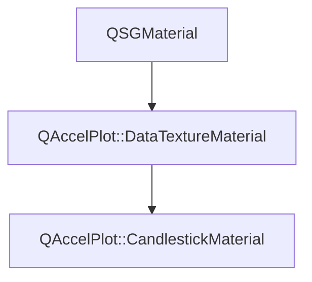

# Class QAccelPlot::CandlestickMaterial


[**ClassList**](annotated.md) **>** [**QAccelPlot**](namespaceQAccelPlot.md) **>** [**CandlestickMaterial**](classQAccelPlot_1_1CandlestickMaterial.md)


_Material that draws candles from (x, open, high, low, close) data points in a data texture._ [More...](#detailed-description)

* `#include <CandlestickMaterial.hpp>`


Inherits the following classes: [QAccelPlot::DataTextureMaterial](classQAccelPlot_1_1DataTextureMaterial.md)


## Inheritance diagram




## Public Attributes

| Type | Name |
| ---: | :--- |
|  float | [**antialiasing**](#variable-antialiasing)   = `{1.0f}`<br>_1.0 to smooth the edges._  |
|  float | [**candleCount**](#variable-candlecount)   = `{0.0f}`<br>_Number of candles drawn; vertices beyond them are culled._  |
|  QColor | [**downColor**](#variable-downcolor)   = `{Qt::red}`<br>_Color of down candles._  |
|  QColor | [**glowDownColor**](#variable-glowdowncolor)  <br>_Halo color of down candles;_ `glow` _holds the one of up candles._ |
|  float | [**halfWidth**](#variable-halfwidth)   = `{0.4f}`<br>_Half the candle width in x data units._  |
|  QColor | [**hoverColor**](#variable-hovercolor)   = `{Qt::transparent}`<br>_Color of the highlighted candle._  |
|  float | [**hoveredIndex**](#variable-hoveredindex)   = `{-1.0f}`<br>_Index of the highlighted candle, or -1 for none._  |
|  float | [**lineWidth**](#variable-linewidth)   = `{1.0f}`<br>_Width of wicks, OHLC lines, and ticks in pixels._  |
|  float | [**minimumWidth**](#variable-minimumwidth)   = `{1.0f}`<br>_Smallest candle width in pixels._  |
|  float | [**ohlc**](#variable-ohlc)   = `{0.0f}`<br>_1.0 to draw OHLC bars instead of candlesticks (float for std140 UBO compatibility)._  |


## Public Attributes inherited from QAccelPlot::DataTextureMaterial

See [QAccelPlot::DataTextureMaterial](classQAccelPlot_1_1DataTextureMaterial.md)

| Type | Name |
| ---: | :--- |
|  QColor | [**color**](classQAccelPlot_1_1DataTextureMaterial.md#variable-color)   = `{Qt::blue}`<br>_Line/fill color uniform._  |
|  std::shared\_ptr&lt; [**DataTexture**](classQAccelPlot_1_1DataTexture.md) &gt; | [**dataTexture**](classQAccelPlot_1_1DataTextureMaterial.md#variable-datatexture)  <br>_Data texture sampled by the shader. Materials drawing the same samples may share one._  |
|  QVector2D | [**domainMax**](classQAccelPlot_1_1DataTextureMaterial.md#variable-domainmax)   = `{1.0f, 1.0f}`<br>_Maximum data-space coordinate._  |
|  QVector2D | [**domainMin**](classQAccelPlot_1_1DataTextureMaterial.md#variable-domainmin)   = `{0.0f, 0.0f}`<br>_Minimum data-space coordinate._  |
|  [**Internal::GlowStyle**](structQAccelPlot_1_1Internal_1_1GlowStyle.md) | [**glow**](classQAccelPlot_1_1DataTextureMaterial.md#variable-glow)  <br>_Halo of a_ `Glow` _effect; none by default. Shaders without a halo ignore it._ |
|  [**Internal::ItemFade**](structQAccelPlot_1_1Internal_1_1ItemFade.md) | [**itemFade**](classQAccelPlot_1_1DataTextureMaterial.md#variable-itemfade)  <br>_Items a running transition fades; inactive by default. Shaders without item opacity ignore it._  |
|  [**Internal::ItemTrail**](structQAccelPlot_1_1Internal_1_1ItemTrail.md) | [**itemTrail**](classQAccelPlot_1_1DataTextureMaterial.md#variable-itemtrail)  <br>_Oldest items a_ `FadeTrail` _fades; none by default. Shaders without item opacity ignore it._ |
|  float | [**logScaleX**](classQAccelPlot_1_1DataTextureMaterial.md#variable-logscalex)   = `{0.0f}`<br>_1.0 when the X axis uses log scale (float for std140 UBO compatibility)._  |
|  float | [**logScaleY**](classQAccelPlot_1_1DataTextureMaterial.md#variable-logscaley)   = `{0.0f}`<br>_1.0 when the Y axis uses log scale (float for std140 UBO compatibility)._  |
|  float | [**useVertexColor**](classQAccelPlot_1_1DataTextureMaterial.md#variable-usevertexcolor)   = `{0.0f}`<br>_1.0 when per-vertex color overrides_ `color` _(float for std140 UBO compatibility)._ |
|  QVector2D | [**viewportSize**](classQAccelPlot_1_1DataTextureMaterial.md#variable-viewportsize)   = `{800.0f, 600.0f}`<br>_Viewport size in pixels._  |


## Public Static Attributes

| Type | Name |
| ---: | :--- |
|  int | [**kVerticesPerCandle**](#variable-kverticespercandle)   = `{18}`<br>_Vertices per candle: a quad of two triangles for each of three parts._  |


## Public Functions

| Type | Name |
| ---: | :--- |
|   | [**CandlestickMaterial**](#function-candlestickmaterial) () <br>_Constructs a_ [_**CandlestickMaterial**_](classQAccelPlot_1_1CandlestickMaterial.md) _with default uniform values._ |
|  QSGMaterialShader \* | [**createShader**](#function-createshader) (QSGRendererInterface::RenderMode renderMode) override const<br>_Creates and returns the candlestick shader program._  |
|  QSGMaterialType \* | [**type**](#function-type) () override const<br>_Returns the unique material type identifier for this class._  |


## Public Functions inherited from QAccelPlot::DataTextureMaterial

See [QAccelPlot::DataTextureMaterial](classQAccelPlot_1_1DataTextureMaterial.md)

| Type | Name |
| ---: | :--- |
|   | [**DataTextureMaterial**](classQAccelPlot_1_1DataTextureMaterial.md#function-datatexturematerial) () <br>_Constructs an empty_ [_**DataTextureMaterial**_](classQAccelPlot_1_1DataTextureMaterial.md) _._ |
|  int | [**compare**](classQAccelPlot_1_1DataTextureMaterial.md#function-compare) (const QSGMaterial \* other) override const<br>_Compares shared uniform fields; delegates type-specific fields to_ `compareExtra()` _._ |
|  QSGTexture \* | [**sampledTexture**](classQAccelPlot_1_1DataTextureMaterial.md#function-sampledtexture) () const<br>_Returns the texture the shader samples, or_ `nullptr` _before_`dataTexture` _holds an upload._ |
|  void | [**uploadTexture**](classQAccelPlot_1_1DataTextureMaterial.md#function-uploadtexture) (QQuickWindow \* window, const float \* data, int floatCount) <br>_Uploads_ _floatCount_ _raw floats from__data_ _into_`dataTexture` _, creating it when it is_`nullptr` _._ |
|   | [**~DataTextureMaterial**](classQAccelPlot_1_1DataTextureMaterial.md#function-datatexturematerial) () override<br> |


## Public Static Functions

| Type | Name |
| ---: | :--- |
|  const QSGGeometry::AttributeSet & | [**attributeSet**](#function-attributeset) () <br>_Returns the vertex attribute set: a 4-byte placeholder the shader ignores._  |


## Public Static Functions inherited from QAccelPlot::DataTextureMaterial

See [QAccelPlot::DataTextureMaterial](classQAccelPlot_1_1DataTextureMaterial.md)

| Type | Name |
| ---: | :--- |
|  const QSGGeometry::AttributeSet & | [**attributeSet**](classQAccelPlot_1_1DataTextureMaterial.md#function-attributeset) () <br>_Returns the shared vertex attribute set:_ `{float` _id, float param, uchar4 color} (12 bytes)._ |
|  void | [**commitTexture**](classQAccelPlot_1_1DataTextureMaterial.md#function-committexture) (QSGMaterialShader::RenderState & state, int binding, QSGTexture \*\* texture, const [**DataTexture**](classQAccelPlot_1_1DataTexture.md) \* data) <br>_Commits the texture of_ _data_ _to sampler__binding_ _(call from_`updateSampledImage` _). Does nothing before an upload._ |
|  const QSGGeometry::AttributeSet & | [**vertexIndexAttributeSet**](classQAccelPlot_1_1DataTextureMaterial.md#function-vertexindexattributeset) () <br>_Returns the attribute set of marker quads: one ignored_ `uchar4` _placeholder (4 bytes)._ |
|  bool | [**writeCommonUniforms**](classQAccelPlot_1_1DataTextureMaterial.md#function-writecommonuniforms) (char \* buf, int bufSize, const QMatrix4x4 & matrix, const [**DataTextureMaterial**](classQAccelPlot_1_1DataTextureMaterial.md#function-datatexturematerial) \* mat) <br>_Writes the shared UBO prefix (transform + color + domain + flags) into_ _buf_ _._ |


## Protected Functions

| Type | Name |
| ---: | :--- |
| virtual int | [**compareExtra**](#function-compareextra) (const QSGMaterial \* other) override const<br>_Compares the candle-specific uniforms after the base-class comparison succeeds._  |


## Protected Functions inherited from QAccelPlot::DataTextureMaterial

See [QAccelPlot::DataTextureMaterial](classQAccelPlot_1_1DataTextureMaterial.md)

| Type | Name |
| ---: | :--- |
| virtual int | [**compareExtra**](classQAccelPlot_1_1DataTextureMaterial.md#function-compareextra) (const QSGMaterial \* other) const<br>_Subclass hook for_ `compare()` _— called after the shared fields compare equal._ |


## Detailed Description


Each candle takes `kVerticesPerCandle` vertices: two triangles each for three parts, the wick above and below the body and the body of a candlestick, or the line and two ticks of an OHLC bar. The shader derives the candle, part, and corner from the vertex index. The inherited `color` is the up candle color. 


    
## Public Attributes Documentation


### variable antialiasing {#variable-antialiasing}

_1.0 to smooth the edges._ 
```C++
float QAccelPlot::CandlestickMaterial::antialiasing;
```


<hr>


### variable candleCount {#variable-candlecount}

_Number of candles drawn; vertices beyond them are culled._ 
```C++
float QAccelPlot::CandlestickMaterial::candleCount;
```


<hr>


### variable downColor {#variable-downcolor}

_Color of down candles._ 
```C++
QColor QAccelPlot::CandlestickMaterial::downColor;
```


<hr>


### variable glowDownColor {#variable-glowdowncolor}

_Halo color of down candles;_ `glow` _holds the one of up candles._
```C++
QColor QAccelPlot::CandlestickMaterial::glowDownColor;
```


<hr>


### variable halfWidth {#variable-halfwidth}

_Half the candle width in x data units._ 
```C++
float QAccelPlot::CandlestickMaterial::halfWidth;
```


<hr>


### variable hoverColor {#variable-hovercolor}

_Color of the highlighted candle._ 
```C++
QColor QAccelPlot::CandlestickMaterial::hoverColor;
```


<hr>


### variable hoveredIndex {#variable-hoveredindex}

_Index of the highlighted candle, or -1 for none._ 
```C++
float QAccelPlot::CandlestickMaterial::hoveredIndex;
```


<hr>


### variable lineWidth {#variable-linewidth}

_Width of wicks, OHLC lines, and ticks in pixels._ 
```C++
float QAccelPlot::CandlestickMaterial::lineWidth;
```


<hr>


### variable minimumWidth {#variable-minimumwidth}

_Smallest candle width in pixels._ 
```C++
float QAccelPlot::CandlestickMaterial::minimumWidth;
```


<hr>


### variable ohlc {#variable-ohlc}

_1.0 to draw OHLC bars instead of candlesticks (float for std140 UBO compatibility)._ 
```C++
float QAccelPlot::CandlestickMaterial::ohlc;
```


<hr>
## Public Static Attributes Documentation


### variable kVerticesPerCandle {#variable-kverticespercandle}

_Vertices per candle: a quad of two triangles for each of three parts._ 
```C++
int QAccelPlot::CandlestickMaterial::kVerticesPerCandle;
```


<hr>
## Public Functions Documentation


### function CandlestickMaterial {#function-candlestickmaterial}

_Constructs a_ [_**CandlestickMaterial**_](classQAccelPlot_1_1CandlestickMaterial.md) _with default uniform values._
```C++
QAccelPlot::CandlestickMaterial::CandlestickMaterial () 
```


<hr>


### function createShader {#function-createshader}

_Creates and returns the candlestick shader program._ 
```C++
QSGMaterialShader * QAccelPlot::CandlestickMaterial::createShader (
    QSGRendererInterface::RenderMode renderMode
) override const
```


<hr>


### function type {#function-type}

_Returns the unique material type identifier for this class._ 
```C++
QSGMaterialType * QAccelPlot::CandlestickMaterial::type () override const
```


<hr>
## Public Static Functions Documentation


### function attributeSet {#function-attributeset}

_Returns the vertex attribute set: a 4-byte placeholder the shader ignores._ 
```C++
static const QSGGeometry::AttributeSet & QAccelPlot::CandlestickMaterial::attributeSet () 
```


<hr>
## Protected Functions Documentation


### function compareExtra {#function-compareextra}

_Compares the candle-specific uniforms after the base-class comparison succeeds._ 
```C++
virtual int QAccelPlot::CandlestickMaterial::compareExtra (
    const QSGMaterial * other
) override const
```


Implements [*QAccelPlot::DataTextureMaterial::compareExtra*](classQAccelPlot_1_1DataTextureMaterial.md#function-compareextra)


<hr>

------------------------------
The documentation for this class was generated from the following file `QAccelPlot/src/QAccelPlot/materials/CandlestickMaterial.hpp`

