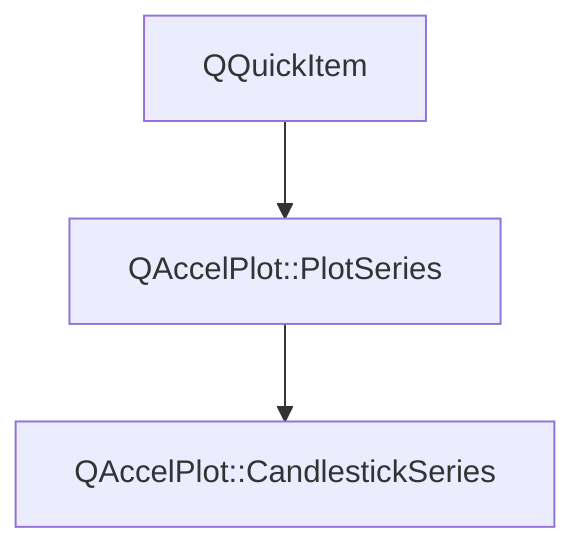

# Class QAccelPlot::CandlestickSeries


[**ClassList**](annotated.md) **>** [**QAccelPlot**](namespaceQAccelPlot.md) **>** [**CandlestickSeries**](classQAccelPlot_1_1CandlestickSeries.md)


_A hardware-accelerated QML item that draws candles: the open, high, low, and close of each data point._ [More...](#detailed-description)

* `#include <CandlestickSeries.hpp>`


Inherits the following classes: [QAccelPlot::PlotSeries](classQAccelPlot_1_1PlotSeries.md)


## Inheritance diagram




## Public Types

| Type | Name |
| ---: | :--- |
| enum  | [**Style**](#enum-style)  <br>_How a candle is drawn._  |


## Public Types inherited from QAccelPlot::PlotSeries

See [QAccelPlot::PlotSeries](classQAccelPlot_1_1PlotSeries.md)

| Type | Name |
| ---: | :--- |
| enum  | [**LegendSymbol**](classQAccelPlot_1_1PlotSeries.md#enum-legendsymbol)  <br>_Supported default legend symbols._  |


## Public Properties

| Type | Name |
| ---: | :--- |
| property qreal | [**candleWidth**](classQAccelPlot_1_1CandlestickSeries.md#property-candlewidth-12)  <br>_Width of a candle as a fraction of_ `spacing` _, clamped to at least 0. Default: 0.8._ |
| property QColor | [**downColor**](classQAccelPlot_1_1CandlestickSeries.md#property-downcolor-12)  <br>_Color of down candles, whose close is below their open. Default:_ `Colors.dark.candleDown` _._ |
| property [**EnterExitTransition**](classQAccelPlot_1_1EnterExitTransition.md) \* | [**enterTransition**](classQAccelPlot_1_1CandlestickSeries.md#property-entertransition-12)  <br>_Transition of the candles a data change adds, or_ `nullptr` _to show them at once._ |
| property [**EnterExitTransition**](classQAccelPlot_1_1EnterExitTransition.md) \* | [**exitTransition**](classQAccelPlot_1_1CandlestickSeries.md#property-exittransition-12)  <br>_Transition of the candles a data change removes, or_ `nullptr` _to remove them at once._ |
| property QColor | [**hoverColor**](classQAccelPlot_1_1CandlestickSeries.md#property-hovercolor-12)  <br>_Color of the hovered candle. Default: an invalid color, which draws it in its own color._  |
| property qreal | [**hoverRadius**](classQAccelPlot_1_1CandlestickSeries.md#property-hoverradius-12)  <br>_Pick distance in pixels from a candle, clamped to at least 0. Default: 4._  |
| property int | [**hoveredIndex**](classQAccelPlot_1_1CandlestickSeries.md#property-hoveredindex-12)  <br>_Read-only: index of the candle under the cursor, or -1 when none._  |
| property qreal | [**lineWidth**](classQAccelPlot_1_1CandlestickSeries.md#property-linewidth-12)  <br>_Width in pixels of wicks, OHLC lines, and ticks, clamped to at least 0. Default: 1._  |
| property qreal | [**minimumWidth**](classQAccelPlot_1_1CandlestickSeries.md#property-minimumwidth-12)  <br>_Smallest candle width in pixels, clamped to at least 0. Default: 1._  |
| property qreal | [**spacing**](classQAccelPlot_1_1CandlestickSeries.md#property-spacing-12)  <br>_Distance between neighboring candles in x data units._  |
| property [**Style**](classQAccelPlot_1_1CandlestickSeries.md#enum-style) | [**style**](classQAccelPlot_1_1CandlestickSeries.md#property-style-12)  <br>_How each candle is drawn. Default:_ `CandlestickSeries.Candlestick` _._ |
| property QColor | [**upColor**](classQAccelPlot_1_1CandlestickSeries.md#property-upcolor-12)  <br>_Color of up candles, whose close is at or above their open. Default:_ `Colors.dark.candleUp` _._ |
| property [**DataTransition**](classQAccelPlot_1_1DataTransition.md) \* | [**updateTransition**](classQAccelPlot_1_1CandlestickSeries.md#property-updatetransition-12)  <br>_Transition of the candles a data change keeps, or_ `nullptr` _to move them at once._ |


## Public Properties inherited from QAccelPlot::PlotSeries

See [QAccelPlot::PlotSeries](classQAccelPlot_1_1PlotSeries.md)

| Type | Name |
| ---: | :--- |
| property bool | [**animating**](classQAccelPlot_1_1PlotSeries.md#property-animating-12)  <br>_Read-only:_ `true` _while a transition animates the series' data._ |
| property int | [**count**](classQAccelPlot_1_1PlotSeries.md#property-count-12)  <br>_Read-only: number of records stored, including invalid ones._  |
| property quint64 | [**dataRevision**](classQAccelPlot_1_1PlotSeries.md#property-datarevision-12)  <br>_Revision incremented by every accepted change of the series' records._  |
| property QQmlListProperty&lt; [**SeriesEffect**](classQAccelPlot_1_1SeriesEffect.md) &gt; | [**effects**](classQAccelPlot_1_1PlotSeries.md#property-effects-12)  <br>_Visual effects drawn with the series, such as_ `GradientFill` _or_`Glow` _._ |
| property bool | [**hoverEnabled**](classQAccelPlot_1_1PlotSeries.md#property-hoverenabled-12)  <br>_Whether the series reacts to the mouse cursor. Default:_ `true` _._ |
| property bool | [**hovered**](classQAccelPlot_1_1PlotSeries.md#property-hovered-12)  <br>_Read-only:_ `true` _while the mouse cursor is over the series._ |
| property SeriesInspection \* | [**inspection**](classQAccelPlot_1_1PlotSeries.md#property-inspection-12)  <br>_Read-only constant: data queries for this series._  |
| property [**LegendSymbol**](classQAccelPlot_1_1PlotSeries.md#enum-legendsymbol) | [**legendSymbol**](classQAccelPlot_1_1PlotSeries.md#property-legendsymbol-12)  <br>_Symbol style requested from the default legend._  |
| property QString | [**name**](classQAccelPlot_1_1PlotSeries.md#property-name-12)  <br>_Identifying name used by the default legend._  |
| property QRectF | [**plotRect**](classQAccelPlot_1_1PlotSeries.md#property-plotrect-12)  <br>_Plot area in parent-item coordinates, assigned by_ `PlotView` _._ |
| property [**Axis**](classQAccelPlot_1_1Axis.md) \* | [**xAxis**](classQAccelPlot_1_1PlotSeries.md#property-xaxis-12)  <br>_Horizontal axis used for data-to-pixel coordinate mapping._  |
| property [**Axis**](classQAccelPlot_1_1Axis.md) \* | [**yAxis**](classQAccelPlot_1_1PlotSeries.md#property-yaxis-12)  <br>_Vertical axis used for data-to-pixel coordinate mapping._  |


## Public Signals

| Type | Name |
| ---: | :--- |
| signal void | [**candleWidthChanged**](classQAccelPlot_1_1CandlestickSeries.md#signal-candlewidthchanged)  <br>_Emitted when the candleWidth property changes._  |
| signal void | [**downColorChanged**](classQAccelPlot_1_1CandlestickSeries.md#signal-downcolorchanged)  <br>_Emitted when the downColor property changes._  |
| signal void | [**enterTransitionChanged**](classQAccelPlot_1_1CandlestickSeries.md#signal-entertransitionchanged)  <br>_Emitted when the enterTransition property changes._  |
| signal void | [**exitTransitionChanged**](classQAccelPlot_1_1CandlestickSeries.md#signal-exittransitionchanged)  <br>_Emitted when the exitTransition property changes._  |
| signal void | [**hoverColorChanged**](classQAccelPlot_1_1CandlestickSeries.md#signal-hovercolorchanged)  <br>_Emitted when the hoverColor property changes._  |
| signal void | [**hoverRadiusChanged**](classQAccelPlot_1_1CandlestickSeries.md#signal-hoverradiuschanged)  <br>_Emitted when the hoverRadius property changes._  |
| signal void | [**hoveredIndexChanged**](classQAccelPlot_1_1CandlestickSeries.md#signal-hoveredindexchanged)  <br>_Emitted when the hovered candle changes._  |
| signal void | [**lineWidthChanged**](classQAccelPlot_1_1CandlestickSeries.md#signal-linewidthchanged)  <br>_Emitted when the lineWidth property changes._  |
| signal void | [**minimumWidthChanged**](classQAccelPlot_1_1CandlestickSeries.md#signal-minimumwidthchanged)  <br>_Emitted when the minimumWidth property changes._  |
| signal void | [**spacingChanged**](classQAccelPlot_1_1CandlestickSeries.md#signal-spacingchanged)  <br>_Emitted when the spacing in effect may have changed._  |
| signal void | [**styleChanged**](classQAccelPlot_1_1CandlestickSeries.md#signal-stylechanged)  <br>_Emitted when the style property changes._  |
| signal void | [**upColorChanged**](classQAccelPlot_1_1CandlestickSeries.md#signal-upcolorchanged)  <br>_Emitted when the upColor property changes._  |
| signal void | [**updateTransitionChanged**](classQAccelPlot_1_1CandlestickSeries.md#signal-updatetransitionchanged)  <br>_Emitted when the updateTransition property changes._  |


## Public Signals inherited from QAccelPlot::PlotSeries

See [QAccelPlot::PlotSeries](classQAccelPlot_1_1PlotSeries.md)

| Type | Name |
| ---: | :--- |
| signal void | [**animatingChanged**](classQAccelPlot_1_1PlotSeries.md#signal-animatingchanged)  <br>_Emitted when the animating property changes._  |
| signal void | [**countChanged**](classQAccelPlot_1_1PlotSeries.md#signal-countchanged)  <br>_Emitted when the number of records changes._  |
| signal void | [**dataRevisionChanged**](classQAccelPlot_1_1PlotSeries.md#signal-datarevisionchanged)  <br>_Emitted when the dataRevision property changes._  |
| signal void | [**hoverEnabledChanged**](classQAccelPlot_1_1PlotSeries.md#signal-hoverenabledchanged)  <br>_Emitted when the hoverEnabled property changes._  |
| signal void | [**hoveredChanged**](classQAccelPlot_1_1PlotSeries.md#signal-hoveredchanged)  <br>_Emitted when the hovered property changes._  |
| signal void | [**legendEntryChanged**](classQAccelPlot_1_1PlotSeries.md#signal-legendentrychanged)  <br>_Emitted when the result of_ `legendEntry()` _or_`legendEntries()` _changes._ |
| signal void | [**legendSymbolChanged**](classQAccelPlot_1_1PlotSeries.md#signal-legendsymbolchanged)  <br> |
| signal void | [**nameChanged**](classQAccelPlot_1_1PlotSeries.md#signal-namechanged)  <br> |
| signal void | [**plotRectChanged**](classQAccelPlot_1_1PlotSeries.md#signal-plotrectchanged)  <br> |
| signal void | [**xAxisChanged**](classQAccelPlot_1_1PlotSeries.md#signal-xaxischanged)  <br> |
| signal void | [**yAxisChanged**](classQAccelPlot_1_1PlotSeries.md#signal-yaxischanged)  <br> |


## Public Functions

| Type | Name |
| ---: | :--- |
|   | [**CandlestickSeries**](#function-candlestickseries) (QQuickItem \* parent=nullptr) <br>_Constructs a_ [_**CandlestickSeries**_](classQAccelPlot_1_1CandlestickSeries.md) _with the given__parent_ _._ |
|  Q\_INVOKABLE void | [**appendData**](#function-appenddata) (qreal x, qreal open, qreal high, qreal low, qreal close) <br>_Appends the data point (_ _x_ _,__open_ _,__high_ _,__low_ _,__close_ _). Triggers a redraw._ |
|  Q\_INVOKABLE QVariantMap | [**candleAt**](#function-candleat) (int index) const<br>_Returns data point_ _index_ _as an object with_`x` _,_`open` _,_`high` _,_`low` _, and_`close` _properties, or an empty object when out of range._ |
|  Q\_INVOKABLE int | [**candleIndexAt**](#function-candleindexat) (const QPointF & position) const<br>_Returns the index of the candle within_ `hoverRadius` _of item position__position_ _, or -1._ |
|  qreal | [**candleWidth**](#function-candlewidth-22) () const<br>_Returns the candle width as a fraction of_ `spacing` _._ |
| virtual Q\_INVOKABLE void | [**clearData**](#function-cleardata) () override<br>_Removes all data points._  |
|  bool | [**contains**](#function-contains) (const QPointF & point) override const<br>_Returns_ `true` _when a candle lies within_`hoverRadius` _of item position__point_ _._ |
|  QColor | [**downColor**](#function-downcolor-22) () const<br>_Returns the color of down candles._  |
|  [**EnterExitTransition**](classQAccelPlot_1_1EnterExitTransition.md) \* | [**enterTransition**](#function-entertransition-22) () const<br>_Returns the transition of added candles, or_ `nullptr` _._ |
|  [**EnterExitTransition**](classQAccelPlot_1_1EnterExitTransition.md) \* | [**exitTransition**](#function-exittransition-22) () const<br>_Returns the transition of removed candles, or_ `nullptr` _._ |
|  QColor | [**hoverColor**](#function-hovercolor-22) () const<br>_Returns the color of the hovered candle, or an invalid color._  |
|  qreal | [**hoverRadius**](#function-hoverradius-22) () const<br>_Returns the hover pick distance in pixels._  |
|  int | [**hoveredIndex**](#function-hoveredindex-22) () const<br>_Returns the index of the hovered candle, or -1 if none._  |
| virtual std::optional&lt; [**LegendEntry**](structQAccelPlot_1_1LegendEntry.md) &gt; | [**legendEntry**](#function-legendentry) () override const<br>_Returns a legend entry with the_ `Candle` _symbol in the up and down colors._ |
|  qreal | [**lineWidth**](#function-linewidth-22) () const<br>_Returns the width of wicks, OHLC lines, and ticks in pixels._  |
|  qreal | [**minimumWidth**](#function-minimumwidth-22) () const<br>_Returns the smallest candle width in pixels._  |
|  Q\_INVOKABLE void | [**replaceData**](#function-replacedata) (int index, qreal x, qreal open, qreal high, qreal low, qreal close) <br>_Replaces data point_ _index_ _with (__x_ _,__open_ _,__high_ _,__low_ _,__close_ _). Triggers a redraw._ |
|  void | [**resetSpacing**](#function-resetspacing) () <br>_Returns to the default spacing: the smallest positive gap between consecutive x values._  |
|  void | [**setCandleWidth**](#function-setcandlewidth) (qreal width) <br>_Sets the candle width to_ _width_ _times_`spacing` _. Negative values are clamped to 0._ |
|  Q\_INVOKABLE void | [**setData**](#function-setdata-16) (const QList&lt; qreal &gt; & xs, const QList&lt; qreal &gt; & opens, const QList&lt; qreal &gt; & highs, const QList&lt; qreal &gt; & lows, const QList&lt; qreal &gt; & closes) <br>_Replaces the data points with_ _xs_ _,__opens_ _,__highs_ _,__lows_ _, and__closes_ _. If the sizes differ, the shortest length is used._ |
|  void | [**setData**](#function-setdata-26) (const std::vector&lt; double &gt; & xs, const std::vector&lt; double &gt; & opens, const std::vector&lt; double &gt; & highs, const std::vector&lt; double &gt; & lows, const std::vector&lt; double &gt; & closes) <br>_Replaces the data points with_ _xs_ _,__opens_ _,__highs_ _,__lows_ _, and__closes_ _. If the sizes differ, the shortest length is used._ |
|  void | [**setData**](#function-setdata-36) (const double \* data, int count) <br>_Replaces the series data with_ _count_ _data points copied from an interleaved double array._ |
|  void | [**setData**](#function-setdata-46) (std::vector&lt; double &gt; && data, int count) <br>_Replaces the series data by moving an interleaved double buffer._  |
|  void | [**setData**](#function-setdata-56) (const double \* data, int count, const [**DataBounds**](structQAccelPlot_1_1PlotSeries_1_1DataBounds.md) & bounds) <br>_Like_ `setData` _(__data_ _,__count_ _), with the data extents given as__bounds_ _instead of scanned for._ |
|  void | [**setData**](#function-setdata-66) (std::vector&lt; double &gt; && data, int count, const [**DataBounds**](structQAccelPlot_1_1PlotSeries_1_1DataBounds.md) & bounds) <br>_Like_ `setData` _(__data_ _,__count_ _), with the data extents given as__bounds_ _instead of scanned for._ |
|  void | [**setDataF**](#function-setdataf-14) (const float \* data, int count) <br>_Replaces the series data with_ _count_ _data points copied from an interleaved float array._ |
|  void | [**setDataF**](#function-setdataf-24) (std::vector&lt; float &gt; && data, int count) <br>_Replaces the series data by moving an interleaved float buffer._  |
|  void | [**setDataF**](#function-setdataf-34) (const float \* data, int count, const [**DataBounds**](structQAccelPlot_1_1PlotSeries_1_1DataBounds.md) & bounds) <br>_Like_ `setDataF` _(__data_ _,__count_ _), with the data extents given as__bounds_ _instead of scanned for._ |
|  void | [**setDataF**](#function-setdataf-44) (std::vector&lt; float &gt; && data, int count, const [**DataBounds**](structQAccelPlot_1_1PlotSeries_1_1DataBounds.md) & bounds) <br>_Like_ `setDataF` _(__data_ _,__count_ _), with the data extents given as__bounds_ _instead of scanned for._ |
|  void | [**setDownColor**](#function-setdowncolor) (const QColor & color) <br>_Sets the color of down candles to_ _color_ _._ |
|  void | [**setEnterTransition**](#function-setentertransition) ([**EnterExitTransition**](classQAccelPlot_1_1EnterExitTransition.md) \* transition) <br>_Sets the transition of added candles to_ _transition_ _._ |
|  void | [**setExitTransition**](#function-setexittransition) ([**EnterExitTransition**](classQAccelPlot_1_1EnterExitTransition.md) \* transition) <br>_Sets the transition of removed candles to_ _transition_ _._ |
|  void | [**setHoverColor**](#function-sethovercolor) (const QColor & color) <br>_Sets the color of the hovered candle to_ _color_ _; an invalid color draws it in its own color._ |
|  void | [**setHoverRadius**](#function-sethoverradius) (qreal radius) <br>_Sets the hover pick distance to_ _radius_ _pixels. Negative values are clamped to 0._ |
|  void | [**setLineWidth**](#function-setlinewidth) (qreal width) <br>_Sets the width of wicks, OHLC lines, and ticks to_ _width_ _pixels. Negative values are clamped to 0._ |
|  void | [**setMinimumWidth**](#function-setminimumwidth) (qreal width) <br>_Sets the smallest candle width to_ _width_ _pixels. Negative values are clamped to 0._ |
|  void | [**setSpacing**](#function-setspacing) (qreal spacing) <br>_Pins the spacing to_ _spacing_ _x data units. A value that is not finite and positive returns to the default._ |
|  void | [**setStyle**](#function-setstyle) ([**Style**](classQAccelPlot_1_1CandlestickSeries.md#enum-style) style) <br>_Sets how each candle is drawn to_ _style_ _._ |
|  void | [**setUpColor**](#function-setupcolor) (const QColor & color) <br>_Sets the color of up candles to_ _color_ _._ |
|  void | [**setUpdateTransition**](#function-setupdatetransition) ([**DataTransition**](classQAccelPlot_1_1DataTransition.md) \* transition) <br>_Sets the transition of kept candles to_ _transition_ _._ |
|  qreal | [**spacing**](#function-spacing-22) () const<br>_Returns the spacing in effect, in x data units._  |
|  [**Style**](classQAccelPlot_1_1CandlestickSeries.md#enum-style) | [**style**](#function-style-22) () const<br>_Returns how each candle is drawn._  |
|  QColor | [**upColor**](#function-upcolor-22) () const<br>_Returns the color of up candles._  |
|  [**DataTransition**](classQAccelPlot_1_1DataTransition.md) \* | [**updateTransition**](#function-updatetransition-22) () const<br>_Returns the transition of kept candles, or_ `nullptr` _._ |
|   | [**~CandlestickSeries**](#function-candlestickseries) () override<br>_Destroys the series, ending its animation on the assigned transition._  |


## Public Functions inherited from QAccelPlot::PlotSeries

See [QAccelPlot::PlotSeries](classQAccelPlot_1_1PlotSeries.md)

| Type | Name |
| ---: | :--- |
|   | [**PlotSeries**](classQAccelPlot_1_1PlotSeries.md#function-plotseries-12) (QQuickItem \* parent=nullptr) <br> |
|  bool | [**animating**](classQAccelPlot_1_1PlotSeries.md#function-animating-22) () const<br>_Returns whether a transition animates the series' data._  |
| virtual void | [**clearData**](classQAccelPlot_1_1PlotSeries.md#function-cleardata) () <br>_Removes all data points from the series._  |
| virtual int | [**count**](classQAccelPlot_1_1PlotSeries.md#function-count-22) () const<br>_Returns the number of records stored. The default is the number of stored data points._  |
|  quint64 | [**dataRevision**](classQAccelPlot_1_1PlotSeries.md#function-datarevision-22) () const<br>_Returns the current data revision._  |
|  QQmlListProperty&lt; [**SeriesEffect**](classQAccelPlot_1_1SeriesEffect.md) &gt; | [**effects**](classQAccelPlot_1_1PlotSeries.md#function-effects-22) () <br>_Returns the QML list property of the effects._  |
|  bool | [**hoverEnabled**](classQAccelPlot_1_1PlotSeries.md#function-hoverenabled-22) () const<br>_Returns whether the series reacts to the mouse cursor._  |
|  bool | [**hovered**](classQAccelPlot_1_1PlotSeries.md#function-hovered-22) () const<br>_Returns whether the mouse cursor is over the series._  |
|  SeriesInspection \* | [**inspection**](classQAccelPlot_1_1PlotSeries.md#function-inspection-22) () const<br>_Returns the data queries for this series; created on first use and owned by the series._  |
| virtual QList&lt; [**LegendEntry**](structQAccelPlot_1_1LegendEntry.md) &gt; | [**legendEntries**](classQAccelPlot_1_1PlotSeries.md#function-legendentries) () const<br>_Returns the legend rows of the series. Default: the_ `legendEntry()` _, if any._ |
| virtual std::optional&lt; [**LegendEntry**](structQAccelPlot_1_1LegendEntry.md) &gt; | [**legendEntry**](classQAccelPlot_1_1PlotSeries.md#function-legendentry) () const<br>_Returns how a legend draws the series, or_ `std::nullopt` _for no legend entry. Default: no entry._ |
|  [**LegendSymbol**](classQAccelPlot_1_1PlotSeries.md#enum-legendsymbol) | [**legendSymbol**](classQAccelPlot_1_1PlotSeries.md#function-legendsymbol-22) () const<br> |
|  QString | [**name**](classQAccelPlot_1_1PlotSeries.md#function-name-22) () const<br> |
|  QRectF | [**plotRect**](classQAccelPlot_1_1PlotSeries.md#function-plotrect-22) () const<br> |
|  void | [**postData**](classQAccelPlot_1_1PlotSeries.md#function-postdata-12) (std::vector&lt; double &gt; && data, int count) <br>_Queues a moved double buffer for assignment on the series' thread._  |
|  void | [**postData**](classQAccelPlot_1_1PlotSeries.md#function-postdata-22) (std::vector&lt; float &gt; && data, int count) <br>_Queues a moved float buffer for assignment on the series' thread._  |
|  void | [**setData**](classQAccelPlot_1_1PlotSeries.md#function-setdata-14) (const double \* data, int count) <br>_Replaces the series data with_ _count_ _data points copied from an interleaved double array._ |
|  void | [**setData**](classQAccelPlot_1_1PlotSeries.md#function-setdata-24) (std::vector&lt; double &gt; && data, int count) <br>_Replaces the series data by moving an interleaved double buffer._  |
|  void | [**setData**](classQAccelPlot_1_1PlotSeries.md#function-setdata-34) (const double \* data, int count, const [**DataBounds**](structQAccelPlot_1_1PlotSeries_1_1DataBounds.md) & bounds) <br>_Like_ `setData` _(__data_ _,__count_ _), with the data extents given as__bounds_ _instead of scanned for._ |
|  void | [**setData**](classQAccelPlot_1_1PlotSeries.md#function-setdata-44) (std::vector&lt; double &gt; && data, int count, const [**DataBounds**](structQAccelPlot_1_1PlotSeries_1_1DataBounds.md) & bounds) <br>_Like_ `setData` _(__data_ _,__count_ _), with the data extents given as__bounds_ _instead of scanned for._ |
|  void | [**setDataF**](classQAccelPlot_1_1PlotSeries.md#function-setdataf-14) (const float \* data, int count) <br>_Replaces the series data with_ _count_ _data points copied from an interleaved float array._ |
|  void | [**setDataF**](classQAccelPlot_1_1PlotSeries.md#function-setdataf-24) (std::vector&lt; float &gt; && data, int count) <br>_Replaces the series data by moving an interleaved float buffer._  |
|  void | [**setDataF**](classQAccelPlot_1_1PlotSeries.md#function-setdataf-34) (const float \* data, int count, const [**DataBounds**](structQAccelPlot_1_1PlotSeries_1_1DataBounds.md) & bounds) <br>_Like_ `setDataF` _(__data_ _,__count_ _), with the data extents given as__bounds_ _instead of scanned for._ |
|  void | [**setDataF**](classQAccelPlot_1_1PlotSeries.md#function-setdataf-44) (std::vector&lt; float &gt; && data, int count, const [**DataBounds**](structQAccelPlot_1_1PlotSeries_1_1DataBounds.md) & bounds) <br>_Like_ `setDataF` _(__data_ _,__count_ _), with the data extents given as__bounds_ _instead of scanned for._ |
|  void | [**setHoverEnabled**](classQAccelPlot_1_1PlotSeries.md#function-sethoverenabled) (bool enabled) <br>_Sets whether the series reacts to the mouse cursor to_ _enabled_ _._ |
|  void | [**setLegendSymbol**](classQAccelPlot_1_1PlotSeries.md#function-setlegendsymbol) ([**LegendSymbol**](classQAccelPlot_1_1PlotSeries.md#enum-legendsymbol) symbol) <br> |
|  void | [**setName**](classQAccelPlot_1_1PlotSeries.md#function-setname) (const QString & name) <br> |
|  void | [**setPlotRect**](classQAccelPlot_1_1PlotSeries.md#function-setplotrect) (const QRectF & rect) <br>_Updates the series geometry to exactly cover_ _rect_ _._ |
|  void | [**setXAxis**](classQAccelPlot_1_1PlotSeries.md#function-setxaxis) ([**Axis**](classQAccelPlot_1_1Axis.md) \* axis) <br> |
|  void | [**setYAxis**](classQAccelPlot_1_1PlotSeries.md#function-setyaxis) ([**Axis**](classQAccelPlot_1_1Axis.md) \* axis) <br> |
|  [**Axis**](classQAccelPlot_1_1Axis.md) \* | [**xAxis**](classQAccelPlot_1_1PlotSeries.md#function-xaxis-22) () const<br> |
|  std::optional&lt; [**DataExtent**](structQAccelPlot_1_1PlotSeries_1_1DataExtent.md) &gt; | [**xDataRange**](classQAccelPlot_1_1PlotSeries.md#function-xdatarange) () const<br>_Returns the extent this series reports to its horizontal axis, or_ `std::nullopt` _when it has none._ |
|  [**Axis**](classQAccelPlot_1_1Axis.md) \* | [**yAxis**](classQAccelPlot_1_1PlotSeries.md#function-yaxis-22) () const<br> |
|  std::optional&lt; [**DataExtent**](structQAccelPlot_1_1PlotSeries_1_1DataExtent.md) &gt; | [**yDataRange**](classQAccelPlot_1_1PlotSeries.md#function-ydatarange) () const<br>_Returns the extent this series reports to its vertical axis, or_ `std::nullopt` _when it has none._ |
|   | [**~PlotSeries**](classQAccelPlot_1_1PlotSeries.md#function-plotseries) () override<br> |


## Protected Types inherited from QAccelPlot::PlotSeries

See [QAccelPlot::PlotSeries](classQAccelPlot_1_1PlotSeries.md)

| Type | Name |
| ---: | :--- |
| enum  | [**CapacityOverflow**](classQAccelPlot_1_1PlotSeries.md#enum-capacityoverflow)  <br>_What a series draws when its records outgrow its GPU capacity._  |
| enum  | [**DataChange**](classQAccelPlot_1_1PlotSeries.md#enum-datachange)  <br>_How the records changed in a data update._  |


## Protected Attributes inherited from QAccelPlot::PlotSeries

See [QAccelPlot::PlotSeries](classQAccelPlot_1_1PlotSeries.md)

| Type | Name |
| ---: | :--- |
|  bool | [**overRenderCapacity\_**](classQAccelPlot_1_1PlotSeries.md#variable-overrendercapacity_)   = `{false}`<br>_Whether the record count of the last_ `updateRenderCapacity()` _exceeded_`renderCapacity_` _._ |
|  int | [**renderCapacity\_**](classQAccelPlot_1_1PlotSeries.md#variable-rendercapacity_)   = `{std::numeric\_limits&lt;int&gt;::max()}`<br>_Records the GPU buffers hold, as of the last_ `updateRenderCapacity()` _; the largest_`int` _before the first._ |


## Protected Functions

| Type | Name |
| ---: | :--- |
| virtual void | [**applyDataPoints**](#function-applydatapoints) ([**DataPointInput**](structQAccelPlot_1_1PlotSeries_1_1DataPointInput.md) && input) override<br>_Stores_ _input_ _, animating it from the drawn candles while a transition is enabled._ |
| virtual [**DataRanges**](structQAccelPlot_1_1PlotSeries_1_1DataRanges.md) | [**computeDataRanges**](#function-computedataranges) () override const<br>_Returns the extents of the valid coordinates, with x widened by half a candle on each side._  |
| virtual [**DataPointStore::Extents**](structQAccelPlot_1_1DataPointStore_1_1Extents.md) | [**dataPointExtents**](#function-datapointextents) (int index) override const<br>_Returns the extents data point_ _index_ _adds to_`computeDataRanges()` _._ |
| virtual void | [**onAxisScaleChanged**](#function-onaxisscalechanged) () override<br>_Refreshes the hover lookup and repaints after a bound axis changes between linear and log scale._  |
| virtual void | [**onDataPointsChanged**](#function-ondatapointschanged) (const [**DataUpdate**](structQAccelPlot_1_1PlotSeries_1_1DataUpdate.md) & dataUpdate) override<br>_Refreshes the hover lookup, and announces the default spacing when the change moved it._  |
| virtual bool | [**supportsEffect**](#function-supportseffect) (const [**SeriesEffect**](classQAccelPlot_1_1SeriesEffect.md) & effect) override const<br>_Returns_ `true` _for_`Glow` _._ |
| virtual bool | [**updateDataRangeInputs**](#function-updatedatarangeinputs) (const [**DataUpdate**](structQAccelPlot_1_1PlotSeries_1_1DataUpdate.md) & dataUpdate) override<br>_Updates the default spacing; returns_ `true` _when an appended or modified data point changes it._ |


## Protected Functions inherited from QAccelPlot::PlotSeries

See [QAccelPlot::PlotSeries](classQAccelPlot_1_1PlotSeries.md)

| Type | Name |
| ---: | :--- |
|   | [**PlotSeries**](classQAccelPlot_1_1PlotSeries.md#function-plotseries-22) ([**DataPointStore::Layout**](structQAccelPlot_1_1DataPointStore_1_1Layout.md) layout, [**DataPointWording**](structQAccelPlot_1_1PlotSeries_1_1DataPointWording.md) wording, QQuickItem \* parent) <br>_Creates a series whose data points have_ _layout_ _;__wording_ _names them in warnings._ |
|  void | [**appendDataPoint**](classQAccelPlot_1_1PlotSeries.md#function-appenddatapoint) (const double \* coordinates) <br>_Appends one double data point and widens the data ranges by its_ `dataPointExtents()` _._ |
| virtual void | [**applyDataPoints**](classQAccelPlot_1_1PlotSeries.md#function-applydatapoints) ([**DataPointInput**](structQAccelPlot_1_1PlotSeries_1_1DataPointInput.md) && input) <br>_Applies data points passed to_ `setData()` _or_`setDataF()` _._ |
|  void | [**classBegin**](classQAccelPlot_1_1PlotSeries.md#function-classbegin) () override<br>_Holds back the warnings about ignored effects while the component loads._  |
|  void | [**componentComplete**](classQAccelPlot_1_1PlotSeries.md#function-componentcomplete) () override<br>_Reports ignored effects once the component is complete._  |
| virtual [**DataRanges**](structQAccelPlot_1_1PlotSeries_1_1DataRanges.md) | [**computeDataRanges**](classQAccelPlot_1_1PlotSeries.md#function-computedataranges) () const<br>_Scans the records for their extents. The default implementation scans the data points._  |
| virtual [**DataPointStore::Extents**](structQAccelPlot_1_1DataPointStore_1_1Extents.md) | [**dataPointExtents**](classQAccelPlot_1_1PlotSeries.md#function-datapointextents) (int index) const<br>_Returns the extents stored data point_ _index_ _adds to the data ranges._ |
| virtual int | [**dataPointValueCount**](classQAccelPlot_1_1PlotSeries.md#function-datapointvaluecount) () const<br>_Returns the number of values per data point that_ `setData()` _and_`setDataF()` _take._ |
|  [**DataPointStore**](classQAccelPlot_1_1DataPointStore.md) & | [**dataPoints**](classQAccelPlot_1_1PlotSeries.md#function-datapoints-12) () <br>_Returns the data points of the series._  |
|  const [**DataPointStore**](classQAccelPlot_1_1DataPointStore.md) & | [**dataPoints**](classQAccelPlot_1_1PlotSeries.md#function-datapoints-22) () const<br>_Returns the data points of the series._  |
|  const [**Internal::SeriesEffectList**](classQAccelPlot_1_1Internal_1_1SeriesEffectList.md) & | [**effectList**](classQAccelPlot_1_1PlotSeries.md#function-effectlist) () const<br>_Returns the effects of the series._  |
|  bool | [**event**](classQAccelPlot_1_1PlotSeries.md#function-event) (QEvent \* event) override<br>_Withholds hover events from a series beneath another series under the cursor._  |
|  void | [**extendXDataRange**](classQAccelPlot_1_1PlotSeries.md#function-extendxdatarange) (qreal x) <br>_Widens the X extent to include_ _x_ _and notifies the bound axes._ |
|  void | [**extendYDataRange**](classQAccelPlot_1_1PlotSeries.md#function-extendydatarange) (qreal y) <br>_Widens the Y extent to include_ _y_ _. A non-finite__y_ _leaves the extent unchanged._ |
| virtual bool | [**inspectionAvailable**](classQAccelPlot_1_1PlotSeries.md#function-inspectionavailable) () const<br>_Returns false while the records are ambiguous, such as during a data transition. Default: true._  |
|  void | [**inspectionDataChanged**](classQAccelPlot_1_1PlotSeries.md#function-inspectiondatachanged) ([**DataChange**](classQAccelPlot_1_1PlotSeries.md#enum-datachange) change=DataChange::Replaced, int index=-1) <br>_Advances the data revision and refreshes the data queries. Call after every accepted record change._  |
| virtual [**InspectionDataPoint**](structQAccelPlot_1_1InspectionDataPoint.md) | [**inspectionDataPointAt**](classQAccelPlot_1_1PlotSeries.md#function-inspectiondatapointat) (const QPointF & position) const<br>_Returns the record drawn at the series-local_ _position_ _as a data point. Default: unsupported._ |
| virtual [**InspectionRecord**](structQAccelPlot_1_1InspectionRecord.md) | [**inspectionRecord**](classQAccelPlot_1_1PlotSeries.md#function-inspectionrecord) (int index) const<br>_Returns the native record at_ _index_ _for series that are not plain XY series. Default: unsupported._ |
| virtual [**InspectionRecord**](structQAccelPlot_1_1InspectionRecord.md) | [**inspectionRecordAt**](classQAccelPlot_1_1PlotSeries.md#function-inspectionrecordat) (const QPointF & position) const<br>_Returns the native record drawn at the series-local_ _position_ _. Default: unsupported._ |
| virtual [**Internal::InspectionSource**](structQAccelPlot_1_1Internal_1_1InspectionSource.md) | [**inspectionSource**](classQAccelPlot_1_1PlotSeries.md#function-inspectionsource) () const<br>_Returns a view of the XY records that data point queries search. The default has none._  |
|  void | [**invalidateDataRanges**](classQAccelPlot_1_1PlotSeries.md#function-invalidatedataranges) () <br>_Discards the cached extents and notifies the bound axes._  |
|  void | [**invalidateInspection**](classQAccelPlot_1_1PlotSeries.md#function-invalidateinspection) () <br>_Refreshes the data queries after record validity changed without a data change, such as an axis scale switch._  |
|  void | [**itemChange**](classQAccelPlot_1_1PlotSeries.md#function-itemchange) (ItemChange change, const ItemChangeData & value) override<br>_Follows the window, whose frames refresh the effects._  |
|  bool | [**logScaleX**](classQAccelPlot_1_1PlotSeries.md#function-logscalex) () const<br>_Returns whether the horizontal axis is logarithmic; false without an axis._  |
|  bool | [**logScaleY**](classQAccelPlot_1_1PlotSeries.md#function-logscaley) () const<br>_Returns whether the vertical axis is logarithmic; false without an axis._  |
|  void | [**notifyDataPointsReplaced**](classQAccelPlot_1_1PlotSeries.md#function-notifydatapointsreplaced) (int previousCount) <br>_Finishes replacing all data points, after a series stored the new ones._  |
| virtual void | [**onAxisRangeChanged**](classQAccelPlot_1_1PlotSeries.md#function-onaxisrangechanged) () <br>_Called when the viewport of a bound axis changes. The default implementation schedules a repaint._  |
| virtual void | [**onAxisScaleChanged**](classQAccelPlot_1_1PlotSeries.md#function-onaxisscalechanged) () <br>_Called when a bound axis switches between linear and logarithmic scale, or a different axis is bound._  |
| virtual void | [**onDataPointsChanged**](classQAccelPlot_1_1PlotSeries.md#function-ondatapointschanged) (const [**DataUpdate**](structQAccelPlot_1_1PlotSeries_1_1DataUpdate.md) & dataUpdate) <br>_Called after the data ranges reflect a change of the data points, before the data queries are refreshed. The default does nothing._  |
| virtual bool | [**positionInspectionSupported**](classQAccelPlot_1_1PlotSeries.md#function-positioninspectionsupported) () const<br>_Returns whether_ `inspectionDataPointAt()` _matches records drawn as areas, such as heatmap cells. Default: false._ |
| virtual bool | [**recordInspectionSupported**](classQAccelPlot_1_1PlotSeries.md#function-recordinspectionsupported) () const<br>_Returns whether_ `inspectionRecord()` _and_`inspectionRecordAt()` _answer for this series. Default: false._ |
|  void | [**replaceDataPoint**](classQAccelPlot_1_1PlotSeries.md#function-replacedatapoint) (int index, const double \* coordinates) <br>_Replaces stored data point_ _index_ _with the double__coordinates_ _._ |
|  QRectF | [**resolvePlotRect**](classQAccelPlot_1_1PlotSeries.md#function-resolveplotrect) () const<br>_Returns the plot area to render into:_ `plotRect` _when set, otherwise the item's current size._ |
|  void | [**setAnimating**](classQAccelPlot_1_1PlotSeries.md#function-setanimating) (bool animating) <br>_Sets the animating property to_ _animating_ _. Called when the series'_`TransitionRunner` _becomes active or idle._ |
|  void | [**setHovered**](classQAccelPlot_1_1PlotSeries.md#function-sethovered) (bool hovered) <br>_Sets the hovered property to_ _hovered_ _. Called by the hover handling of a series._ |
|  void | [**storeDataPoints**](classQAccelPlot_1_1PlotSeries.md#function-storedatapoints) ([**DataPointInput**](structQAccelPlot_1_1PlotSeries_1_1DataPointInput.md) && input) <br>_Stores_ _input_ _as the data points and finishes the change._ |
|  void | [**supportHover**](classQAccelPlot_1_1PlotSeries.md#function-supporthover) () <br>_Makes the series accept hover events while_ `hoverEnabled` _is_`true` _._ |
| virtual bool | [**supportsEffect**](classQAccelPlot_1_1PlotSeries.md#function-supportseffect) (const [**SeriesEffect**](classQAccelPlot_1_1SeriesEffect.md) & effect) const<br>_Returns whether the series draws_ _effect_ _. The default draws none._ |
| virtual bool | [**updateDataRangeInputs**](classQAccelPlot_1_1PlotSeries.md#function-updatedatarangeinputs) (const [**DataUpdate**](structQAccelPlot_1_1PlotSeries_1_1DataUpdate.md) & dataUpdate) <br>_Updates what_ `computeDataRanges()` _and_`dataPointExtents()` _read after the data points changed._ |
|  void | [**updateRenderCapacity**](classQAccelPlot_1_1PlotSeries.md#function-updaterendercapacity) (int capacity, int recordCount, [**CapacityOverflow**](classQAccelPlot_1_1PlotSeries.md#enum-capacityoverflow) overflow=CapacityOverflow::DropsExcess) <br>_Stores_ _capacity_ _, the number of records the GPU buffers hold, and warns when__recordCount_ _newly exceeds it._ |
|  bool | [**validateDataPointIndex**](classQAccelPlot_1_1PlotSeries.md#function-validatedatapointindex) (int index) const<br>_Returns whether_ _index_ _is the index of a stored data point; warns otherwise._ |
|  bool | [**validateDataSize**](classQAccelPlot_1_1PlotSeries.md#function-validatedatasize) (std::size\_t valueCount, int count, bool floatData, int valuesPerDataPoint=0) const<br>_Returns whether_ _valueCount_ _values hold__count_ _data points; warns otherwise._ |
|  bool | [**validateRawDataArguments**](classQAccelPlot_1_1PlotSeries.md#function-validaterawdataarguments) (const void \* data, int count) const<br>_Returns whether_ _data_ _and__count_ _are valid arguments for copying data points; warns otherwise._ |


## Detailed Description


Each data point is an `(x, open, high, low, close)` quintuple. `style` draws a candle as a body from its open to its close over a wick from its low to its high, or as an OHLC bar: a line from its low to its high with the open as a tick to the left and the close as a tick to the right. A candle whose close is at or above its open is drawn in `upColor`, any other in `downColor`.


A candle is `candleWidth` times `spacing` wide, at least `minimumWidth` pixels. `spacing` is the smallest positive gap between consecutive x values unless set. To skip non-trading gaps, use the bar index as x and map it to a date with a tick label formatter.


Data points are uploaded to the GPU as a float data texture once per data change; panning, zooming, and changing `style`, the colors, or the widths only change shader uniforms. The `setData()` overloads keep doubles and upload them relative to an origin near the viewport, so large coordinates such as epoch timestamps stay precise. The `setDataF()` overloads store floats and upload them without conversion.


```C++
QAccelPlot.CandlestickSeries {
    xAxis: plot.xAxis
    yAxis: plot.yAxis
    Component.onCompleted: setData([0, 1, 2], [10, 11, 10.5], [11.2, 11.4, 10.9], [9.8, 10.6, 9.9], [11, 10.5, 10.1])
}
```


**
**

A candle is not drawn or hovered when its `x` is NaN or ±Inf, or not strictly positive on a log-scale axis, or when its open or close is NaN. A NaN high or low leaves out that half of the wick or line, which then ends at the body. An infinite value, and a value that is not strictly positive on a log-scale axis, extends past the plot edge. Inconsistent values, such as a high below the body, are drawn as given. On a log-scale x axis, a candle whose left edge would be at or below 0 starts at its `x`. Auto-ranging counts every valid coordinate and widens x by half a candle on each side.


**
**

`hoveredIndex` is the candle whose body, wick, line, or ticks lie within `hoverRadius` pixels of the cursor, the nearest one when several do, and the one with the highest index on a tie. A valid `hoverColor` draws it. Only the topmost series under the cursor is hovered: set `hoverEnabled` to `false` to leave hover to the series beneath.


**
**

`enterTransition` animates added candles, `updateTransition` kept ones, and `exitTransition` removed ones, matched by index. With a `MorphTransition`, kept candles move to their new x, open, high, low, and close; a `GrowTransition` grows the high, low, and close from each candle's open unless its `baseline` is set. `count`, `candleAt()`, the data ranges, `spacing`, and inspection use the new data from the start of the animation, while hover picks the candles as drawn. While a transition is enabled, the `setDataF()` overloads store doubles. `appendData()`, `replaceData()`, and replacing, clearing, or cancelling a transition skip to the new data; `clearData()` runs the exit transition.


**
**

At most 16,777,216 (2^24) candles are drawn, fewer on GPUs whose maximum texture size is below
* Candles beyond the limit are not drawn or hovered, and a warning is logged once.


**See also:** [**BarSeries**](classQAccelPlot_1_1BarSeries.md), [**ErrorBarSeries**](classQAccelPlot_1_1ErrorBarSeries.md), [**MorphTransition**](classQAccelPlot_1_1MorphTransition.md), [**GrowTransition**](classQAccelPlot_1_1GrowTransition.md) 


    
## Public Types Documentation


### enum Style {#enum-style}

_How a candle is drawn._ 
```C++
enum QAccelPlot::CandlestickSeries::Style {
    Candlestick,
    Ohlc
};
```


<hr>
## Public Properties Documentation


### property candleWidth {#property-candlewidth-12}

_Width of a candle as a fraction of_ `spacing` _, clamped to at least 0. Default: 0.8._
```C++
qreal QAccelPlot::CandlestickSeries::candleWidth;
```


Each OHLC tick is half this width long. 


        

<hr>


### property downColor {#property-downcolor-12}

_Color of down candles, whose close is below their open. Default:_ `Colors.dark.candleDown` _._
```C++
QColor QAccelPlot::CandlestickSeries::downColor;
```


<hr>


### property enterTransition {#property-entertransition-12}

_Transition of the candles a data change adds, or_ `nullptr` _to show them at once._
```C++
EnterExitTransition* QAccelPlot::CandlestickSeries::enterTransition;
```


<hr>


### property exitTransition {#property-exittransition-12}

_Transition of the candles a data change removes, or_ `nullptr` _to remove them at once._
```C++
EnterExitTransition* QAccelPlot::CandlestickSeries::exitTransition;
```


<hr>


### property hoverColor {#property-hovercolor-12}

_Color of the hovered candle. Default: an invalid color, which draws it in its own color._ 
```C++
QColor QAccelPlot::CandlestickSeries::hoverColor;
```


<hr>


### property hoverRadius {#property-hoverradius-12}

_Pick distance in pixels from a candle, clamped to at least 0. Default: 4._ 
```C++
qreal QAccelPlot::CandlestickSeries::hoverRadius;
```


<hr>


### property hoveredIndex {#property-hoveredindex-12}

_Read-only: index of the candle under the cursor, or -1 when none._ 
```C++
int QAccelPlot::CandlestickSeries::hoveredIndex;
```


<hr>


### property lineWidth {#property-linewidth-12}

_Width in pixels of wicks, OHLC lines, and ticks, clamped to at least 0. Default: 1._ 
```C++
qreal QAccelPlot::CandlestickSeries::lineWidth;
```


A body is at least this tall, so a candle whose open equals its close stays visible. 


        

<hr>


### property minimumWidth {#property-minimumwidth-12}

_Smallest candle width in pixels, clamped to at least 0. Default: 1._ 
```C++
qreal QAccelPlot::CandlestickSeries::minimumWidth;
```


<hr>


### property spacing {#property-spacing-12}

_Distance between neighboring candles in x data units._ 
```C++
qreal QAccelPlot::CandlestickSeries::spacing;
```


Defaults to the smallest positive gap between consecutive x values in stored order, ignoring non-finite ones, or 1 without such a gap. Reading it returns the spacing in effect. Assign a positive value to pin it, for example on timestamps with gaps; assign `undefined` to return to the default. While the default applies, `spacingChanged()` is emitted on every data change. 


        

<hr>


### property style {#property-style-12}

_How each candle is drawn. Default:_ `CandlestickSeries.Candlestick` _._
```C++
Style QAccelPlot::CandlestickSeries::style;
```


<hr>


### property upColor {#property-upcolor-12}

_Color of up candles, whose close is at or above their open. Default:_ `Colors.dark.candleUp` _._
```C++
QColor QAccelPlot::CandlestickSeries::upColor;
```


<hr>


### property updateTransition {#property-updatetransition-12}

_Transition of the candles a data change keeps, or_ `nullptr` _to move them at once._
```C++
DataTransition* QAccelPlot::CandlestickSeries::updateTransition;
```


<hr>
## Public Signals Documentation


### signal candleWidthChanged {#signal-candlewidthchanged}

_Emitted when the candleWidth property changes._ 
```C++
void QAccelPlot::CandlestickSeries::candleWidthChanged;
```


<hr>


### signal downColorChanged {#signal-downcolorchanged}

_Emitted when the downColor property changes._ 
```C++
void QAccelPlot::CandlestickSeries::downColorChanged;
```


<hr>


### signal enterTransitionChanged {#signal-entertransitionchanged}

_Emitted when the enterTransition property changes._ 
```C++
void QAccelPlot::CandlestickSeries::enterTransitionChanged;
```


<hr>


### signal exitTransitionChanged {#signal-exittransitionchanged}

_Emitted when the exitTransition property changes._ 
```C++
void QAccelPlot::CandlestickSeries::exitTransitionChanged;
```


<hr>


### signal hoverColorChanged {#signal-hovercolorchanged}

_Emitted when the hoverColor property changes._ 
```C++
void QAccelPlot::CandlestickSeries::hoverColorChanged;
```


<hr>


### signal hoverRadiusChanged {#signal-hoverradiuschanged}

_Emitted when the hoverRadius property changes._ 
```C++
void QAccelPlot::CandlestickSeries::hoverRadiusChanged;
```


<hr>


### signal hoveredIndexChanged {#signal-hoveredindexchanged}

_Emitted when the hovered candle changes._ 
```C++
void QAccelPlot::CandlestickSeries::hoveredIndexChanged;
```


<hr>


### signal lineWidthChanged {#signal-linewidthchanged}

_Emitted when the lineWidth property changes._ 
```C++
void QAccelPlot::CandlestickSeries::lineWidthChanged;
```


<hr>


### signal minimumWidthChanged {#signal-minimumwidthchanged}

_Emitted when the minimumWidth property changes._ 
```C++
void QAccelPlot::CandlestickSeries::minimumWidthChanged;
```


<hr>


### signal spacingChanged {#signal-spacingchanged}

_Emitted when the spacing in effect may have changed._ 
```C++
void QAccelPlot::CandlestickSeries::spacingChanged;
```


<hr>


### signal styleChanged {#signal-stylechanged}

_Emitted when the style property changes._ 
```C++
void QAccelPlot::CandlestickSeries::styleChanged;
```


<hr>


### signal upColorChanged {#signal-upcolorchanged}

_Emitted when the upColor property changes._ 
```C++
void QAccelPlot::CandlestickSeries::upColorChanged;
```


<hr>


### signal updateTransitionChanged {#signal-updatetransitionchanged}

_Emitted when the updateTransition property changes._ 
```C++
void QAccelPlot::CandlestickSeries::updateTransitionChanged;
```


<hr>
## Public Functions Documentation


### function CandlestickSeries {#function-candlestickseries}

_Constructs a_ [_**CandlestickSeries**_](classQAccelPlot_1_1CandlestickSeries.md) _with the given__parent_ _._
```C++
explicit QAccelPlot::CandlestickSeries::CandlestickSeries (
    QQuickItem * parent=nullptr
) 
```


<hr>


### function appendData {#function-appenddata}

_Appends the data point (_ _x_ _,__open_ _,__high_ _,__low_ _,__close_ _). Triggers a redraw._
```C++
Q_INVOKABLE void QAccelPlot::CandlestickSeries::appendData (
    qreal x,
    qreal open,
    qreal high,
    qreal low,
    qreal close
) 
```


<hr>


### function candleAt {#function-candleat}

_Returns data point_ _index_ _as an object with_`x` _,_`open` _,_`high` _,_`low` _, and_`close` _properties, or an empty object when out of range._
```C++
Q_INVOKABLE QVariantMap QAccelPlot::CandlestickSeries::candleAt (
    int index
) const
```


<hr>


### function candleIndexAt {#function-candleindexat}

_Returns the index of the candle within_ `hoverRadius` _of item position__position_ _, or -1._
```C++
Q_INVOKABLE int QAccelPlot::CandlestickSeries::candleIndexAt (
    const QPointF & position
) const
```


The nearest candle wins; on a tie, the one with the highest index. 


        

<hr>


### function candleWidth {#function-candlewidth-22}

_Returns the candle width as a fraction of_ `spacing` _._
```C++
qreal QAccelPlot::CandlestickSeries::candleWidth () const
```


<hr>


### function clearData {#function-cleardata}

_Removes all data points._ 
```C++
virtual Q_INVOKABLE void QAccelPlot::CandlestickSeries::clearData () override
```


Implements [*QAccelPlot::PlotSeries::clearData*](classQAccelPlot_1_1PlotSeries.md#function-cleardata)


<hr>


### function contains {#function-contains}

_Returns_ `true` _when a candle lies within_`hoverRadius` _of item position__point_ _._
```C++
bool QAccelPlot::CandlestickSeries::contains (
    const QPointF & point
) override const
```


Hover delivery uses this test, so stacked series underneath still receive hover events away from the candles. 


        

<hr>


### function downColor {#function-downcolor-22}

_Returns the color of down candles._ 
```C++
QColor QAccelPlot::CandlestickSeries::downColor () const
```


<hr>


### function enterTransition {#function-entertransition-22}

_Returns the transition of added candles, or_ `nullptr` _._
```C++
EnterExitTransition * QAccelPlot::CandlestickSeries::enterTransition () const
```


<hr>


### function exitTransition {#function-exittransition-22}

_Returns the transition of removed candles, or_ `nullptr` _._
```C++
EnterExitTransition * QAccelPlot::CandlestickSeries::exitTransition () const
```


<hr>


### function hoverColor {#function-hovercolor-22}

_Returns the color of the hovered candle, or an invalid color._ 
```C++
QColor QAccelPlot::CandlestickSeries::hoverColor () const
```


<hr>


### function hoverRadius {#function-hoverradius-22}

_Returns the hover pick distance in pixels._ 
```C++
qreal QAccelPlot::CandlestickSeries::hoverRadius () const
```


<hr>


### function hoveredIndex {#function-hoveredindex-22}

_Returns the index of the hovered candle, or -1 if none._ 
```C++
int QAccelPlot::CandlestickSeries::hoveredIndex () const
```


<hr>


### function legendEntry {#function-legendentry}

_Returns a legend entry with the_ `Candle` _symbol in the up and down colors._
```C++
virtual std::optional< LegendEntry > QAccelPlot::CandlestickSeries::legendEntry () override const
```


Implements [*QAccelPlot::PlotSeries::legendEntry*](classQAccelPlot_1_1PlotSeries.md#function-legendentry)


<hr>


### function lineWidth {#function-linewidth-22}

_Returns the width of wicks, OHLC lines, and ticks in pixels._ 
```C++
qreal QAccelPlot::CandlestickSeries::lineWidth () const
```


<hr>


### function minimumWidth {#function-minimumwidth-22}

_Returns the smallest candle width in pixels._ 
```C++
qreal QAccelPlot::CandlestickSeries::minimumWidth () const
```


<hr>


### function replaceData {#function-replacedata}

_Replaces data point_ _index_ _with (__x_ _,__open_ _,__high_ _,__low_ _,__close_ _). Triggers a redraw._
```C++
Q_INVOKABLE void QAccelPlot::CandlestickSeries::replaceData (
    int index,
    qreal x,
    qreal open,
    qreal high,
    qreal low,
    qreal close
) 
```


An _index_ out of range logs a warning and changes nothing. The data ranges and the default `spacing` update in place, except that a new _x_ rescans the x values for the default `spacing`. When the default `spacing` changes, or the candle no longer reaches an edge of the data ranges that it reached before, the next read of the data ranges rescans the candles. 


        

<hr>


### function resetSpacing {#function-resetspacing}

_Returns to the default spacing: the smallest positive gap between consecutive x values._ 
```C++
void QAccelPlot::CandlestickSeries::resetSpacing () 
```


<hr>


### function setCandleWidth {#function-setcandlewidth}

_Sets the candle width to_ _width_ _times_`spacing` _. Negative values are clamped to 0._
```C++
void QAccelPlot::CandlestickSeries::setCandleWidth (
    qreal width
) 
```


<hr>


### function setData {#function-setdata-16}

_Replaces the data points with_ _xs_ _,__opens_ _,__highs_ _,__lows_ _, and__closes_ _. If the sizes differ, the shortest length is used._
```C++
Q_INVOKABLE void QAccelPlot::CandlestickSeries::setData (
    const QList< qreal > & xs,
    const QList< qreal > & opens,
    const QList< qreal > & highs,
    const QList< qreal > & lows,
    const QList< qreal > & closes
) 
```


<hr>


### function setData {#function-setdata-26}

_Replaces the data points with_ _xs_ _,__opens_ _,__highs_ _,__lows_ _, and__closes_ _. If the sizes differ, the shortest length is used._
```C++
void QAccelPlot::CandlestickSeries::setData (
    const std::vector< double > & xs,
    const std::vector< double > & opens,
    const std::vector< double > & highs,
    const std::vector< double > & lows,
    const std::vector< double > & closes
) 
```


<hr>


### function setData {#function-setdata-36}

_Replaces the series data with_ _count_ _data points copied from an interleaved double array._
```C++
void QAccelPlot::CandlestickSeries::setData (
    const double * data,
    int count
) 
```


See the class description for the data point layout of each series. 


        

<hr>


### function setData {#function-setdata-46}

_Replaces the series data by moving an interleaved double buffer._ 
```C++
void QAccelPlot::CandlestickSeries::setData (
    std::vector< double > && data,
    int count
) 
```


<hr>


### function setData {#function-setdata-56}

_Like_ `setData` _(__data_ _,__count_ _), with the data extents given as__bounds_ _instead of scanned for._
```C++
void QAccelPlot::CandlestickSeries::setData (
    const double * data,
    int count,
    const DataBounds & bounds
) 
```


<hr>


### function setData {#function-setdata-66}

_Like_ `setData` _(__data_ _,__count_ _), with the data extents given as__bounds_ _instead of scanned for._
```C++
void QAccelPlot::CandlestickSeries::setData (
    std::vector< double > && data,
    int count,
    const DataBounds & bounds
) 
```


<hr>


### function setDataF {#function-setdataf-14}

_Replaces the series data with_ _count_ _data points copied from an interleaved float array._
```C++
void QAccelPlot::CandlestickSeries::setDataF (
    const float * data,
    int count
) 
```


<hr>


### function setDataF {#function-setdataf-24}

_Replaces the series data by moving an interleaved float buffer._ 
```C++
void QAccelPlot::CandlestickSeries::setDataF (
    std::vector< float > && data,
    int count
) 
```


<hr>


### function setDataF {#function-setdataf-34}

_Like_ `setDataF` _(__data_ _,__count_ _), with the data extents given as__bounds_ _instead of scanned for._
```C++
void QAccelPlot::CandlestickSeries::setDataF (
    const float * data,
    int count,
    const DataBounds & bounds
) 
```


<hr>


### function setDataF {#function-setdataf-44}

_Like_ `setDataF` _(__data_ _,__count_ _), with the data extents given as__bounds_ _instead of scanned for._
```C++
void QAccelPlot::CandlestickSeries::setDataF (
    std::vector< float > && data,
    int count,
    const DataBounds & bounds
) 
```


<hr>


### function setDownColor {#function-setdowncolor}

_Sets the color of down candles to_ _color_ _._
```C++
void QAccelPlot::CandlestickSeries::setDownColor (
    const QColor & color
) 
```


<hr>


### function setEnterTransition {#function-setentertransition}

_Sets the transition of added candles to_ _transition_ _._
```C++
void QAccelPlot::CandlestickSeries::setEnterTransition (
    EnterExitTransition * transition
) 
```


<hr>


### function setExitTransition {#function-setexittransition}

_Sets the transition of removed candles to_ _transition_ _._
```C++
void QAccelPlot::CandlestickSeries::setExitTransition (
    EnterExitTransition * transition
) 
```


<hr>


### function setHoverColor {#function-sethovercolor}

_Sets the color of the hovered candle to_ _color_ _; an invalid color draws it in its own color._
```C++
void QAccelPlot::CandlestickSeries::setHoverColor (
    const QColor & color
) 
```


<hr>


### function setHoverRadius {#function-sethoverradius}

_Sets the hover pick distance to_ _radius_ _pixels. Negative values are clamped to 0._
```C++
void QAccelPlot::CandlestickSeries::setHoverRadius (
    qreal radius
) 
```


<hr>


### function setLineWidth {#function-setlinewidth}

_Sets the width of wicks, OHLC lines, and ticks to_ _width_ _pixels. Negative values are clamped to 0._
```C++
void QAccelPlot::CandlestickSeries::setLineWidth (
    qreal width
) 
```


<hr>


### function setMinimumWidth {#function-setminimumwidth}

_Sets the smallest candle width to_ _width_ _pixels. Negative values are clamped to 0._
```C++
void QAccelPlot::CandlestickSeries::setMinimumWidth (
    qreal width
) 
```


<hr>


### function setSpacing {#function-setspacing}

_Pins the spacing to_ _spacing_ _x data units. A value that is not finite and positive returns to the default._
```C++
void QAccelPlot::CandlestickSeries::setSpacing (
    qreal spacing
) 
```


<hr>


### function setStyle {#function-setstyle}

_Sets how each candle is drawn to_ _style_ _._
```C++
void QAccelPlot::CandlestickSeries::setStyle (
    Style style
) 
```


<hr>


### function setUpColor {#function-setupcolor}

_Sets the color of up candles to_ _color_ _._
```C++
void QAccelPlot::CandlestickSeries::setUpColor (
    const QColor & color
) 
```


<hr>


### function setUpdateTransition {#function-setupdatetransition}

_Sets the transition of kept candles to_ _transition_ _._
```C++
void QAccelPlot::CandlestickSeries::setUpdateTransition (
    DataTransition * transition
) 
```


<hr>


### function spacing {#function-spacing-22}

_Returns the spacing in effect, in x data units._ 
```C++
qreal QAccelPlot::CandlestickSeries::spacing () const
```


<hr>


### function style {#function-style-22}

_Returns how each candle is drawn._ 
```C++
Style QAccelPlot::CandlestickSeries::style () const
```


<hr>


### function upColor {#function-upcolor-22}

_Returns the color of up candles._ 
```C++
QColor QAccelPlot::CandlestickSeries::upColor () const
```


<hr>


### function updateTransition {#function-updatetransition-22}

_Returns the transition of kept candles, or_ `nullptr` _._
```C++
DataTransition * QAccelPlot::CandlestickSeries::updateTransition () const
```


<hr>


### function ~CandlestickSeries {#function-candlestickseries}

_Destroys the series, ending its animation on the assigned transition._ 
```C++
QAccelPlot::CandlestickSeries::~CandlestickSeries () override
```


<hr>
## Protected Functions Documentation


### function applyDataPoints {#function-applydatapoints}

_Stores_ _input_ _, animating it from the drawn candles while a transition is enabled._
```C++
virtual void QAccelPlot::CandlestickSeries::applyDataPoints (
    DataPointInput && input
) override
```


Implements [*QAccelPlot::PlotSeries::applyDataPoints*](classQAccelPlot_1_1PlotSeries.md#function-applydatapoints)


<hr>


### function computeDataRanges {#function-computedataranges}

_Returns the extents of the valid coordinates, with x widened by half a candle on each side._ 
```C++
virtual DataRanges QAccelPlot::CandlestickSeries::computeDataRanges () override const
```


Implements [*QAccelPlot::PlotSeries::computeDataRanges*](classQAccelPlot_1_1PlotSeries.md#function-computedataranges)


<hr>


### function dataPointExtents {#function-datapointextents}

_Returns the extents data point_ _index_ _adds to_`computeDataRanges()` _._
```C++
virtual DataPointStore::Extents QAccelPlot::CandlestickSeries::dataPointExtents (
    int index
) override const
```


Implements [*QAccelPlot::PlotSeries::dataPointExtents*](classQAccelPlot_1_1PlotSeries.md#function-datapointextents)


<hr>


### function onAxisScaleChanged {#function-onaxisscalechanged}

_Refreshes the hover lookup and repaints after a bound axis changes between linear and log scale._ 
```C++
virtual void QAccelPlot::CandlestickSeries::onAxisScaleChanged () override
```


Implements [*QAccelPlot::PlotSeries::onAxisScaleChanged*](classQAccelPlot_1_1PlotSeries.md#function-onaxisscalechanged)


<hr>


### function onDataPointsChanged {#function-ondatapointschanged}

_Refreshes the hover lookup, and announces the default spacing when the change moved it._ 
```C++
virtual void QAccelPlot::CandlestickSeries::onDataPointsChanged (
    const DataUpdate & dataUpdate
) override
```


Implements [*QAccelPlot::PlotSeries::onDataPointsChanged*](classQAccelPlot_1_1PlotSeries.md#function-ondatapointschanged)


<hr>


### function supportsEffect {#function-supportseffect}

_Returns_ `true` _for_`Glow` _._
```C++
virtual bool QAccelPlot::CandlestickSeries::supportsEffect (
    const SeriesEffect & effect
) override const
```


Implements [*QAccelPlot::PlotSeries::supportsEffect*](classQAccelPlot_1_1PlotSeries.md#function-supportseffect)


<hr>


### function updateDataRangeInputs {#function-updatedatarangeinputs}

_Updates the default spacing; returns_ `true` _when an appended or modified data point changes it._
```C++
virtual bool QAccelPlot::CandlestickSeries::updateDataRangeInputs (
    const DataUpdate & dataUpdate
) override
```


Implements [*QAccelPlot::PlotSeries::updateDataRangeInputs*](classQAccelPlot_1_1PlotSeries.md#function-updatedatarangeinputs)


<hr>

------------------------------
The documentation for this class was generated from the following file `QAccelPlot/src/QAccelPlot/series/CandlestickSeries.hpp`

