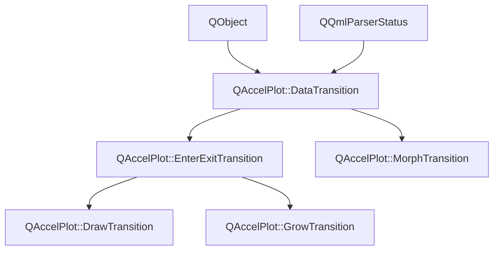

# Class QAccelPlot::DataTransition


[**ClassList**](annotated.md) **>** [**QAccelPlot**](namespaceQAccelPlot.md) **>** [**DataTransition**](classQAccelPlot_1_1DataTransition.md)


_Abstract base class for animated data transitions on plot series._ [More...](#detailed-description)

* `#include <DataTransition.hpp>`


Inherits the following classes: QObject,  QQmlParserStatus


Inherited by the following classes: [QAccelPlot::EnterExitTransition](classQAccelPlot_1_1EnterExitTransition.md),  [QAccelPlot::MorphTransition](classQAccelPlot_1_1MorphTransition.md)


## Inheritance diagram




## Classes

| Type | Name |
| ---: | :--- |
| class | [**Run**](classQAccelPlot_1_1DataTransition_1_1Run.md) <br>_One animation of a transition on one series._  |


## Public Properties

| Type | Name |
| ---: | :--- |
| property QQmlListProperty&lt; QObject &gt; | [**animations**](classQAccelPlot_1_1DataTransition.md#property-animations-12)  <br>_Qt Quick animations of the opacity of each item, such as_ `NumberAnimation` _{ property: "opacity" }._ |
| property QML\_ANONYMOUSint | [**duration**](classQAccelPlot_1_1DataTransition.md#property-duration-12)  <br>_Duration of the transition in milliseconds. Default: 300._  |
| property QEasingCurve | [**easing**](classQAccelPlot_1_1DataTransition.md#property-easing-12)  <br>_Easing curve applied to the progress of each item. Default:_ `QEasingCurve::Linear` _._ |
| property bool | [**enabled**](classQAccelPlot_1_1DataTransition.md#property-enabled-12)  <br>_Whether the transition is active. When_ `false` _, the items it animates change instantly._ |
| property bool | [**running**](classQAccelPlot_1_1DataTransition.md#property-running-12)  <br>_Read-only:_ `true` _while the transition is playing on at least one series._ |
| property qreal | [**stagger**](classQAccelPlot_1_1DataTransition.md#property-stagger-12)  <br>_Share of_ `duration` _over which the start times of the items are spread, in [0, 1]._ |


## Public Signals

| Type | Name |
| ---: | :--- |
| signal void | [**durationChanged**](classQAccelPlot_1_1DataTransition.md#signal-durationchanged)  <br>_Emitted when the duration property changes._  |
| signal void | [**easingChanged**](classQAccelPlot_1_1DataTransition.md#signal-easingchanged)  <br>_Emitted when the easing property changes._  |
| signal void | [**enabledChanged**](classQAccelPlot_1_1DataTransition.md#signal-enabledchanged)  <br>_Emitted when the enabled property changes._  |
| signal void | [**runningChanged**](classQAccelPlot_1_1DataTransition.md#signal-runningchanged)  <br>_Emitted when the running property changes._  |
| signal void | [**staggerChanged**](classQAccelPlot_1_1DataTransition.md#signal-staggerchanged)  <br>_Emitted when the stagger property changes._  |


## Public Functions

| Type | Name |
| ---: | :--- |
|  QQmlListProperty&lt; QObject &gt; | [**animations**](#function-animations-22) () <br>_Returns the QML list property of the opacity animations._  |
|  void | [**cancel**](#function-cancel) () <br>_Ends every active run immediately._  |
|  void | [**classBegin**](#function-classbegin) () override<br>_Holds back the warnings about ignored animations while the component loads._  |
|  void | [**componentComplete**](#function-componentcomplete) () override<br>_Reports ignored animations once the component is complete._  |
|  int | [**duration**](#function-duration-22) () const<br>_Returns the animation duration in milliseconds._  |
|  QEasingCurve | [**easing**](#function-easing-22) () const<br>_Returns the easing curve._  |
|  bool | [**enabled**](#function-enabled-22) () const<br>_Returns_ `true` _if the transition is enabled._ |
|  double | [**progress**](#function-progress) (const [**Run**](classQAccelPlot_1_1DataTransition_1_1Run.md) & run) const<br>_Returns the progress of_ _run_ _in [0, 1], before easing._ |
|  bool | [**running**](#function-running-22) () const<br>_Returns_ `true` _while at least one run is active._ |
|  void | [**setDuration**](#function-setduration) (int duration) <br>_Sets the animation duration to_ _duration_ _milliseconds._ |
|  void | [**setEasing**](#function-seteasing) (const QEasingCurve & easing) <br>_Sets the easing curve to_ _easing_ _._ |
|  void | [**setEnabled**](#function-setenabled) (bool enabled) <br>_Sets the enabled state to_ _enabled_ _._ |
|  void | [**setStagger**](#function-setstagger) (qreal stagger) <br>_Sets the stagger to_ _stagger_ _, clamped to [0, 1]._ |
|  qreal | [**stagger**](#function-stagger-22) () const<br>_Returns the share of the duration over which item start times are spread._  |
|  void | [**start**](#function-start) ([**Run**](classQAccelPlot_1_1DataTransition_1_1Run.md) & run) <br>_Starts_ _run_ _, restarting it if it is already active._ |
|   | [**~DataTransition**](#function-datatransition) () override<br>_Destroys the transition, ending its runs._  |


## Detailed Description


A series animates a data change with up to three transitions, matched to its items by index: `enterTransition` for added items, `updateTransition` for kept items, and `exitTransition` for removed items. `MorphTransition`, `DrawTransition`, and `GrowTransition` are the available transitions.


Time comes from Qt's animation timer on the transition's thread, the clock of QML animations. An installed `QAnimationDriver` therefore steps transitions too, for example to record frames offscreen at a fixed time step.


One transition can be assigned to several series, and to several slots of one series. Each assignment keeps its own `Run`, so the animations are independent.


Qt Quick animations of `"opacity"` declared inside a transition fade each item, see `animations:` 


```C++
enterTransition: QAccelPlot.DrawTransition {
    NumberAnimation { property: "opacity"; from: 0; duration: 250 }
}
```


**See also:** [**MorphTransition**](classQAccelPlot_1_1MorphTransition.md), [**DrawTransition**](classQAccelPlot_1_1DrawTransition.md), [**GrowTransition**](classQAccelPlot_1_1GrowTransition.md), [**TransitionRunner**](classQAccelPlot_1_1TransitionRunner.md) 


    
## Public Properties Documentation


### property animations {#property-animations-12}

_Qt Quick animations of the opacity of each item, such as_ `NumberAnimation` _{ property: "opacity" }._
```C++
QQmlListProperty<QObject> QAccelPlot::DataTransition::animations;
```


The default property. The animations run together on the timeline of each item, which starts when the item starts to move. They are read, never run, so `running`, `paused`, and their signals have no effect.


* Supported: `NumberAnimation` and other numeric `PropertyAnimation` types, `PropertyAction`, `PauseAnimation`, `SequentialAnimation`, and `ParallelAnimation`, with finite `loops`.
* A missing `from` continues from the opacity reached so far, and a missing `to` is 1. Before its first animation starts, an item shows that animation's start opacity.
* Other animations, such as `SpringAnimation` or `ScriptAction`, and animations of other properties log a warning and only add their duration.
* When the animations last longer than an item's share of `duration`, the start times of the items move closer together, so the transition still ends after `duration`.
* The opacity is clamped to [0, 1], and every item is opaque again when the transition ends. 


        

<hr>


### property duration {#property-duration-12}

_Duration of the transition in milliseconds. Default: 300._ 
```C++
QML_ANONYMOUSint QAccelPlot::DataTransition::duration;
```


With 0 or less, a run shows the target data at its next frame. 


        

<hr>


### property easing {#property-easing-12}

_Easing curve applied to the progress of each item. Default:_ `QEasingCurve::Linear` _._
```C++
QEasingCurve QAccelPlot::DataTransition::easing;
```


<hr>


### property enabled {#property-enabled-12}

_Whether the transition is active. When_ `false` _, the items it animates change instantly._
```C++
bool QAccelPlot::DataTransition::enabled;
```


<hr>


### property running {#property-running-12}

_Read-only:_ `true` _while the transition is playing on at least one series._
```C++
bool QAccelPlot::DataTransition::running;
```


<hr>


### property stagger {#property-stagger-12}

_Share of_ `duration` _over which the start times of the items are spread, in [0, 1]._
```C++
qreal QAccelPlot::DataTransition::stagger;
```


0 animates all items together; 1 animates them one after another, each changing at once. Items start in index order. Values outside [0, 1] are clamped. Default: 0, and 1 for `DrawTransition`. 


        

<hr>
## Public Signals Documentation


### signal durationChanged {#signal-durationchanged}

_Emitted when the duration property changes._ 
```C++
void QAccelPlot::DataTransition::durationChanged;
```


<hr>


### signal easingChanged {#signal-easingchanged}

_Emitted when the easing property changes._ 
```C++
void QAccelPlot::DataTransition::easingChanged;
```


<hr>


### signal enabledChanged {#signal-enabledchanged}

_Emitted when the enabled property changes._ 
```C++
void QAccelPlot::DataTransition::enabledChanged;
```


<hr>


### signal runningChanged {#signal-runningchanged}

_Emitted when the running property changes._ 
```C++
void QAccelPlot::DataTransition::runningChanged;
```


<hr>


### signal staggerChanged {#signal-staggerchanged}

_Emitted when the stagger property changes._ 
```C++
void QAccelPlot::DataTransition::staggerChanged;
```


<hr>
## Public Functions Documentation


### function animations {#function-animations-22}

_Returns the QML list property of the opacity animations._ 
```C++
QQmlListProperty< QObject > QAccelPlot::DataTransition::animations () 
```


<hr>


### function cancel {#function-cancel}

_Ends every active run immediately._ 
```C++
void QAccelPlot::DataTransition::cancel () 
```


<hr>


### function classBegin {#function-classbegin}

_Holds back the warnings about ignored animations while the component loads._ 
```C++
void QAccelPlot::DataTransition::classBegin () override
```


<hr>


### function componentComplete {#function-componentcomplete}

_Reports ignored animations once the component is complete._ 
```C++
void QAccelPlot::DataTransition::componentComplete () override
```


<hr>


### function duration {#function-duration-22}

_Returns the animation duration in milliseconds._ 
```C++
int QAccelPlot::DataTransition::duration () const
```


<hr>


### function easing {#function-easing-22}

_Returns the easing curve._ 
```C++
QEasingCurve QAccelPlot::DataTransition::easing () const
```


<hr>


### function enabled {#function-enabled-22}

_Returns_ `true` _if the transition is enabled._
```C++
bool QAccelPlot::DataTransition::enabled () const
```


<hr>


### function progress {#function-progress}

_Returns the progress of_ _run_ _in [0, 1], before easing._
```C++
double QAccelPlot::DataTransition::progress (
    const Run & run
) const
```


It is 1 once the duration has elapsed, and 1 for a run that is not active on this transition. 


        

<hr>


### function running {#function-running-22}

_Returns_ `true` _while at least one run is active._
```C++
bool QAccelPlot::DataTransition::running () const
```


<hr>


### function setDuration {#function-setduration}

_Sets the animation duration to_ _duration_ _milliseconds._
```C++
void QAccelPlot::DataTransition::setDuration (
    int duration
) 
```


<hr>


### function setEasing {#function-seteasing}

_Sets the easing curve to_ _easing_ _._
```C++
void QAccelPlot::DataTransition::setEasing (
    const QEasingCurve & easing
) 
```


<hr>


### function setEnabled {#function-setenabled}

_Sets the enabled state to_ _enabled_ _._
```C++
void QAccelPlot::DataTransition::setEnabled (
    bool enabled
) 
```


<hr>


### function setStagger {#function-setstagger}

_Sets the stagger to_ _stagger_ _, clamped to [0, 1]._
```C++
void QAccelPlot::DataTransition::setStagger (
    qreal stagger
) 
```


<hr>


### function stagger {#function-stagger-22}

_Returns the share of the duration over which item start times are spread._ 
```C++
qreal QAccelPlot::DataTransition::stagger () const
```


<hr>


### function start {#function-start}

_Starts_ _run_ _, restarting it if it is already active._
```C++
void QAccelPlot::DataTransition::start (
    Run & run
) 
```


A run active on another transition is ended first. 


        

<hr>


### function ~DataTransition {#function-datatransition}

_Destroys the transition, ending its runs._ 
```C++
QAccelPlot::DataTransition::~DataTransition () override
```


<hr>

------------------------------
The documentation for this class was generated from the following file `QAccelPlot/src/QAccelPlot/transitions/DataTransition.hpp`

