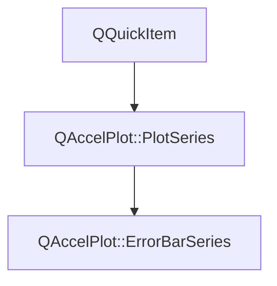

# Class QAccelPlot::ErrorBarSeries


[**ClassList**](annotated.md) **>** [**QAccelPlot**](namespaceQAccelPlot.md) **>** [**ErrorBarSeries**](classQAccelPlot_1_1ErrorBarSeries.md)


_A hardware-accelerated QML item that draws error bars: a line from a low to a high bound at each data point, capped at both ends._ [More...](#detailed-description)

* `#include <ErrorBarSeries.hpp>`


Inherits the following classes: [QAccelPlot::PlotSeries](classQAccelPlot_1_1PlotSeries.md)


## Inheritance diagram




## Public Types inherited from QAccelPlot::PlotSeries

See [QAccelPlot::PlotSeries](classQAccelPlot_1_1PlotSeries.md)

| Type | Name |
| ---: | :--- |
| enum  | [**LegendSymbol**](classQAccelPlot_1_1PlotSeries.md#enum-legendsymbol)  <br>_Supported default legend symbols._  |


## Public Properties

| Type | Name |
| ---: | :--- |
| property qreal | [**capLength**](classQAccelPlot_1_1ErrorBarSeries.md#property-caplength-12)  <br>_Length in pixels of the caps across the error bar, clamped to at least 0; 0 hides them. Default: 8._  |
| property QColor | [**color**](classQAccelPlot_1_1ErrorBarSeries.md#property-color-12)  <br>_Line color. Default:_ `Colors.dark.seriesPrimary` _._ |
| property QColor | [**hoverColor**](classQAccelPlot_1_1ErrorBarSeries.md#property-hovercolor-12)  <br>_Color of the hovered error bar. Default:_ `Colors.dark.hover` _; an invalid color draws it in_`color` _._ |
| property qreal | [**hoverRadius**](classQAccelPlot_1_1ErrorBarSeries.md#property-hoverradius-12)  <br>_Pick distance in pixels from an error bar or its caps, clamped to at least 0. Default: 6._  |
| property int | [**hoveredIndex**](classQAccelPlot_1_1ErrorBarSeries.md#property-hoveredindex-12)  <br>_Read-only: index of the error bar under the cursor, or -1 when none._  |
| property qreal | [**lineWidth**](classQAccelPlot_1_1ErrorBarSeries.md#property-linewidth-12)  <br>_Width in pixels of the error bars and their caps, clamped to at least 0. Default: 1.5._  |
| property qreal | [**offset**](classQAccelPlot_1_1ErrorBarSeries.md#property-offset-12)  <br>_Shift of every error bar across its bounds, in data units of the other axis. Default: 0._  |
| property Qt::Orientation | [**orientation**](classQAccelPlot_1_1ErrorBarSeries.md#property-orientation-12)  <br>[_**Axis**_](classQAccelPlot_1_1Axis.md) _the bounds lie on:_`Qt.Vertical` _for the Y axis,_`Qt.Horizontal` _for the X axis. Default:_`Qt.Vertical` _._ |
| property [**DataTransition**](classQAccelPlot_1_1DataTransition.md) \* | [**transition**](classQAccelPlot_1_1ErrorBarSeries.md#property-transition-12)  <br>_Optional data transition animation applied when new data arrives._  |


## Public Properties inherited from QAccelPlot::PlotSeries

See [QAccelPlot::PlotSeries](classQAccelPlot_1_1PlotSeries.md)

| Type | Name |
| ---: | :--- |
| property int | [**count**](classQAccelPlot_1_1PlotSeries.md#property-count-12)  <br>_Read-only: number of records stored, including invalid ones._  |
| property quint64 | [**dataRevision**](classQAccelPlot_1_1PlotSeries.md#property-datarevision-12)  <br>_Revision incremented by every accepted change of the series' records._  |
| property bool | [**hoverEnabled**](classQAccelPlot_1_1PlotSeries.md#property-hoverenabled-12)  <br>_Whether the series reacts to the mouse cursor. Default:_ `true` _._ |
| property bool | [**hovered**](classQAccelPlot_1_1PlotSeries.md#property-hovered-12)  <br>_Read-only:_ `true` _while the mouse cursor is over the series._ |
| property [**QAccelPlot::SeriesInspection**](classQAccelPlot_1_1SeriesInspection.md) \* | [**inspection**](classQAccelPlot_1_1PlotSeries.md#property-inspection-12)  <br>_Read-only constant: data queries for this series._  |
| property [**LegendSymbol**](classQAccelPlot_1_1PlotSeries.md#enum-legendsymbol) | [**legendSymbol**](classQAccelPlot_1_1PlotSeries.md#property-legendsymbol-12)  <br>_Symbol style requested from the default legend._  |
| property QString | [**name**](classQAccelPlot_1_1PlotSeries.md#property-name-12)  <br>_Identifying name used by the default legend._  |
| property QRectF | [**plotRect**](classQAccelPlot_1_1PlotSeries.md#property-plotrect-12)  <br>_Plot area in parent-item coordinates, assigned by_ `PlotView` _._ |
| property [**Axis**](classQAccelPlot_1_1Axis.md) \* | [**xAxis**](classQAccelPlot_1_1PlotSeries.md#property-xaxis-12)  <br>_Horizontal axis used for data-to-pixel coordinate mapping._  |
| property [**Axis**](classQAccelPlot_1_1Axis.md) \* | [**yAxis**](classQAccelPlot_1_1PlotSeries.md#property-yaxis-12)  <br>_Vertical axis used for data-to-pixel coordinate mapping._  |


## Public Signals

| Type | Name |
| ---: | :--- |
| signal void | [**capLengthChanged**](classQAccelPlot_1_1ErrorBarSeries.md#signal-caplengthchanged)  <br>_Emitted when the capLength property changes._  |
| signal void | [**colorChanged**](classQAccelPlot_1_1ErrorBarSeries.md#signal-colorchanged)  <br>_Emitted when the color property changes._  |
| signal void | [**hoverColorChanged**](classQAccelPlot_1_1ErrorBarSeries.md#signal-hovercolorchanged)  <br>_Emitted when the hoverColor property changes._  |
| signal void | [**hoverRadiusChanged**](classQAccelPlot_1_1ErrorBarSeries.md#signal-hoverradiuschanged)  <br>_Emitted when the hoverRadius property changes._  |
| signal void | [**hoveredIndexChanged**](classQAccelPlot_1_1ErrorBarSeries.md#signal-hoveredindexchanged)  <br>_Emitted when the hovered error bar changes._  |
| signal void | [**lineWidthChanged**](classQAccelPlot_1_1ErrorBarSeries.md#signal-linewidthchanged)  <br>_Emitted when the lineWidth property changes._  |
| signal void | [**offsetChanged**](classQAccelPlot_1_1ErrorBarSeries.md#signal-offsetchanged)  <br>_Emitted when the offset property changes._  |
| signal void | [**orientationChanged**](classQAccelPlot_1_1ErrorBarSeries.md#signal-orientationchanged)  <br>_Emitted when the orientation property changes._  |
| signal void | [**transitionChanged**](classQAccelPlot_1_1ErrorBarSeries.md#signal-transitionchanged)  <br>_Emitted when the transition property changes._  |


## Public Signals inherited from QAccelPlot::PlotSeries

See [QAccelPlot::PlotSeries](classQAccelPlot_1_1PlotSeries.md)

| Type | Name |
| ---: | :--- |
| signal void | [**countChanged**](classQAccelPlot_1_1PlotSeries.md#signal-countchanged)  <br>_Emitted when the number of records changes._  |
| signal void | [**dataRevisionChanged**](classQAccelPlot_1_1PlotSeries.md#signal-datarevisionchanged)  <br>_Emitted when the dataRevision property changes._  |
| signal void | [**hoverEnabledChanged**](classQAccelPlot_1_1PlotSeries.md#signal-hoverenabledchanged)  <br>_Emitted when the hoverEnabled property changes._  |
| signal void | [**hoveredChanged**](classQAccelPlot_1_1PlotSeries.md#signal-hoveredchanged)  <br>_Emitted when the hovered property changes._  |
| signal void | [**legendEntryChanged**](classQAccelPlot_1_1PlotSeries.md#signal-legendentrychanged)  <br>_Emitted when the result of_ `legendEntry()` _changes._ |
| signal void | [**legendSymbolChanged**](classQAccelPlot_1_1PlotSeries.md#signal-legendsymbolchanged)  <br> |
| signal void | [**nameChanged**](classQAccelPlot_1_1PlotSeries.md#signal-namechanged)  <br> |
| signal void | [**plotRectChanged**](classQAccelPlot_1_1PlotSeries.md#signal-plotrectchanged)  <br> |
| signal void | [**xAxisChanged**](classQAccelPlot_1_1PlotSeries.md#signal-xaxischanged)  <br> |
| signal void | [**yAxisChanged**](classQAccelPlot_1_1PlotSeries.md#signal-yaxischanged)  <br> |


## Public Functions

| Type | Name |
| ---: | :--- |
|   | [**ErrorBarSeries**](#function-errorbarseries) (QQuickItem \* parent=nullptr) <br>_Constructs an_ [_**ErrorBarSeries**_](classQAccelPlot_1_1ErrorBarSeries.md) _with the given__parent_ _._ |
|  Q\_INVOKABLE void | [**appendData**](#function-appenddata) (qreal x, qreal y, qreal low, qreal high) <br>_Appends the data point (_ _x_ _,__y_ _,__low_ _,__high_ _). Triggers a redraw._ |
|  Q\_INVOKABLE void | [**appendErrorData**](#function-appenderrordata-12) (qreal x, qreal y, qreal error) <br>_Appends a data point at (_ _x_ _,__y_ _) with__error_ _on both sides of the value._ |
|  Q\_INVOKABLE void | [**appendErrorData**](#function-appenderrordata-22) (qreal x, qreal y, qreal minus, qreal plus) <br>_Appends a data point at (_ _x_ _,__y_ _) with__minus_ _below and__plus_ _above the value. Signs are ignored._ |
|  qreal | [**capLength**](#function-caplength-22) () const<br>_Returns the cap length in pixels._  |
| virtual Q\_INVOKABLE void | [**clearData**](#function-cleardata) () override<br>_Removes all data points._  |
|  QColor | [**color**](#function-color-22) () const<br>_Returns the line color._  |
|  bool | [**contains**](#function-contains) (const QPointF & point) override const<br>_Returns_ `true` _when an error bar lies within_`hoverRadius` _of item position__point_ _._ |
|  Q\_INVOKABLE QVariantMap | [**errorBarAt**](#function-errorbarat) (int index) const<br>_Returns data point_ _index_ _as an object with_`x` _,_`y` _,_`low` _, and_`high` _properties, or an empty object when out of range._ |
|  Q\_INVOKABLE int | [**errorBarIndexAt**](#function-errorbarindexat) (const QPointF & position) const<br>_Returns the index of the error bar within_ `hoverRadius` _of item position__position_ _, or -1._ |
|  QColor | [**hoverColor**](#function-hovercolor-22) () const<br>_Returns the color of the hovered error bar._  |
|  qreal | [**hoverRadius**](#function-hoverradius-22) () const<br>_Returns the hover pick distance in pixels._  |
|  int | [**hoveredIndex**](#function-hoveredindex-22) () const<br>_Returns the index of the hovered error bar, or -1 if none._  |
|  qreal | [**lineWidth**](#function-linewidth-22) () const<br>_Returns the line width in pixels._  |
|  qreal | [**offset**](#function-offset-22) () const<br>_Returns the shift of every error bar across its bounds, in data units._  |
|  Qt::Orientation | [**orientation**](#function-orientation-22) () const<br>_Returns the axis the bounds lie on._  |
|  void | [**setCapLength**](#function-setcaplength) (qreal length) <br>_Sets the cap length to_ _length_ _pixels. Negative values are clamped to 0._ |
|  void | [**setColor**](#function-setcolor) (const QColor & color) <br>_Sets the line color to_ _color_ _._ |
|  Q\_INVOKABLE void | [**setData**](#function-setdata-16) (const QList&lt; qreal &gt; & xs, const QList&lt; qreal &gt; & ys, const QList&lt; qreal &gt; & lows, const QList&lt; qreal &gt; & highs) <br>_Replaces the data points with_ _xs_ _,__ys_ _,__lows_ _, and__highs_ _. If the sizes differ, the shortest length is used._ |
|  void | [**setData**](#function-setdata-26) (const std::vector&lt; double &gt; & xs, const std::vector&lt; double &gt; & ys, const std::vector&lt; double &gt; & lows, const std::vector&lt; double &gt; & highs) <br>_Replaces the data points with_ _xs_ _,__ys_ _,__lows_ _, and__highs_ _. If the sizes differ, the shortest length is used._ |
|  void | [**setData**](#function-setdata-36) (const double \* data, int count) <br>_Replaces the series data with_ _count_ _data points copied from an interleaved double array._ |
|  void | [**setData**](#function-setdata-46) (std::vector&lt; double &gt; && data, int count) <br>_Replaces the series data by moving an interleaved double buffer._  |
|  void | [**setData**](#function-setdata-56) (const double \* data, int count, const [**DataBounds**](structQAccelPlot_1_1PlotSeries_1_1DataBounds.md) & bounds) <br>_Like_ `setData` _(__data_ _,__count_ _), with the data extents given as__bounds_ _instead of scanned for._ |
|  void | [**setData**](#function-setdata-66) (std::vector&lt; double &gt; && data, int count, const [**DataBounds**](structQAccelPlot_1_1PlotSeries_1_1DataBounds.md) & bounds) <br>_Like_ `setData` _(__data_ _,__count_ _), with the data extents given as__bounds_ _instead of scanned for._ |
|  void | [**setDataF**](#function-setdataf-14) (const float \* data, int count) <br>_Replaces the series data with_ _count_ _data points copied from an interleaved float array._ |
|  void | [**setDataF**](#function-setdataf-24) (std::vector&lt; float &gt; && data, int count) <br>_Replaces the series data by moving an interleaved float buffer._  |
|  void | [**setDataF**](#function-setdataf-34) (const float \* data, int count, const [**DataBounds**](structQAccelPlot_1_1PlotSeries_1_1DataBounds.md) & bounds) <br>_Like_ `setDataF` _(__data_ _,__count_ _), with the data extents given as__bounds_ _instead of scanned for._ |
|  void | [**setDataF**](#function-setdataf-44) (std::vector&lt; float &gt; && data, int count, const [**DataBounds**](structQAccelPlot_1_1PlotSeries_1_1DataBounds.md) & bounds) <br>_Like_ `setDataF` _(__data_ _,__count_ _), with the data extents given as__bounds_ _instead of scanned for._ |
|  Q\_INVOKABLE void | [**setErrorData**](#function-seterrordata-14) (const QList&lt; qreal &gt; & xs, const QList&lt; qreal &gt; & ys, const QList&lt; qreal &gt; & errors) <br>_Replaces the data points with_ _xs_ _and__ys_ _, each with an error from__errors_ _on both sides of the value._ |
|  Q\_INVOKABLE void | [**setErrorData**](#function-seterrordata-24) (const QList&lt; qreal &gt; & xs, const QList&lt; qreal &gt; & ys, const QList&lt; qreal &gt; & minuses, const QList&lt; qreal &gt; & pluses) <br>_Replaces the data points with_ _xs_ _and__ys_ _, each with an error from__minuses_ _below and__pluses_ _above the value._ |
|  void | [**setErrorData**](#function-seterrordata-34) (const std::vector&lt; double &gt; & xs, const std::vector&lt; double &gt; & ys, const std::vector&lt; double &gt; & errors) <br>_Replaces the data points with_ _xs_ _and__ys_ _, each with an error from__errors_ _on both sides of the value._ |
|  void | [**setErrorData**](#function-seterrordata-44) (const std::vector&lt; double &gt; & xs, const std::vector&lt; double &gt; & ys, const std::vector&lt; double &gt; & minuses, const std::vector&lt; double &gt; & pluses) <br>_Replaces the data points with_ _xs_ _and__ys_ _, each with an error from__minuses_ _below and__pluses_ _above the value._ |
|  void | [**setHoverColor**](#function-sethovercolor) (const QColor & color) <br>_Sets the color of the hovered error bar to_ _color_ _._ |
|  void | [**setHoverRadius**](#function-sethoverradius) (qreal radius) <br>_Sets the hover pick distance to_ _radius_ _pixels. Negative values are clamped to 0._ |
|  void | [**setLineWidth**](#function-setlinewidth) (qreal width) <br>_Sets the line width to_ _width_ _pixels. Negative values are clamped to 0._ |
|  void | [**setOffset**](#function-setoffset) (qreal offset) <br>_Sets the shift of every error bar across its bounds to_ _offset_ _data units._ |
|  void | [**setOrientation**](#function-setorientation) (Qt::Orientation orientation) <br>_Sets the axis the bounds lie on to_ _orientation_ _. The stored data points are kept._ |
|  void | [**setTransition**](#function-settransition) ([**DataTransition**](classQAccelPlot_1_1DataTransition.md) \* transition) <br>_Sets the data transition to_ _transition_ _._ |
|  [**DataTransition**](classQAccelPlot_1_1DataTransition.md) \* | [**transition**](#function-transition-22) () const<br>_Returns the active data transition, or_ `nullptr` _if none._ |
|   | [**~ErrorBarSeries**](#function-errorbarseries) () override<br>_Destroys the series, ending its animation on the assigned transition._  |


## Public Functions inherited from QAccelPlot::PlotSeries

See [QAccelPlot::PlotSeries](classQAccelPlot_1_1PlotSeries.md)

| Type | Name |
| ---: | :--- |
|   | [**PlotSeries**](classQAccelPlot_1_1PlotSeries.md#function-plotseries-12) (QQuickItem \* parent=nullptr) <br> |
| virtual void | [**clearData**](classQAccelPlot_1_1PlotSeries.md#function-cleardata) () <br>_Removes all data points from the series._  |
| virtual int | [**count**](classQAccelPlot_1_1PlotSeries.md#function-count-22) () const<br>_Returns the number of records stored. The default is the number of stored data points._  |
|  quint64 | [**dataRevision**](classQAccelPlot_1_1PlotSeries.md#function-datarevision-22) () const<br>_Returns the current data revision._  |
|  bool | [**hoverEnabled**](classQAccelPlot_1_1PlotSeries.md#function-hoverenabled-22) () const<br>_Returns whether the series reacts to the mouse cursor._  |
|  bool | [**hovered**](classQAccelPlot_1_1PlotSeries.md#function-hovered-22) () const<br>_Returns whether the mouse cursor is over the series._  |
|  [**SeriesInspection**](classQAccelPlot_1_1SeriesInspection.md) \* | [**inspection**](classQAccelPlot_1_1PlotSeries.md#function-inspection-22) () const<br>_Returns the data queries for this series; created on first use and owned by the series._  |
| virtual std::optional&lt; [**LegendEntry**](structQAccelPlot_1_1LegendEntry.md) &gt; | [**legendEntry**](classQAccelPlot_1_1PlotSeries.md#function-legendentry) () const<br>_Returns how a legend draws the series, or_ `std::nullopt` _for no legend entry. Default: no entry._ |
|  [**LegendSymbol**](classQAccelPlot_1_1PlotSeries.md#enum-legendsymbol) | [**legendSymbol**](classQAccelPlot_1_1PlotSeries.md#function-legendsymbol-22) () const<br> |
|  QString | [**name**](classQAccelPlot_1_1PlotSeries.md#function-name-22) () const<br> |
|  QRectF | [**plotRect**](classQAccelPlot_1_1PlotSeries.md#function-plotrect-22) () const<br> |
|  void | [**postData**](classQAccelPlot_1_1PlotSeries.md#function-postdata-12) (std::vector&lt; double &gt; && data, int count) <br>_Queues a moved double buffer for assignment on the series' thread._  |
|  void | [**postData**](classQAccelPlot_1_1PlotSeries.md#function-postdata-22) (std::vector&lt; float &gt; && data, int count) <br>_Queues a moved float buffer for assignment on the series' thread._  |
|  void | [**setData**](classQAccelPlot_1_1PlotSeries.md#function-setdata-14) (const double \* data, int count) <br>_Replaces the series data with_ _count_ _data points copied from an interleaved double array._ |
|  void | [**setData**](classQAccelPlot_1_1PlotSeries.md#function-setdata-24) (std::vector&lt; double &gt; && data, int count) <br>_Replaces the series data by moving an interleaved double buffer._  |
|  void | [**setData**](classQAccelPlot_1_1PlotSeries.md#function-setdata-34) (const double \* data, int count, const [**DataBounds**](structQAccelPlot_1_1PlotSeries_1_1DataBounds.md) & bounds) <br>_Like_ `setData` _(__data_ _,__count_ _), with the data extents given as__bounds_ _instead of scanned for._ |
|  void | [**setData**](classQAccelPlot_1_1PlotSeries.md#function-setdata-44) (std::vector&lt; double &gt; && data, int count, const [**DataBounds**](structQAccelPlot_1_1PlotSeries_1_1DataBounds.md) & bounds) <br>_Like_ `setData` _(__data_ _,__count_ _), with the data extents given as__bounds_ _instead of scanned for._ |
|  void | [**setDataF**](classQAccelPlot_1_1PlotSeries.md#function-setdataf-14) (const float \* data, int count) <br>_Replaces the series data with_ _count_ _data points copied from an interleaved float array._ |
|  void | [**setDataF**](classQAccelPlot_1_1PlotSeries.md#function-setdataf-24) (std::vector&lt; float &gt; && data, int count) <br>_Replaces the series data by moving an interleaved float buffer._  |
|  void | [**setDataF**](classQAccelPlot_1_1PlotSeries.md#function-setdataf-34) (const float \* data, int count, const [**DataBounds**](structQAccelPlot_1_1PlotSeries_1_1DataBounds.md) & bounds) <br>_Like_ `setDataF` _(__data_ _,__count_ _), with the data extents given as__bounds_ _instead of scanned for._ |
|  void | [**setDataF**](classQAccelPlot_1_1PlotSeries.md#function-setdataf-44) (std::vector&lt; float &gt; && data, int count, const [**DataBounds**](structQAccelPlot_1_1PlotSeries_1_1DataBounds.md) & bounds) <br>_Like_ `setDataF` _(__data_ _,__count_ _), with the data extents given as__bounds_ _instead of scanned for._ |
|  void | [**setHoverEnabled**](classQAccelPlot_1_1PlotSeries.md#function-sethoverenabled) (bool enabled) <br>_Sets whether the series reacts to the mouse cursor to_ _enabled_ _._ |
|  void | [**setLegendSymbol**](classQAccelPlot_1_1PlotSeries.md#function-setlegendsymbol) ([**LegendSymbol**](classQAccelPlot_1_1PlotSeries.md#enum-legendsymbol) symbol) <br> |
|  void | [**setName**](classQAccelPlot_1_1PlotSeries.md#function-setname) (const QString & name) <br> |
|  void | [**setPlotRect**](classQAccelPlot_1_1PlotSeries.md#function-setplotrect) (const QRectF & rect) <br>_Updates the series geometry to exactly cover_ _rect_ _._ |
|  void | [**setXAxis**](classQAccelPlot_1_1PlotSeries.md#function-setxaxis) ([**Axis**](classQAccelPlot_1_1Axis.md) \* axis) <br> |
|  void | [**setYAxis**](classQAccelPlot_1_1PlotSeries.md#function-setyaxis) ([**Axis**](classQAccelPlot_1_1Axis.md) \* axis) <br> |
|  [**Axis**](classQAccelPlot_1_1Axis.md) \* | [**xAxis**](classQAccelPlot_1_1PlotSeries.md#function-xaxis-22) () const<br> |
|  std::optional&lt; [**DataExtent**](structQAccelPlot_1_1PlotSeries_1_1DataExtent.md) &gt; | [**xDataRange**](classQAccelPlot_1_1PlotSeries.md#function-xdatarange) () const<br>_Returns the extent this series reports to its horizontal axis, or_ `std::nullopt` _when it has none._ |
|  [**Axis**](classQAccelPlot_1_1Axis.md) \* | [**yAxis**](classQAccelPlot_1_1PlotSeries.md#function-yaxis-22) () const<br> |
|  std::optional&lt; [**DataExtent**](structQAccelPlot_1_1PlotSeries_1_1DataExtent.md) &gt; | [**yDataRange**](classQAccelPlot_1_1PlotSeries.md#function-ydatarange) () const<br>_Returns the extent this series reports to its vertical axis, or_ `std::nullopt` _when it has none._ |
|   | [**~PlotSeries**](classQAccelPlot_1_1PlotSeries.md#function-plotseries) () override<br> |


## Protected Types inherited from QAccelPlot::PlotSeries

See [QAccelPlot::PlotSeries](classQAccelPlot_1_1PlotSeries.md)

| Type | Name |
| ---: | :--- |
| enum  | [**CapacityOverflow**](classQAccelPlot_1_1PlotSeries.md#enum-capacityoverflow)  <br>_What a series draws when its records outgrow its GPU capacity._  |
| enum  | [**DataChange**](classQAccelPlot_1_1PlotSeries.md#enum-datachange)  <br>_How the records changed in a data update._  |


## Protected Attributes inherited from QAccelPlot::PlotSeries

See [QAccelPlot::PlotSeries](classQAccelPlot_1_1PlotSeries.md)

| Type | Name |
| ---: | :--- |
|  bool | [**overRenderCapacity\_**](classQAccelPlot_1_1PlotSeries.md#variable-overrendercapacity_)   = `{false}`<br>_Whether the record count of the last_ `updateRenderCapacity()` _exceeded_`renderCapacity_` _._ |
|  int | [**renderCapacity\_**](classQAccelPlot_1_1PlotSeries.md#variable-rendercapacity_)   = `{std::numeric\_limits&lt;int&gt;::max()}`<br>_Records the GPU buffers hold, as of the last_ `updateRenderCapacity()` _; the largest_`int` _before the first._ |


## Protected Functions

| Type | Name |
| ---: | :--- |
| virtual void | [**applyDataPoints**](#function-applydatapoints) ([**DataPointInput**](structQAccelPlot_1_1PlotSeries_1_1DataPointInput.md) && input) override<br>_Stores_ _input_ _, animating it from the drawn error bars while a transition is enabled._ |
| virtual void | [**onAxisScaleChanged**](#function-onaxisscalechanged) () override<br>_Refreshes the hover lookup and repaints after a bound axis changes between linear and log scale._  |
| virtual void | [**onDataPointsChanged**](#function-ondatapointschanged) ([**DataChange**](classQAccelPlot_1_1PlotSeries.md#enum-datachange) change, int previousCount) override<br>_Refreshes the hover lookup and the count after the data points changed._  |


## Protected Functions inherited from QAccelPlot::PlotSeries

See [QAccelPlot::PlotSeries](classQAccelPlot_1_1PlotSeries.md)

| Type | Name |
| ---: | :--- |
|   | [**PlotSeries**](classQAccelPlot_1_1PlotSeries.md#function-plotseries-22) ([**DataPointStore::Layout**](structQAccelPlot_1_1DataPointStore_1_1Layout.md) layout, [**DataPointWording**](structQAccelPlot_1_1PlotSeries_1_1DataPointWording.md) wording, QQuickItem \* parent) <br>_Creates a series whose data points have_ _layout_ _;__wording_ _names them in warnings._ |
|  void | [**appendDataPoint**](classQAccelPlot_1_1PlotSeries.md#function-appenddatapoint) (const double \* coordinates) <br>_Appends one double data point and widens the data ranges by its valid coordinates._  |
| virtual void | [**applyDataPoints**](classQAccelPlot_1_1PlotSeries.md#function-applydatapoints) ([**DataPointInput**](structQAccelPlot_1_1PlotSeries_1_1DataPointInput.md) && input) <br>_Applies data points passed to_ `setData()` _or_`setDataF()` _._ |
| virtual [**DataRanges**](structQAccelPlot_1_1PlotSeries_1_1DataRanges.md) | [**computeDataRanges**](classQAccelPlot_1_1PlotSeries.md#function-computedataranges) () const<br>_Scans the records for their extents. The default implementation scans the data points._  |
| virtual int | [**dataPointValueCount**](classQAccelPlot_1_1PlotSeries.md#function-datapointvaluecount) () const<br>_Returns the number of values per data point that_ `setData()` _and_`setDataF()` _take._ |
|  [**DataPointStore**](classQAccelPlot_1_1DataPointStore.md) & | [**dataPoints**](classQAccelPlot_1_1PlotSeries.md#function-datapoints-12) () <br>_Returns the data points of the series._  |
|  const [**DataPointStore**](classQAccelPlot_1_1DataPointStore.md) & | [**dataPoints**](classQAccelPlot_1_1PlotSeries.md#function-datapoints-22) () const<br>_Returns the data points of the series._  |
|  bool | [**event**](classQAccelPlot_1_1PlotSeries.md#function-event) (QEvent \* event) override<br>_Withholds hover events from a series beneath another series under the cursor._  |
|  void | [**extendXDataRange**](classQAccelPlot_1_1PlotSeries.md#function-extendxdatarange) (qreal x) <br>_Widens the X extent to include_ _x_ _and notifies the bound axes._ |
|  void | [**extendYDataRange**](classQAccelPlot_1_1PlotSeries.md#function-extendydatarange) (qreal y) <br>_Widens the Y extent to include_ _y_ _. A non-finite__y_ _leaves the extent unchanged._ |
| virtual bool | [**inspectionAvailable**](classQAccelPlot_1_1PlotSeries.md#function-inspectionavailable) () const<br>_Returns false while the records are ambiguous, such as during a data transition. Default: true._  |
|  void | [**inspectionDataChanged**](classQAccelPlot_1_1PlotSeries.md#function-inspectiondatachanged) ([**DataChange**](classQAccelPlot_1_1PlotSeries.md#enum-datachange) change=DataChange::Replaced) <br>_Advances the data revision and refreshes the data queries. Call after every accepted record change._  |
| virtual [**InspectionDataPoint**](structQAccelPlot_1_1InspectionDataPoint.md) | [**inspectionDataPointAt**](classQAccelPlot_1_1PlotSeries.md#function-inspectiondatapointat) (const QPointF & position) const<br>_Returns the record drawn at the series-local_ _position_ _as a data point. Default: unsupported._ |
| virtual [**InspectionRecord**](structQAccelPlot_1_1InspectionRecord.md) | [**inspectionRecord**](classQAccelPlot_1_1PlotSeries.md#function-inspectionrecord) (int index) const<br>_Returns the native record at_ _index_ _for series that are not plain XY series. Default: unsupported._ |
| virtual [**InspectionRecord**](structQAccelPlot_1_1InspectionRecord.md) | [**inspectionRecordAt**](classQAccelPlot_1_1PlotSeries.md#function-inspectionrecordat) (const QPointF & position) const<br>_Returns the native record drawn at the series-local_ _position_ _. Default: unsupported._ |
| virtual [**Internal::InspectionSource**](structQAccelPlot_1_1Internal_1_1InspectionSource.md) | [**inspectionSource**](classQAccelPlot_1_1PlotSeries.md#function-inspectionsource) () const<br>_Returns a view of the XY records that data point queries search. The default has none._  |
|  void | [**invalidateDataRanges**](classQAccelPlot_1_1PlotSeries.md#function-invalidatedataranges) () <br>_Discards the cached extents and notifies the bound axes._  |
|  void | [**invalidateInspection**](classQAccelPlot_1_1PlotSeries.md#function-invalidateinspection) () <br>_Refreshes the data queries after record validity changed without a data change, such as an axis scale switch._  |
|  bool | [**logScaleX**](classQAccelPlot_1_1PlotSeries.md#function-logscalex) () const<br>_Returns whether the horizontal axis is logarithmic; false without an axis._  |
|  bool | [**logScaleY**](classQAccelPlot_1_1PlotSeries.md#function-logscaley) () const<br>_Returns whether the vertical axis is logarithmic; false without an axis._  |
|  void | [**notifyDataPointsChanged**](classQAccelPlot_1_1PlotSeries.md#function-notifydatapointschanged) ([**DataChange**](classQAccelPlot_1_1PlotSeries.md#enum-datachange) change, int previousCount) <br>_Finishes a change of the data points: data ranges,_ `onDataPointsChanged()` _,_`countChanged()` _, data queries, and a repaint._ |
| virtual void | [**onAxisRangeChanged**](classQAccelPlot_1_1PlotSeries.md#function-onaxisrangechanged) () <br>_Called when the viewport of a bound axis changes. The default implementation schedules a repaint._  |
| virtual void | [**onAxisScaleChanged**](classQAccelPlot_1_1PlotSeries.md#function-onaxisscalechanged) () <br>_Called when a bound axis switches between linear and logarithmic scale, or a different axis is bound._  |
| virtual void | [**onDataPointsChanged**](classQAccelPlot_1_1PlotSeries.md#function-ondatapointschanged) ([**DataChange**](classQAccelPlot_1_1PlotSeries.md#enum-datachange) change, int previousCount) <br>_Called after the data points changed, before the data queries are refreshed. The default does nothing._  |
| virtual bool | [**positionInspectionSupported**](classQAccelPlot_1_1PlotSeries.md#function-positioninspectionsupported) () const<br>_Returns whether_ `inspectionDataPointAt()` _matches records drawn as areas, such as heatmap cells. Default: false._ |
| virtual bool | [**recordInspectionSupported**](classQAccelPlot_1_1PlotSeries.md#function-recordinspectionsupported) () const<br>_Returns whether_ `inspectionRecord()` _and_`inspectionRecordAt()` _answer for this series. Default: false._ |
|  QRectF | [**resolvePlotRect**](classQAccelPlot_1_1PlotSeries.md#function-resolveplotrect) () const<br>_Returns the plot area to render into:_ `plotRect` _when set, otherwise the item's current size._ |
|  void | [**setHovered**](classQAccelPlot_1_1PlotSeries.md#function-sethovered) (bool hovered) <br>_Sets the hovered property to_ _hovered_ _. Called by the hover handling of a series._ |
|  void | [**storeDataPoints**](classQAccelPlot_1_1PlotSeries.md#function-storedatapoints) ([**DataPointInput**](structQAccelPlot_1_1PlotSeries_1_1DataPointInput.md) && input) <br>_Stores_ _input_ _as the data points and finishes the change._ |
|  void | [**supportHover**](classQAccelPlot_1_1PlotSeries.md#function-supporthover) () <br>_Makes the series accept hover events while_ `hoverEnabled` _is_`true` _._ |
|  void | [**updateRenderCapacity**](classQAccelPlot_1_1PlotSeries.md#function-updaterendercapacity) (int capacity, int recordCount, [**CapacityOverflow**](classQAccelPlot_1_1PlotSeries.md#enum-capacityoverflow) overflow=CapacityOverflow::DropsExcess) <br>_Stores_ _capacity_ _, the number of records the GPU buffers hold, and warns when__recordCount_ _newly exceeds it._ |
|  bool | [**validateDataSize**](classQAccelPlot_1_1PlotSeries.md#function-validatedatasize) (std::size\_t valueCount, int count, bool floatData, int valuesPerDataPoint=0) const<br>_Returns whether_ _valueCount_ _values hold__count_ _data points; warns otherwise._ |
|  bool | [**validateRawDataArguments**](classQAccelPlot_1_1PlotSeries.md#function-validaterawdataarguments) (const void \* data, int count) const<br>_Returns whether_ _data_ _and__count_ _are valid arguments for copying data points; warns otherwise._ |


## Detailed Description


Each data point is an `(x, y, low, high)` quadruple. `orientation` selects the axis that `low` and `high` lie on: a vertical error bar is drawn at `x` from `low` to `high` along the Y axis, and a horizontal one at `y` from `low` to `high` along the X axis. The other coordinate, `y` for vertical and `x` for horizontal error bars, is the value the bounds belong to. The series does not draw it: draw the values with a `PointCloud` or `LineCurve` declared after the error bars, so that its markers are drawn and hovered on top. The same `xs` and `ys` then feed both series.


`setErrorData()` and `appendErrorData()` take errors relative to the value instead of bounds, one for both sides or one per side, and store the bounds they give. A NaN error gives a NaN bound.


Data points are uploaded to the GPU as a float data texture once per data change; panning, zooming, and changing `lineWidth`, `capLength`, or `offset` only change shader uniforms. The `setData()` overloads keep doubles and upload them relative to an origin near the viewport, so large coordinates such as epoch timestamps stay precise. The `setDataF()` overloads store floats and upload them without conversion.


```C++
QAccelPlot.ErrorBarSeries {
    xAxis: plot.xAxis
    yAxis: plot.yAxis
    Component.onCompleted: setErrorData([1, 2, 3], [4.2, 5.1, 4.7], [0.3, 0.5, 0.2])
}
```


**
**

A data point is not drawn or hovered when its position (`x` for vertical, `y` for horizontal error bars) is NaN or ±Inf, or not strictly positive on a log-scale axis, or when its value is NaN. A NaN bound leaves out that half of the error bar, which then runs from the value to the other bound. An infinite bound, and a bound that is not strictly positive on a log-scale axis, extends the error bar past the plot edge without a cap. `low` may be above `high`. Auto-ranging counts every valid coordinate on its own.


**
**

`hoveredIndex` is the error bar within `hoverRadius` pixels of the cursor, the nearest one when several are, and the one with the highest index on a tie. `hoverColor` draws it. Only the topmost series under the cursor is hovered: set `hoverEnabled` to `false` to leave hover to the series beneath.


**
**

Assign a `MorphTransition` or `DrawTransition` to `transition` to animate data updates. With `MorphTransition`, error bars move to their new position, value, and bounds. New error bars appear, and removed ones disappear, at once. `count`, `errorBarAt()`, the data ranges, and inspection use the new data from the start of the animation, while hover picks the error bars as drawn. While a transition is enabled, the `setDataF()` overloads store doubles. `appendData()`, `appendErrorData()`, `clearData()`, and replacing, clearing, or cancelling `transition`, skip to the new data.


**
**

At most 16,777,216 (2^24) error bars are drawn, fewer on GPUs whose maximum texture size is below
* Error bars beyond the limit are not drawn or hovered, and a warning is logged once.


**See also:** [**PointCloud**](classQAccelPlot_1_1PointCloud.md), [**LineCurve**](classQAccelPlot_1_1LineCurve.md), [**BandSeries**](classQAccelPlot_1_1BandSeries.md), [**MorphTransition**](classQAccelPlot_1_1MorphTransition.md), [**DrawTransition**](classQAccelPlot_1_1DrawTransition.md) 


    
## Public Properties Documentation


### property capLength {#property-caplength-12}

_Length in pixels of the caps across the error bar, clamped to at least 0; 0 hides them. Default: 8._ 
```C++
qreal QAccelPlot::ErrorBarSeries::capLength;
```


<hr>


### property color {#property-color-12}

_Line color. Default:_ `Colors.dark.seriesPrimary` _._
```C++
QColor QAccelPlot::ErrorBarSeries::color;
```


<hr>


### property hoverColor {#property-hovercolor-12}

_Color of the hovered error bar. Default:_ `Colors.dark.hover` _; an invalid color draws it in_`color` _._
```C++
QColor QAccelPlot::ErrorBarSeries::hoverColor;
```


<hr>


### property hoverRadius {#property-hoverradius-12}

_Pick distance in pixels from an error bar or its caps, clamped to at least 0. Default: 6._ 
```C++
qreal QAccelPlot::ErrorBarSeries::hoverRadius;
```


<hr>


### property hoveredIndex {#property-hoveredindex-12}

_Read-only: index of the error bar under the cursor, or -1 when none._ 
```C++
int QAccelPlot::ErrorBarSeries::hoveredIndex;
```


<hr>


### property lineWidth {#property-linewidth-12}

_Width in pixels of the error bars and their caps, clamped to at least 0. Default: 1.5._ 
```C++
qreal QAccelPlot::ErrorBarSeries::lineWidth;
```


<hr>


### property offset {#property-offset-12}

_Shift of every error bar across its bounds, in data units of the other axis. Default: 0._ 
```C++
qreal QAccelPlot::ErrorBarSeries::offset;
```


Bind it to `BarSeries::barOffset` to center error bars on grouped bars. Auto-ranging ignores it. 


        

<hr>


### property orientation {#property-orientation-12}

[_**Axis**_](classQAccelPlot_1_1Axis.md) _the bounds lie on:_`Qt.Vertical` _for the Y axis,_`Qt.Horizontal` _for the X axis. Default:_`Qt.Vertical` _._
```C++
Qt::Orientation QAccelPlot::ErrorBarSeries::orientation;
```


<hr>


### property transition {#property-transition-12}

_Optional data transition animation applied when new data arrives._ 
```C++
DataTransition* QAccelPlot::ErrorBarSeries::transition;
```


<hr>
## Public Signals Documentation


### signal capLengthChanged {#signal-caplengthchanged}

_Emitted when the capLength property changes._ 
```C++
void QAccelPlot::ErrorBarSeries::capLengthChanged;
```


<hr>


### signal colorChanged {#signal-colorchanged}

_Emitted when the color property changes._ 
```C++
void QAccelPlot::ErrorBarSeries::colorChanged;
```


<hr>


### signal hoverColorChanged {#signal-hovercolorchanged}

_Emitted when the hoverColor property changes._ 
```C++
void QAccelPlot::ErrorBarSeries::hoverColorChanged;
```


<hr>


### signal hoverRadiusChanged {#signal-hoverradiuschanged}

_Emitted when the hoverRadius property changes._ 
```C++
void QAccelPlot::ErrorBarSeries::hoverRadiusChanged;
```


<hr>


### signal hoveredIndexChanged {#signal-hoveredindexchanged}

_Emitted when the hovered error bar changes._ 
```C++
void QAccelPlot::ErrorBarSeries::hoveredIndexChanged;
```


<hr>


### signal lineWidthChanged {#signal-linewidthchanged}

_Emitted when the lineWidth property changes._ 
```C++
void QAccelPlot::ErrorBarSeries::lineWidthChanged;
```


<hr>


### signal offsetChanged {#signal-offsetchanged}

_Emitted when the offset property changes._ 
```C++
void QAccelPlot::ErrorBarSeries::offsetChanged;
```


<hr>


### signal orientationChanged {#signal-orientationchanged}

_Emitted when the orientation property changes._ 
```C++
void QAccelPlot::ErrorBarSeries::orientationChanged;
```


<hr>


### signal transitionChanged {#signal-transitionchanged}

_Emitted when the transition property changes._ 
```C++
void QAccelPlot::ErrorBarSeries::transitionChanged;
```


<hr>
## Public Functions Documentation


### function ErrorBarSeries {#function-errorbarseries}

_Constructs an_ [_**ErrorBarSeries**_](classQAccelPlot_1_1ErrorBarSeries.md) _with the given__parent_ _._
```C++
explicit QAccelPlot::ErrorBarSeries::ErrorBarSeries (
    QQuickItem * parent=nullptr
) 
```


<hr>


### function appendData {#function-appenddata}

_Appends the data point (_ _x_ _,__y_ _,__low_ _,__high_ _). Triggers a redraw._
```C++
Q_INVOKABLE void QAccelPlot::ErrorBarSeries::appendData (
    qreal x,
    qreal y,
    qreal low,
    qreal high
) 
```


<hr>


### function appendErrorData {#function-appenderrordata-12}

_Appends a data point at (_ _x_ _,__y_ _) with__error_ _on both sides of the value._
```C++
Q_INVOKABLE void QAccelPlot::ErrorBarSeries::appendErrorData (
    qreal x,
    qreal y,
    qreal error
) 
```


The value is _y_ for vertical and _x_ for horizontal error bars. The sign of _error_ is ignored. 


        

<hr>


### function appendErrorData {#function-appenderrordata-22}

_Appends a data point at (_ _x_ _,__y_ _) with__minus_ _below and__plus_ _above the value. Signs are ignored._
```C++
Q_INVOKABLE void QAccelPlot::ErrorBarSeries::appendErrorData (
    qreal x,
    qreal y,
    qreal minus,
    qreal plus
) 
```


<hr>


### function capLength {#function-caplength-22}

_Returns the cap length in pixels._ 
```C++
qreal QAccelPlot::ErrorBarSeries::capLength () const
```


<hr>


### function clearData {#function-cleardata}

_Removes all data points._ 
```C++
virtual Q_INVOKABLE void QAccelPlot::ErrorBarSeries::clearData () override
```


Implements [*QAccelPlot::PlotSeries::clearData*](classQAccelPlot_1_1PlotSeries.md#function-cleardata)


<hr>


### function color {#function-color-22}

_Returns the line color._ 
```C++
QColor QAccelPlot::ErrorBarSeries::color () const
```


<hr>


### function contains {#function-contains}

_Returns_ `true` _when an error bar lies within_`hoverRadius` _of item position__point_ _._
```C++
bool QAccelPlot::ErrorBarSeries::contains (
    const QPointF & point
) override const
```


Hover delivery uses this test, so stacked series underneath still receive hover events away from the error bars. 


        

<hr>


### function errorBarAt {#function-errorbarat}

_Returns data point_ _index_ _as an object with_`x` _,_`y` _,_`low` _, and_`high` _properties, or an empty object when out of range._
```C++
Q_INVOKABLE QVariantMap QAccelPlot::ErrorBarSeries::errorBarAt (
    int index
) const
```


<hr>


### function errorBarIndexAt {#function-errorbarindexat}

_Returns the index of the error bar within_ `hoverRadius` _of item position__position_ _, or -1._
```C++
Q_INVOKABLE int QAccelPlot::ErrorBarSeries::errorBarIndexAt (
    const QPointF & position
) const
```


The nearest error bar wins; on a tie, the one with the highest index. 


        

<hr>


### function hoverColor {#function-hovercolor-22}

_Returns the color of the hovered error bar._ 
```C++
QColor QAccelPlot::ErrorBarSeries::hoverColor () const
```


<hr>


### function hoverRadius {#function-hoverradius-22}

_Returns the hover pick distance in pixels._ 
```C++
qreal QAccelPlot::ErrorBarSeries::hoverRadius () const
```


<hr>


### function hoveredIndex {#function-hoveredindex-22}

_Returns the index of the hovered error bar, or -1 if none._ 
```C++
int QAccelPlot::ErrorBarSeries::hoveredIndex () const
```


<hr>


### function lineWidth {#function-linewidth-22}

_Returns the line width in pixels._ 
```C++
qreal QAccelPlot::ErrorBarSeries::lineWidth () const
```


<hr>


### function offset {#function-offset-22}

_Returns the shift of every error bar across its bounds, in data units._ 
```C++
qreal QAccelPlot::ErrorBarSeries::offset () const
```


<hr>


### function orientation {#function-orientation-22}

_Returns the axis the bounds lie on._ 
```C++
Qt::Orientation QAccelPlot::ErrorBarSeries::orientation () const
```


<hr>


### function setCapLength {#function-setcaplength}

_Sets the cap length to_ _length_ _pixels. Negative values are clamped to 0._
```C++
void QAccelPlot::ErrorBarSeries::setCapLength (
    qreal length
) 
```


<hr>


### function setColor {#function-setcolor}

_Sets the line color to_ _color_ _._
```C++
void QAccelPlot::ErrorBarSeries::setColor (
    const QColor & color
) 
```


<hr>


### function setData {#function-setdata-16}

_Replaces the data points with_ _xs_ _,__ys_ _,__lows_ _, and__highs_ _. If the sizes differ, the shortest length is used._
```C++
Q_INVOKABLE void QAccelPlot::ErrorBarSeries::setData (
    const QList< qreal > & xs,
    const QList< qreal > & ys,
    const QList< qreal > & lows,
    const QList< qreal > & highs
) 
```


<hr>


### function setData {#function-setdata-26}

_Replaces the data points with_ _xs_ _,__ys_ _,__lows_ _, and__highs_ _. If the sizes differ, the shortest length is used._
```C++
void QAccelPlot::ErrorBarSeries::setData (
    const std::vector< double > & xs,
    const std::vector< double > & ys,
    const std::vector< double > & lows,
    const std::vector< double > & highs
) 
```


<hr>


### function setData {#function-setdata-36}

_Replaces the series data with_ _count_ _data points copied from an interleaved double array._
```C++
void QAccelPlot::ErrorBarSeries::setData (
    const double * data,
    int count
) 
```


See the class description for the data point layout of each series. 


        

<hr>


### function setData {#function-setdata-46}

_Replaces the series data by moving an interleaved double buffer._ 
```C++
void QAccelPlot::ErrorBarSeries::setData (
    std::vector< double > && data,
    int count
) 
```


<hr>


### function setData {#function-setdata-56}

_Like_ `setData` _(__data_ _,__count_ _), with the data extents given as__bounds_ _instead of scanned for._
```C++
void QAccelPlot::ErrorBarSeries::setData (
    const double * data,
    int count,
    const DataBounds & bounds
) 
```


<hr>


### function setData {#function-setdata-66}

_Like_ `setData` _(__data_ _,__count_ _), with the data extents given as__bounds_ _instead of scanned for._
```C++
void QAccelPlot::ErrorBarSeries::setData (
    std::vector< double > && data,
    int count,
    const DataBounds & bounds
) 
```


<hr>


### function setDataF {#function-setdataf-14}

_Replaces the series data with_ _count_ _data points copied from an interleaved float array._
```C++
void QAccelPlot::ErrorBarSeries::setDataF (
    const float * data,
    int count
) 
```


<hr>


### function setDataF {#function-setdataf-24}

_Replaces the series data by moving an interleaved float buffer._ 
```C++
void QAccelPlot::ErrorBarSeries::setDataF (
    std::vector< float > && data,
    int count
) 
```


<hr>


### function setDataF {#function-setdataf-34}

_Like_ `setDataF` _(__data_ _,__count_ _), with the data extents given as__bounds_ _instead of scanned for._
```C++
void QAccelPlot::ErrorBarSeries::setDataF (
    const float * data,
    int count,
    const DataBounds & bounds
) 
```


<hr>


### function setDataF {#function-setdataf-44}

_Like_ `setDataF` _(__data_ _,__count_ _), with the data extents given as__bounds_ _instead of scanned for._
```C++
void QAccelPlot::ErrorBarSeries::setDataF (
    std::vector< float > && data,
    int count,
    const DataBounds & bounds
) 
```


<hr>


### function setErrorData {#function-seterrordata-14}

_Replaces the data points with_ _xs_ _and__ys_ _, each with an error from__errors_ _on both sides of the value._
```C++
Q_INVOKABLE void QAccelPlot::ErrorBarSeries::setErrorData (
    const QList< qreal > & xs,
    const QList< qreal > & ys,
    const QList< qreal > & errors
) 
```


If the sizes differ, the shortest length is used. The signs of the errors are ignored. 


        

<hr>


### function setErrorData {#function-seterrordata-24}

_Replaces the data points with_ _xs_ _and__ys_ _, each with an error from__minuses_ _below and__pluses_ _above the value._
```C++
Q_INVOKABLE void QAccelPlot::ErrorBarSeries::setErrorData (
    const QList< qreal > & xs,
    const QList< qreal > & ys,
    const QList< qreal > & minuses,
    const QList< qreal > & pluses
) 
```


If the sizes differ, the shortest length is used. The signs of the errors are ignored. 


        

<hr>


### function setErrorData {#function-seterrordata-34}

_Replaces the data points with_ _xs_ _and__ys_ _, each with an error from__errors_ _on both sides of the value._
```C++
void QAccelPlot::ErrorBarSeries::setErrorData (
    const std::vector< double > & xs,
    const std::vector< double > & ys,
    const std::vector< double > & errors
) 
```


<hr>


### function setErrorData {#function-seterrordata-44}

_Replaces the data points with_ _xs_ _and__ys_ _, each with an error from__minuses_ _below and__pluses_ _above the value._
```C++
void QAccelPlot::ErrorBarSeries::setErrorData (
    const std::vector< double > & xs,
    const std::vector< double > & ys,
    const std::vector< double > & minuses,
    const std::vector< double > & pluses
) 
```


<hr>


### function setHoverColor {#function-sethovercolor}

_Sets the color of the hovered error bar to_ _color_ _._
```C++
void QAccelPlot::ErrorBarSeries::setHoverColor (
    const QColor & color
) 
```


<hr>


### function setHoverRadius {#function-sethoverradius}

_Sets the hover pick distance to_ _radius_ _pixels. Negative values are clamped to 0._
```C++
void QAccelPlot::ErrorBarSeries::setHoverRadius (
    qreal radius
) 
```


<hr>


### function setLineWidth {#function-setlinewidth}

_Sets the line width to_ _width_ _pixels. Negative values are clamped to 0._
```C++
void QAccelPlot::ErrorBarSeries::setLineWidth (
    qreal width
) 
```


<hr>


### function setOffset {#function-setoffset}

_Sets the shift of every error bar across its bounds to_ _offset_ _data units._
```C++
void QAccelPlot::ErrorBarSeries::setOffset (
    qreal offset
) 
```


<hr>


### function setOrientation {#function-setorientation}

_Sets the axis the bounds lie on to_ _orientation_ _. The stored data points are kept._
```C++
void QAccelPlot::ErrorBarSeries::setOrientation (
    Qt::Orientation orientation
) 
```


<hr>


### function setTransition {#function-settransition}

_Sets the data transition to_ _transition_ _._
```C++
void QAccelPlot::ErrorBarSeries::setTransition (
    DataTransition * transition
) 
```


<hr>


### function transition {#function-transition-22}

_Returns the active data transition, or_ `nullptr` _if none._
```C++
DataTransition * QAccelPlot::ErrorBarSeries::transition () const
```


<hr>


### function ~ErrorBarSeries {#function-errorbarseries}

_Destroys the series, ending its animation on the assigned transition._ 
```C++
QAccelPlot::ErrorBarSeries::~ErrorBarSeries () override
```


<hr>
## Protected Functions Documentation


### function applyDataPoints {#function-applydatapoints}

_Stores_ _input_ _, animating it from the drawn error bars while a transition is enabled._
```C++
virtual void QAccelPlot::ErrorBarSeries::applyDataPoints (
    DataPointInput && input
) override
```


Implements [*QAccelPlot::PlotSeries::applyDataPoints*](classQAccelPlot_1_1PlotSeries.md#function-applydatapoints)


<hr>


### function onAxisScaleChanged {#function-onaxisscalechanged}

_Refreshes the hover lookup and repaints after a bound axis changes between linear and log scale._ 
```C++
virtual void QAccelPlot::ErrorBarSeries::onAxisScaleChanged () override
```


Implements [*QAccelPlot::PlotSeries::onAxisScaleChanged*](classQAccelPlot_1_1PlotSeries.md#function-onaxisscalechanged)


<hr>


### function onDataPointsChanged {#function-ondatapointschanged}

_Refreshes the hover lookup and the count after the data points changed._ 
```C++
virtual void QAccelPlot::ErrorBarSeries::onDataPointsChanged (
    DataChange change,
    int previousCount
) override
```


Implements [*QAccelPlot::PlotSeries::onDataPointsChanged*](classQAccelPlot_1_1PlotSeries.md#function-ondatapointschanged)


<hr>

------------------------------
The documentation for this class was generated from the following file `QAccelPlot/src/QAccelPlot/series/ErrorBarSeries.hpp`

