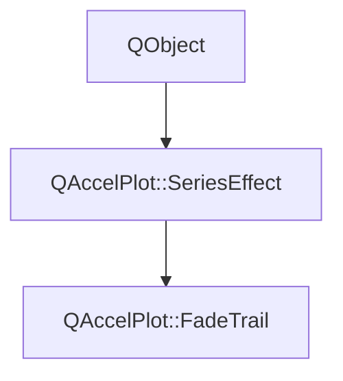

# Class QAccelPlot::FadeTrail


[**ClassList**](annotated.md) **>** [**QAccelPlot**](namespaceQAccelPlot.md) **>** [**FadeTrail**](classQAccelPlot_1_1FadeTrail.md)


_Fades the oldest items of a series, like the trace of an oscilloscope._ [More...](#detailed-description)

* `#include <FadeTrail.hpp>`


Inherits the following classes: [QAccelPlot::SeriesEffect](classQAccelPlot_1_1SeriesEffect.md)


## Inheritance diagram




## Public Properties

| Type | Name |
| ---: | :--- |
| property QEasingCurve | [**easing**](classQAccelPlot_1_1FadeTrail.md#property-easing-12)  <br>_How the opacity rises along the fading items, from the oldest. Default:_ `QEasingCurve::InQuad` _._ |
| property qreal | [**length**](classQAccelPlot_1_1FadeTrail.md#property-length-12)  <br>_Share of the items that fades, counted from the oldest, clamped to [0, 1]. Default: 0.5._  |
| property qreal | [**minOpacity**](classQAccelPlot_1_1FadeTrail.md#property-minopacity-12)  <br>_Opacity of the oldest item, clamped to [0, 1]. Default: 0._  |


## Public Properties inherited from QAccelPlot::SeriesEffect

See [QAccelPlot::SeriesEffect](classQAccelPlot_1_1SeriesEffect.md)

| Type | Name |
| ---: | :--- |
| property QML\_ANONYMOUSbool | [**enabled**](classQAccelPlot_1_1SeriesEffect.md#property-enabled-12)  <br>_Whether this effect is active. Disabled effects are ignored during rendering._  |


## Public Signals

| Type | Name |
| ---: | :--- |
| signal void | [**easingChanged**](classQAccelPlot_1_1FadeTrail.md#signal-easingchanged)  <br>_Emitted when the easing property changes._  |
| signal void | [**lengthChanged**](classQAccelPlot_1_1FadeTrail.md#signal-lengthchanged)  <br>_Emitted when the length property changes._  |
| signal void | [**minOpacityChanged**](classQAccelPlot_1_1FadeTrail.md#signal-minopacitychanged)  <br>_Emitted when the minOpacity property changes._  |


## Public Signals inherited from QAccelPlot::SeriesEffect

See [QAccelPlot::SeriesEffect](classQAccelPlot_1_1SeriesEffect.md)

| Type | Name |
| ---: | :--- |
| signal void | [**effectChanged**](classQAccelPlot_1_1SeriesEffect.md#signal-effectchanged)  <br>_Emitted when any effect property changes, requesting a redraw of the series._  |
| signal void | [**enabledChanged**](classQAccelPlot_1_1SeriesEffect.md#signal-enabledchanged)  <br>_Emitted when the enabled property changes._  |


## Public Functions

| Type | Name |
| ---: | :--- |
|   | [**FadeTrail**](#function-fadetrail) (QObject \* parent=nullptr) <br>_Constructs a_ [_**FadeTrail**_](classQAccelPlot_1_1FadeTrail.md) _with the given__parent_ _._ |
|  QEasingCurve | [**easing**](#function-easing-22) () const<br>_Returns how the opacity rises along the fading items._  |
|  qreal | [**length**](#function-length-22) () const<br>_Returns the share of the items that fades._  |
|  qreal | [**minOpacity**](#function-minopacity-22) () const<br>_Returns the opacity of the oldest item._  |
|  void | [**setEasing**](#function-seteasing) (const QEasingCurve & easing) <br>_Sets how the opacity rises along the fading items to_ _easing_ _._ |
|  void | [**setLength**](#function-setlength) (qreal length) <br>_Sets the share of the items that fades to_ _length_ _, clamped to [0, 1]._ |
|  void | [**setMinOpacity**](#function-setminopacity) (qreal opacity) <br>_Sets the opacity of the oldest item to_ _opacity_ _, clamped to [0, 1]._ |


## Public Functions inherited from QAccelPlot::SeriesEffect

See [QAccelPlot::SeriesEffect](classQAccelPlot_1_1SeriesEffect.md)

| Type | Name |
| ---: | :--- |
|   | [**SeriesEffect**](classQAccelPlot_1_1SeriesEffect.md#function-serieseffect) (QObject \* parent=nullptr) <br>_Constructs a_ [_**SeriesEffect**_](classQAccelPlot_1_1SeriesEffect.md) _with the given__parent_ _._ |
|  bool | [**enabled**](classQAccelPlot_1_1SeriesEffect.md#function-enabled-22) () const<br>_Returns_ `true` _if the effect is active._ |
| virtual void | [**refresh**](classQAccelPlot_1_1SeriesEffect.md#function-refresh) () <br>_Re-reads inputs that can change without a notification and emits_ `effectChanged()` _if they did._ |
|  void | [**setEnabled**](classQAccelPlot_1_1SeriesEffect.md#function-setenabled) (bool enabled) <br>_Sets the effect's enabled state to_ _enabled_ _._ |


## Detailed Description


Items are ordered by index: the first item is the oldest. The oldest `length` share of the items fades from `minOpacity` at the first item to full opacity, along `easing`; the newer items are drawn as usual. Supported by `LineCurve`, line and markers, and `PointCloud`.


**See also:** [**SeriesEffect**](classQAccelPlot_1_1SeriesEffect.md), [**Glow**](classQAccelPlot_1_1Glow.md) 


    
## Public Properties Documentation


### property easing {#property-easing-12}

_How the opacity rises along the fading items, from the oldest. Default:_ `QEasingCurve::InQuad` _._
```C++
QEasingCurve QAccelPlot::FadeTrail::easing;
```


`InQuad` keeps most of the trail dim, like the decaying trace of an oscilloscope; `QEasingCurve::Linear` rises evenly. Values outside [0, 1] are clamped. 


        

<hr>


### property length {#property-length-12}

_Share of the items that fades, counted from the oldest, clamped to [0, 1]. Default: 0.5._ 
```C++
qreal QAccelPlot::FadeTrail::length;
```


<hr>


### property minOpacity {#property-minopacity-12}

_Opacity of the oldest item, clamped to [0, 1]. Default: 0._ 
```C++
qreal QAccelPlot::FadeTrail::minOpacity;
```


<hr>
## Public Signals Documentation


### signal easingChanged {#signal-easingchanged}

_Emitted when the easing property changes._ 
```C++
void QAccelPlot::FadeTrail::easingChanged;
```


<hr>


### signal lengthChanged {#signal-lengthchanged}

_Emitted when the length property changes._ 
```C++
void QAccelPlot::FadeTrail::lengthChanged;
```


<hr>


### signal minOpacityChanged {#signal-minopacitychanged}

_Emitted when the minOpacity property changes._ 
```C++
void QAccelPlot::FadeTrail::minOpacityChanged;
```


<hr>
## Public Functions Documentation


### function FadeTrail {#function-fadetrail}

_Constructs a_ [_**FadeTrail**_](classQAccelPlot_1_1FadeTrail.md) _with the given__parent_ _._
```C++
explicit QAccelPlot::FadeTrail::FadeTrail (
    QObject * parent=nullptr
) 
```


<hr>


### function easing {#function-easing-22}

_Returns how the opacity rises along the fading items._ 
```C++
QEasingCurve QAccelPlot::FadeTrail::easing () const
```


<hr>


### function length {#function-length-22}

_Returns the share of the items that fades._ 
```C++
qreal QAccelPlot::FadeTrail::length () const
```


<hr>


### function minOpacity {#function-minopacity-22}

_Returns the opacity of the oldest item._ 
```C++
qreal QAccelPlot::FadeTrail::minOpacity () const
```


<hr>


### function setEasing {#function-seteasing}

_Sets how the opacity rises along the fading items to_ _easing_ _._
```C++
void QAccelPlot::FadeTrail::setEasing (
    const QEasingCurve & easing
) 
```


<hr>


### function setLength {#function-setlength}

_Sets the share of the items that fades to_ _length_ _, clamped to [0, 1]._
```C++
void QAccelPlot::FadeTrail::setLength (
    qreal length
) 
```


<hr>


### function setMinOpacity {#function-setminopacity}

_Sets the opacity of the oldest item to_ _opacity_ _, clamped to [0, 1]._
```C++
void QAccelPlot::FadeTrail::setMinOpacity (
    qreal opacity
) 
```


<hr>

------------------------------
The documentation for this class was generated from the following file `QAccelPlot/src/QAccelPlot/effects/FadeTrail.hpp`

