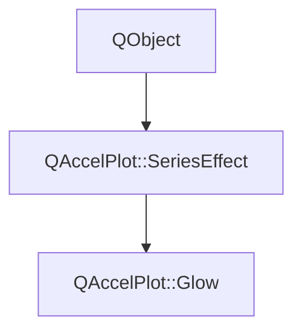

# Class QAccelPlot::Glow


[**ClassList**](annotated.md) **>** [**QAccelPlot**](namespaceQAccelPlot.md) **>** [**Glow**](classQAccelPlot_1_1Glow.md)


_A soft halo around the lines and markers of a series._ [More...](#detailed-description)

* `#include <Glow.hpp>`


Inherits the following classes: [QAccelPlot::SeriesEffect](classQAccelPlot_1_1SeriesEffect.md)


## Inheritance diagram




## Public Properties

| Type | Name |
| ---: | :--- |
| property QColor | [**color**](classQAccelPlot_1_1Glow.md#property-color-12)  <br>_Color of the halo. Default: an invalid color, which uses the series color._  |
| property qreal | [**intensity**](classQAccelPlot_1_1Glow.md#property-intensity-12)  <br>_Opacity of the halo next to the shape, clamped to [0, 1]. Default: 0.5._  |
| property qreal | [**radius**](classQAccelPlot_1_1Glow.md#property-radius-12)  <br>_Width of the halo in pixels, clamped to at least 0. Default: 8._  |


## Public Properties inherited from QAccelPlot::SeriesEffect

See [QAccelPlot::SeriesEffect](classQAccelPlot_1_1SeriesEffect.md)

| Type | Name |
| ---: | :--- |
| property QML\_ANONYMOUSbool | [**enabled**](classQAccelPlot_1_1SeriesEffect.md#property-enabled-12)  <br>_Whether this effect is active. Disabled effects are ignored during rendering._  |


## Public Signals

| Type | Name |
| ---: | :--- |
| signal void | [**colorChanged**](classQAccelPlot_1_1Glow.md#signal-colorchanged)  <br>_Emitted when the color property changes._  |
| signal void | [**intensityChanged**](classQAccelPlot_1_1Glow.md#signal-intensitychanged)  <br>_Emitted when the intensity property changes._  |
| signal void | [**radiusChanged**](classQAccelPlot_1_1Glow.md#signal-radiuschanged)  <br>_Emitted when the radius property changes._  |


## Public Signals inherited from QAccelPlot::SeriesEffect

See [QAccelPlot::SeriesEffect](classQAccelPlot_1_1SeriesEffect.md)

| Type | Name |
| ---: | :--- |
| signal void | [**effectChanged**](classQAccelPlot_1_1SeriesEffect.md#signal-effectchanged)  <br>_Emitted when any effect property changes, requesting a redraw of the series._  |
| signal void | [**enabledChanged**](classQAccelPlot_1_1SeriesEffect.md#signal-enabledchanged)  <br>_Emitted when the enabled property changes._  |


## Public Functions

| Type | Name |
| ---: | :--- |
|   | [**Glow**](#function-glow) (QObject \* parent=nullptr) <br>_Constructs a_ [_**Glow**_](classQAccelPlot_1_1Glow.md) _with the given__parent_ _._ |
|  QColor | [**color**](#function-color-22) () const<br>_Returns the halo color, or an invalid color when the series color applies._  |
|  qreal | [**intensity**](#function-intensity-22) () const<br>_Returns the halo opacity next to the shape._  |
|  qreal | [**radius**](#function-radius-22) () const<br>_Returns the halo width in pixels._  |
|  void | [**resetColor**](#function-resetcolor) () <br>_Uses the series color for the halo again._  |
|  void | [**setColor**](#function-setcolor) (const QColor & color) <br>_Sets the halo color to_ _color_ _; an invalid color uses the series color._ |
|  void | [**setIntensity**](#function-setintensity) (qreal intensity) <br>_Sets the halo opacity next to the shape to_ _intensity_ _, clamped to [0, 1]._ |
|  void | [**setRadius**](#function-setradius) (qreal radius) <br>_Sets the halo width to_ _radius_ _pixels, clamped to at least 0._ |


## Public Functions inherited from QAccelPlot::SeriesEffect

See [QAccelPlot::SeriesEffect](classQAccelPlot_1_1SeriesEffect.md)

| Type | Name |
| ---: | :--- |
|   | [**SeriesEffect**](classQAccelPlot_1_1SeriesEffect.md#function-serieseffect) (QObject \* parent=nullptr) <br>_Constructs a_ [_**SeriesEffect**_](classQAccelPlot_1_1SeriesEffect.md) _with the given__parent_ _._ |
|  bool | [**enabled**](classQAccelPlot_1_1SeriesEffect.md#function-enabled-22) () const<br>_Returns_ `true` _if the effect is active._ |
| virtual void | [**refresh**](classQAccelPlot_1_1SeriesEffect.md#function-refresh) () <br>_Re-reads inputs that can change without a notification and emits_ `effectChanged()` _if they did._ |
|  void | [**setEnabled**](classQAccelPlot_1_1SeriesEffect.md#function-setenabled) (bool enabled) <br>_Sets the effect's enabled state to_ _enabled_ _._ |


## Detailed Description


The halo fades out over `radius` pixels outside the drawn shape. It is drawn in the same pass as the series, with no offscreen blur. A fading item and its halo fade together. Halos of parts of a line that come close to each other add up, as halos of separate lines do.


|Series  |Glows around  |
|-----|-----|
|`LineCurve`  |The line and its markers  |
|`PointCloud`  |The markers  |
|`BarSeries`  |The bars  |
|`ErrorBarSeries`  |The error bars  |


**See also:** [**SeriesEffect**](classQAccelPlot_1_1SeriesEffect.md), [**FadeTrail**](classQAccelPlot_1_1FadeTrail.md) 


    
## Public Properties Documentation


### property color {#property-color-12}

_Color of the halo. Default: an invalid color, which uses the series color._ 
```C++
QColor QAccelPlot::Glow::color;
```


<hr>


### property intensity {#property-intensity-12}

_Opacity of the halo next to the shape, clamped to [0, 1]. Default: 0.5._ 
```C++
qreal QAccelPlot::Glow::intensity;
```


<hr>


### property radius {#property-radius-12}

_Width of the halo in pixels, clamped to at least 0. Default: 8._ 
```C++
qreal QAccelPlot::Glow::radius;
```


<hr>
## Public Signals Documentation


### signal colorChanged {#signal-colorchanged}

_Emitted when the color property changes._ 
```C++
void QAccelPlot::Glow::colorChanged;
```


<hr>


### signal intensityChanged {#signal-intensitychanged}

_Emitted when the intensity property changes._ 
```C++
void QAccelPlot::Glow::intensityChanged;
```


<hr>


### signal radiusChanged {#signal-radiuschanged}

_Emitted when the radius property changes._ 
```C++
void QAccelPlot::Glow::radiusChanged;
```


<hr>
## Public Functions Documentation


### function Glow {#function-glow}

_Constructs a_ [_**Glow**_](classQAccelPlot_1_1Glow.md) _with the given__parent_ _._
```C++
explicit QAccelPlot::Glow::Glow (
    QObject * parent=nullptr
) 
```


<hr>


### function color {#function-color-22}

_Returns the halo color, or an invalid color when the series color applies._ 
```C++
QColor QAccelPlot::Glow::color () const
```


<hr>


### function intensity {#function-intensity-22}

_Returns the halo opacity next to the shape._ 
```C++
qreal QAccelPlot::Glow::intensity () const
```


<hr>


### function radius {#function-radius-22}

_Returns the halo width in pixels._ 
```C++
qreal QAccelPlot::Glow::radius () const
```


<hr>


### function resetColor {#function-resetcolor}

_Uses the series color for the halo again._ 
```C++
void QAccelPlot::Glow::resetColor () 
```


<hr>


### function setColor {#function-setcolor}

_Sets the halo color to_ _color_ _; an invalid color uses the series color._
```C++
void QAccelPlot::Glow::setColor (
    const QColor & color
) 
```


<hr>


### function setIntensity {#function-setintensity}

_Sets the halo opacity next to the shape to_ _intensity_ _, clamped to [0, 1]._
```C++
void QAccelPlot::Glow::setIntensity (
    qreal intensity
) 
```


<hr>


### function setRadius {#function-setradius}

_Sets the halo width to_ _radius_ _pixels, clamped to at least 0._
```C++
void QAccelPlot::Glow::setRadius (
    qreal radius
) 
```


<hr>

------------------------------
The documentation for this class was generated from the following file `QAccelPlot/src/QAccelPlot/effects/Glow.hpp`

