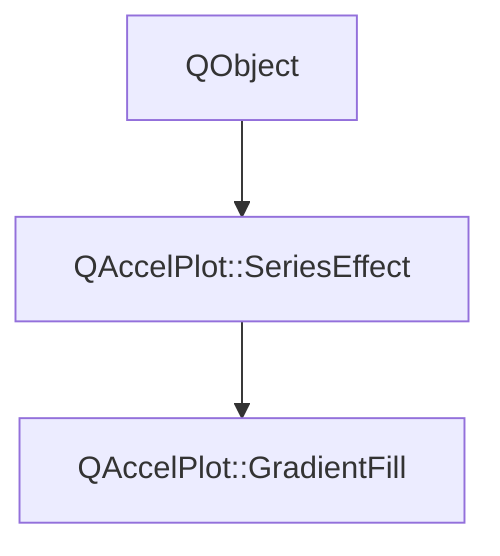

# Class QAccelPlot::GradientFill


[**ClassList**](annotated.md) **>** [**QAccelPlot**](namespaceQAccelPlot.md) **>** [**GradientFill**](classQAccelPlot_1_1GradientFill.md)


_A_ [_**LineCurve**_](classQAccelPlot_1_1LineCurve.md) _effect that fills the area under the curve with a color gradient._[More...](#detailed-description)

* `#include <GradientFill.hpp>`


Inherits the following classes: [QAccelPlot::SeriesEffect](classQAccelPlot_1_1SeriesEffect.md)


## Inheritance diagram




## Public Properties

| Type | Name |
| ---: | :--- |
| property qreal | [**baselineValue**](classQAccelPlot_1_1GradientFill.md#property-baselinevalue-12)  <br>_Y data value the filled area starts from. Unset by default: the smallest visible value of each series' Y axis, so the fill follows panning and zooming._  |
| property [**Colormap**](classQAccelPlot_1_1Colormap.md) \* | [**colormap**](classQAccelPlot_1_1GradientFill.md#property-colormap-12)  <br>[_**Colormap**_](classQAccelPlot_1_1Colormap.md) _supplying the color stops. Overrides_`gradient` _when set._ |
| property Qt::Orientation | [**direction**](classQAccelPlot_1_1GradientFill.md#property-direction-12)  <br>[_**Axis**_](classQAccelPlot_1_1Axis.md) _along which the gradient color varies:_`Qt.Horizontal` _for X values,_`Qt.Vertical` _for Y values. Default:_`Qt.Horizontal` _._ |
| property QObject \* | [**gradient**](classQAccelPlot_1_1GradientFill.md#property-gradient-12)  <br>_A Qt_ `Gradient` _(or compatible) object supplying the color stops._ |
| property qreal | [**opacity**](classQAccelPlot_1_1GradientFill.md#property-opacity-12)  <br>_Overall opacity of the fill area in [0, 1]. Default: 0.35._  |
| property qreal | [**valueMax**](classQAccelPlot_1_1GradientFill.md#property-valuemax-12)  <br>_Data value at gradient position 1. Unset by default: the largest value of each series along_ `direction` _, or of its axis data range when the series has no valid data point._ |
| property qreal | [**valueMin**](classQAccelPlot_1_1GradientFill.md#property-valuemin-12)  <br>_Data value at gradient position 0. Unset by default: the smallest value of each series along_ `direction` _, or of its axis data range when the series has no valid data point._ |


## Public Properties inherited from QAccelPlot::SeriesEffect

See [QAccelPlot::SeriesEffect](classQAccelPlot_1_1SeriesEffect.md)

| Type | Name |
| ---: | :--- |
| property QML\_ANONYMOUSbool | [**enabled**](classQAccelPlot_1_1SeriesEffect.md#property-enabled-12)  <br>_Whether this effect is active. Disabled effects are ignored during rendering._  |


## Public Signals

| Type | Name |
| ---: | :--- |
| signal void | [**baselineValueChanged**](classQAccelPlot_1_1GradientFill.md#signal-baselinevaluechanged)  <br>_Emitted when the baselineValue property changes._  |
| signal void | [**colormapChanged**](classQAccelPlot_1_1GradientFill.md#signal-colormapchanged)  <br>_Emitted when the colormap property changes._  |
| signal void | [**directionChanged**](classQAccelPlot_1_1GradientFill.md#signal-directionchanged)  <br>_Emitted when the direction property changes._  |
| signal void | [**gradientChanged**](classQAccelPlot_1_1GradientFill.md#signal-gradientchanged)  <br>_Emitted when the gradient property changes._  |
| signal void | [**opacityChanged**](classQAccelPlot_1_1GradientFill.md#signal-opacitychanged)  <br>_Emitted when the opacity property changes._  |
| signal void | [**valueMaxChanged**](classQAccelPlot_1_1GradientFill.md#signal-valuemaxchanged)  <br>_Emitted when the valueMax property changes._  |
| signal void | [**valueMinChanged**](classQAccelPlot_1_1GradientFill.md#signal-valueminchanged)  <br>_Emitted when the valueMin property changes._  |


## Public Signals inherited from QAccelPlot::SeriesEffect

See [QAccelPlot::SeriesEffect](classQAccelPlot_1_1SeriesEffect.md)

| Type | Name |
| ---: | :--- |
| signal void | [**effectChanged**](classQAccelPlot_1_1SeriesEffect.md#signal-effectchanged)  <br>_Emitted when any effect property changes, requesting a redraw of the series._  |
| signal void | [**enabledChanged**](classQAccelPlot_1_1SeriesEffect.md#signal-enabledchanged)  <br>_Emitted when the enabled property changes._  |


## Public Functions

| Type | Name |
| ---: | :--- |
|   | [**GradientFill**](#function-gradientfill) (QObject \* parent=nullptr) <br>_Constructs a_ [_**GradientFill**_](classQAccelPlot_1_1GradientFill.md) _with the given__parent_ _._ |
|  qreal | [**baselineValue**](#function-baselinevalue-22) () const<br>_Returns the baseline data value, or NaN when the fill starts at the smallest visible Y value._  |
|  [**Colormap**](classQAccelPlot_1_1Colormap.md) \* | [**colormap**](#function-colormap-22) () const<br>_Returns the colormap supplying color stops, or_ `nullptr` _when_`gradient` _supplies them._ |
|  Qt::Orientation | [**direction**](#function-direction-22) () const<br>_Returns the gradient direction._  |
|  QObject \* | [**gradient**](#function-gradient-22) () const<br>_Returns the Qt Gradient object supplying color stops._  |
|  qreal | [**opacity**](#function-opacity-22) () const<br>_Returns the fill opacity._  |
|  const [**GradientFillPayload**](structQAccelPlot_1_1GradientFillPayload.md) & | [**payload**](#function-payload) () const<br>_Returns a snapshot of all fill parameters, updated on the GUI thread when the effect changes._  |
| virtual void | [**refresh**](#function-refresh) () override<br>_Re-reads the_ `gradient` _stops, which can change without a notification, and emits_`effectChanged()` _if they differ from the snapshot._ |
|  void | [**resetBaselineValue**](#function-resetbaselinevalue) () <br>_Unsets the baseline, so the fill starts at the smallest visible Y value again._  |
|  void | [**resetValueMax**](#function-resetvaluemax) () <br>_Unsets the value at gradient position 1, so each series' data range applies again._  |
|  void | [**resetValueMin**](#function-resetvaluemin) () <br>_Unsets the value at gradient position 0, so each series' data range applies again._  |
|  void | [**setBaselineValue**](#function-setbaselinevalue) (qreal value) <br>_Sets the baseline data value to_ _value_ _. NaN unsets it._ |
|  void | [**setColormap**](#function-setcolormap) ([**Colormap**](classQAccelPlot_1_1Colormap.md) \* colormap) <br>_Sets the colormap to_ _colormap_ _. Pass_`nullptr` _to take the stops from_`gradient` _._ |
|  void | [**setDirection**](#function-setdirection) (Qt::Orientation direction) <br>_Sets the gradient direction to_ _direction_ _._ |
|  void | [**setGradient**](#function-setgradient) (QObject \* gradient) <br>_Sets the Qt Gradient object to_ _gradient_ _._ |
|  void | [**setOpacity**](#function-setopacity) (qreal value) <br>_Sets the fill opacity to_ _value_ _._ |
|  void | [**setValueMax**](#function-setvaluemax) (qreal value) <br>_Sets the data value at gradient position 1 to_ _value_ _. NaN unsets it._ |
|  void | [**setValueMin**](#function-setvaluemin) (qreal value) <br>_Sets the data value at gradient position 0 to_ _value_ _. NaN unsets it._ |
|  qreal | [**valueMax**](#function-valuemax-22) () const<br>_Returns the data value at gradient position 1, or NaN when each series' data range applies._  |
|  qreal | [**valueMin**](#function-valuemin-22) () const<br>_Returns the data value at gradient position 0, or NaN when each series' data range applies._  |


## Public Functions inherited from QAccelPlot::SeriesEffect

See [QAccelPlot::SeriesEffect](classQAccelPlot_1_1SeriesEffect.md)

| Type | Name |
| ---: | :--- |
|   | [**SeriesEffect**](classQAccelPlot_1_1SeriesEffect.md#function-serieseffect) (QObject \* parent=nullptr) <br>_Constructs a_ [_**SeriesEffect**_](classQAccelPlot_1_1SeriesEffect.md) _with the given__parent_ _._ |
|  bool | [**enabled**](classQAccelPlot_1_1SeriesEffect.md#function-enabled-22) () const<br>_Returns_ `true` _if the effect is active._ |
| virtual void | [**refresh**](classQAccelPlot_1_1SeriesEffect.md#function-refresh) () <br>_Re-reads inputs that can change without a notification and emits_ `effectChanged()` _if they did._ |
|  void | [**setEnabled**](classQAccelPlot_1_1SeriesEffect.md#function-setenabled) (bool enabled) <br>_Sets the effect's enabled state to_ _enabled_ _._ |


## Detailed Description


Attach to `LineCurve::effects` to render a shaded fill between the curve and a configurable baseline. The color stops come from `colormap` when set, otherwise from a Qt `Gradient` assigned to `gradient`. `direction` sets the axis the colors vary along.


**See also:** [**GradientStroke**](classQAccelPlot_1_1GradientStroke.md), [**Colormap**](classQAccelPlot_1_1Colormap.md), [**SeriesEffect**](classQAccelPlot_1_1SeriesEffect.md), [**LineCurve**](classQAccelPlot_1_1LineCurve.md) 


    
## Public Properties Documentation


### property baselineValue {#property-baselinevalue-12}

_Y data value the filled area starts from. Unset by default: the smallest visible value of each series' Y axis, so the fill follows panning and zooming._ 
```C++
qreal QAccelPlot::GradientFill::baselineValue;
```


Reads NaN while unset; assign `undefined` to unset it. 


        

<hr>


### property colormap {#property-colormap-12}

[_**Colormap**_](classQAccelPlot_1_1Colormap.md) _supplying the color stops. Overrides_`gradient` _when set._
```C++
Colormap* QAccelPlot::GradientFill::colormap;
```


Only the ramp is used. `Colormap::min`, `Colormap::max`, and `Colormap::logScale` are ignored; `valueMin` and `valueMax` place the ramp instead. 


        

<hr>


### property direction {#property-direction-12}

[_**Axis**_](classQAccelPlot_1_1Axis.md) _along which the gradient color varies:_`Qt.Horizontal` _for X values,_`Qt.Vertical` _for Y values. Default:_`Qt.Horizontal` _._
```C++
Qt::Orientation QAccelPlot::GradientFill::direction;
```


<hr>


### property gradient {#property-gradient-12}

_A Qt_ `Gradient` _(or compatible) object supplying the color stops._
```C++
QObject* QAccelPlot::GradientFill::gradient;
```


<hr>


### property opacity {#property-opacity-12}

_Overall opacity of the fill area in [0, 1]. Default: 0.35._ 
```C++
qreal QAccelPlot::GradientFill::opacity;
```


Applies to the fill only. The curve's `opacity` and the `opacity` of its parent items also apply, so the rendered fill alpha is the product of all of them. 


        

<hr>


### property valueMax {#property-valuemax-12}

_Data value at gradient position 1. Unset by default: the largest value of each series along_ `direction` _, or of its axis data range when the series has no valid data point._
```C++
qreal QAccelPlot::GradientFill::valueMax;
```


Reads NaN while unset; assign `undefined` to unset it. 


        

<hr>


### property valueMin {#property-valuemin-12}

_Data value at gradient position 0. Unset by default: the smallest value of each series along_ `direction` _, or of its axis data range when the series has no valid data point._
```C++
qreal QAccelPlot::GradientFill::valueMin;
```


Reads NaN while unset; assign `undefined` to unset it. 


        

<hr>
## Public Signals Documentation


### signal baselineValueChanged {#signal-baselinevaluechanged}

_Emitted when the baselineValue property changes._ 
```C++
void QAccelPlot::GradientFill::baselineValueChanged;
```


<hr>


### signal colormapChanged {#signal-colormapchanged}

_Emitted when the colormap property changes._ 
```C++
void QAccelPlot::GradientFill::colormapChanged;
```


<hr>


### signal directionChanged {#signal-directionchanged}

_Emitted when the direction property changes._ 
```C++
void QAccelPlot::GradientFill::directionChanged;
```


<hr>


### signal gradientChanged {#signal-gradientchanged}

_Emitted when the gradient property changes._ 
```C++
void QAccelPlot::GradientFill::gradientChanged;
```


<hr>


### signal opacityChanged {#signal-opacitychanged}

_Emitted when the opacity property changes._ 
```C++
void QAccelPlot::GradientFill::opacityChanged;
```


<hr>


### signal valueMaxChanged {#signal-valuemaxchanged}

_Emitted when the valueMax property changes._ 
```C++
void QAccelPlot::GradientFill::valueMaxChanged;
```


<hr>


### signal valueMinChanged {#signal-valueminchanged}

_Emitted when the valueMin property changes._ 
```C++
void QAccelPlot::GradientFill::valueMinChanged;
```


<hr>
## Public Functions Documentation


### function GradientFill {#function-gradientfill}

_Constructs a_ [_**GradientFill**_](classQAccelPlot_1_1GradientFill.md) _with the given__parent_ _._
```C++
explicit QAccelPlot::GradientFill::GradientFill (
    QObject * parent=nullptr
) 
```


<hr>


### function baselineValue {#function-baselinevalue-22}

_Returns the baseline data value, or NaN when the fill starts at the smallest visible Y value._ 
```C++
qreal QAccelPlot::GradientFill::baselineValue () const
```


<hr>


### function colormap {#function-colormap-22}

_Returns the colormap supplying color stops, or_ `nullptr` _when_`gradient` _supplies them._
```C++
Colormap * QAccelPlot::GradientFill::colormap () const
```


<hr>


### function direction {#function-direction-22}

_Returns the gradient direction._ 
```C++
Qt::Orientation QAccelPlot::GradientFill::direction () const
```


<hr>


### function gradient {#function-gradient-22}

_Returns the Qt Gradient object supplying color stops._ 
```C++
QObject * QAccelPlot::GradientFill::gradient () const
```


<hr>


### function opacity {#function-opacity-22}

_Returns the fill opacity._ 
```C++
qreal QAccelPlot::GradientFill::opacity () const
```


<hr>


### function payload {#function-payload}

_Returns a snapshot of all fill parameters, updated on the GUI thread when the effect changes._ 
```C++
const GradientFillPayload & QAccelPlot::GradientFill::payload () const
```


Does not read the QML gradient, so `updatePaintNode()` can call it on the render thread. 


        

<hr>


### function refresh {#function-refresh}

_Re-reads the_ `gradient` _stops, which can change without a notification, and emits_`effectChanged()` _if they differ from the snapshot._
```C++
virtual void QAccelPlot::GradientFill::refresh () override
```


Implements [*QAccelPlot::SeriesEffect::refresh*](classQAccelPlot_1_1SeriesEffect.md#function-refresh)


<hr>


### function resetBaselineValue {#function-resetbaselinevalue}

_Unsets the baseline, so the fill starts at the smallest visible Y value again._ 
```C++
void QAccelPlot::GradientFill::resetBaselineValue () 
```


<hr>


### function resetValueMax {#function-resetvaluemax}

_Unsets the value at gradient position 1, so each series' data range applies again._ 
```C++
void QAccelPlot::GradientFill::resetValueMax () 
```


<hr>


### function resetValueMin {#function-resetvaluemin}

_Unsets the value at gradient position 0, so each series' data range applies again._ 
```C++
void QAccelPlot::GradientFill::resetValueMin () 
```


<hr>


### function setBaselineValue {#function-setbaselinevalue}

_Sets the baseline data value to_ _value_ _. NaN unsets it._
```C++
void QAccelPlot::GradientFill::setBaselineValue (
    qreal value
) 
```


<hr>


### function setColormap {#function-setcolormap}

_Sets the colormap to_ _colormap_ _. Pass_`nullptr` _to take the stops from_`gradient` _._
```C++
void QAccelPlot::GradientFill::setColormap (
    Colormap * colormap
) 
```


<hr>


### function setDirection {#function-setdirection}

_Sets the gradient direction to_ _direction_ _._
```C++
void QAccelPlot::GradientFill::setDirection (
    Qt::Orientation direction
) 
```


<hr>


### function setGradient {#function-setgradient}

_Sets the Qt Gradient object to_ _gradient_ _._
```C++
void QAccelPlot::GradientFill::setGradient (
    QObject * gradient
) 
```


<hr>


### function setOpacity {#function-setopacity}

_Sets the fill opacity to_ _value_ _._
```C++
void QAccelPlot::GradientFill::setOpacity (
    qreal value
) 
```


<hr>


### function setValueMax {#function-setvaluemax}

_Sets the data value at gradient position 1 to_ _value_ _. NaN unsets it._
```C++
void QAccelPlot::GradientFill::setValueMax (
    qreal value
) 
```


<hr>


### function setValueMin {#function-setvaluemin}

_Sets the data value at gradient position 0 to_ _value_ _. NaN unsets it._
```C++
void QAccelPlot::GradientFill::setValueMin (
    qreal value
) 
```


<hr>


### function valueMax {#function-valuemax-22}

_Returns the data value at gradient position 1, or NaN when each series' data range applies._ 
```C++
qreal QAccelPlot::GradientFill::valueMax () const
```


<hr>


### function valueMin {#function-valuemin-22}

_Returns the data value at gradient position 0, or NaN when each series' data range applies._ 
```C++
qreal QAccelPlot::GradientFill::valueMin () const
```


<hr>

------------------------------
The documentation for this class was generated from the following file `QAccelPlot/src/QAccelPlot/effects/GradientFill.hpp`

