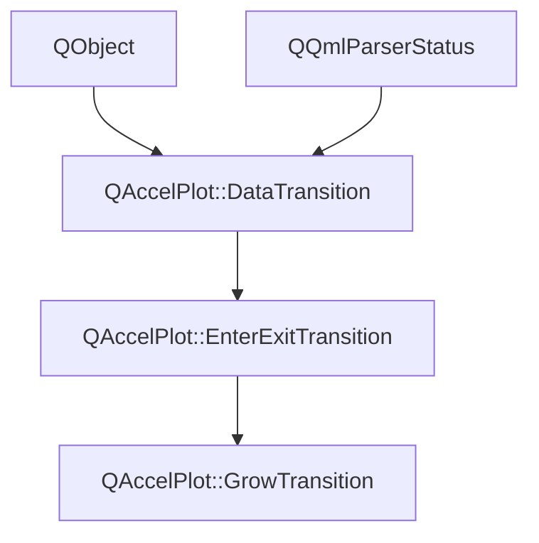

# Class QAccelPlot::GrowTransition


[**ClassList**](annotated.md) **>** [**QAccelPlot**](namespaceQAccelPlot.md) **>** [**GrowTransition**](classQAccelPlot_1_1GrowTransition.md)


_A transition that grows item values from a baseline._ [More...](#detailed-description)

* `#include <GrowTransition.hpp>`


Inherits the following classes: [QAccelPlot::EnterExitTransition](classQAccelPlot_1_1EnterExitTransition.md)


## Inheritance diagram




## Public Properties

| Type | Name |
| ---: | :--- |
| property qreal | [**baseline**](classQAccelPlot_1_1GrowTransition.md#property-baseline-12)  <br>_Value the items grow from, in data units._  |


## Public Properties inherited from QAccelPlot::DataTransition

See [QAccelPlot::DataTransition](classQAccelPlot_1_1DataTransition.md)

| Type | Name |
| ---: | :--- |
| property QQmlListProperty&lt; QObject &gt; | [**animations**](classQAccelPlot_1_1DataTransition.md#property-animations-12)  <br>_Qt Quick animations of the opacity of each item, such as_ `NumberAnimation` _{ property: "opacity" }._ |
| property QML\_ANONYMOUSint | [**duration**](classQAccelPlot_1_1DataTransition.md#property-duration-12)  <br>_Duration of the transition in milliseconds. Default: 300._  |
| property QEasingCurve | [**easing**](classQAccelPlot_1_1DataTransition.md#property-easing-12)  <br>_Easing curve applied to the progress of each item. Default:_ `QEasingCurve::Linear` _._ |
| property bool | [**enabled**](classQAccelPlot_1_1DataTransition.md#property-enabled-12)  <br>_Whether the transition is active. When_ `false` _, the items it animates change instantly._ |
| property bool | [**running**](classQAccelPlot_1_1DataTransition.md#property-running-12)  <br>_Read-only:_ `true` _while the transition is playing on at least one series._ |
| property qreal | [**stagger**](classQAccelPlot_1_1DataTransition.md#property-stagger-12)  <br>_Share of_ `duration` _over which the start times of the items are spread, in [0, 1]._ |


## Public Signals

| Type | Name |
| ---: | :--- |
| signal void | [**baselineChanged**](classQAccelPlot_1_1GrowTransition.md#signal-baselinechanged)  <br>_Emitted when the baseline property changes._  |


## Public Signals inherited from QAccelPlot::DataTransition

See [QAccelPlot::DataTransition](classQAccelPlot_1_1DataTransition.md)

| Type | Name |
| ---: | :--- |
| signal void | [**durationChanged**](classQAccelPlot_1_1DataTransition.md#signal-durationchanged)  <br>_Emitted when the duration property changes._  |
| signal void | [**easingChanged**](classQAccelPlot_1_1DataTransition.md#signal-easingchanged)  <br>_Emitted when the easing property changes._  |
| signal void | [**enabledChanged**](classQAccelPlot_1_1DataTransition.md#signal-enabledchanged)  <br>_Emitted when the enabled property changes._  |
| signal void | [**runningChanged**](classQAccelPlot_1_1DataTransition.md#signal-runningchanged)  <br>_Emitted when the running property changes._  |
| signal void | [**staggerChanged**](classQAccelPlot_1_1DataTransition.md#signal-staggerchanged)  <br>_Emitted when the stagger property changes._  |


## Public Functions

| Type | Name |
| ---: | :--- |
|   | [**GrowTransition**](#function-growtransition) (QObject \* parent=nullptr) <br>_Constructs a_ [_**GrowTransition**_](classQAccelPlot_1_1GrowTransition.md) _with the given__parent_ _._ |
|  qreal | [**baseline**](#function-baseline-22) () const<br>_Returns the baseline, or NaN when the series baseline applies._  |
|  void | [**resetBaseline**](#function-resetbaseline) () <br>_Applies the series baseline again._  |
|  void | [**setBaseline**](#function-setbaseline) (qreal baseline) <br>_Sets the baseline to_ _baseline_ _; NaN applies the series baseline._ |


## Public Functions inherited from QAccelPlot::DataTransition

See [QAccelPlot::DataTransition](classQAccelPlot_1_1DataTransition.md)

| Type | Name |
| ---: | :--- |
|  QQmlListProperty&lt; QObject &gt; | [**animations**](classQAccelPlot_1_1DataTransition.md#function-animations-22) () <br>_Returns the QML list property of the opacity animations._  |
|  void | [**cancel**](classQAccelPlot_1_1DataTransition.md#function-cancel) () <br>_Ends every active run immediately._  |
|  void | [**classBegin**](classQAccelPlot_1_1DataTransition.md#function-classbegin) () override<br>_Holds back the warnings about ignored animations while the component loads._  |
|  void | [**componentComplete**](classQAccelPlot_1_1DataTransition.md#function-componentcomplete) () override<br>_Reports ignored animations once the component is complete._  |
|  int | [**duration**](classQAccelPlot_1_1DataTransition.md#function-duration-22) () const<br>_Returns the animation duration in milliseconds._  |
|  QEasingCurve | [**easing**](classQAccelPlot_1_1DataTransition.md#function-easing-22) () const<br>_Returns the easing curve._  |
|  bool | [**enabled**](classQAccelPlot_1_1DataTransition.md#function-enabled-22) () const<br>_Returns_ `true` _if the transition is enabled._ |
|  double | [**progress**](classQAccelPlot_1_1DataTransition.md#function-progress) (const [**Run**](classQAccelPlot_1_1DataTransition_1_1Run.md) & run) const<br>_Returns the progress of_ _run_ _in [0, 1], before easing._ |
|  bool | [**running**](classQAccelPlot_1_1DataTransition.md#function-running-22) () const<br>_Returns_ `true` _while at least one run is active._ |
|  void | [**setDuration**](classQAccelPlot_1_1DataTransition.md#function-setduration) (int duration) <br>_Sets the animation duration to_ _duration_ _milliseconds._ |
|  void | [**setEasing**](classQAccelPlot_1_1DataTransition.md#function-seteasing) (const QEasingCurve & easing) <br>_Sets the easing curve to_ _easing_ _._ |
|  void | [**setEnabled**](classQAccelPlot_1_1DataTransition.md#function-setenabled) (bool enabled) <br>_Sets the enabled state to_ _enabled_ _._ |
|  void | [**setStagger**](classQAccelPlot_1_1DataTransition.md#function-setstagger) (qreal stagger) <br>_Sets the stagger to_ _stagger_ _, clamped to [0, 1]._ |
|  qreal | [**stagger**](classQAccelPlot_1_1DataTransition.md#function-stagger-22) () const<br>_Returns the share of the duration over which item start times are spread._  |
|  void | [**start**](classQAccelPlot_1_1DataTransition.md#function-start) ([**Run**](classQAccelPlot_1_1DataTransition_1_1Run.md) & run) <br>_Starts_ _run_ _, restarting it if it is already active._ |
|   | [**~DataTransition**](classQAccelPlot_1_1DataTransition.md#function-datatransition) () override<br>_Destroys the transition, ending its runs._  |


## Detailed Description


As an `enterTransition`, the added items grow from `baseline` to their values; as an `exitTransition`, the removed items shrink back to it. Only values grow; positions stay:


|Series  |Grows  |
|-----|-----|
|`LineCurve`, `PointCloud`  |Y  |
|`BarSeries`  |The bar value  |
|`ErrorBarSeries`  |The center and both bounds  |


With `stagger`, the items grow one after another in a wave.


**See also:** [**DrawTransition**](classQAccelPlot_1_1DrawTransition.md), [**MorphTransition**](classQAccelPlot_1_1MorphTransition.md), [**EnterExitTransition**](classQAccelPlot_1_1EnterExitTransition.md) 


    
## Public Properties Documentation


### property baseline {#property-baseline-12}

_Value the items grow from, in data units._ 
```C++
qreal QAccelPlot::GrowTransition::baseline;
```


Unset by default, after a reset, or when NaN: `BarSeries::baselineValue` for bars, 0 for other series. A default the value axis cannot place, infinite or at or below 0 on a log axis, is replaced by the nearest viewport edge. 


        

<hr>
## Public Signals Documentation


### signal baselineChanged {#signal-baselinechanged}

_Emitted when the baseline property changes._ 
```C++
void QAccelPlot::GrowTransition::baselineChanged;
```


<hr>
## Public Functions Documentation


### function GrowTransition {#function-growtransition}

_Constructs a_ [_**GrowTransition**_](classQAccelPlot_1_1GrowTransition.md) _with the given__parent_ _._
```C++
explicit QAccelPlot::GrowTransition::GrowTransition (
    QObject * parent=nullptr
) 
```


<hr>


### function baseline {#function-baseline-22}

_Returns the baseline, or NaN when the series baseline applies._ 
```C++
qreal QAccelPlot::GrowTransition::baseline () const
```


<hr>


### function resetBaseline {#function-resetbaseline}

_Applies the series baseline again._ 
```C++
void QAccelPlot::GrowTransition::resetBaseline () 
```


<hr>


### function setBaseline {#function-setbaseline}

_Sets the baseline to_ _baseline_ _; NaN applies the series baseline._
```C++
void QAccelPlot::GrowTransition::setBaseline (
    qreal baseline
) 
```


<hr>

------------------------------
The documentation for this class was generated from the following file `QAccelPlot/src/QAccelPlot/transitions/GrowTransition.hpp`

