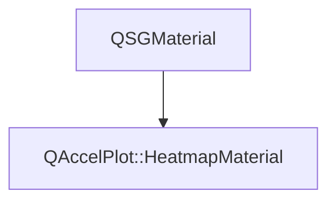

# Class QAccelPlot::HeatmapMaterial


[**ClassList**](annotated.md) **>** [**QAccelPlot**](namespaceQAccelPlot.md) **>** [**HeatmapMaterial**](classQAccelPlot_1_1HeatmapMaterial.md)


_Material that colors each fragment by the value of the heatmap cell under it._ [More...](#detailed-description)

* `#include <HeatmapMaterial.hpp>`


Inherits the following classes: QSGMaterial


## Inheritance diagram




## Public Attributes

| Type | Name |
| ---: | :--- |
|  QVector2D | [**cellOffset**](#variable-celloffset)   = `{0.0f, 0.0f}`<br>_Cell coordinate at item-local pixel (0, 0)._  |
|  QVector2D | [**cellScale**](#variable-cellscale)   = `{1.0f, 1.0f}`<br>_Cells per item-local pixel along X and Y._  |
|  [**GradientTexture**](classQAccelPlot_1_1GradientTexture.md) | [**colorMap**](#variable-colormap)  <br>[_**Colormap**_](classQAccelPlot_1_1Colormap.md) _lookup texture sampled at binding 2._ |
|  int | [**columns**](#variable-columns)   = `{0}`<br>_Cells per row._  |
|  int | [**rows**](#variable-rows)   = `{0}`<br>_Number of rows._  |
|  float | [**valueLogScale**](#variable-valuelogscale)   = `{0.0f}`<br>_1.0 to place values on the ramp in log10 instead of linearly._  |
|  float | [**valueMax**](#variable-valuemax)   = `{1.0f}`<br>_Value mapped to colormap position 1._  |
|  float | [**valueMin**](#variable-valuemin)   = `{0.0f}`<br>_Value mapped to colormap position 0._  |
|  [**DataTexture**](classQAccelPlot_1_1DataTexture.md) | [**values**](#variable-values)  <br>_Cell values, row by row, sampled at binding 1._  |


## Public Functions

| Type | Name |
| ---: | :--- |
|   | [**HeatmapMaterial**](#function-heatmapmaterial) () <br>_Constructs a_ [_**HeatmapMaterial**_](classQAccelPlot_1_1HeatmapMaterial.md) _with blending enabled and batching disabled._ |
|  int | [**compare**](#function-compare) (const QSGMaterial \* other) override const<br>_Compares the uniforms and the texture identities._  |
|  QSGMaterialShader \* | [**createShader**](#function-createshader) (QSGRendererInterface::RenderMode) override const<br>_Creates and returns the heatmap shader program._  |
|  QSGMaterialType \* | [**type**](#function-type) () override const<br>_Returns the unique material type identifier for this class._  |


## Detailed Description


The vertex shader maps item-local pixels to fractional cell coordinates with `cellScale` and `cellOffset`; the fragment shader reads the cell value from `values` and looks up its color in `colorMap`. 


    
## Public Attributes Documentation


### variable cellOffset {#variable-celloffset}

_Cell coordinate at item-local pixel (0, 0)._ 
```C++
QVector2D QAccelPlot::HeatmapMaterial::cellOffset;
```


<hr>


### variable cellScale {#variable-cellscale}

_Cells per item-local pixel along X and Y._ 
```C++
QVector2D QAccelPlot::HeatmapMaterial::cellScale;
```


<hr>


### variable colorMap {#variable-colormap}

[_**Colormap**_](classQAccelPlot_1_1Colormap.md) _lookup texture sampled at binding 2._
```C++
GradientTexture QAccelPlot::HeatmapMaterial::colorMap;
```


<hr>


### variable columns {#variable-columns}

_Cells per row._ 
```C++
int QAccelPlot::HeatmapMaterial::columns;
```


<hr>


### variable rows {#variable-rows}

_Number of rows._ 
```C++
int QAccelPlot::HeatmapMaterial::rows;
```


<hr>


### variable valueLogScale {#variable-valuelogscale}

_1.0 to place values on the ramp in log10 instead of linearly._ 
```C++
float QAccelPlot::HeatmapMaterial::valueLogScale;
```


<hr>


### variable valueMax {#variable-valuemax}

_Value mapped to colormap position 1._ 
```C++
float QAccelPlot::HeatmapMaterial::valueMax;
```


<hr>


### variable valueMin {#variable-valuemin}

_Value mapped to colormap position 0._ 
```C++
float QAccelPlot::HeatmapMaterial::valueMin;
```


<hr>


### variable values {#variable-values}

_Cell values, row by row, sampled at binding 1._ 
```C++
DataTexture QAccelPlot::HeatmapMaterial::values;
```


<hr>
## Public Functions Documentation


### function HeatmapMaterial {#function-heatmapmaterial}

_Constructs a_ [_**HeatmapMaterial**_](classQAccelPlot_1_1HeatmapMaterial.md) _with blending enabled and batching disabled._
```C++
QAccelPlot::HeatmapMaterial::HeatmapMaterial () 
```


<hr>


### function compare {#function-compare}

_Compares the uniforms and the texture identities._ 
```C++
int QAccelPlot::HeatmapMaterial::compare (
    const QSGMaterial * other
) override const
```


<hr>


### function createShader {#function-createshader}

_Creates and returns the heatmap shader program._ 
```C++
QSGMaterialShader * QAccelPlot::HeatmapMaterial::createShader (
    QSGRendererInterface::RenderMode
) override const
```


<hr>


### function type {#function-type}

_Returns the unique material type identifier for this class._ 
```C++
QSGMaterialType * QAccelPlot::HeatmapMaterial::type () override const
```


<hr>

------------------------------
The documentation for this class was generated from the following file `QAccelPlot/src/QAccelPlot/materials/HeatmapMaterial.hpp`

