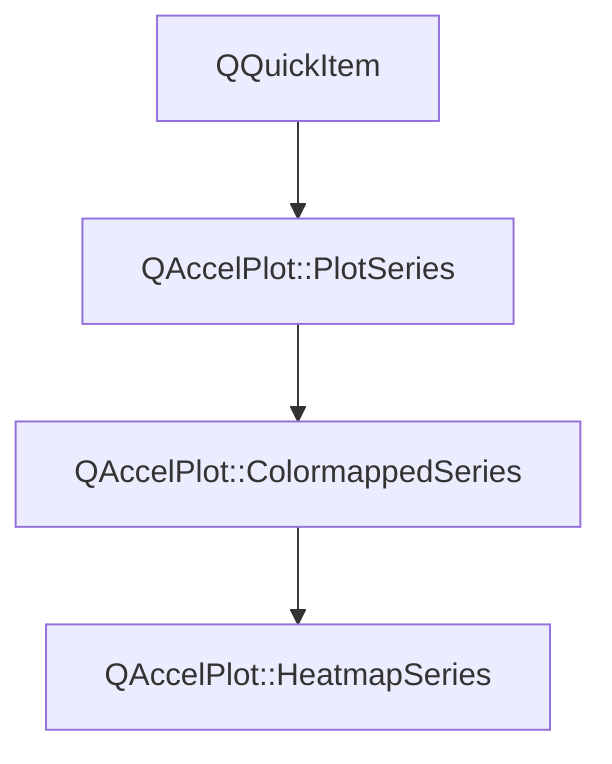

# Class QAccelPlot::HeatmapSeries


[**ClassList**](annotated.md) **>** [**QAccelPlot**](namespaceQAccelPlot.md) **>** [**HeatmapSeries**](classQAccelPlot_1_1HeatmapSeries.md)


_A hardware-accelerated QML item that draws a grid of values as colored cells._ [More...](#detailed-description)

* `#include <HeatmapSeries.hpp>`


Inherits the following classes: [QAccelPlot::ColormappedSeries](classQAccelPlot_1_1ColormappedSeries.md)


## Inheritance diagram




## Public Types

| Type | Name |
| ---: | :--- |
| enum  | [**Spacing**](#enum-spacing)  <br>_How the cells of one dimension are spaced between its grid edges._  |


## Public Types inherited from QAccelPlot::PlotSeries

See [QAccelPlot::PlotSeries](classQAccelPlot_1_1PlotSeries.md)

| Type | Name |
| ---: | :--- |
| enum  | [**LegendSymbol**](classQAccelPlot_1_1PlotSeries.md#enum-legendsymbol)  <br>_Supported default legend symbols._  |
| enum  | [**MarkerShape**](classQAccelPlot_1_1PlotSeries.md#enum-markershape)  <br>_Marker shapes shared by every series that draws markers._  |


## Public Properties

| Type | Name |
| ---: | :--- |
| property int | [**columns**](classQAccelPlot_1_1HeatmapSeries.md#property-columns-12)  <br>_Number of cells per row. Changing it keeps the values and recomputes_ `rows` _. Default: 0._ |
| property int | [**rows**](classQAccelPlot_1_1HeatmapSeries.md#property-rows-12)  <br>_Read-only: number of complete rows of_ `columns` _values._ |
| property qreal | [**xMax**](classQAccelPlot_1_1HeatmapSeries.md#property-xmax-12)  <br>_Right edge of the last column in data coordinates. Unset (NaN) means_ `columns` _. Default: unset._ |
| property qreal | [**xMin**](classQAccelPlot_1_1HeatmapSeries.md#property-xmin-12)  <br>_Left edge of column 0 in data coordinates. Unset (NaN) means 0. Default: unset._  |
| property [**Spacing**](classQAccelPlot_1_1HeatmapSeries.md#enum-spacing) | [**xSpacing**](classQAccelPlot_1_1HeatmapSeries.md#property-xspacing-12)  <br>_How the columns are spaced between_ `xMin` _and_`xMax` _. Default:_`Linear` _._ |
| property qreal | [**yMax**](classQAccelPlot_1_1HeatmapSeries.md#property-ymax-12)  <br>_Top edge of the last row in data coordinates. Unset (NaN) means_ `rows` _. Default: unset._ |
| property qreal | [**yMin**](classQAccelPlot_1_1HeatmapSeries.md#property-ymin-12)  <br>_Bottom edge of row 0 in data coordinates. Unset (NaN) means 0. Default: unset._  |
| property [**Spacing**](classQAccelPlot_1_1HeatmapSeries.md#enum-spacing) | [**ySpacing**](classQAccelPlot_1_1HeatmapSeries.md#property-yspacing-12)  <br>_How the rows are spaced between_ `yMin` _and_`yMax` _. Default:_`Linear` _._ |


## Public Properties inherited from QAccelPlot::ColormappedSeries

See [QAccelPlot::ColormappedSeries](classQAccelPlot_1_1ColormappedSeries.md)

| Type | Name |
| ---: | :--- |
| property [**Colormap**](classQAccelPlot_1_1Colormap.md) \* | [**colormap**](classQAccelPlot_1_1ColormappedSeries.md#property-colormap-12)  <br>_Maps values to colors. What a series draws without one is described by the series._  |
| property qreal | [**dataValueMax**](classQAccelPlot_1_1ColormappedSeries.md#property-datavaluemax-12)  <br>_Read-only: upper bound of the value range, taken from_ `Colormap::max` _when it is set and from the data otherwise._ |
| property qreal | [**dataValueMin**](classQAccelPlot_1_1ColormappedSeries.md#property-datavaluemin-12)  <br>_Read-only: lower bound of the value range, taken from_ `Colormap::min` _when it is set and from the data otherwise._`ColorBar` _labels its ticks from this and_`dataValueMax` _._ |


## Public Properties inherited from QAccelPlot::PlotSeries

See [QAccelPlot::PlotSeries](classQAccelPlot_1_1PlotSeries.md)

| Type | Name |
| ---: | :--- |
| property quint64 | [**dataRevision**](classQAccelPlot_1_1PlotSeries.md#property-datarevision-12)  <br>_Revision incremented by every accepted change of the series' records._  |
| property [**QAccelPlot::SeriesInspection**](classQAccelPlot_1_1SeriesInspection.md) \* | [**inspection**](classQAccelPlot_1_1PlotSeries.md#property-inspection-12)  <br>_Read-only constant: data queries for this series._  |
| property [**LegendSymbol**](classQAccelPlot_1_1PlotSeries.md#enum-legendsymbol) | [**legendSymbol**](classQAccelPlot_1_1PlotSeries.md#property-legendsymbol-12)  <br>_Symbol style requested from the default legend._  |
| property QString | [**name**](classQAccelPlot_1_1PlotSeries.md#property-name-12)  <br>_Identifying name used by the default legend._  |
| property QRectF | [**plotRect**](classQAccelPlot_1_1PlotSeries.md#property-plotrect-12)  <br>_Plot area in parent-item coordinates, assigned by_ `PlotView` _._ |
| property [**Axis**](classQAccelPlot_1_1Axis.md) \* | [**xAxis**](classQAccelPlot_1_1PlotSeries.md#property-xaxis-12)  <br>_Horizontal axis used for data-to-pixel coordinate mapping._  |
| property [**Axis**](classQAccelPlot_1_1Axis.md) \* | [**yAxis**](classQAccelPlot_1_1PlotSeries.md#property-yaxis-12)  <br>_Vertical axis used for data-to-pixel coordinate mapping._  |


## Public Signals

| Type | Name |
| ---: | :--- |
| signal void | [**columnsChanged**](classQAccelPlot_1_1HeatmapSeries.md#signal-columnschanged)  <br>_Emitted when the columns property changes._  |
| signal void | [**rowsChanged**](classQAccelPlot_1_1HeatmapSeries.md#signal-rowschanged)  <br>_Emitted when the rows property changes._  |
| signal void | [**xMaxChanged**](classQAccelPlot_1_1HeatmapSeries.md#signal-xmaxchanged)  <br>_Emitted when the xMax property changes._  |
| signal void | [**xMinChanged**](classQAccelPlot_1_1HeatmapSeries.md#signal-xminchanged)  <br>_Emitted when the xMin property changes._  |
| signal void | [**xSpacingChanged**](classQAccelPlot_1_1HeatmapSeries.md#signal-xspacingchanged)  <br>_Emitted when the xSpacing property changes._  |
| signal void | [**yMaxChanged**](classQAccelPlot_1_1HeatmapSeries.md#signal-ymaxchanged)  <br>_Emitted when the yMax property changes._  |
| signal void | [**yMinChanged**](classQAccelPlot_1_1HeatmapSeries.md#signal-yminchanged)  <br>_Emitted when the yMin property changes._  |
| signal void | [**ySpacingChanged**](classQAccelPlot_1_1HeatmapSeries.md#signal-yspacingchanged)  <br>_Emitted when the ySpacing property changes._  |


## Public Signals inherited from QAccelPlot::ColormappedSeries

See [QAccelPlot::ColormappedSeries](classQAccelPlot_1_1ColormappedSeries.md)

| Type | Name |
| ---: | :--- |
| signal void | [**colormapChanged**](classQAccelPlot_1_1ColormappedSeries.md#signal-colormapchanged)  <br>_Emitted when the colormap property changes._  |
| signal void | [**valueRangeChanged**](classQAccelPlot_1_1ColormappedSeries.md#signal-valuerangechanged)  <br>_Emitted when_ `dataValueMin` _or_`dataValueMax` _changes._ |


## Public Signals inherited from QAccelPlot::PlotSeries

See [QAccelPlot::PlotSeries](classQAccelPlot_1_1PlotSeries.md)

| Type | Name |
| ---: | :--- |
| signal void | [**dataRevisionChanged**](classQAccelPlot_1_1PlotSeries.md#signal-datarevisionchanged)  <br>_Emitted when the dataRevision property changes._  |
| signal void | [**legendEntryChanged**](classQAccelPlot_1_1PlotSeries.md#signal-legendentrychanged)  <br>_Emitted when the result of_ `legendEntry()` _changes._ |
| signal void | [**legendSymbolChanged**](classQAccelPlot_1_1PlotSeries.md#signal-legendsymbolchanged)  <br> |
| signal void | [**nameChanged**](classQAccelPlot_1_1PlotSeries.md#signal-namechanged)  <br> |
| signal void | [**plotRectChanged**](classQAccelPlot_1_1PlotSeries.md#signal-plotrectchanged)  <br> |
| signal void | [**xAxisChanged**](classQAccelPlot_1_1PlotSeries.md#signal-xaxischanged)  <br> |
| signal void | [**yAxisChanged**](classQAccelPlot_1_1PlotSeries.md#signal-yaxischanged)  <br> |


## Public Functions

| Type | Name |
| ---: | :--- |
|   | [**HeatmapSeries**](#function-heatmapseries) (QQuickItem \* parent=nullptr) <br>_Constructs a_ [_**HeatmapSeries**_](classQAccelPlot_1_1HeatmapSeries.md) _with the given__parent_ _._ |
| virtual Q\_INVOKABLE void | [**clearData**](#function-cleardata) () override<br>_Removes all values and keeps_ `columns` _._ |
|  int | [**columns**](#function-columns-22) () const<br>_Returns the number of cells per row._  |
|  void | [**postValues**](#function-postvalues) (std::vector&lt; float &gt; && values, int columns, int rows) <br>_Thread-safe: queues_ `setValues` _(__values_ _,__columns_ _,__rows_ _) to the item's thread._ |
|  int | [**rows**](#function-rows-22) () const<br>_Returns the number of complete rows._  |
|  void | [**setColumns**](#function-setcolumns) (int columns) <br>_Sets the number of cells per row to_ _columns_ _. Negative values are clamped to 0._ |
|  Q\_INVOKABLE void | [**setValues**](#function-setvalues-12) (const QList&lt; qreal &gt; & values, int columns) <br>_Replaces the grid with_ _values_ _, row by row,__columns_ _per row._ |
|  void | [**setValues**](#function-setvalues-22) (std::vector&lt; float &gt; && values, int columns, int rows) <br>_Replaces the grid with_ _columns_ _by__rows_ _values moved from__values_ _, row by row._ |
|  void | [**setXMax**](#function-setxmax) (qreal value) <br>_Sets the right grid edge to_ _value_ _. NaN unsets it._ |
|  void | [**setXMin**](#function-setxmin) (qreal value) <br>_Sets the left grid edge to_ _value_ _. NaN unsets it._ |
|  void | [**setXSpacing**](#function-setxspacing) ([**Spacing**](classQAccelPlot_1_1HeatmapSeries.md#enum-spacing) spacing) <br>_Sets how the columns are spaced to_ _spacing_ _._ |
|  void | [**setYMax**](#function-setymax) (qreal value) <br>_Sets the top grid edge to_ _value_ _. NaN unsets it._ |
|  void | [**setYMin**](#function-setymin) (qreal value) <br>_Sets the bottom grid edge to_ _value_ _. NaN unsets it._ |
|  void | [**setYSpacing**](#function-setyspacing) ([**Spacing**](classQAccelPlot_1_1HeatmapSeries.md#enum-spacing) spacing) <br>_Sets how the rows are spaced to_ _spacing_ _._ |
|  Q\_INVOKABLE qreal | [**valueAt**](#function-valueat) (int row, int column) const<br>_Returns the value of the cell at_ _row_ _and__column_ _, or NaN when it is outside the grid._ |
|  qreal | [**xMax**](#function-xmax-22) () const<br>_Returns the right grid edge, or NaN when unset._  |
|  qreal | [**xMin**](#function-xmin-22) () const<br>_Returns the left grid edge, or NaN when unset._  |
|  [**Spacing**](classQAccelPlot_1_1HeatmapSeries.md#enum-spacing) | [**xSpacing**](#function-xspacing-22) () const<br>_Returns how the columns are spaced._  |
|  qreal | [**yMax**](#function-ymax-22) () const<br>_Returns the top grid edge, or NaN when unset._  |
|  qreal | [**yMin**](#function-ymin-22) () const<br>_Returns the bottom grid edge, or NaN when unset._  |
|  [**Spacing**](classQAccelPlot_1_1HeatmapSeries.md#enum-spacing) | [**ySpacing**](#function-yspacing-22) () const<br>_Returns how the rows are spaced._  |


## Public Functions inherited from QAccelPlot::ColormappedSeries

See [QAccelPlot::ColormappedSeries](classQAccelPlot_1_1ColormappedSeries.md)

| Type | Name |
| ---: | :--- |
|  [**Colormap**](classQAccelPlot_1_1Colormap.md) \* | [**colormap**](classQAccelPlot_1_1ColormappedSeries.md#function-colormap-22) () const<br>_Returns the colormap, or_ `nullptr` _when none is assigned._ |
|  qreal | [**dataValueMax**](classQAccelPlot_1_1ColormappedSeries.md#function-datavaluemax-22) () const<br>_Returns the resolved upper bound of the value range._  |
|  qreal | [**dataValueMin**](classQAccelPlot_1_1ColormappedSeries.md#function-datavaluemin-22) () const<br>_Returns the resolved lower bound of the value range._  |
|  void | [**setColormap**](classQAccelPlot_1_1ColormappedSeries.md#function-setcolormap) ([**Colormap**](classQAccelPlot_1_1Colormap.md) \* colormap) <br>_Sets the colormap to_ _colormap_ _._ |


## Public Functions inherited from QAccelPlot::PlotSeries

See [QAccelPlot::PlotSeries](classQAccelPlot_1_1PlotSeries.md)

| Type | Name |
| ---: | :--- |
|   | [**PlotSeries**](classQAccelPlot_1_1PlotSeries.md#function-plotseries-12) (QQuickItem \* parent=nullptr) <br> |
| virtual void | [**clearData**](classQAccelPlot_1_1PlotSeries.md#function-cleardata) () <br>_Removes all data points from the series._  |
|  quint64 | [**dataRevision**](classQAccelPlot_1_1PlotSeries.md#function-datarevision-22) () const<br>_Returns the current data revision._  |
|  [**SeriesInspection**](classQAccelPlot_1_1SeriesInspection.md) \* | [**inspection**](classQAccelPlot_1_1PlotSeries.md#function-inspection-22) () const<br>_Returns the data queries for this series; created on first use and owned by the series._  |
| virtual std::optional&lt; [**LegendEntry**](structQAccelPlot_1_1LegendEntry.md) &gt; | [**legendEntry**](classQAccelPlot_1_1PlotSeries.md#function-legendentry) () const<br>_Returns how a legend draws the series, or_ `std::nullopt` _for no legend entry. Default: no entry._ |
|  [**LegendSymbol**](classQAccelPlot_1_1PlotSeries.md#enum-legendsymbol) | [**legendSymbol**](classQAccelPlot_1_1PlotSeries.md#function-legendsymbol-22) () const<br> |
|  QString | [**name**](classQAccelPlot_1_1PlotSeries.md#function-name-22) () const<br> |
|  QRectF | [**plotRect**](classQAccelPlot_1_1PlotSeries.md#function-plotrect-22) () const<br> |
|  void | [**postData**](classQAccelPlot_1_1PlotSeries.md#function-postdata-12) (std::vector&lt; double &gt; && data, int count) <br>_Queues a moved double buffer for assignment on the series' thread._  |
|  void | [**postData**](classQAccelPlot_1_1PlotSeries.md#function-postdata-22) (std::vector&lt; float &gt; && data, int count) <br>_Queues a moved float buffer for assignment on the series' thread._  |
|  void | [**setData**](classQAccelPlot_1_1PlotSeries.md#function-setdata-14) (const double \* data, int count) <br>_Replaces the series data with_ _count_ _data points copied from an interleaved double array._ |
|  void | [**setData**](classQAccelPlot_1_1PlotSeries.md#function-setdata-24) (std::vector&lt; double &gt; && data, int count) <br>_Replaces the series data by moving an interleaved double buffer._  |
|  void | [**setData**](classQAccelPlot_1_1PlotSeries.md#function-setdata-34) (const double \* data, int count, const [**DataBounds**](structQAccelPlot_1_1PlotSeries_1_1DataBounds.md) & bounds) <br>_Like_ `setData` _(__data_ _,__count_ _), with the data extents given as__bounds_ _instead of scanned for._ |
|  void | [**setData**](classQAccelPlot_1_1PlotSeries.md#function-setdata-44) (std::vector&lt; double &gt; && data, int count, const [**DataBounds**](structQAccelPlot_1_1PlotSeries_1_1DataBounds.md) & bounds) <br>_Like_ `setData` _(__data_ _,__count_ _), with the data extents given as__bounds_ _instead of scanned for._ |
|  void | [**setDataF**](classQAccelPlot_1_1PlotSeries.md#function-setdataf-14) (const float \* data, int count) <br>_Replaces the series data with_ _count_ _data points copied from an interleaved float array._ |
|  void | [**setDataF**](classQAccelPlot_1_1PlotSeries.md#function-setdataf-24) (std::vector&lt; float &gt; && data, int count) <br>_Replaces the series data by moving an interleaved float buffer._  |
|  void | [**setDataF**](classQAccelPlot_1_1PlotSeries.md#function-setdataf-34) (const float \* data, int count, const [**DataBounds**](structQAccelPlot_1_1PlotSeries_1_1DataBounds.md) & bounds) <br>_Like_ `setDataF` _(__data_ _,__count_ _), with the data extents given as__bounds_ _instead of scanned for._ |
|  void | [**setDataF**](classQAccelPlot_1_1PlotSeries.md#function-setdataf-44) (std::vector&lt; float &gt; && data, int count, const [**DataBounds**](structQAccelPlot_1_1PlotSeries_1_1DataBounds.md) & bounds) <br>_Like_ `setDataF` _(__data_ _,__count_ _), with the data extents given as__bounds_ _instead of scanned for._ |
|  void | [**setLegendSymbol**](classQAccelPlot_1_1PlotSeries.md#function-setlegendsymbol) ([**LegendSymbol**](classQAccelPlot_1_1PlotSeries.md#enum-legendsymbol) symbol) <br> |
|  void | [**setName**](classQAccelPlot_1_1PlotSeries.md#function-setname) (const QString & name) <br> |
|  void | [**setPlotRect**](classQAccelPlot_1_1PlotSeries.md#function-setplotrect) (const QRectF & rect) <br>_Updates the series geometry to exactly cover_ _rect_ _._ |
|  void | [**setXAxis**](classQAccelPlot_1_1PlotSeries.md#function-setxaxis) ([**Axis**](classQAccelPlot_1_1Axis.md) \* axis) <br> |
|  void | [**setYAxis**](classQAccelPlot_1_1PlotSeries.md#function-setyaxis) ([**Axis**](classQAccelPlot_1_1Axis.md) \* axis) <br> |
|  [**Axis**](classQAccelPlot_1_1Axis.md) \* | [**xAxis**](classQAccelPlot_1_1PlotSeries.md#function-xaxis-22) () const<br> |
|  std::optional&lt; [**DataExtent**](structQAccelPlot_1_1PlotSeries_1_1DataExtent.md) &gt; | [**xDataRange**](classQAccelPlot_1_1PlotSeries.md#function-xdatarange) () const<br>_Returns the extent this series reports to its horizontal axis, or_ `std::nullopt` _when it has none._ |
|  [**Axis**](classQAccelPlot_1_1Axis.md) \* | [**yAxis**](classQAccelPlot_1_1PlotSeries.md#function-yaxis-22) () const<br> |
|  std::optional&lt; [**DataExtent**](structQAccelPlot_1_1PlotSeries_1_1DataExtent.md) &gt; | [**yDataRange**](classQAccelPlot_1_1PlotSeries.md#function-ydatarange) () const<br>_Returns the extent this series reports to its vertical axis, or_ `std::nullopt` _when it has none._ |
|   | [**~PlotSeries**](classQAccelPlot_1_1PlotSeries.md#function-plotseries) () override<br> |


## Protected Types inherited from QAccelPlot::PlotSeries

See [QAccelPlot::PlotSeries](classQAccelPlot_1_1PlotSeries.md)

| Type | Name |
| ---: | :--- |
| enum  | [**DataChange**](classQAccelPlot_1_1PlotSeries.md#enum-datachange)  <br>_How the records changed in a data update._  |


## Protected Functions

| Type | Name |
| ---: | :--- |
| virtual void | [**applyDataPoints**](#function-applydatapoints) ([**DataPointInput**](structQAccelPlot_1_1PlotSeries_1_1DataPointInput.md) && input) override<br>_Stores the cell values passed to the_ `PlotSeries` _setters, keeping_`columns` _._ |
| virtual [**DataRanges**](structQAccelPlot_1_1PlotSeries_1_1DataRanges.md) | [**computeDataRanges**](#function-computedataranges) () override const<br>_Returns the grid edges in each dimension; on a log axis from the first cell edge above zero._  |
| virtual int | [**dataPointValueCount**](#function-datapointvaluecount) () override const<br>_Returns 1: the_ `PlotSeries` _setters take one value per cell._ |
| virtual [**InspectionDataPoint**](structQAccelPlot_1_1InspectionDataPoint.md) | [**inspectionDataPointAt**](#function-inspectiondatapointat) (const QPointF & position) override const<br>_Returns the cell drawn at the series-local_ _position_ _as a data point at its center._ |
| virtual [**InspectionRecord**](structQAccelPlot_1_1InspectionRecord.md) | [**inspectionRecord**](#function-inspectionrecord) (int index) override const<br>_Returns the cell record at_ _index_ _._ |
| virtual [**InspectionRecord**](structQAccelPlot_1_1InspectionRecord.md) | [**inspectionRecordAt**](#function-inspectionrecordat) (const QPointF & position) override const<br>_Returns the record of the cell drawn at the series-local_ _position_ _._ |
| virtual void | [**onAxisScaleChanged**](#function-onaxisscalechanged) () override<br>_Repaints, because the mapping from pixels to cells depends on the axis scale._  |
| virtual bool | [**positionInspectionSupported**](#function-positioninspectionsupported) () override const<br>_Returns true: cells are matched by position._  |
| virtual bool | [**recordInspectionSupported**](#function-recordinspectionsupported) () override const<br>_Returns true: cells are inspected as records._  |
| virtual std::optional&lt; [**ValueSpan**](structQAccelPlot_1_1ColormappedSeries_1_1ValueSpan.md) &gt; | [**scanValueRange**](#function-scanvaluerange) () override const<br>_Returns the span of the finite cell values._  |


## Protected Functions inherited from QAccelPlot::ColormappedSeries

See [QAccelPlot::ColormappedSeries](classQAccelPlot_1_1ColormappedSeries.md)

| Type | Name |
| ---: | :--- |
|   | [**ColormappedSeries**](classQAccelPlot_1_1ColormappedSeries.md#function-colormappedseries) ([**DataPointStore::Layout**](structQAccelPlot_1_1DataPointStore_1_1Layout.md) layout, [**DataPointWording**](structQAccelPlot_1_1PlotSeries_1_1DataPointWording.md) wording, QQuickItem \* parent) <br>_Creates a series whose data points have_ _layout_ _;__wording_ _names them in warnings._ |
|  const std::vector&lt; [**GradientStopData**](structQAccelPlot_1_1GradientStopData.md) &gt; & | [**colorStops**](classQAccelPlot_1_1ColormappedSeries.md#function-colorstops) () const<br>_Returns the ramp stops of the colormap, empty without one._  |
| virtual std::optional&lt; [**ValueSpan**](structQAccelPlot_1_1ColormappedSeries_1_1ValueSpan.md) &gt; | [**scanValueRange**](classQAccelPlot_1_1ColormappedSeries.md#function-scanvaluerange) () const<br>_Returns the span of the finite values, or_ `std::nullopt` _when there is none. Default: none._ |
|  void | [**updateValueRange**](classQAccelPlot_1_1ColormappedSeries.md#function-updatevaluerange) () <br>_Resolves the value range again. Call after every change of the values._  |


## Protected Functions inherited from QAccelPlot::PlotSeries

See [QAccelPlot::PlotSeries](classQAccelPlot_1_1PlotSeries.md)

| Type | Name |
| ---: | :--- |
|   | [**PlotSeries**](classQAccelPlot_1_1PlotSeries.md#function-plotseries-22) ([**DataPointStore::Layout**](structQAccelPlot_1_1DataPointStore_1_1Layout.md) layout, [**DataPointWording**](structQAccelPlot_1_1PlotSeries_1_1DataPointWording.md) wording, QQuickItem \* parent) <br>_Creates a series whose data points have_ _layout_ _;__wording_ _names them in warnings._ |
|  void | [**appendDataPoint**](classQAccelPlot_1_1PlotSeries.md#function-appenddatapoint) (const double \* coordinates) <br>_Appends one double data point and widens the data ranges by its valid coordinates._  |
| virtual void | [**applyDataPoints**](classQAccelPlot_1_1PlotSeries.md#function-applydatapoints) ([**DataPointInput**](structQAccelPlot_1_1PlotSeries_1_1DataPointInput.md) && input) <br>_Applies data points passed to_ `setData()` _or_`setDataF()` _._ |
| virtual [**DataRanges**](structQAccelPlot_1_1PlotSeries_1_1DataRanges.md) | [**computeDataRanges**](classQAccelPlot_1_1PlotSeries.md#function-computedataranges) () const<br>_Scans the records for their extents. The default implementation scans the data points._  |
| virtual int | [**dataPointValueCount**](classQAccelPlot_1_1PlotSeries.md#function-datapointvaluecount) () const<br>_Returns the number of values per data point that_ `setData()` _and_`setDataF()` _take._ |
|  [**DataPointStore**](classQAccelPlot_1_1DataPointStore.md) & | [**dataPoints**](classQAccelPlot_1_1PlotSeries.md#function-datapoints-12) () <br>_Returns the data points of the series._  |
|  const [**DataPointStore**](classQAccelPlot_1_1DataPointStore.md) & | [**dataPoints**](classQAccelPlot_1_1PlotSeries.md#function-datapoints-22) () const<br>_Returns the data points of the series._  |
|  bool | [**event**](classQAccelPlot_1_1PlotSeries.md#function-event) (QEvent \* event) override<br>_Withholds hover events from a series beneath another series under the cursor._  |
|  void | [**extendXDataRange**](classQAccelPlot_1_1PlotSeries.md#function-extendxdatarange) (qreal x) <br>_Widens the X extent to include_ _x_ _and notifies the bound axes._ |
|  void | [**extendYDataRange**](classQAccelPlot_1_1PlotSeries.md#function-extendydatarange) (qreal y) <br>_Widens the Y extent to include_ _y_ _. A non-finite__y_ _leaves the extent unchanged._ |
| virtual bool | [**inspectionAvailable**](classQAccelPlot_1_1PlotSeries.md#function-inspectionavailable) () const<br>_Returns false while the records are ambiguous, such as during a data transition. Default: true._  |
|  void | [**inspectionDataChanged**](classQAccelPlot_1_1PlotSeries.md#function-inspectiondatachanged) ([**DataChange**](classQAccelPlot_1_1PlotSeries.md#enum-datachange) change=DataChange::Replaced) <br>_Advances the data revision and refreshes the data queries. Call after every accepted record change._  |
| virtual [**InspectionDataPoint**](structQAccelPlot_1_1InspectionDataPoint.md) | [**inspectionDataPointAt**](classQAccelPlot_1_1PlotSeries.md#function-inspectiondatapointat) (const QPointF & position) const<br>_Returns the record drawn at the series-local_ _position_ _as a data point. Default: unsupported._ |
| virtual [**InspectionRecord**](structQAccelPlot_1_1InspectionRecord.md) | [**inspectionRecord**](classQAccelPlot_1_1PlotSeries.md#function-inspectionrecord) (int index) const<br>_Returns the native record at_ _index_ _for series that are not plain XY series. Default: unsupported._ |
| virtual [**InspectionRecord**](structQAccelPlot_1_1InspectionRecord.md) | [**inspectionRecordAt**](classQAccelPlot_1_1PlotSeries.md#function-inspectionrecordat) (const QPointF & position) const<br>_Returns the native record drawn at the series-local_ _position_ _. Default: unsupported._ |
| virtual [**InspectionSource**](structQAccelPlot_1_1InspectionSource.md) | [**inspectionSource**](classQAccelPlot_1_1PlotSeries.md#function-inspectionsource) () const<br>_Returns a view of the XY records that data point queries search. The default has none._  |
|  void | [**invalidateDataRanges**](classQAccelPlot_1_1PlotSeries.md#function-invalidatedataranges) () <br>_Discards the cached extents and notifies the bound axes._  |
|  void | [**invalidateInspection**](classQAccelPlot_1_1PlotSeries.md#function-invalidateinspection) () <br>_Refreshes the data queries after record validity changed without a data change, such as an axis scale switch._  |
|  bool | [**logScaleX**](classQAccelPlot_1_1PlotSeries.md#function-logscalex) () const<br>_Returns whether the horizontal axis is logarithmic; false without an axis._  |
|  bool | [**logScaleY**](classQAccelPlot_1_1PlotSeries.md#function-logscaley) () const<br>_Returns whether the vertical axis is logarithmic; false without an axis._  |
|  void | [**notifyDataPointsChanged**](classQAccelPlot_1_1PlotSeries.md#function-notifydatapointschanged) ([**DataChange**](classQAccelPlot_1_1PlotSeries.md#enum-datachange) change, int previousCount) <br>_Finishes a change of the data points: data ranges,_ `onDataPointsChanged()` _, data queries, and a repaint._ |
| virtual void | [**onAxisRangeChanged**](classQAccelPlot_1_1PlotSeries.md#function-onaxisrangechanged) () <br>_Called when the viewport of a bound axis changes. The default implementation schedules a repaint._  |
| virtual void | [**onAxisScaleChanged**](classQAccelPlot_1_1PlotSeries.md#function-onaxisscalechanged) () <br>_Called when a bound axis switches between linear and logarithmic scale, or a different axis is bound._  |
| virtual void | [**onDataPointsChanged**](classQAccelPlot_1_1PlotSeries.md#function-ondatapointschanged) ([**DataChange**](classQAccelPlot_1_1PlotSeries.md#enum-datachange) change, int previousCount) <br>_Called after the data points changed, before the data queries are refreshed. The default does nothing._  |
| virtual bool | [**positionInspectionSupported**](classQAccelPlot_1_1PlotSeries.md#function-positioninspectionsupported) () const<br>_Returns whether_ `inspectionDataPointAt()` _matches records drawn as areas, such as heatmap cells. Default: false._ |
| virtual bool | [**recordInspectionSupported**](classQAccelPlot_1_1PlotSeries.md#function-recordinspectionsupported) () const<br>_Returns whether_ `inspectionRecord()` _and_`inspectionRecordAt()` _answer for this series. Default: false._ |
|  QRectF | [**resolvePlotRect**](classQAccelPlot_1_1PlotSeries.md#function-resolveplotrect) () const<br>_Returns the plot area to render into:_ `plotRect` _when set, otherwise the item's current size._ |
|  void | [**storeDataPoints**](classQAccelPlot_1_1PlotSeries.md#function-storedatapoints) ([**DataPointInput**](structQAccelPlot_1_1PlotSeries_1_1DataPointInput.md) && input) <br>_Stores_ _input_ _as the data points and finishes the change._ |
|  bool | [**validateDataSize**](classQAccelPlot_1_1PlotSeries.md#function-validatedatasize) (std::size\_t valueCount, int count, bool floatData, int valuesPerDataPoint=0) const<br>_Returns whether_ _valueCount_ _values hold__count_ _data points; warns otherwise._ |
|  bool | [**validateRawDataArguments**](classQAccelPlot_1_1PlotSeries.md#function-validaterawdataarguments) (const void \* data, int count) const<br>_Returns whether_ _data_ _and__count_ _are valid arguments for copying data points; warns otherwise._ |


## Detailed Description


The grid has `columns` cells per row and `rows` rows of cells. Values are stored row by row: the value of a cell has index `row * columns + column`, with row 0 at `yMin` and column 0 at `xMin`. `xMin`, `xMax`, `yMin`, and `yMax` are the outer edges of the grid; an unset bound places the grid in index space, so column _c_ spans [c, c + 1].


Each cell is colored by mapping its value through `colormap`. The series starts with a Viridis colormap of its own whose range is resolved from the data; assign a shared `Colormap` to replace it. Nothing is drawn while `colormap` is null. The series has no legend entry: a `ColorBar` is its key.


```C++
QAccelPlot.HeatmapSeries {
    xMin: -10; xMax: 10
    yMin: -5; yMax: 5
    // Three columns by two rows.
    Component.onCompleted: setValues([0, 1, 2, 3, 4, 5], 3)
}
```


**
**

`setValues()` replaces the values and the shape together. The `PlotSeries` setters take one value per cell and keep `columns`, so their count must be a multiple of it. `DataBounds` passed to them replace the grid edges as the data range until the values, the shape, or an edge next changes. Values are stored in single precision. `postValues()` and `postData()` may be called from any thread.


**
**

Cells with a non-finite value, and cells with a value at or below zero under a `Log` colormap, are transparent. Non-finite values do not count toward the value range.


**
**

`xSpacing` and `ySpacing` space the cells evenly in data or in log10, independently of the axis scale. On a log axis, `Log` cells have equal widths, `Linear` cells narrow toward larger values, and the parts of cells at or below zero are not drawn; the data range starts at the first cell edge above zero. Under `Log` spacing, both edges of that dimension must be positive, so set them: an unset edge resolves to index space, which starts at 0. Otherwise the series draws nothing, reports no data range in that dimension, and logs a warning.


**
**

`inspection.recordAt()` and `inspection.recordAtPosition()` return a record with the fields `x` and `y` (the cell center, geometric under `Log` spacing), `value`, `row`, and `column`. `inspection.dataPointAtPosition()` returns the cell as a data point at its center, with `index` `row * columns + column`, which `PlotInspector` reports in every mode. A cell with a non-finite value is still a match. While a grid edge is not finite, or not positive under `Log` spacing, `recordAt()` returns `Unavailable` and no position matches a cell.


**
**

Each pixel takes the color of the cell under its center, without interpolation. A grid with an infinite edge draws nothing. A grid of more than 16,777,216 (2^24) columns or rows, or of more cells than the GPU data texture holds, about 67 million for an 8192-pixel texture limit, draws nothing and logs a warning.


**See also:** [**ColormappedSeries**](classQAccelPlot_1_1ColormappedSeries.md), [**Colormap**](classQAccelPlot_1_1Colormap.md), [**ColorBar**](classQAccelPlot_1_1ColorBar.md), [**PlotSeries**](classQAccelPlot_1_1PlotSeries.md) 


    
## Public Types Documentation


### enum Spacing {#enum-spacing}

_How the cells of one dimension are spaced between its grid edges._ 
```C++
enum QAccelPlot::HeatmapSeries::Spacing {
    Linear,
    Log
};
```


<hr>
## Public Properties Documentation


### property columns {#property-columns-12}

_Number of cells per row. Changing it keeps the values and recomputes_ `rows` _. Default: 0._
```C++
int QAccelPlot::HeatmapSeries::columns;
```


Values of an incomplete last row are kept but not drawn or inspected. `setValues()` sets it, so do not bind `columns` while using `setValues()`: the binding reshapes the grid when it is re-evaluated. 


        

<hr>


### property rows {#property-rows-12}

_Read-only: number of complete rows of_ `columns` _values._
```C++
int QAccelPlot::HeatmapSeries::rows;
```


<hr>


### property xMax {#property-xmax-12}

_Right edge of the last column in data coordinates. Unset (NaN) means_ `columns` _. Default: unset._
```C++
qreal QAccelPlot::HeatmapSeries::xMax;
```


<hr>


### property xMin {#property-xmin-12}

_Left edge of column 0 in data coordinates. Unset (NaN) means 0. Default: unset._ 
```C++
qreal QAccelPlot::HeatmapSeries::xMin;
```


<hr>


### property xSpacing {#property-xspacing-12}

_How the columns are spaced between_ `xMin` _and_`xMax` _. Default:_`Linear` _._
```C++
Spacing QAccelPlot::HeatmapSeries::xSpacing;
```


<hr>


### property yMax {#property-ymax-12}

_Top edge of the last row in data coordinates. Unset (NaN) means_ `rows` _. Default: unset._
```C++
qreal QAccelPlot::HeatmapSeries::yMax;
```


<hr>


### property yMin {#property-ymin-12}

_Bottom edge of row 0 in data coordinates. Unset (NaN) means 0. Default: unset._ 
```C++
qreal QAccelPlot::HeatmapSeries::yMin;
```


<hr>


### property ySpacing {#property-yspacing-12}

_How the rows are spaced between_ `yMin` _and_`yMax` _. Default:_`Linear` _._
```C++
Spacing QAccelPlot::HeatmapSeries::ySpacing;
```


<hr>
## Public Signals Documentation


### signal columnsChanged {#signal-columnschanged}

_Emitted when the columns property changes._ 
```C++
void QAccelPlot::HeatmapSeries::columnsChanged;
```


<hr>


### signal rowsChanged {#signal-rowschanged}

_Emitted when the rows property changes._ 
```C++
void QAccelPlot::HeatmapSeries::rowsChanged;
```


<hr>


### signal xMaxChanged {#signal-xmaxchanged}

_Emitted when the xMax property changes._ 
```C++
void QAccelPlot::HeatmapSeries::xMaxChanged;
```


<hr>


### signal xMinChanged {#signal-xminchanged}

_Emitted when the xMin property changes._ 
```C++
void QAccelPlot::HeatmapSeries::xMinChanged;
```


<hr>


### signal xSpacingChanged {#signal-xspacingchanged}

_Emitted when the xSpacing property changes._ 
```C++
void QAccelPlot::HeatmapSeries::xSpacingChanged;
```


<hr>


### signal yMaxChanged {#signal-ymaxchanged}

_Emitted when the yMax property changes._ 
```C++
void QAccelPlot::HeatmapSeries::yMaxChanged;
```


<hr>


### signal yMinChanged {#signal-yminchanged}

_Emitted when the yMin property changes._ 
```C++
void QAccelPlot::HeatmapSeries::yMinChanged;
```


<hr>


### signal ySpacingChanged {#signal-yspacingchanged}

_Emitted when the ySpacing property changes._ 
```C++
void QAccelPlot::HeatmapSeries::ySpacingChanged;
```


<hr>
## Public Functions Documentation


### function HeatmapSeries {#function-heatmapseries}

_Constructs a_ [_**HeatmapSeries**_](classQAccelPlot_1_1HeatmapSeries.md) _with the given__parent_ _._
```C++
explicit QAccelPlot::HeatmapSeries::HeatmapSeries (
    QQuickItem * parent=nullptr
) 
```


<hr>


### function clearData {#function-cleardata}

_Removes all values and keeps_ `columns` _._
```C++
virtual Q_INVOKABLE void QAccelPlot::HeatmapSeries::clearData () override
```


Implements [*QAccelPlot::PlotSeries::clearData*](classQAccelPlot_1_1PlotSeries.md#function-cleardata)


<hr>


### function columns {#function-columns-22}

_Returns the number of cells per row._ 
```C++
int QAccelPlot::HeatmapSeries::columns () const
```


<hr>


### function postValues {#function-postvalues}

_Thread-safe: queues_ `setValues` _(__values_ _,__columns_ _,__rows_ _) to the item's thread._
```C++
void QAccelPlot::HeatmapSeries::postValues (
    std::vector< float > && values,
    int columns,
    int rows
) 
```


<hr>


### function rows {#function-rows-22}

_Returns the number of complete rows._ 
```C++
int QAccelPlot::HeatmapSeries::rows () const
```


<hr>


### function setColumns {#function-setcolumns}

_Sets the number of cells per row to_ _columns_ _. Negative values are clamped to 0._
```C++
void QAccelPlot::HeatmapSeries::setColumns (
    int columns
) 
```


<hr>


### function setValues {#function-setvalues-12}

_Replaces the grid with_ _values_ _, row by row,__columns_ _per row._
```C++
Q_INVOKABLE void QAccelPlot::HeatmapSeries::setValues (
    const QList< qreal > & values,
    int columns
) 
```


The number of values must be a multiple of _columns_. An empty list clears the values and keeps `columns`. Sets `columns` without removing a binding on it, so do not bind `columns` while using this function. 


        

<hr>


### function setValues {#function-setvalues-22}

_Replaces the grid with_ _columns_ _by__rows_ _values moved from__values_ _, row by row._
```C++
void QAccelPlot::HeatmapSeries::setValues (
    std::vector< float > && values,
    int columns,
    int rows
) 
```


<hr>


### function setXMax {#function-setxmax}

_Sets the right grid edge to_ _value_ _. NaN unsets it._
```C++
void QAccelPlot::HeatmapSeries::setXMax (
    qreal value
) 
```


<hr>


### function setXMin {#function-setxmin}

_Sets the left grid edge to_ _value_ _. NaN unsets it._
```C++
void QAccelPlot::HeatmapSeries::setXMin (
    qreal value
) 
```


<hr>


### function setXSpacing {#function-setxspacing}

_Sets how the columns are spaced to_ _spacing_ _._
```C++
void QAccelPlot::HeatmapSeries::setXSpacing (
    Spacing spacing
) 
```


<hr>


### function setYMax {#function-setymax}

_Sets the top grid edge to_ _value_ _. NaN unsets it._
```C++
void QAccelPlot::HeatmapSeries::setYMax (
    qreal value
) 
```


<hr>


### function setYMin {#function-setymin}

_Sets the bottom grid edge to_ _value_ _. NaN unsets it._
```C++
void QAccelPlot::HeatmapSeries::setYMin (
    qreal value
) 
```


<hr>


### function setYSpacing {#function-setyspacing}

_Sets how the rows are spaced to_ _spacing_ _._
```C++
void QAccelPlot::HeatmapSeries::setYSpacing (
    Spacing spacing
) 
```


<hr>


### function valueAt {#function-valueat}

_Returns the value of the cell at_ _row_ _and__column_ _, or NaN when it is outside the grid._
```C++
Q_INVOKABLE qreal QAccelPlot::HeatmapSeries::valueAt (
    int row,
    int column
) const
```


<hr>


### function xMax {#function-xmax-22}

_Returns the right grid edge, or NaN when unset._ 
```C++
qreal QAccelPlot::HeatmapSeries::xMax () const
```


<hr>


### function xMin {#function-xmin-22}

_Returns the left grid edge, or NaN when unset._ 
```C++
qreal QAccelPlot::HeatmapSeries::xMin () const
```


<hr>


### function xSpacing {#function-xspacing-22}

_Returns how the columns are spaced._ 
```C++
Spacing QAccelPlot::HeatmapSeries::xSpacing () const
```


<hr>


### function yMax {#function-ymax-22}

_Returns the top grid edge, or NaN when unset._ 
```C++
qreal QAccelPlot::HeatmapSeries::yMax () const
```


<hr>


### function yMin {#function-ymin-22}

_Returns the bottom grid edge, or NaN when unset._ 
```C++
qreal QAccelPlot::HeatmapSeries::yMin () const
```


<hr>


### function ySpacing {#function-yspacing-22}

_Returns how the rows are spaced._ 
```C++
Spacing QAccelPlot::HeatmapSeries::ySpacing () const
```


<hr>
## Protected Functions Documentation


### function applyDataPoints {#function-applydatapoints}

_Stores the cell values passed to the_ `PlotSeries` _setters, keeping_`columns` _._
```C++
virtual void QAccelPlot::HeatmapSeries::applyDataPoints (
    DataPointInput && input
) override
```


Implements [*QAccelPlot::PlotSeries::applyDataPoints*](classQAccelPlot_1_1PlotSeries.md#function-applydatapoints)


<hr>


### function computeDataRanges {#function-computedataranges}

_Returns the grid edges in each dimension; on a log axis from the first cell edge above zero._ 
```C++
virtual DataRanges QAccelPlot::HeatmapSeries::computeDataRanges () override const
```


Implements [*QAccelPlot::PlotSeries::computeDataRanges*](classQAccelPlot_1_1PlotSeries.md#function-computedataranges)


<hr>


### function dataPointValueCount {#function-datapointvaluecount}

_Returns 1: the_ `PlotSeries` _setters take one value per cell._
```C++
virtual int QAccelPlot::HeatmapSeries::dataPointValueCount () override const
```


Implements [*QAccelPlot::PlotSeries::dataPointValueCount*](classQAccelPlot_1_1PlotSeries.md#function-datapointvaluecount)


<hr>


### function inspectionDataPointAt {#function-inspectiondatapointat}

_Returns the cell drawn at the series-local_ _position_ _as a data point at its center._
```C++
virtual InspectionDataPoint QAccelPlot::HeatmapSeries::inspectionDataPointAt (
    const QPointF & position
) override const
```


Implements [*QAccelPlot::PlotSeries::inspectionDataPointAt*](classQAccelPlot_1_1PlotSeries.md#function-inspectiondatapointat)


<hr>


### function inspectionRecord {#function-inspectionrecord}

_Returns the cell record at_ _index_ _._
```C++
virtual InspectionRecord QAccelPlot::HeatmapSeries::inspectionRecord (
    int index
) override const
```


Implements [*QAccelPlot::PlotSeries::inspectionRecord*](classQAccelPlot_1_1PlotSeries.md#function-inspectionrecord)


<hr>


### function inspectionRecordAt {#function-inspectionrecordat}

_Returns the record of the cell drawn at the series-local_ _position_ _._
```C++
virtual InspectionRecord QAccelPlot::HeatmapSeries::inspectionRecordAt (
    const QPointF & position
) override const
```


Implements [*QAccelPlot::PlotSeries::inspectionRecordAt*](classQAccelPlot_1_1PlotSeries.md#function-inspectionrecordat)


<hr>


### function onAxisScaleChanged {#function-onaxisscalechanged}

_Repaints, because the mapping from pixels to cells depends on the axis scale._ 
```C++
virtual void QAccelPlot::HeatmapSeries::onAxisScaleChanged () override
```


Implements [*QAccelPlot::PlotSeries::onAxisScaleChanged*](classQAccelPlot_1_1PlotSeries.md#function-onaxisscalechanged)


<hr>


### function positionInspectionSupported {#function-positioninspectionsupported}

_Returns true: cells are matched by position._ 
```C++
virtual bool QAccelPlot::HeatmapSeries::positionInspectionSupported () override const
```


Implements [*QAccelPlot::PlotSeries::positionInspectionSupported*](classQAccelPlot_1_1PlotSeries.md#function-positioninspectionsupported)


<hr>


### function recordInspectionSupported {#function-recordinspectionsupported}

_Returns true: cells are inspected as records._ 
```C++
virtual bool QAccelPlot::HeatmapSeries::recordInspectionSupported () override const
```


Implements [*QAccelPlot::PlotSeries::recordInspectionSupported*](classQAccelPlot_1_1PlotSeries.md#function-recordinspectionsupported)


<hr>


### function scanValueRange {#function-scanvaluerange}

_Returns the span of the finite cell values._ 
```C++
virtual std::optional< ValueSpan > QAccelPlot::HeatmapSeries::scanValueRange () override const
```


Implements [*QAccelPlot::ColormappedSeries::scanValueRange*](classQAccelPlot_1_1ColormappedSeries.md#function-scanvaluerange)


<hr>

------------------------------
The documentation for this class was generated from the following file `QAccelPlot/src/QAccelPlot/series/HeatmapSeries.hpp`

