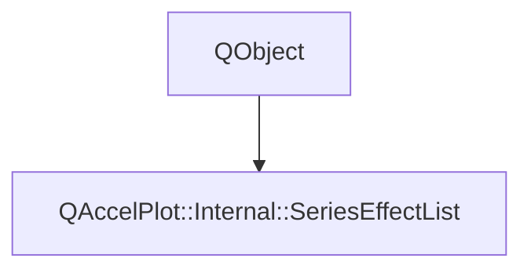

# Class QAccelPlot::Internal::SeriesEffectList


[**ClassList**](annotated.md) **>** [**QAccelPlot**](namespaceQAccelPlot.md) **>** [**Internal**](namespaceQAccelPlot_1_1Internal.md) **>** [**SeriesEffectList**](classQAccelPlot_1_1Internal_1_1SeriesEffectList.md)


_The_ `effects` _list of one series._[More...](#detailed-description)

* `#include <SeriesEffectList.hpp>`


Inherits the following classes: QObject


## Inheritance diagram




## Public Types

| Type | Name |
| ---: | :--- |
| typedef std::function&lt; bool(const [**SeriesEffect**](classQAccelPlot_1_1SeriesEffect.md) &effect)&gt; | [**Supports**](#typedef-supports)  <br>_Returns whether the series draws_ _effect_ _._ |


## Public Functions

| Type | Name |
| ---: | :--- |
|   | [**SeriesEffectList**](#function-serieseffectlist) (QQuickItem \* series, [**Supports**](classQAccelPlot_1_1Internal_1_1SeriesEffectList.md#typedef-supports) supports) <br>_Constructs the list of_ _series_ _, which must outlive it;__supports_ _tells which effects it draws._ |
|  void | [**classBegin**](#function-classbegin) () <br>_Holds back warnings while the series' component loads._  |
|  void | [**componentComplete**](#function-componentcomplete) () <br>_Reports the effects added while the series' component loaded._  |
|  void | [**connectWindow**](#function-connectwindow) (QQuickWindow \* window) <br>_Refreshes the effects once per frame of_ _window_ _._ |
|  const QList&lt; [**SeriesEffect**](classQAccelPlot_1_1SeriesEffect.md) \* &gt; & | [**effects**](#function-effects) () const<br>_Returns the effects in list order, including ignored ones._  |
|  const Effect \* | [**first**](#function-first) () const<br>_Returns the first enabled effect of type_ _Effect_ _, or_`nullptr` _._ |
|  [**GlowStyle**](structQAccelPlot_1_1Internal_1_1GlowStyle.md) | [**glowStyle**](#function-glowstyle) (const QColor & seriesColor) const<br>_Returns the halo of the first enabled_ `Glow` _, in__seriesColor_ _unless it has its own color; none without a_`Glow` _._ |
|  [**ItemTrail**](structQAccelPlot_1_1Internal_1_1ItemTrail.md) | [**itemTrail**](#function-itemtrail) (int itemCount) const<br>_Returns how the first enabled_ `FadeTrail` _fades__itemCount_ _drawn items; none without a_`FadeTrail` _._ |
|  QQmlListProperty&lt; [**SeriesEffect**](classQAccelPlot_1_1SeriesEffect.md) &gt; | [**property**](#function-property) () <br>_Returns the QML list property over the effects._  |


## Detailed Description


Redraws the series when an effect changes, refreshes the effects once per frame, and warns about effects the series ignores: unsupported ones and repeated types. Warnings wait for the series' component to complete, so they can name it by its `objectName`. 


    
## Public Types Documentation


### typedef Supports {#typedef-supports}

_Returns whether the series draws_ _effect_ _._
```C++
using QAccelPlot::Internal::SeriesEffectList::Supports =  std::function<bool(const SeriesEffect& effect)>;
```


<hr>
## Public Functions Documentation


### function SeriesEffectList {#function-serieseffectlist}

_Constructs the list of_ _series_ _, which must outlive it;__supports_ _tells which effects it draws._
```C++
QAccelPlot::Internal::SeriesEffectList::SeriesEffectList (
    QQuickItem * series,
    Supports supports
) 
```


<hr>


### function classBegin {#function-classbegin}

_Holds back warnings while the series' component loads._ 
```C++
void QAccelPlot::Internal::SeriesEffectList::classBegin () 
```


<hr>


### function componentComplete {#function-componentcomplete}

_Reports the effects added while the series' component loaded._ 
```C++
void QAccelPlot::Internal::SeriesEffectList::componentComplete () 
```


<hr>


### function connectWindow {#function-connectwindow}

_Refreshes the effects once per frame of_ _window_ _._
```C++
void QAccelPlot::Internal::SeriesEffectList::connectWindow (
    QQuickWindow * window
) 
```


<hr>


### function effects {#function-effects}

_Returns the effects in list order, including ignored ones._ 
```C++
const QList< SeriesEffect * > & QAccelPlot::Internal::SeriesEffectList::effects () const
```


<hr>


### function first {#function-first}

_Returns the first enabled effect of type_ _Effect_ _, or_`nullptr` _._
```C++
template<typename Effect>
inline const Effect * QAccelPlot::Internal::SeriesEffectList::first () const
```


<hr>


### function glowStyle {#function-glowstyle}

_Returns the halo of the first enabled_ `Glow` _, in__seriesColor_ _unless it has its own color; none without a_`Glow` _._
```C++
GlowStyle QAccelPlot::Internal::SeriesEffectList::glowStyle (
    const QColor & seriesColor
) const
```


<hr>


### function itemTrail {#function-itemtrail}

_Returns how the first enabled_ `FadeTrail` _fades__itemCount_ _drawn items; none without a_`FadeTrail` _._
```C++
ItemTrail QAccelPlot::Internal::SeriesEffectList::itemTrail (
    int itemCount
) const
```


<hr>


### function property {#function-property}

_Returns the QML list property over the effects._ 
```C++
QQmlListProperty< SeriesEffect > QAccelPlot::Internal::SeriesEffectList::property () 
```


<hr>

------------------------------
The documentation for this class was generated from the following file `QAccelPlot/src/QAccelPlot/series/internal/SeriesEffectList.hpp`

