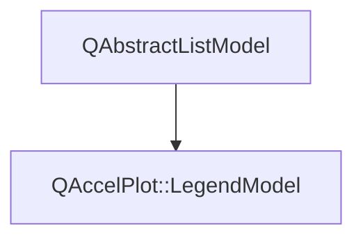

# Class QAccelPlot::LegendModel


[**ClassList**](annotated.md) **>** [**QAccelPlot**](namespaceQAccelPlot.md) **>** [**LegendModel**](classQAccelPlot_1_1LegendModel.md)


_List model of the legend entries of a list of series._ [More...](#detailed-description)

* `#include <LegendModel.hpp>`


Inherits the following classes: QAbstractListModel


## Inheritance diagram




## Public Types

| Type | Name |
| ---: | :--- |
| enum  | [**Role**](#enum-role)  <br>_Data roles; the QML role names are listed in the class description._  |


## Public Properties

| Type | Name |
| ---: | :--- |
| property int | [**count**](classQAccelPlot_1_1LegendModel.md#property-count-12)  <br>_Read-only: number of rows._  |
| property QList&lt;[**::QAccelPlot::PlotSeries**](classQAccelPlot_1_1PlotSeries.md) \* &gt; | [**series**](classQAccelPlot_1_1LegendModel.md#property-series-12)  <br>_Series to list, in legend order. Default: empty._  |


## Public Signals

| Type | Name |
| ---: | :--- |
| signal void | [**countChanged**](classQAccelPlot_1_1LegendModel.md#signal-countchanged)  <br>_Emitted when the number of rows changes._  |
| signal void | [**seriesChanged**](classQAccelPlot_1_1LegendModel.md#signal-serieschanged)  <br>_Emitted when the series property changes._  |


## Public Functions

| Type | Name |
| ---: | :--- |
|   | [**LegendModel**](#function-legendmodel) (QObject \* parent=nullptr) <br>_Constructs an empty model with the given_ _parent_ _._ |
|  int | [**count**](#function-count-22) () const<br>_Returns the number of rows._  |
|  QVariant | [**data**](#function-data) (const QModelIndex & index, int role) override const<br>_Returns the value of_ _role_ _for the row at__index_ _._ |
|  QHash&lt; int, QByteArray &gt; | [**roleNames**](#function-rolenames) () override const<br>_Returns the QML role names._  |
|  int | [**rowCount**](#function-rowcount) (const QModelIndex & parent={}) override const<br>_Returns the number of rows;_ _parent_ _must be invalid._ |
|  QList&lt; [**PlotSeries**](classQAccelPlot_1_1PlotSeries.md) \* &gt; | [**series**](#function-series-22) () const<br>_Returns the listed series._  |
|  void | [**setSeries**](#function-setseries) (const QList&lt; [**PlotSeries**](classQAccelPlot_1_1PlotSeries.md) \* &gt; & series) <br>_Sets the listed series to_ _series_ _._ |


## Detailed Description


Has one row per series in `series` that is visible and returns a `PlotSeries::legendEntry()`. Series without an entry, such as `HeatmapSeries`, and hidden series have no row. Rows follow changes of the series' entries, names, and visibility.


Roles: `series`, `name` (the series' `name`, its `objectName`, or "Series N"), and `entry` (a `LegendEntry`). `Plot` provides one over all its series as `legendModel:` 


```C++
QAccelPlot.Plot {
    id: plot
    legend: QAccelPlot.Legend { model: QAccelPlot.LegendModel { series: [signal, fit] } }
}
```


**See also:** [**LegendEntry**](structQAccelPlot_1_1LegendEntry.md), [**PlotSeries::legendEntry()**](classQAccelPlot_1_1PlotSeries.md#function-legendentry) 


    
## Public Types Documentation


### enum Role {#enum-role}

_Data roles; the QML role names are listed in the class description._ 
```C++
enum QAccelPlot::LegendModel::Role {
    SeriesRole = Qt::UserRole + 1,
    NameRole,
    EntryRole
};
```


<hr>
## Public Properties Documentation


### property count {#property-count-12}

_Read-only: number of rows._ 
```C++
int QAccelPlot::LegendModel::count;
```


<hr>


### property series {#property-series-12}

_Series to list, in legend order. Default: empty._ 
```C++
QList<::QAccelPlot::PlotSeries*> QAccelPlot::LegendModel::series;
```


<hr>
## Public Signals Documentation


### signal countChanged {#signal-countchanged}

_Emitted when the number of rows changes._ 
```C++
void QAccelPlot::LegendModel::countChanged;
```


<hr>


### signal seriesChanged {#signal-serieschanged}

_Emitted when the series property changes._ 
```C++
void QAccelPlot::LegendModel::seriesChanged;
```


<hr>
## Public Functions Documentation


### function LegendModel {#function-legendmodel}

_Constructs an empty model with the given_ _parent_ _._
```C++
explicit QAccelPlot::LegendModel::LegendModel (
    QObject * parent=nullptr
) 
```


<hr>


### function count {#function-count-22}

_Returns the number of rows._ 
```C++
int QAccelPlot::LegendModel::count () const
```


<hr>


### function data {#function-data}

_Returns the value of_ _role_ _for the row at__index_ _._
```C++
QVariant QAccelPlot::LegendModel::data (
    const QModelIndex & index,
    int role
) override const
```


<hr>


### function roleNames {#function-rolenames}

_Returns the QML role names._ 
```C++
QHash< int, QByteArray > QAccelPlot::LegendModel::roleNames () override const
```


<hr>


### function rowCount {#function-rowcount}

_Returns the number of rows;_ _parent_ _must be invalid._
```C++
int QAccelPlot::LegendModel::rowCount (
    const QModelIndex & parent={}
) override const
```


<hr>


### function series {#function-series-22}

_Returns the listed series._ 
```C++
QList< PlotSeries * > QAccelPlot::LegendModel::series () const
```


<hr>


### function setSeries {#function-setseries}

_Sets the listed series to_ _series_ _._
```C++
void QAccelPlot::LegendModel::setSeries (
    const QList< PlotSeries * > & series
) 
```


<hr>

------------------------------
The documentation for this class was generated from the following file `QAccelPlot/src/QAccelPlot/legend/LegendModel.hpp`

