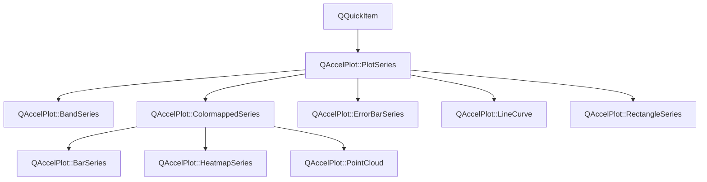

# Class QAccelPlot::PlotSeries


[**ClassList**](annotated.md) **>** [**QAccelPlot**](namespaceQAccelPlot.md) **>** [**PlotSeries**](classQAccelPlot_1_1PlotSeries.md)


_Common QML item contract for data series hosted by_ `PlotView` _._[More...](#detailed-description)

* `#include <PlotSeries.hpp>`


Inherits the following classes: QQuickItem


Inherited by the following classes: [QAccelPlot::BandSeries](classQAccelPlot_1_1BandSeries.md),  [QAccelPlot::ColormappedSeries](classQAccelPlot_1_1ColormappedSeries.md),  [QAccelPlot::ErrorBarSeries](classQAccelPlot_1_1ErrorBarSeries.md),  [QAccelPlot::LineCurve](classQAccelPlot_1_1LineCurve.md),  [QAccelPlot::RectangleSeries](classQAccelPlot_1_1RectangleSeries.md)


## Inheritance diagram




## Classes

| Type | Name |
| ---: | :--- |
| struct | [**DataBounds**](structQAccelPlot_1_1PlotSeries_1_1DataBounds.md) <br>_Extents of a data update that the caller already knows._  |
| struct | [**DataExtent**](structQAccelPlot_1_1PlotSeries_1_1DataExtent.md) <br>_Extent of the valid coordinates in one dimension._  |


## Public Types

| Type | Name |
| ---: | :--- |
| enum  | [**LegendSymbol**](#enum-legendsymbol)  <br>_Supported default legend symbols._  |


## Public Properties

| Type | Name |
| ---: | :--- |
| property int | [**count**](classQAccelPlot_1_1PlotSeries.md#property-count-12)  <br>_Read-only: number of records stored, including invalid ones._  |
| property quint64 | [**dataRevision**](classQAccelPlot_1_1PlotSeries.md#property-datarevision-12)  <br>_Revision incremented by every accepted change of the series' records._  |
| property bool | [**hoverEnabled**](classQAccelPlot_1_1PlotSeries.md#property-hoverenabled-12)  <br>_Whether the series reacts to the mouse cursor. Default:_ `true` _._ |
| property bool | [**hovered**](classQAccelPlot_1_1PlotSeries.md#property-hovered-12)  <br>_Read-only:_ `true` _while the mouse cursor is over the series._ |
| property [**SeriesInspection**](classQAccelPlot_1_1SeriesInspection.md) \* | [**inspection**](classQAccelPlot_1_1PlotSeries.md#property-inspection-12)  <br>_Read-only constant: data queries for this series._  |
| property [**LegendSymbol**](classQAccelPlot_1_1PlotSeries.md#enum-legendsymbol) | [**legendSymbol**](classQAccelPlot_1_1PlotSeries.md#property-legendsymbol-12)  <br>_Symbol style requested from the default legend._  |
| property QString | [**name**](classQAccelPlot_1_1PlotSeries.md#property-name-12)  <br>_Identifying name used by the default legend._  |
| property QRectF | [**plotRect**](classQAccelPlot_1_1PlotSeries.md#property-plotrect-12)  <br>_Plot area in parent-item coordinates, assigned by_ `PlotView` _._ |
| property [**Axis**](classQAccelPlot_1_1Axis.md) \* | [**xAxis**](classQAccelPlot_1_1PlotSeries.md#property-xaxis-12)  <br>_Horizontal axis used for data-to-pixel coordinate mapping._  |
| property [**Axis**](classQAccelPlot_1_1Axis.md) \* | [**yAxis**](classQAccelPlot_1_1PlotSeries.md#property-yaxis-12)  <br>_Vertical axis used for data-to-pixel coordinate mapping._  |


## Public Signals

| Type | Name |
| ---: | :--- |
| signal void | [**countChanged**](classQAccelPlot_1_1PlotSeries.md#signal-countchanged)  <br>_Emitted when the number of records changes._  |
| signal void | [**dataRevisionChanged**](classQAccelPlot_1_1PlotSeries.md#signal-datarevisionchanged)  <br>_Emitted when the dataRevision property changes._  |
| signal void | [**hoverEnabledChanged**](classQAccelPlot_1_1PlotSeries.md#signal-hoverenabledchanged)  <br>_Emitted when the hoverEnabled property changes._  |
| signal void | [**hoveredChanged**](classQAccelPlot_1_1PlotSeries.md#signal-hoveredchanged)  <br>_Emitted when the hovered property changes._  |
| signal void | [**legendEntryChanged**](classQAccelPlot_1_1PlotSeries.md#signal-legendentrychanged)  <br>_Emitted when the result of_ `legendEntry()` _changes._ |
| signal void | [**legendSymbolChanged**](classQAccelPlot_1_1PlotSeries.md#signal-legendsymbolchanged)  <br> |
| signal void | [**nameChanged**](classQAccelPlot_1_1PlotSeries.md#signal-namechanged)  <br> |
| signal void | [**plotRectChanged**](classQAccelPlot_1_1PlotSeries.md#signal-plotrectchanged)  <br> |
| signal void | [**xAxisChanged**](classQAccelPlot_1_1PlotSeries.md#signal-xaxischanged)  <br> |
| signal void | [**yAxisChanged**](classQAccelPlot_1_1PlotSeries.md#signal-yaxischanged)  <br> |


## Public Functions

| Type | Name |
| ---: | :--- |
|   | [**PlotSeries**](#function-plotseries-12) (QQuickItem \* parent=nullptr) <br> |
| virtual void | [**clearData**](#function-cleardata) () <br>_Removes all data points from the series._  |
| virtual int | [**count**](#function-count-22) () const<br>_Returns the number of records stored. The default is the number of stored data points._  |
|  quint64 | [**dataRevision**](#function-datarevision-22) () const<br>_Returns the current data revision._  |
|  bool | [**hoverEnabled**](#function-hoverenabled-22) () const<br>_Returns whether the series reacts to the mouse cursor._  |
|  bool | [**hovered**](#function-hovered-22) () const<br>_Returns whether the mouse cursor is over the series._  |
|  [**SeriesInspection**](classQAccelPlot_1_1SeriesInspection.md) \* | [**inspection**](#function-inspection-22) () const<br>_Returns the data queries for this series; created on first use and owned by the series._  |
| virtual std::optional&lt; [**LegendEntry**](structQAccelPlot_1_1LegendEntry.md) &gt; | [**legendEntry**](#function-legendentry) () const<br>_Returns how a legend draws the series, or_ `std::nullopt` _for no legend entry. Default: no entry._ |
|  [**LegendSymbol**](classQAccelPlot_1_1PlotSeries.md#enum-legendsymbol) | [**legendSymbol**](#function-legendsymbol-22) () const<br> |
|  QString | [**name**](#function-name-22) () const<br> |
|  QRectF | [**plotRect**](#function-plotrect-22) () const<br> |
|  void | [**postData**](#function-postdata-12) (std::vector&lt; double &gt; && data, int count) <br>_Queues a moved double buffer for assignment on the series' thread._  |
|  void | [**postData**](#function-postdata-22) (std::vector&lt; float &gt; && data, int count) <br>_Queues a moved float buffer for assignment on the series' thread._  |
|  void | [**setData**](#function-setdata-14) (const double \* data, int count) <br>_Replaces the series data with_ _count_ _data points copied from an interleaved double array._ |
|  void | [**setData**](#function-setdata-24) (std::vector&lt; double &gt; && data, int count) <br>_Replaces the series data by moving an interleaved double buffer._  |
|  void | [**setData**](#function-setdata-34) (const double \* data, int count, const [**DataBounds**](structQAccelPlot_1_1PlotSeries_1_1DataBounds.md) & bounds) <br>_Like_ `setData` _(__data_ _,__count_ _), with the data extents given as__bounds_ _instead of scanned for._ |
|  void | [**setData**](#function-setdata-44) (std::vector&lt; double &gt; && data, int count, const [**DataBounds**](structQAccelPlot_1_1PlotSeries_1_1DataBounds.md) & bounds) <br>_Like_ `setData` _(__data_ _,__count_ _), with the data extents given as__bounds_ _instead of scanned for._ |
|  void | [**setDataF**](#function-setdataf-14) (const float \* data, int count) <br>_Replaces the series data with_ _count_ _data points copied from an interleaved float array._ |
|  void | [**setDataF**](#function-setdataf-24) (std::vector&lt; float &gt; && data, int count) <br>_Replaces the series data by moving an interleaved float buffer._  |
|  void | [**setDataF**](#function-setdataf-34) (const float \* data, int count, const [**DataBounds**](structQAccelPlot_1_1PlotSeries_1_1DataBounds.md) & bounds) <br>_Like_ `setDataF` _(__data_ _,__count_ _), with the data extents given as__bounds_ _instead of scanned for._ |
|  void | [**setDataF**](#function-setdataf-44) (std::vector&lt; float &gt; && data, int count, const [**DataBounds**](structQAccelPlot_1_1PlotSeries_1_1DataBounds.md) & bounds) <br>_Like_ `setDataF` _(__data_ _,__count_ _), with the data extents given as__bounds_ _instead of scanned for._ |
|  void | [**setHoverEnabled**](#function-sethoverenabled) (bool enabled) <br>_Sets whether the series reacts to the mouse cursor to_ _enabled_ _._ |
|  void | [**setLegendSymbol**](#function-setlegendsymbol) ([**LegendSymbol**](classQAccelPlot_1_1PlotSeries.md#enum-legendsymbol) symbol) <br> |
|  void | [**setName**](#function-setname) (const QString & name) <br> |
|  void | [**setPlotRect**](#function-setplotrect) (const QRectF & rect) <br>_Updates the series geometry to exactly cover_ _rect_ _._ |
|  void | [**setXAxis**](#function-setxaxis) ([**Axis**](classQAccelPlot_1_1Axis.md) \* axis) <br> |
|  void | [**setYAxis**](#function-setyaxis) ([**Axis**](classQAccelPlot_1_1Axis.md) \* axis) <br> |
|  [**Axis**](classQAccelPlot_1_1Axis.md) \* | [**xAxis**](#function-xaxis-22) () const<br> |
|  std::optional&lt; [**DataExtent**](structQAccelPlot_1_1PlotSeries_1_1DataExtent.md) &gt; | [**xDataRange**](#function-xdatarange) () const<br>_Returns the extent this series reports to its horizontal axis, or_ `std::nullopt` _when it has none._ |
|  [**Axis**](classQAccelPlot_1_1Axis.md) \* | [**yAxis**](#function-yaxis-22) () const<br> |
|  std::optional&lt; [**DataExtent**](structQAccelPlot_1_1PlotSeries_1_1DataExtent.md) &gt; | [**yDataRange**](#function-ydatarange) () const<br>_Returns the extent this series reports to its vertical axis, or_ `std::nullopt` _when it has none._ |
|   | [**~PlotSeries**](#function-plotseries) () override<br> |


## Protected Types

| Type | Name |
| ---: | :--- |
| enum  | [**CapacityOverflow**](#enum-capacityoverflow)  <br>_What a series draws when its records outgrow its GPU capacity._  |
| enum  | [**DataChange**](#enum-datachange)  <br>_How the records changed in a data update._  |


## Protected Attributes

| Type | Name |
| ---: | :--- |
|  bool | [**overRenderCapacity\_**](#variable-overrendercapacity_)   = `{false}`<br>_Whether the record count of the last_ `updateRenderCapacity()` _exceeded_`renderCapacity_` _._ |
|  int | [**renderCapacity\_**](#variable-rendercapacity_)   = `{std::numeric\_limits&lt;int&gt;::max()}`<br>_Records the GPU buffers hold, as of the last_ `updateRenderCapacity()` _; the largest_`int` _before the first._ |


## Protected Functions

| Type | Name |
| ---: | :--- |
|   | [**PlotSeries**](#function-plotseries-22) ([**DataPointStore::Layout**](structQAccelPlot_1_1DataPointStore_1_1Layout.md) layout, [**DataPointWording**](structQAccelPlot_1_1PlotSeries_1_1DataPointWording.md) wording, QQuickItem \* parent) <br>_Creates a series whose data points have_ _layout_ _;__wording_ _names them in warnings._ |
|  void | [**appendDataPoint**](#function-appenddatapoint) (const double \* coordinates) <br>_Appends one double data point and widens the data ranges by its valid coordinates._  |
| virtual void | [**applyDataPoints**](#function-applydatapoints) ([**DataPointInput**](structQAccelPlot_1_1PlotSeries_1_1DataPointInput.md) && input) <br>_Applies data points passed to_ `setData()` _or_`setDataF()` _._ |
| virtual [**DataRanges**](structQAccelPlot_1_1PlotSeries_1_1DataRanges.md) | [**computeDataRanges**](#function-computedataranges) () const<br>_Scans the records for their extents. The default implementation scans the data points._  |
| virtual int | [**dataPointValueCount**](#function-datapointvaluecount) () const<br>_Returns the number of values per data point that_ `setData()` _and_`setDataF()` _take._ |
|  [**DataPointStore**](classQAccelPlot_1_1DataPointStore.md) & | [**dataPoints**](#function-datapoints-12) () <br>_Returns the data points of the series._  |
|  const [**DataPointStore**](classQAccelPlot_1_1DataPointStore.md) & | [**dataPoints**](#function-datapoints-22) () const<br>_Returns the data points of the series._  |
|  bool | [**event**](#function-event) (QEvent \* event) override<br>_Withholds hover events from a series beneath another series under the cursor._  |
|  void | [**extendXDataRange**](#function-extendxdatarange) (qreal x) <br>_Widens the X extent to include_ _x_ _and notifies the bound axes._ |
|  void | [**extendYDataRange**](#function-extendydatarange) (qreal y) <br>_Widens the Y extent to include_ _y_ _. A non-finite__y_ _leaves the extent unchanged._ |
| virtual bool | [**inspectionAvailable**](#function-inspectionavailable) () const<br>_Returns false while the records are ambiguous, such as during a data transition. Default: true._  |
|  void | [**inspectionDataChanged**](#function-inspectiondatachanged) ([**DataChange**](classQAccelPlot_1_1PlotSeries.md#enum-datachange) change=DataChange::Replaced) <br>_Advances the data revision and refreshes the data queries. Call after every accepted record change._  |
| virtual [**InspectionDataPoint**](structQAccelPlot_1_1InspectionDataPoint.md) | [**inspectionDataPointAt**](#function-inspectiondatapointat) (const QPointF & position) const<br>_Returns the record drawn at the series-local_ _position_ _as a data point. Default: unsupported._ |
| virtual [**InspectionRecord**](structQAccelPlot_1_1InspectionRecord.md) | [**inspectionRecord**](#function-inspectionrecord) (int index) const<br>_Returns the native record at_ _index_ _for series that are not plain XY series. Default: unsupported._ |
| virtual [**InspectionRecord**](structQAccelPlot_1_1InspectionRecord.md) | [**inspectionRecordAt**](#function-inspectionrecordat) (const QPointF & position) const<br>_Returns the native record drawn at the series-local_ _position_ _. Default: unsupported._ |
| virtual [**Internal::InspectionSource**](structQAccelPlot_1_1Internal_1_1InspectionSource.md) | [**inspectionSource**](#function-inspectionsource) () const<br>_Returns a view of the XY records that data point queries search. The default has none._  |
|  void | [**invalidateDataRanges**](#function-invalidatedataranges) () <br>_Discards the cached extents and notifies the bound axes._  |
|  void | [**invalidateInspection**](#function-invalidateinspection) () <br>_Refreshes the data queries after record validity changed without a data change, such as an axis scale switch._  |
|  bool | [**logScaleX**](#function-logscalex) () const<br>_Returns whether the horizontal axis is logarithmic; false without an axis._  |
|  bool | [**logScaleY**](#function-logscaley) () const<br>_Returns whether the vertical axis is logarithmic; false without an axis._  |
|  void | [**notifyDataPointsChanged**](#function-notifydatapointschanged) ([**DataChange**](classQAccelPlot_1_1PlotSeries.md#enum-datachange) change, int previousCount) <br>_Finishes a change of the data points: data ranges,_ `onDataPointsChanged()` _,_`countChanged()` _, data queries, and a repaint._ |
| virtual void | [**onAxisRangeChanged**](#function-onaxisrangechanged) () <br>_Called when the viewport of a bound axis changes. The default implementation schedules a repaint._  |
| virtual void | [**onAxisScaleChanged**](#function-onaxisscalechanged) () <br>_Called when a bound axis switches between linear and logarithmic scale, or a different axis is bound._  |
| virtual void | [**onDataPointsChanged**](#function-ondatapointschanged) ([**DataChange**](classQAccelPlot_1_1PlotSeries.md#enum-datachange) change, int previousCount) <br>_Called after the data points changed, before the data queries are refreshed. The default does nothing._  |
| virtual bool | [**positionInspectionSupported**](#function-positioninspectionsupported) () const<br>_Returns whether_ `inspectionDataPointAt()` _matches records drawn as areas, such as heatmap cells. Default: false._ |
| virtual bool | [**recordInspectionSupported**](#function-recordinspectionsupported) () const<br>_Returns whether_ `inspectionRecord()` _and_`inspectionRecordAt()` _answer for this series. Default: false._ |
|  QRectF | [**resolvePlotRect**](#function-resolveplotrect) () const<br>_Returns the plot area to render into:_ `plotRect` _when set, otherwise the item's current size._ |
|  void | [**setHovered**](#function-sethovered) (bool hovered) <br>_Sets the hovered property to_ _hovered_ _. Called by the hover handling of a series._ |
|  void | [**storeDataPoints**](#function-storedatapoints) ([**DataPointInput**](structQAccelPlot_1_1PlotSeries_1_1DataPointInput.md) && input) <br>_Stores_ _input_ _as the data points and finishes the change._ |
|  void | [**supportHover**](#function-supporthover) () <br>_Makes the series accept hover events while_ `hoverEnabled` _is_`true` _._ |
|  void | [**updateRenderCapacity**](#function-updaterendercapacity) (int capacity, int recordCount, [**CapacityOverflow**](classQAccelPlot_1_1PlotSeries.md#enum-capacityoverflow) overflow=CapacityOverflow::DropsExcess) <br>_Stores_ _capacity_ _, the number of records the GPU buffers hold, and warns when__recordCount_ _newly exceeds it._ |
|  bool | [**validateDataSize**](#function-validatedatasize) (std::size\_t valueCount, int count, bool floatData, int valuesPerDataPoint=0) const<br>_Returns whether_ _valueCount_ _values hold__count_ _data points; warns otherwise._ |
|  bool | [**validateRawDataArguments**](#function-validaterawdataarguments) (const void \* data, int count) const<br>_Returns whether_ _data_ _and__count_ _are valid arguments for copying data points; warns otherwise._ |


## Detailed Description


[**PlotSeries**](classQAccelPlot_1_1PlotSeries.md) owns the integration shared by every plot type: axis bindings, plot-area layout, data-range reporting, legend metadata, and a common C++ data-setting API backed by the series' data points. Concrete series define their data point layout, rendering, and hit testing.


`setData()`, `setDataF()`, and `postData()` take interleaved values, one data point after another, in the layout of the series:


|Series   |Data point   |Values    |
|-----|-----|-----|
|`LineCurve`   |(x, y)   |2    |
|`PointCloud`   |(x, y)   |2    |
|`RectangleSeries`   |(x1, y1, x2, y2)   |4    |
|`BarSeries`   |(position, value)   |2    |
|`BandSeries`   |(x, low, high)   |3    |
|`ErrorBarSeries`   |(x, y, low, high)   |4    |
|`HeatmapSeries`   |cell value   |1   |


The buffer holds _count_ times that many values. A `HeatmapSeries` takes its cells row by row, `columns` per row. Series-specific setters take other layouts, such as point values, categories, or ranged bars.


Series smooth their edges with the inherited `antialiasing` property. `HeatmapSeries` ignores it.


|Series   |Default `antialiasing`   |Smoothed edges    |
|-----|-----|-----|
|`LineCurve`   |`true`   |lines and markers    |
|`PointCloud`   |`true`   |markers    |
|`BandSeries`   |`true`   |edge lines    |
|`ErrorBarSeries`   |`true`   |lines and caps    |
|`RectangleSeries`   |`false`   |rectangles and their border    |
|`BarSeries`   |`false`   |bars and their border   |


**See also:** [**LineCurve**](classQAccelPlot_1_1LineCurve.md), [**PointCloud**](classQAccelPlot_1_1PointCloud.md), [**RectangleSeries**](classQAccelPlot_1_1RectangleSeries.md), [**BarSeries**](classQAccelPlot_1_1BarSeries.md), [**BandSeries**](classQAccelPlot_1_1BandSeries.md), [**ErrorBarSeries**](classQAccelPlot_1_1ErrorBarSeries.md), [**HeatmapSeries**](classQAccelPlot_1_1HeatmapSeries.md), QAccelPlot 


    
## Public Types Documentation


### enum LegendSymbol {#enum-legendsymbol}

_Supported default legend symbols._ 
```C++
enum QAccelPlot::PlotSeries::LegendSymbol {
    Line,
    Fill,
    Marker
};
```


`Line` draws the series line style and marker, `Fill` a filled swatch, and `Marker` only the series marker shape (used by unconnected series such as `PointCloud`). 


        

<hr>
## Public Properties Documentation


### property count {#property-count-12}

_Read-only: number of records stored, including invalid ones._ 
```C++
int QAccelPlot::PlotSeries::count;
```


A record is one data point of the layout in the class description: a point of a `LineCurve` or `PointCloud`, a rectangle, a bar, a band sample, an error bar, or a heatmap cell. A `HeatmapSeries` counts `columns` × `rows` cells, without an incomplete last row. 


        

<hr>


### property dataRevision {#property-datarevision-12}

_Revision incremented by every accepted change of the series' records._ 
```C++
quint64 QAccelPlot::PlotSeries::dataRevision;
```


<hr>


### property hoverEnabled {#property-hoverenabled-12}

_Whether the series reacts to the mouse cursor. Default:_ `true` _._
```C++
bool QAccelPlot::PlotSeries::hoverEnabled;
```


When `false`, the series is never hovered and hover reaches the series beneath it. `QACCELPLOT_HOVER_ENABLED=0` turns hover off for every series regardless of this property. `HeatmapSeries` has no hover and ignores it. 


        

<hr>


### property hovered {#property-hovered-12}

_Read-only:_ `true` _while the mouse cursor is over the series._
```C++
bool QAccelPlot::PlotSeries::hovered;
```


Only the topmost series under the cursor is hovered. A series with a `hoveredIndex` is hovered while that index is not -1. A `HeatmapSeries` is never hovered. 


        

<hr>


### property inspection {#property-inspection-12}

_Read-only constant: data queries for this series._ 
```C++
SeriesInspection* QAccelPlot::PlotSeries::inspection;
```


<hr>


### property legendSymbol {#property-legendsymbol-12}

_Symbol style requested from the default legend._ 
```C++
LegendSymbol QAccelPlot::PlotSeries::legendSymbol;
```


<hr>


### property name {#property-name-12}

_Identifying name used by the default legend._ 
```C++
QString QAccelPlot::PlotSeries::name;
```


<hr>


### property plotRect {#property-plotrect-12}

_Plot area in parent-item coordinates, assigned by_ `PlotView` _._
```C++
QRectF QAccelPlot::PlotSeries::plotRect;
```


<hr>


### property xAxis {#property-xaxis-12}

_Horizontal axis used for data-to-pixel coordinate mapping._ 
```C++
Axis* QAccelPlot::PlotSeries::xAxis;
```


<hr>


### property yAxis {#property-yaxis-12}

_Vertical axis used for data-to-pixel coordinate mapping._ 
```C++
Axis* QAccelPlot::PlotSeries::yAxis;
```


<hr>
## Public Signals Documentation


### signal countChanged {#signal-countchanged}

_Emitted when the number of records changes._ 
```C++
void QAccelPlot::PlotSeries::countChanged;
```


<hr>


### signal dataRevisionChanged {#signal-datarevisionchanged}

_Emitted when the dataRevision property changes._ 
```C++
void QAccelPlot::PlotSeries::dataRevisionChanged;
```


<hr>


### signal hoverEnabledChanged {#signal-hoverenabledchanged}

_Emitted when the hoverEnabled property changes._ 
```C++
void QAccelPlot::PlotSeries::hoverEnabledChanged;
```


<hr>


### signal hoveredChanged {#signal-hoveredchanged}

_Emitted when the hovered property changes._ 
```C++
void QAccelPlot::PlotSeries::hoveredChanged;
```


<hr>


### signal legendEntryChanged {#signal-legendentrychanged}

_Emitted when the result of_ `legendEntry()` _changes._
```C++
void QAccelPlot::PlotSeries::legendEntryChanged;
```


<hr>


### signal legendSymbolChanged {#signal-legendsymbolchanged}

```C++
void QAccelPlot::PlotSeries::legendSymbolChanged;
```


<hr>


### signal nameChanged {#signal-namechanged}

```C++
void QAccelPlot::PlotSeries::nameChanged;
```


<hr>


### signal plotRectChanged {#signal-plotrectchanged}

```C++
void QAccelPlot::PlotSeries::plotRectChanged;
```


<hr>


### signal xAxisChanged {#signal-xaxischanged}

```C++
void QAccelPlot::PlotSeries::xAxisChanged;
```


<hr>


### signal yAxisChanged {#signal-yaxischanged}

```C++
void QAccelPlot::PlotSeries::yAxisChanged;
```


<hr>
## Public Functions Documentation


### function PlotSeries {#function-plotseries-12}

```C++
explicit QAccelPlot::PlotSeries::PlotSeries (
    QQuickItem * parent=nullptr
) 
```


<hr>


### function clearData {#function-cleardata}

_Removes all data points from the series._ 
```C++
virtual void QAccelPlot::PlotSeries::clearData () 
```


<hr>


### function count {#function-count-22}

_Returns the number of records stored. The default is the number of stored data points._ 
```C++
virtual int QAccelPlot::PlotSeries::count () const
```


<hr>


### function dataRevision {#function-datarevision-22}

_Returns the current data revision._ 
```C++
quint64 QAccelPlot::PlotSeries::dataRevision () const
```


<hr>


### function hoverEnabled {#function-hoverenabled-22}

_Returns whether the series reacts to the mouse cursor._ 
```C++
bool QAccelPlot::PlotSeries::hoverEnabled () const
```


<hr>


### function hovered {#function-hovered-22}

_Returns whether the mouse cursor is over the series._ 
```C++
bool QAccelPlot::PlotSeries::hovered () const
```


<hr>


### function inspection {#function-inspection-22}

_Returns the data queries for this series; created on first use and owned by the series._ 
```C++
SeriesInspection * QAccelPlot::PlotSeries::inspection () const
```


<hr>


### function legendEntry {#function-legendentry}

_Returns how a legend draws the series, or_ `std::nullopt` _for no legend entry. Default: no entry._
```C++
virtual std::optional< LegendEntry > QAccelPlot::PlotSeries::legendEntry () const
```


Series that override it emit `legendEntryChanged()` whenever the result changes. 


        

<hr>


### function legendSymbol {#function-legendsymbol-22}

```C++
LegendSymbol QAccelPlot::PlotSeries::legendSymbol () const
```


<hr>


### function name {#function-name-22}

```C++
QString QAccelPlot::PlotSeries::name () const
```


<hr>


### function plotRect {#function-plotrect-22}

```C++
QRectF QAccelPlot::PlotSeries::plotRect () const
```


<hr>


### function postData {#function-postdata-12}

_Queues a moved double buffer for assignment on the series' thread._ 
```C++
void QAccelPlot::PlotSeries::postData (
    std::vector< double > && data,
    int count
) 
```


<hr>


### function postData {#function-postdata-22}

_Queues a moved float buffer for assignment on the series' thread._ 
```C++
void QAccelPlot::PlotSeries::postData (
    std::vector< float > && data,
    int count
) 
```


<hr>


### function setData {#function-setdata-14}

_Replaces the series data with_ _count_ _data points copied from an interleaved double array._
```C++
void QAccelPlot::PlotSeries::setData (
    const double * data,
    int count
) 
```


See the class description for the data point layout of each series. 


        

<hr>


### function setData {#function-setdata-24}

_Replaces the series data by moving an interleaved double buffer._ 
```C++
void QAccelPlot::PlotSeries::setData (
    std::vector< double > && data,
    int count
) 
```


<hr>


### function setData {#function-setdata-34}

_Like_ `setData` _(__data_ _,__count_ _), with the data extents given as__bounds_ _instead of scanned for._
```C++
void QAccelPlot::PlotSeries::setData (
    const double * data,
    int count,
    const DataBounds & bounds
) 
```


<hr>


### function setData {#function-setdata-44}

_Like_ `setData` _(__data_ _,__count_ _), with the data extents given as__bounds_ _instead of scanned for._
```C++
void QAccelPlot::PlotSeries::setData (
    std::vector< double > && data,
    int count,
    const DataBounds & bounds
) 
```


<hr>


### function setDataF {#function-setdataf-14}

_Replaces the series data with_ _count_ _data points copied from an interleaved float array._
```C++
void QAccelPlot::PlotSeries::setDataF (
    const float * data,
    int count
) 
```


<hr>


### function setDataF {#function-setdataf-24}

_Replaces the series data by moving an interleaved float buffer._ 
```C++
void QAccelPlot::PlotSeries::setDataF (
    std::vector< float > && data,
    int count
) 
```


<hr>


### function setDataF {#function-setdataf-34}

_Like_ `setDataF` _(__data_ _,__count_ _), with the data extents given as__bounds_ _instead of scanned for._
```C++
void QAccelPlot::PlotSeries::setDataF (
    const float * data,
    int count,
    const DataBounds & bounds
) 
```


<hr>


### function setDataF {#function-setdataf-44}

_Like_ `setDataF` _(__data_ _,__count_ _), with the data extents given as__bounds_ _instead of scanned for._
```C++
void QAccelPlot::PlotSeries::setDataF (
    std::vector< float > && data,
    int count,
    const DataBounds & bounds
) 
```


<hr>


### function setHoverEnabled {#function-sethoverenabled}

_Sets whether the series reacts to the mouse cursor to_ _enabled_ _._
```C++
void QAccelPlot::PlotSeries::setHoverEnabled (
    bool enabled
) 
```


Turning hover off while the series is hovered clears its hover state at once. 


        

<hr>


### function setLegendSymbol {#function-setlegendsymbol}

```C++
void QAccelPlot::PlotSeries::setLegendSymbol (
    LegendSymbol symbol
) 
```


<hr>


### function setName {#function-setname}

```C++
void QAccelPlot::PlotSeries::setName (
    const QString & name
) 
```


<hr>


### function setPlotRect {#function-setplotrect}

_Updates the series geometry to exactly cover_ _rect_ _._
```C++
void QAccelPlot::PlotSeries::setPlotRect (
    const QRectF & rect
) 
```


<hr>


### function setXAxis {#function-setxaxis}

```C++
void QAccelPlot::PlotSeries::setXAxis (
    Axis * axis
) 
```


<hr>


### function setYAxis {#function-setyaxis}

```C++
void QAccelPlot::PlotSeries::setYAxis (
    Axis * axis
) 
```


<hr>


### function xAxis {#function-xaxis-22}

```C++
Axis * QAccelPlot::PlotSeries::xAxis () const
```


<hr>


### function xDataRange {#function-xdatarange}

_Returns the extent this series reports to its horizontal axis, or_ `std::nullopt` _when it has none._
```C++
std::optional< DataExtent > QAccelPlot::PlotSeries::xDataRange () const
```


The first read after a data update scans the records, unless the update came with `DataBounds`. 


        

<hr>


### function yAxis {#function-yaxis-22}

```C++
Axis * QAccelPlot::PlotSeries::yAxis () const
```


<hr>


### function yDataRange {#function-ydatarange}

_Returns the extent this series reports to its vertical axis, or_ `std::nullopt` _when it has none._
```C++
std::optional< DataExtent > QAccelPlot::PlotSeries::yDataRange () const
```


<hr>


### function ~PlotSeries {#function-plotseries}

```C++
QAccelPlot::PlotSeries::~PlotSeries () override
```


<hr>
## Protected Types Documentation


### enum CapacityOverflow {#enum-capacityoverflow}

_What a series draws when its records outgrow its GPU capacity._ 
```C++
enum QAccelPlot::PlotSeries::CapacityOverflow {
    DropsExcess,
    DropsAll
};
```


<hr>


### enum DataChange {#enum-datachange}

_How the records changed in a data update._ 
```C++
enum QAccelPlot::PlotSeries::DataChange {
    Replaced,
    Appended
};
```


<hr>
## Protected Attributes Documentation


### variable overRenderCapacity\_ {#variable-overrendercapacity_}

_Whether the record count of the last_ `updateRenderCapacity()` _exceeded_`renderCapacity_` _._
```C++
bool QAccelPlot::PlotSeries::overRenderCapacity_;
```


<hr>


### variable renderCapacity\_ {#variable-rendercapacity_}

_Records the GPU buffers hold, as of the last_ `updateRenderCapacity()` _; the largest_`int` _before the first._
```C++
int QAccelPlot::PlotSeries::renderCapacity_;
```


<hr>
## Protected Functions Documentation


### function PlotSeries {#function-plotseries-22}

_Creates a series whose data points have_ _layout_ _;__wording_ _names them in warnings._
```C++
QAccelPlot::PlotSeries::PlotSeries (
    DataPointStore::Layout layout,
    DataPointWording wording,
    QQuickItem * parent
) 
```


<hr>


### function appendDataPoint {#function-appenddatapoint}

_Appends one double data point and widens the data ranges by its valid coordinates._ 
```C++
void QAccelPlot::PlotSeries::appendDataPoint (
    const double * coordinates
) 
```


<hr>


### function applyDataPoints {#function-applydatapoints}

_Applies data points passed to_ `setData()` _or_`setDataF()` _._
```C++
virtual void QAccelPlot::PlotSeries::applyDataPoints (
    DataPointInput && input
) 
```


The default stores them; series that animate data changes override it. 


        

<hr>


### function computeDataRanges {#function-computedataranges}

_Scans the records for their extents. The default implementation scans the data points._ 
```C++
virtual DataRanges QAccelPlot::PlotSeries::computeDataRanges () const
```


Called when a data range is read after `invalidateDataRanges()`, so a series that nothing asks for its range never scans. 


        

<hr>


### function dataPointValueCount {#function-datapointvaluecount}

_Returns the number of values per data point that_ `setData()` _and_`setDataF()` _take._
```C++
virtual int QAccelPlot::PlotSeries::dataPointValueCount () const
```


The default is one per coordinate column. 


        

<hr>


### function dataPoints {#function-datapoints-12}

_Returns the data points of the series._ 
```C++
DataPointStore & QAccelPlot::PlotSeries::dataPoints () 
```


<hr>


### function dataPoints {#function-datapoints-22}

_Returns the data points of the series._ 
```C++
const DataPointStore & QAccelPlot::PlotSeries::dataPoints () const
```


<hr>


### function event {#function-event}

_Withholds hover events from a series beneath another series under the cursor._ 
```C++
bool QAccelPlot::PlotSeries::event (
    QEvent * event
) override
```


Series ignore hover events so that the plot receives them too. Qt Quick 6.3 and newer stop at the topmost hovered item anyway; older versions also deliver the event to the series beneath, which then see a hover leave instead. 


        

<hr>


### function extendXDataRange {#function-extendxdatarange}

_Widens the X extent to include_ _x_ _and notifies the bound axes._
```C++
void QAccelPlot::PlotSeries::extendXDataRange (
    qreal x
) 
```


Lets an append-style ingestion path keep computed extents current in O(1) instead of rescanning the whole buffer. A non-finite _x_ leaves the extent unchanged. 


        

<hr>


### function extendYDataRange {#function-extendydatarange}

_Widens the Y extent to include_ _y_ _. A non-finite__y_ _leaves the extent unchanged._
```C++
void QAccelPlot::PlotSeries::extendYDataRange (
    qreal y
) 
```


<hr>


### function inspectionAvailable {#function-inspectionavailable}

_Returns false while the records are ambiguous, such as during a data transition. Default: true._ 
```C++
virtual bool QAccelPlot::PlotSeries::inspectionAvailable () const
```


<hr>


### function inspectionDataChanged {#function-inspectiondatachanged}

_Advances the data revision and refreshes the data queries. Call after every accepted record change._ 
```C++
void QAccelPlot::PlotSeries::inspectionDataChanged (
    DataChange change=DataChange::Replaced
) 
```


<hr>


### function inspectionDataPointAt {#function-inspectiondatapointat}

_Returns the record drawn at the series-local_ _position_ _as a data point. Default: unsupported._
```C++
virtual InspectionDataPoint QAccelPlot::PlotSeries::inspectionDataPointAt (
    const QPointF & position
) const
```


<hr>


### function inspectionRecord {#function-inspectionrecord}

_Returns the native record at_ _index_ _for series that are not plain XY series. Default: unsupported._
```C++
virtual InspectionRecord QAccelPlot::PlotSeries::inspectionRecord (
    int index
) const
```


<hr>


### function inspectionRecordAt {#function-inspectionrecordat}

_Returns the native record drawn at the series-local_ _position_ _. Default: unsupported._
```C++
virtual InspectionRecord QAccelPlot::PlotSeries::inspectionRecordAt (
    const QPointF & position
) const
```


<hr>


### function inspectionSource {#function-inspectionsource}

_Returns a view of the XY records that data point queries search. The default has none._ 
```C++
virtual Internal::InspectionSource QAccelPlot::PlotSeries::inspectionSource () const
```


<hr>


### function invalidateDataRanges {#function-invalidatedataranges}

_Discards the cached extents and notifies the bound axes._ 
```C++
void QAccelPlot::PlotSeries::invalidateDataRanges () 
```


Call after every change of the records, or of anything else `computeDataRanges()` depends on. 


        

<hr>


### function invalidateInspection {#function-invalidateinspection}

_Refreshes the data queries after record validity changed without a data change, such as an axis scale switch._ 
```C++
void QAccelPlot::PlotSeries::invalidateInspection () 
```


<hr>


### function logScaleX {#function-logscalex}

_Returns whether the horizontal axis is logarithmic; false without an axis._ 
```C++
bool QAccelPlot::PlotSeries::logScaleX () const
```


<hr>


### function logScaleY {#function-logscaley}

_Returns whether the vertical axis is logarithmic; false without an axis._ 
```C++
bool QAccelPlot::PlotSeries::logScaleY () const
```


<hr>


### function notifyDataPointsChanged {#function-notifydatapointschanged}

_Finishes a change of the data points: data ranges,_ `onDataPointsChanged()` _,_`countChanged()` _, data queries, and a repaint._
```C++
void QAccelPlot::PlotSeries::notifyDataPointsChanged (
    DataChange change,
    int previousCount
) 
```


<hr>


### function onAxisRangeChanged {#function-onaxisrangechanged}

_Called when the viewport of a bound axis changes. The default implementation schedules a repaint._ 
```C++
virtual void QAccelPlot::PlotSeries::onAxisRangeChanged () 
```


<hr>


### function onAxisScaleChanged {#function-onaxisscalechanged}

_Called when a bound axis switches between linear and logarithmic scale, or a different axis is bound._ 
```C++
virtual void QAccelPlot::PlotSeries::onAxisScaleChanged () 
```


Log scale changes which data points are valid. The data ranges of a changed scale are already invalidated; series override this to refresh cached geometry. The default implementation does nothing. 


        

<hr>


### function onDataPointsChanged {#function-ondatapointschanged}

_Called after the data points changed, before the data queries are refreshed. The default does nothing._ 
```C++
virtual void QAccelPlot::PlotSeries::onDataPointsChanged (
    DataChange change,
    int previousCount
) 
```


<hr>


### function positionInspectionSupported {#function-positioninspectionsupported}

_Returns whether_ `inspectionDataPointAt()` _matches records drawn as areas, such as heatmap cells. Default: false._
```C++
virtual bool QAccelPlot::PlotSeries::positionInspectionSupported () const
```


<hr>


### function recordInspectionSupported {#function-recordinspectionsupported}

_Returns whether_ `inspectionRecord()` _and_`inspectionRecordAt()` _answer for this series. Default: false._
```C++
virtual bool QAccelPlot::PlotSeries::recordInspectionSupported () const
```


<hr>


### function resolvePlotRect {#function-resolveplotrect}

_Returns the plot area to render into:_ `plotRect` _when set, otherwise the item's current size._
```C++
QRectF QAccelPlot::PlotSeries::resolvePlotRect () const
```


Safe to call from `updatePaintNode()`; it never modifies the item. 


        

<hr>


### function setHovered {#function-sethovered}

_Sets the hovered property to_ _hovered_ _. Called by the hover handling of a series._
```C++
void QAccelPlot::PlotSeries::setHovered (
    bool hovered
) 
```


<hr>


### function storeDataPoints {#function-storedatapoints}

_Stores_ _input_ _as the data points and finishes the change._
```C++
void QAccelPlot::PlotSeries::storeDataPoints (
    DataPointInput && input
) 
```


<hr>


### function supportHover {#function-supporthover}

_Makes the series accept hover events while_ `hoverEnabled` _is_`true` _._
```C++
void QAccelPlot::PlotSeries::supportHover () 
```


Call from the constructor of a series that reacts to the cursor. Its `hoverLeaveEvent()` must clear the hover state, `hovered` included, as turning `hoverEnabled` off calls it. 


        

<hr>


### function updateRenderCapacity {#function-updaterendercapacity}

_Stores_ _capacity_ _, the number of records the GPU buffers hold, and warns when__recordCount_ _newly exceeds it._
```C++
void QAccelPlot::PlotSeries::updateRenderCapacity (
    int capacity,
    int recordCount,
    CapacityOverflow overflow=CapacityOverflow::DropsExcess
) 
```


Call from `updatePaintNode()` on every frame. A series that stays over capacity, for example while streaming, warns once; one whose data fits again and then outgrows the capacity warns again. _overflow_ says in the warning what the series draws. 


        

<hr>


### function validateDataSize {#function-validatedatasize}

_Returns whether_ _valueCount_ _values hold__count_ _data points; warns otherwise._
```C++
bool QAccelPlot::PlotSeries::validateDataSize (
    std::size_t valueCount,
    int count,
    bool floatData,
    int valuesPerDataPoint=0
) const
```


A data point has _valuesPerDataPoint_ values, or one per coordinate column when it is 0. 


        

<hr>


### function validateRawDataArguments {#function-validaterawdataarguments}

_Returns whether_ _data_ _and__count_ _are valid arguments for copying data points; warns otherwise._
```C++
bool QAccelPlot::PlotSeries::validateRawDataArguments (
    const void * data,
    int count
) const
```


<hr>

------------------------------
The documentation for this class was generated from the following file `QAccelPlot/src/QAccelPlot/series/PlotSeries.hpp`

