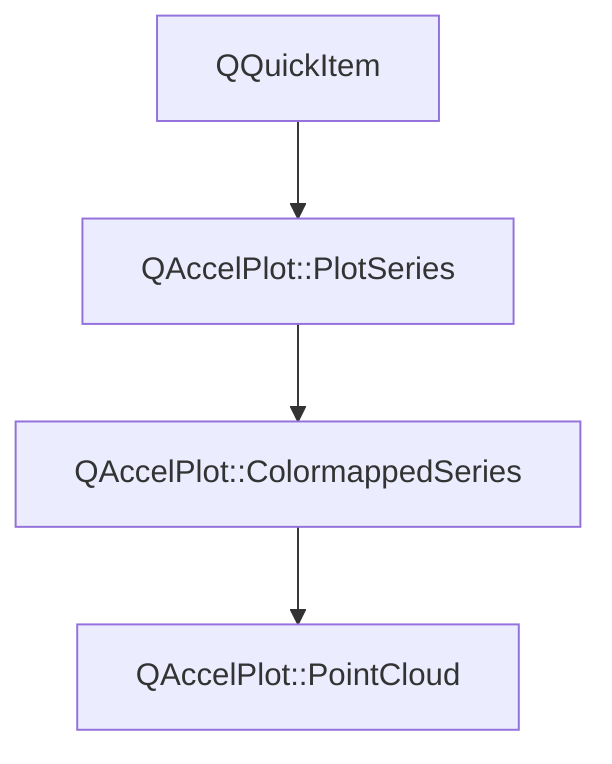

# Class QAccelPlot::PointCloud


[**ClassList**](annotated.md) **>** [**QAccelPlot**](namespaceQAccelPlot.md) **>** [**PointCloud**](classQAccelPlot_1_1PointCloud.md)


_A hardware-accelerated QML item that renders large sets of unconnected 2D points as markers._ [More...](#detailed-description)

* `#include <PointCloud.hpp>`


Inherits the following classes: [QAccelPlot::ColormappedSeries](classQAccelPlot_1_1ColormappedSeries.md)


## Inheritance diagram




## Public Types inherited from QAccelPlot::PlotSeries

See [QAccelPlot::PlotSeries](classQAccelPlot_1_1PlotSeries.md)

| Type | Name |
| ---: | :--- |
| enum  | [**LegendSymbol**](classQAccelPlot_1_1PlotSeries.md#enum-legendsymbol)  <br>_Supported default legend symbols._  |
| enum  | [**MarkerShape**](classQAccelPlot_1_1PlotSeries.md#enum-markershape)  <br>_Marker shapes shared by every series that draws markers._  |


## Public Properties

| Type | Name |
| ---: | :--- |
| property bool | [**antialiasingEnabled**](classQAccelPlot_1_1PointCloud.md#property-antialiasingenabled-12)  <br>_Whether GPU-side anti-aliasing is applied to markers. Default:_ `true` _._ |
| property qreal | [**antialiasingFeather**](classQAccelPlot_1_1PointCloud.md#property-antialiasingfeather-12)  <br>_Anti-aliasing feather width in pixels, clamped to [0, 10]. Default: 1._  |
| property QColor | [**color**](classQAccelPlot_1_1PointCloud.md#property-color-12)  <br>_Uniform marker color, also used by the legend. Default:_ `Colors.dark.seriesPrimary` _._ |
| property int | [**count**](classQAccelPlot_1_1PointCloud.md#property-count-12)  <br>_Read-only: number of points currently stored, including invalid ones._  |
| property bool | [**hasValues**](classQAccelPlot_1_1PointCloud.md#property-hasvalues-12)  <br>_Read-only:_ `true` _when per-point values are stored._ |
| property qreal | [**hoverRadius**](classQAccelPlot_1_1PointCloud.md#property-hoverradius-12)  <br>_Pick radius in pixels used for hover detection. Default: 6._  |
| property int | [**hoveredIndex**](classQAccelPlot_1_1PointCloud.md#property-hoveredindex-12)  <br>_Read-only: index of the point under the cursor, or -1 when none._  |
| property [**SeriesMarker**](classQAccelPlot_1_1SeriesMarker.md) \* | [**marker**](classQAccelPlot_1_1PointCloud.md#property-marker-12)  <br>_Grouped marker settings, e.g._ `marker.shape` _and_`marker.size` _._`marker.shape` _defaults to_`Circle` _and does not accept_`None` _, because a cloud always draws markers;_`marker.size` _defaults to 3._ |
| property [**DataTransition**](classQAccelPlot_1_1DataTransition.md) \* | [**transition**](classQAccelPlot_1_1PointCloud.md#property-transition-12)  <br>_Optional data transition animation applied when new data arrives._  |


## Public Properties inherited from QAccelPlot::ColormappedSeries

See [QAccelPlot::ColormappedSeries](classQAccelPlot_1_1ColormappedSeries.md)

| Type | Name |
| ---: | :--- |
| property [**Colormap**](classQAccelPlot_1_1Colormap.md) \* | [**colormap**](classQAccelPlot_1_1ColormappedSeries.md#property-colormap-12)  <br>_Maps values to colors. What a series draws without one is described by the series._  |
| property qreal | [**dataValueMax**](classQAccelPlot_1_1ColormappedSeries.md#property-datavaluemax-12)  <br>_Read-only: upper bound of the value range, taken from_ `Colormap::max` _when it is set and from the data otherwise._ |
| property qreal | [**dataValueMin**](classQAccelPlot_1_1ColormappedSeries.md#property-datavaluemin-12)  <br>_Read-only: lower bound of the value range, taken from_ `Colormap::min` _when it is set and from the data otherwise._`ColorBar` _labels its ticks from this and_`dataValueMax` _._ |


## Public Properties inherited from QAccelPlot::PlotSeries

See [QAccelPlot::PlotSeries](classQAccelPlot_1_1PlotSeries.md)

| Type | Name |
| ---: | :--- |
| property quint64 | [**dataRevision**](classQAccelPlot_1_1PlotSeries.md#property-datarevision-12)  <br>_Revision incremented by every accepted change of the series' records._  |
| property [**QAccelPlot::SeriesInspection**](classQAccelPlot_1_1SeriesInspection.md) \* | [**inspection**](classQAccelPlot_1_1PlotSeries.md#property-inspection-12)  <br>_Read-only constant: data queries for this series._  |
| property [**LegendSymbol**](classQAccelPlot_1_1PlotSeries.md#enum-legendsymbol) | [**legendSymbol**](classQAccelPlot_1_1PlotSeries.md#property-legendsymbol-12)  <br>_Symbol style requested from the default legend._  |
| property QString | [**name**](classQAccelPlot_1_1PlotSeries.md#property-name-12)  <br>_Identifying name used by the default legend._  |
| property QRectF | [**plotRect**](classQAccelPlot_1_1PlotSeries.md#property-plotrect-12)  <br>_Plot area in parent-item coordinates, assigned by_ `PlotView` _._ |
| property [**Axis**](classQAccelPlot_1_1Axis.md) \* | [**xAxis**](classQAccelPlot_1_1PlotSeries.md#property-xaxis-12)  <br>_Horizontal axis used for data-to-pixel coordinate mapping._  |
| property [**Axis**](classQAccelPlot_1_1Axis.md) \* | [**yAxis**](classQAccelPlot_1_1PlotSeries.md#property-yaxis-12)  <br>_Vertical axis used for data-to-pixel coordinate mapping._  |


## Public Signals

| Type | Name |
| ---: | :--- |
| signal void | [**antialiasingEnabledChanged**](classQAccelPlot_1_1PointCloud.md#signal-antialiasingenabledchanged)  <br>_Emitted when the antialiasingEnabled property changes._  |
| signal void | [**antialiasingFeatherChanged**](classQAccelPlot_1_1PointCloud.md#signal-antialiasingfeatherchanged)  <br>_Emitted when the antialiasingFeather property changes._  |
| signal void | [**colorChanged**](classQAccelPlot_1_1PointCloud.md#signal-colorchanged)  <br>_Emitted when the color property changes._  |
| signal void | [**countChanged**](classQAccelPlot_1_1PointCloud.md#signal-countchanged)  <br>_Emitted when the number of points or the presence of values changes._  |
| signal void | [**hoverRadiusChanged**](classQAccelPlot_1_1PointCloud.md#signal-hoverradiuschanged)  <br>_Emitted when the hoverRadius property changes._  |
| signal void | [**hoveredIndexChanged**](classQAccelPlot_1_1PointCloud.md#signal-hoveredindexchanged)  <br>_Emitted when the hovered point changes._  |
| signal void | [**transitionChanged**](classQAccelPlot_1_1PointCloud.md#signal-transitionchanged)  <br>_Emitted when the transition property changes._  |


## Public Signals inherited from QAccelPlot::ColormappedSeries

See [QAccelPlot::ColormappedSeries](classQAccelPlot_1_1ColormappedSeries.md)

| Type | Name |
| ---: | :--- |
| signal void | [**colormapChanged**](classQAccelPlot_1_1ColormappedSeries.md#signal-colormapchanged)  <br>_Emitted when the colormap property changes._  |
| signal void | [**valueRangeChanged**](classQAccelPlot_1_1ColormappedSeries.md#signal-valuerangechanged)  <br>_Emitted when_ `dataValueMin` _or_`dataValueMax` _changes._ |


## Public Signals inherited from QAccelPlot::PlotSeries

See [QAccelPlot::PlotSeries](classQAccelPlot_1_1PlotSeries.md)

| Type | Name |
| ---: | :--- |
| signal void | [**dataRevisionChanged**](classQAccelPlot_1_1PlotSeries.md#signal-datarevisionchanged)  <br>_Emitted when the dataRevision property changes._  |
| signal void | [**legendEntryChanged**](classQAccelPlot_1_1PlotSeries.md#signal-legendentrychanged)  <br>_Emitted when the result of_ `legendEntry()` _changes._ |
| signal void | [**legendSymbolChanged**](classQAccelPlot_1_1PlotSeries.md#signal-legendsymbolchanged)  <br> |
| signal void | [**nameChanged**](classQAccelPlot_1_1PlotSeries.md#signal-namechanged)  <br> |
| signal void | [**plotRectChanged**](classQAccelPlot_1_1PlotSeries.md#signal-plotrectchanged)  <br> |
| signal void | [**xAxisChanged**](classQAccelPlot_1_1PlotSeries.md#signal-xaxischanged)  <br> |
| signal void | [**yAxisChanged**](classQAccelPlot_1_1PlotSeries.md#signal-yaxischanged)  <br> |


## Public Functions

| Type | Name |
| ---: | :--- |
|   | [**PointCloud**](#function-pointcloud) (QQuickItem \* parent=nullptr) <br>_Constructs a_ [_**PointCloud**_](classQAccelPlot_1_1PointCloud.md) _with the given__parent_ _._ |
|  bool | [**antialiasingEnabled**](#function-antialiasingenabled-22) () const<br>_Returns_ `true` _when GPU anti-aliasing is enabled._ |
|  qreal | [**antialiasingFeather**](#function-antialiasingfeather-22) () const<br>_Returns the anti-aliasing feather width._  |
| virtual Q\_INVOKABLE void | [**clearData**](#function-cleardata) () override<br>_Removes all points and values._  |
|  QColor | [**color**](#function-color-22) () const<br>_Returns the uniform marker color._  |
|  bool | [**contains**](#function-contains) (const QPointF & point) override const<br>_Returns_ `true` _when a valid point lies within_`hoverRadius` _of item position__point_ _._ |
|  int | [**count**](#function-count-22) () const<br>_Returns the number of stored points._  |
|  bool | [**hasValues**](#function-hasvalues-22) () const<br>_Returns_ `true` _when per-point values are stored._ |
|  qreal | [**hoverRadius**](#function-hoverradius-22) () const<br>_Returns the hover pick radius in pixels._  |
|  int | [**hoveredIndex**](#function-hoveredindex-22) () const<br>_Returns the index of the hovered point, or -1._  |
| virtual std::optional&lt; [**LegendEntry**](structQAccelPlot_1_1LegendEntry.md) &gt; | [**legendEntry**](#function-legendentry) () override const<br>_Returns the legend entry: the symbol, color, and marker of the points._  |
|  [**SeriesMarker**](classQAccelPlot_1_1SeriesMarker.md) \* | [**marker**](#function-marker-22) () const<br>_Returns the grouped marker settings. The object is owned by the cloud._  |
|  Q\_INVOKABLE QPointF | [**pointAt**](#function-pointat) (int index) const<br>_Returns point_ _index_ _, or a NaN point when__index_ _is out of range._ |
|  int | [**pointIndexAt**](#function-pointindexat) (const QPointF & position) const<br>_Returns the index of the valid point within_ `hoverRadius` _of item position__position_ _, or -1._ |
|  void | [**postData**](#function-postdata-14) (std::vector&lt; double &gt; && xyInterleaved, std::vector&lt; float &gt; && values, int pointCount) <br>_Thread-safe: queues_ `setData` _(__xyInterleaved_ _,__values_ _,__pointCount_ _) to the item's thread._ |
|  void | [**postData**](#function-postdata-24) (std::vector&lt; float &gt; && xyInterleaved, std::vector&lt; float &gt; && values, int pointCount) <br>_Thread-safe: queues_ `setDataF` _(__xyInterleaved_ _,__values_ _,__pointCount_ _) to the item's thread._ |
|  void | [**postData**](#function-postdata-34) (std::vector&lt; double &gt; && data, int count) <br>_Queues a moved double buffer for assignment on the series' thread._  |
|  void | [**postData**](#function-postdata-44) (std::vector&lt; float &gt; && data, int count) <br>_Queues a moved float buffer for assignment on the series' thread._  |
|  void | [**setAntialiasingEnabled**](#function-setantialiasingenabled) (bool enabled) <br>_Sets anti-aliasing to_ _enabled_ _._ |
|  void | [**setAntialiasingFeather**](#function-setantialiasingfeather) (qreal feather) <br>_Sets the anti-aliasing feather width to_ _feather_ _pixels._ |
|  void | [**setColor**](#function-setcolor) (const QColor & color) <br>_Sets the uniform marker color to_ _color_ _._ |
|  Q\_INVOKABLE void | [**setData**](#function-setdata-16) (const QList&lt; QPointF &gt; & points) <br>_Replaces all points with_ _points_ _and clears per-point values._ |
|  void | [**setData**](#function-setdata-26) (std::vector&lt; double &gt; && xyInterleaved, std::vector&lt; float &gt; && values, int pointCount) <br>_Sets double-precision positions and per-point_ _values_ _(empty, or exactly__pointCount_ _floats)._ |
|  void | [**setData**](#function-setdata-36) (const double \* data, int count) <br>_Replaces the series data with_ _count_ _data points copied from an interleaved double array._ |
|  void | [**setData**](#function-setdata-46) (std::vector&lt; double &gt; && data, int count) <br>_Replaces the series data by moving an interleaved double buffer._  |
|  void | [**setData**](#function-setdata-56) (const double \* data, int count, const [**DataBounds**](structQAccelPlot_1_1PlotSeries_1_1DataBounds.md) & bounds) <br>_Like_ `setData` _(__data_ _,__count_ _), with the data extents given as__bounds_ _instead of scanned for._ |
|  void | [**setData**](#function-setdata-66) (std::vector&lt; double &gt; && data, int count, const [**DataBounds**](structQAccelPlot_1_1PlotSeries_1_1DataBounds.md) & bounds) <br>_Like_ `setData` _(__data_ _,__count_ _), with the data extents given as__bounds_ _instead of scanned for._ |
|  void | [**setDataF**](#function-setdataf-15) (std::vector&lt; float &gt; && xyInterleaved, std::vector&lt; float &gt; && values, int pointCount) <br>_Sets positions and per-point_ _values_ _(empty, or exactly__pointCount_ _floats)._ |
|  void | [**setDataF**](#function-setdataf-25) (const float \* data, int count) <br>_Replaces the series data with_ _count_ _data points copied from an interleaved float array._ |
|  void | [**setDataF**](#function-setdataf-35) (std::vector&lt; float &gt; && data, int count) <br>_Replaces the series data by moving an interleaved float buffer._  |
|  void | [**setDataF**](#function-setdataf-45) (const float \* data, int count, const [**DataBounds**](structQAccelPlot_1_1PlotSeries_1_1DataBounds.md) & bounds) <br>_Like_ `setDataF` _(__data_ _,__count_ _), with the data extents given as__bounds_ _instead of scanned for._ |
|  void | [**setDataF**](#function-setdataf-55) (std::vector&lt; float &gt; && data, int count, const [**DataBounds**](structQAccelPlot_1_1PlotSeries_1_1DataBounds.md) & bounds) <br>_Like_ `setDataF` _(__data_ _,__count_ _), with the data extents given as__bounds_ _instead of scanned for._ |
|  void | [**setHoverRadius**](#function-sethoverradius) (qreal radius) <br>_Sets the hover pick radius to_ _radius_ _pixels. Negative values are clamped to 0._ |
|  void | [**setTransition**](#function-settransition) ([**DataTransition**](classQAccelPlot_1_1DataTransition.md) \* transition) <br>_Sets the data transition to_ _transition_ _._ |
|  Q\_INVOKABLE void | [**setValues**](#function-setvalues) (const QList&lt; qreal &gt; & values) <br>_Sets one value per point. An empty list clears values; any other size must equal_ `count` _._ |
|  [**DataTransition**](classQAccelPlot_1_1DataTransition.md) \* | [**transition**](#function-transition-22) () const<br>_Returns the active data transition, or_ `nullptr` _if none._ |
|  Q\_INVOKABLE qreal | [**valueAt**](#function-valueat) (int index) const<br>_Returns the value of point_ _index_ _, or NaN when out of range or no values are stored._ |
|   | [**~PointCloud**](#function-pointcloud) () override<br>_Destroys the point cloud, ending its animation on the assigned transition._  |


## Public Functions inherited from QAccelPlot::ColormappedSeries

See [QAccelPlot::ColormappedSeries](classQAccelPlot_1_1ColormappedSeries.md)

| Type | Name |
| ---: | :--- |
|  [**Colormap**](classQAccelPlot_1_1Colormap.md) \* | [**colormap**](classQAccelPlot_1_1ColormappedSeries.md#function-colormap-22) () const<br>_Returns the colormap, or_ `nullptr` _when none is assigned._ |
|  qreal | [**dataValueMax**](classQAccelPlot_1_1ColormappedSeries.md#function-datavaluemax-22) () const<br>_Returns the resolved upper bound of the value range._  |
|  qreal | [**dataValueMin**](classQAccelPlot_1_1ColormappedSeries.md#function-datavaluemin-22) () const<br>_Returns the resolved lower bound of the value range._  |
|  void | [**setColormap**](classQAccelPlot_1_1ColormappedSeries.md#function-setcolormap) ([**Colormap**](classQAccelPlot_1_1Colormap.md) \* colormap) <br>_Sets the colormap to_ _colormap_ _._ |


## Public Functions inherited from QAccelPlot::PlotSeries

See [QAccelPlot::PlotSeries](classQAccelPlot_1_1PlotSeries.md)

| Type | Name |
| ---: | :--- |
|   | [**PlotSeries**](classQAccelPlot_1_1PlotSeries.md#function-plotseries-12) (QQuickItem \* parent=nullptr) <br> |
| virtual void | [**clearData**](classQAccelPlot_1_1PlotSeries.md#function-cleardata) () <br>_Removes all data points from the series._  |
|  quint64 | [**dataRevision**](classQAccelPlot_1_1PlotSeries.md#function-datarevision-22) () const<br>_Returns the current data revision._  |
|  [**SeriesInspection**](classQAccelPlot_1_1SeriesInspection.md) \* | [**inspection**](classQAccelPlot_1_1PlotSeries.md#function-inspection-22) () const<br>_Returns the data queries for this series; created on first use and owned by the series._  |
| virtual std::optional&lt; [**LegendEntry**](structQAccelPlot_1_1LegendEntry.md) &gt; | [**legendEntry**](classQAccelPlot_1_1PlotSeries.md#function-legendentry) () const<br>_Returns how a legend draws the series, or_ `std::nullopt` _for no legend entry. Default: no entry._ |
|  [**LegendSymbol**](classQAccelPlot_1_1PlotSeries.md#enum-legendsymbol) | [**legendSymbol**](classQAccelPlot_1_1PlotSeries.md#function-legendsymbol-22) () const<br> |
|  QString | [**name**](classQAccelPlot_1_1PlotSeries.md#function-name-22) () const<br> |
|  QRectF | [**plotRect**](classQAccelPlot_1_1PlotSeries.md#function-plotrect-22) () const<br> |
|  void | [**postData**](classQAccelPlot_1_1PlotSeries.md#function-postdata-12) (std::vector&lt; double &gt; && data, int count) <br>_Queues a moved double buffer for assignment on the series' thread._  |
|  void | [**postData**](classQAccelPlot_1_1PlotSeries.md#function-postdata-22) (std::vector&lt; float &gt; && data, int count) <br>_Queues a moved float buffer for assignment on the series' thread._  |
|  void | [**setData**](classQAccelPlot_1_1PlotSeries.md#function-setdata-14) (const double \* data, int count) <br>_Replaces the series data with_ _count_ _data points copied from an interleaved double array._ |
|  void | [**setData**](classQAccelPlot_1_1PlotSeries.md#function-setdata-24) (std::vector&lt; double &gt; && data, int count) <br>_Replaces the series data by moving an interleaved double buffer._  |
|  void | [**setData**](classQAccelPlot_1_1PlotSeries.md#function-setdata-34) (const double \* data, int count, const [**DataBounds**](structQAccelPlot_1_1PlotSeries_1_1DataBounds.md) & bounds) <br>_Like_ `setData` _(__data_ _,__count_ _), with the data extents given as__bounds_ _instead of scanned for._ |
|  void | [**setData**](classQAccelPlot_1_1PlotSeries.md#function-setdata-44) (std::vector&lt; double &gt; && data, int count, const [**DataBounds**](structQAccelPlot_1_1PlotSeries_1_1DataBounds.md) & bounds) <br>_Like_ `setData` _(__data_ _,__count_ _), with the data extents given as__bounds_ _instead of scanned for._ |
|  void | [**setDataF**](classQAccelPlot_1_1PlotSeries.md#function-setdataf-14) (const float \* data, int count) <br>_Replaces the series data with_ _count_ _data points copied from an interleaved float array._ |
|  void | [**setDataF**](classQAccelPlot_1_1PlotSeries.md#function-setdataf-24) (std::vector&lt; float &gt; && data, int count) <br>_Replaces the series data by moving an interleaved float buffer._  |
|  void | [**setDataF**](classQAccelPlot_1_1PlotSeries.md#function-setdataf-34) (const float \* data, int count, const [**DataBounds**](structQAccelPlot_1_1PlotSeries_1_1DataBounds.md) & bounds) <br>_Like_ `setDataF` _(__data_ _,__count_ _), with the data extents given as__bounds_ _instead of scanned for._ |
|  void | [**setDataF**](classQAccelPlot_1_1PlotSeries.md#function-setdataf-44) (std::vector&lt; float &gt; && data, int count, const [**DataBounds**](structQAccelPlot_1_1PlotSeries_1_1DataBounds.md) & bounds) <br>_Like_ `setDataF` _(__data_ _,__count_ _), with the data extents given as__bounds_ _instead of scanned for._ |
|  void | [**setLegendSymbol**](classQAccelPlot_1_1PlotSeries.md#function-setlegendsymbol) ([**LegendSymbol**](classQAccelPlot_1_1PlotSeries.md#enum-legendsymbol) symbol) <br> |
|  void | [**setName**](classQAccelPlot_1_1PlotSeries.md#function-setname) (const QString & name) <br> |
|  void | [**setPlotRect**](classQAccelPlot_1_1PlotSeries.md#function-setplotrect) (const QRectF & rect) <br>_Updates the series geometry to exactly cover_ _rect_ _._ |
|  void | [**setXAxis**](classQAccelPlot_1_1PlotSeries.md#function-setxaxis) ([**Axis**](classQAccelPlot_1_1Axis.md) \* axis) <br> |
|  void | [**setYAxis**](classQAccelPlot_1_1PlotSeries.md#function-setyaxis) ([**Axis**](classQAccelPlot_1_1Axis.md) \* axis) <br> |
|  [**Axis**](classQAccelPlot_1_1Axis.md) \* | [**xAxis**](classQAccelPlot_1_1PlotSeries.md#function-xaxis-22) () const<br> |
|  std::optional&lt; [**DataExtent**](structQAccelPlot_1_1PlotSeries_1_1DataExtent.md) &gt; | [**xDataRange**](classQAccelPlot_1_1PlotSeries.md#function-xdatarange) () const<br>_Returns the extent this series reports to its horizontal axis, or_ `std::nullopt` _when it has none._ |
|  [**Axis**](classQAccelPlot_1_1Axis.md) \* | [**yAxis**](classQAccelPlot_1_1PlotSeries.md#function-yaxis-22) () const<br> |
|  std::optional&lt; [**DataExtent**](structQAccelPlot_1_1PlotSeries_1_1DataExtent.md) &gt; | [**yDataRange**](classQAccelPlot_1_1PlotSeries.md#function-ydatarange) () const<br>_Returns the extent this series reports to its vertical axis, or_ `std::nullopt` _when it has none._ |
|   | [**~PlotSeries**](classQAccelPlot_1_1PlotSeries.md#function-plotseries) () override<br> |


## Protected Types inherited from QAccelPlot::PlotSeries

See [QAccelPlot::PlotSeries](classQAccelPlot_1_1PlotSeries.md)

| Type | Name |
| ---: | :--- |
| enum  | [**DataChange**](classQAccelPlot_1_1PlotSeries.md#enum-datachange)  <br>_How the records changed in a data update._  |


## Protected Functions

| Type | Name |
| ---: | :--- |
| virtual void | [**applyDataPoints**](#function-applydatapoints) ([**DataPointInput**](structQAccelPlot_1_1PlotSeries_1_1DataPointInput.md) && input) override<br>_Applies new points without values, animating to them when a transition is enabled._  |
| virtual void | [**onAxisScaleChanged**](#function-onaxisscalechanged) () override<br>_Rebuilds the hover index, because log dimensions map points differently._  |
| virtual void | [**onDataPointsChanged**](#function-ondatapointschanged) ([**DataChange**](classQAccelPlot_1_1PlotSeries.md#enum-datachange) change, int previousCount) override<br>_Refreshes the hover index, the value range, and the count after the points changed._  |
| virtual std::optional&lt; [**ValueSpan**](structQAccelPlot_1_1ColormappedSeries_1_1ValueSpan.md) &gt; | [**scanValueRange**](#function-scanvaluerange) () override const<br>_Returns the span of the finite point values._  |


## Protected Functions inherited from QAccelPlot::ColormappedSeries

See [QAccelPlot::ColormappedSeries](classQAccelPlot_1_1ColormappedSeries.md)

| Type | Name |
| ---: | :--- |
|   | [**ColormappedSeries**](classQAccelPlot_1_1ColormappedSeries.md#function-colormappedseries) ([**DataPointStore::Layout**](structQAccelPlot_1_1DataPointStore_1_1Layout.md) layout, [**DataPointWording**](structQAccelPlot_1_1PlotSeries_1_1DataPointWording.md) wording, QQuickItem \* parent) <br>_Creates a series whose data points have_ _layout_ _;__wording_ _names them in warnings._ |
|  const std::vector&lt; [**GradientStopData**](structQAccelPlot_1_1GradientStopData.md) &gt; & | [**colorStops**](classQAccelPlot_1_1ColormappedSeries.md#function-colorstops) () const<br>_Returns the ramp stops of the colormap, empty without one._  |
| virtual std::optional&lt; [**ValueSpan**](structQAccelPlot_1_1ColormappedSeries_1_1ValueSpan.md) &gt; | [**scanValueRange**](classQAccelPlot_1_1ColormappedSeries.md#function-scanvaluerange) () const<br>_Returns the span of the finite values, or_ `std::nullopt` _when there is none. Default: none._ |
|  void | [**updateValueRange**](classQAccelPlot_1_1ColormappedSeries.md#function-updatevaluerange) () <br>_Resolves the value range again. Call after every change of the values._  |


## Protected Functions inherited from QAccelPlot::PlotSeries

See [QAccelPlot::PlotSeries](classQAccelPlot_1_1PlotSeries.md)

| Type | Name |
| ---: | :--- |
|   | [**PlotSeries**](classQAccelPlot_1_1PlotSeries.md#function-plotseries-22) ([**DataPointStore::Layout**](structQAccelPlot_1_1DataPointStore_1_1Layout.md) layout, [**DataPointWording**](structQAccelPlot_1_1PlotSeries_1_1DataPointWording.md) wording, QQuickItem \* parent) <br>_Creates a series whose data points have_ _layout_ _;__wording_ _names them in warnings._ |
|  void | [**appendDataPoint**](classQAccelPlot_1_1PlotSeries.md#function-appenddatapoint) (const double \* coordinates) <br>_Appends one double data point and widens the data ranges by its valid coordinates._  |
| virtual void | [**applyDataPoints**](classQAccelPlot_1_1PlotSeries.md#function-applydatapoints) ([**DataPointInput**](structQAccelPlot_1_1PlotSeries_1_1DataPointInput.md) && input) <br>_Applies data points passed to_ `setData()` _or_`setDataF()` _._ |
| virtual [**DataRanges**](structQAccelPlot_1_1PlotSeries_1_1DataRanges.md) | [**computeDataRanges**](classQAccelPlot_1_1PlotSeries.md#function-computedataranges) () const<br>_Scans the records for their extents. The default implementation scans the data points._  |
| virtual int | [**dataPointValueCount**](classQAccelPlot_1_1PlotSeries.md#function-datapointvaluecount) () const<br>_Returns the number of values per data point that_ `setData()` _and_`setDataF()` _take._ |
|  [**DataPointStore**](classQAccelPlot_1_1DataPointStore.md) & | [**dataPoints**](classQAccelPlot_1_1PlotSeries.md#function-datapoints-12) () <br>_Returns the data points of the series._  |
|  const [**DataPointStore**](classQAccelPlot_1_1DataPointStore.md) & | [**dataPoints**](classQAccelPlot_1_1PlotSeries.md#function-datapoints-22) () const<br>_Returns the data points of the series._  |
|  bool | [**event**](classQAccelPlot_1_1PlotSeries.md#function-event) (QEvent \* event) override<br>_Withholds hover events from a series beneath another series under the cursor._  |
|  void | [**extendXDataRange**](classQAccelPlot_1_1PlotSeries.md#function-extendxdatarange) (qreal x) <br>_Widens the X extent to include_ _x_ _and notifies the bound axes._ |
|  void | [**extendYDataRange**](classQAccelPlot_1_1PlotSeries.md#function-extendydatarange) (qreal y) <br>_Widens the Y extent to include_ _y_ _. A non-finite__y_ _leaves the extent unchanged._ |
| virtual bool | [**inspectionAvailable**](classQAccelPlot_1_1PlotSeries.md#function-inspectionavailable) () const<br>_Returns false while the records are ambiguous, such as during a data transition. Default: true._  |
|  void | [**inspectionDataChanged**](classQAccelPlot_1_1PlotSeries.md#function-inspectiondatachanged) ([**DataChange**](classQAccelPlot_1_1PlotSeries.md#enum-datachange) change=DataChange::Replaced) <br>_Advances the data revision and refreshes the data queries. Call after every accepted record change._  |
| virtual [**InspectionDataPoint**](structQAccelPlot_1_1InspectionDataPoint.md) | [**inspectionDataPointAt**](classQAccelPlot_1_1PlotSeries.md#function-inspectiondatapointat) (const QPointF & position) const<br>_Returns the record drawn at the series-local_ _position_ _as a data point. Default: unsupported._ |
| virtual [**InspectionRecord**](structQAccelPlot_1_1InspectionRecord.md) | [**inspectionRecord**](classQAccelPlot_1_1PlotSeries.md#function-inspectionrecord) (int index) const<br>_Returns the native record at_ _index_ _for series that are not plain XY series. Default: unsupported._ |
| virtual [**InspectionRecord**](structQAccelPlot_1_1InspectionRecord.md) | [**inspectionRecordAt**](classQAccelPlot_1_1PlotSeries.md#function-inspectionrecordat) (const QPointF & position) const<br>_Returns the native record drawn at the series-local_ _position_ _. Default: unsupported._ |
| virtual [**InspectionSource**](structQAccelPlot_1_1InspectionSource.md) | [**inspectionSource**](classQAccelPlot_1_1PlotSeries.md#function-inspectionsource) () const<br>_Returns a view of the XY records that data point queries search. The default has none._  |
|  void | [**invalidateDataRanges**](classQAccelPlot_1_1PlotSeries.md#function-invalidatedataranges) () <br>_Discards the cached extents and notifies the bound axes._  |
|  void | [**invalidateInspection**](classQAccelPlot_1_1PlotSeries.md#function-invalidateinspection) () <br>_Refreshes the data queries after record validity changed without a data change, such as an axis scale switch._  |
|  bool | [**logScaleX**](classQAccelPlot_1_1PlotSeries.md#function-logscalex) () const<br>_Returns whether the horizontal axis is logarithmic; false without an axis._  |
|  bool | [**logScaleY**](classQAccelPlot_1_1PlotSeries.md#function-logscaley) () const<br>_Returns whether the vertical axis is logarithmic; false without an axis._  |
|  void | [**notifyDataPointsChanged**](classQAccelPlot_1_1PlotSeries.md#function-notifydatapointschanged) ([**DataChange**](classQAccelPlot_1_1PlotSeries.md#enum-datachange) change, int previousCount) <br>_Finishes a change of the data points: data ranges,_ `onDataPointsChanged()` _, data queries, and a repaint._ |
| virtual void | [**onAxisRangeChanged**](classQAccelPlot_1_1PlotSeries.md#function-onaxisrangechanged) () <br>_Called when the viewport of a bound axis changes. The default implementation schedules a repaint._  |
| virtual void | [**onAxisScaleChanged**](classQAccelPlot_1_1PlotSeries.md#function-onaxisscalechanged) () <br>_Called when a bound axis switches between linear and logarithmic scale, or a different axis is bound._  |
| virtual void | [**onDataPointsChanged**](classQAccelPlot_1_1PlotSeries.md#function-ondatapointschanged) ([**DataChange**](classQAccelPlot_1_1PlotSeries.md#enum-datachange) change, int previousCount) <br>_Called after the data points changed, before the data queries are refreshed. The default does nothing._  |
| virtual bool | [**positionInspectionSupported**](classQAccelPlot_1_1PlotSeries.md#function-positioninspectionsupported) () const<br>_Returns whether_ `inspectionDataPointAt()` _matches records drawn as areas, such as heatmap cells. Default: false._ |
| virtual bool | [**recordInspectionSupported**](classQAccelPlot_1_1PlotSeries.md#function-recordinspectionsupported) () const<br>_Returns whether_ `inspectionRecord()` _and_`inspectionRecordAt()` _answer for this series. Default: false._ |
|  QRectF | [**resolvePlotRect**](classQAccelPlot_1_1PlotSeries.md#function-resolveplotrect) () const<br>_Returns the plot area to render into:_ `plotRect` _when set, otherwise the item's current size._ |
|  void | [**storeDataPoints**](classQAccelPlot_1_1PlotSeries.md#function-storedatapoints) ([**DataPointInput**](structQAccelPlot_1_1PlotSeries_1_1DataPointInput.md) && input) <br>_Stores_ _input_ _as the data points and finishes the change._ |
|  bool | [**validateDataSize**](classQAccelPlot_1_1PlotSeries.md#function-validatedatasize) (std::size\_t valueCount, int count, bool floatData, int valuesPerDataPoint=0) const<br>_Returns whether_ _valueCount_ _values hold__count_ _data points; warns otherwise._ |
|  bool | [**validateRawDataArguments**](classQAccelPlot_1_1PlotSeries.md#function-validaterawdataarguments) (const void \* data, int count) const<br>_Returns whether_ _data_ _and__count_ _are valid arguments for copying data points; warns otherwise._ |


## Detailed Description


Every point is drawn as a GPU billboard with one of the marker shapes shared with `LineCurve`. Points are colored uniformly with `color`, or by a per-point scalar value mapped through `colormap`. Points are colored uniformly while `colormap` is null or no values are stored.


Positions and values are uploaded as a single data texture; the vertex buffer depends only on the point count, so updating a cloud of constant size is one texture upload per frame. Methods whose names end in `F` take interleaved float XY pairs `[x0, y0, x1, y1, …]` and an optional value vector with one float per point. `postData()` may be called from any thread.


**
**

Non-finite coordinates, and non-positive coordinates on a logarithmic axis, are kept in storage so indices stay stable, but they are not drawn, not hit-tested, and do not contribute to data ranges. A point with a non-finite value is drawn with the uniform `color`.


**
**

Assign a `MorphTransition` or `DrawTransition` to `transition` to animate data updates. With `MorphTransition`, points move to their new position, and their values, when the old and the new points both have them, change with them. New points appear, and removed points disappear, at once. `count`, `pointAt()`, `valueAt()`, the data and value ranges, and inspection use the new data from the start of the animation, while hover picks the points as drawn. While a transition is enabled, `setValues()` animates as well and the `setDataF()` overloads store doubles. `clearData()`, and replacing, clearing, or cancelling `transition`, skip to the new data.


**
**

Coordinates are single precision. The number of renderable points is bounded by the GPU's maximum texture size: about 22 million points with values, or 33 million without, for an 8192-pixel limit, and twice that for 16384. Points beyond it are not drawn or hovered, and a warning is logged once.


**See also:** [**LineCurve**](classQAccelPlot_1_1LineCurve.md), [**Axis**](classQAccelPlot_1_1Axis.md), [**ColormappedSeries**](classQAccelPlot_1_1ColormappedSeries.md), [**ColorBar**](classQAccelPlot_1_1ColorBar.md), [**MorphTransition**](classQAccelPlot_1_1MorphTransition.md), [**DrawTransition**](classQAccelPlot_1_1DrawTransition.md) 


    
## Public Properties Documentation


### property antialiasingEnabled {#property-antialiasingenabled-12}

_Whether GPU-side anti-aliasing is applied to markers. Default:_ `true` _._
```C++
bool QAccelPlot::PointCloud::antialiasingEnabled;
```


<hr>


### property antialiasingFeather {#property-antialiasingfeather-12}

_Anti-aliasing feather width in pixels, clamped to [0, 10]. Default: 1._ 
```C++
qreal QAccelPlot::PointCloud::antialiasingFeather;
```


<hr>


### property color {#property-color-12}

_Uniform marker color, also used by the legend. Default:_ `Colors.dark.seriesPrimary` _._
```C++
QColor QAccelPlot::PointCloud::color;
```


<hr>


### property count {#property-count-12}

_Read-only: number of points currently stored, including invalid ones._ 
```C++
int QAccelPlot::PointCloud::count;
```


<hr>


### property hasValues {#property-hasvalues-12}

_Read-only:_ `true` _when per-point values are stored._
```C++
bool QAccelPlot::PointCloud::hasValues;
```


<hr>


### property hoverRadius {#property-hoverradius-12}

_Pick radius in pixels used for hover detection. Default: 6._ 
```C++
qreal QAccelPlot::PointCloud::hoverRadius;
```


<hr>


### property hoveredIndex {#property-hoveredindex-12}

_Read-only: index of the point under the cursor, or -1 when none._ 
```C++
int QAccelPlot::PointCloud::hoveredIndex;
```


<hr>


### property marker {#property-marker-12}

_Grouped marker settings, e.g._ `marker.shape` _and_`marker.size` _._`marker.shape` _defaults to_`Circle` _and does not accept_`None` _, because a cloud always draws markers;_`marker.size` _defaults to 3._
```C++
SeriesMarker* QAccelPlot::PointCloud::marker;
```


<hr>


### property transition {#property-transition-12}

_Optional data transition animation applied when new data arrives._ 
```C++
DataTransition* QAccelPlot::PointCloud::transition;
```


<hr>
## Public Signals Documentation


### signal antialiasingEnabledChanged {#signal-antialiasingenabledchanged}

_Emitted when the antialiasingEnabled property changes._ 
```C++
void QAccelPlot::PointCloud::antialiasingEnabledChanged;
```


<hr>


### signal antialiasingFeatherChanged {#signal-antialiasingfeatherchanged}

_Emitted when the antialiasingFeather property changes._ 
```C++
void QAccelPlot::PointCloud::antialiasingFeatherChanged;
```


<hr>


### signal colorChanged {#signal-colorchanged}

_Emitted when the color property changes._ 
```C++
void QAccelPlot::PointCloud::colorChanged;
```


<hr>


### signal countChanged {#signal-countchanged}

_Emitted when the number of points or the presence of values changes._ 
```C++
void QAccelPlot::PointCloud::countChanged;
```


<hr>


### signal hoverRadiusChanged {#signal-hoverradiuschanged}

_Emitted when the hoverRadius property changes._ 
```C++
void QAccelPlot::PointCloud::hoverRadiusChanged;
```


<hr>


### signal hoveredIndexChanged {#signal-hoveredindexchanged}

_Emitted when the hovered point changes._ 
```C++
void QAccelPlot::PointCloud::hoveredIndexChanged;
```


<hr>


### signal transitionChanged {#signal-transitionchanged}

_Emitted when the transition property changes._ 
```C++
void QAccelPlot::PointCloud::transitionChanged;
```


<hr>
## Public Functions Documentation


### function PointCloud {#function-pointcloud}

_Constructs a_ [_**PointCloud**_](classQAccelPlot_1_1PointCloud.md) _with the given__parent_ _._
```C++
explicit QAccelPlot::PointCloud::PointCloud (
    QQuickItem * parent=nullptr
) 
```


<hr>


### function antialiasingEnabled {#function-antialiasingenabled-22}

_Returns_ `true` _when GPU anti-aliasing is enabled._
```C++
bool QAccelPlot::PointCloud::antialiasingEnabled () const
```


<hr>


### function antialiasingFeather {#function-antialiasingfeather-22}

_Returns the anti-aliasing feather width._ 
```C++
qreal QAccelPlot::PointCloud::antialiasingFeather () const
```


<hr>


### function clearData {#function-cleardata}

_Removes all points and values._ 
```C++
virtual Q_INVOKABLE void QAccelPlot::PointCloud::clearData () override
```


Implements [*QAccelPlot::PlotSeries::clearData*](classQAccelPlot_1_1PlotSeries.md#function-cleardata)


<hr>


### function color {#function-color-22}

_Returns the uniform marker color._ 
```C++
QColor QAccelPlot::PointCloud::color () const
```


<hr>


### function contains {#function-contains}

_Returns_ `true` _when a valid point lies within_`hoverRadius` _of item position__point_ _._
```C++
bool QAccelPlot::PointCloud::contains (
    const QPointF & point
) override const
```


Hover delivery uses this test, so stacked series underneath still receive hover events away from this cloud's points. 


        

<hr>


### function count {#function-count-22}

_Returns the number of stored points._ 
```C++
int QAccelPlot::PointCloud::count () const
```


<hr>


### function hasValues {#function-hasvalues-22}

_Returns_ `true` _when per-point values are stored._
```C++
bool QAccelPlot::PointCloud::hasValues () const
```


<hr>


### function hoverRadius {#function-hoverradius-22}

_Returns the hover pick radius in pixels._ 
```C++
qreal QAccelPlot::PointCloud::hoverRadius () const
```


<hr>


### function hoveredIndex {#function-hoveredindex-22}

_Returns the index of the hovered point, or -1._ 
```C++
int QAccelPlot::PointCloud::hoveredIndex () const
```


<hr>


### function legendEntry {#function-legendentry}

_Returns the legend entry: the symbol, color, and marker of the points._ 
```C++
virtual std::optional< LegendEntry > QAccelPlot::PointCloud::legendEntry () override const
```


Implements [*QAccelPlot::PlotSeries::legendEntry*](classQAccelPlot_1_1PlotSeries.md#function-legendentry)


<hr>


### function marker {#function-marker-22}

_Returns the grouped marker settings. The object is owned by the cloud._ 
```C++
SeriesMarker * QAccelPlot::PointCloud::marker () const
```


<hr>


### function pointAt {#function-pointat}

_Returns point_ _index_ _, or a NaN point when__index_ _is out of range._
```C++
Q_INVOKABLE QPointF QAccelPlot::PointCloud::pointAt (
    int index
) const
```


<hr>


### function pointIndexAt {#function-pointindexat}

_Returns the index of the valid point within_ `hoverRadius` _of item position__position_ _, or -1._
```C++
int QAccelPlot::PointCloud::pointIndexAt (
    const QPointF & position
) const
```


<hr>


### function postData {#function-postdata-14}

_Thread-safe: queues_ `setData` _(__xyInterleaved_ _,__values_ _,__pointCount_ _) to the item's thread._
```C++
void QAccelPlot::PointCloud::postData (
    std::vector< double > && xyInterleaved,
    std::vector< float > && values,
    int pointCount
) 
```


<hr>


### function postData {#function-postdata-24}

_Thread-safe: queues_ `setDataF` _(__xyInterleaved_ _,__values_ _,__pointCount_ _) to the item's thread._
```C++
void QAccelPlot::PointCloud::postData (
    std::vector< float > && xyInterleaved,
    std::vector< float > && values,
    int pointCount
) 
```


<hr>


### function postData {#function-postdata-34}

_Queues a moved double buffer for assignment on the series' thread._ 
```C++
void QAccelPlot::PointCloud::postData (
    std::vector< double > && data,
    int count
) 
```


<hr>


### function postData {#function-postdata-44}

_Queues a moved float buffer for assignment on the series' thread._ 
```C++
void QAccelPlot::PointCloud::postData (
    std::vector< float > && data,
    int count
) 
```


<hr>


### function setAntialiasingEnabled {#function-setantialiasingenabled}

_Sets anti-aliasing to_ _enabled_ _._
```C++
void QAccelPlot::PointCloud::setAntialiasingEnabled (
    bool enabled
) 
```


<hr>


### function setAntialiasingFeather {#function-setantialiasingfeather}

_Sets the anti-aliasing feather width to_ _feather_ _pixels._
```C++
void QAccelPlot::PointCloud::setAntialiasingFeather (
    qreal feather
) 
```


<hr>


### function setColor {#function-setcolor}

_Sets the uniform marker color to_ _color_ _._
```C++
void QAccelPlot::PointCloud::setColor (
    const QColor & color
) 
```


<hr>


### function setData {#function-setdata-16}

_Replaces all points with_ _points_ _and clears per-point values._
```C++
Q_INVOKABLE void QAccelPlot::PointCloud::setData (
    const QList< QPointF > & points
) 
```


<hr>


### function setData {#function-setdata-26}

_Sets double-precision positions and per-point_ _values_ _(empty, or exactly__pointCount_ _floats)._
```C++
void QAccelPlot::PointCloud::setData (
    std::vector< double > && xyInterleaved,
    std::vector< float > && values,
    int pointCount
) 
```


<hr>


### function setData {#function-setdata-36}

_Replaces the series data with_ _count_ _data points copied from an interleaved double array._
```C++
void QAccelPlot::PointCloud::setData (
    const double * data,
    int count
) 
```


See the class description for the data point layout of each series. 


        

<hr>


### function setData {#function-setdata-46}

_Replaces the series data by moving an interleaved double buffer._ 
```C++
void QAccelPlot::PointCloud::setData (
    std::vector< double > && data,
    int count
) 
```


<hr>


### function setData {#function-setdata-56}

_Like_ `setData` _(__data_ _,__count_ _), with the data extents given as__bounds_ _instead of scanned for._
```C++
void QAccelPlot::PointCloud::setData (
    const double * data,
    int count,
    const DataBounds & bounds
) 
```


<hr>


### function setData {#function-setdata-66}

_Like_ `setData` _(__data_ _,__count_ _), with the data extents given as__bounds_ _instead of scanned for._
```C++
void QAccelPlot::PointCloud::setData (
    std::vector< double > && data,
    int count,
    const DataBounds & bounds
) 
```


<hr>


### function setDataF {#function-setdataf-15}

_Sets positions and per-point_ _values_ _(empty, or exactly__pointCount_ _floats)._
```C++
void QAccelPlot::PointCloud::setDataF (
    std::vector< float > && xyInterleaved,
    std::vector< float > && values,
    int pointCount
) 
```


<hr>


### function setDataF {#function-setdataf-25}

_Replaces the series data with_ _count_ _data points copied from an interleaved float array._
```C++
void QAccelPlot::PointCloud::setDataF (
    const float * data,
    int count
) 
```


<hr>


### function setDataF {#function-setdataf-35}

_Replaces the series data by moving an interleaved float buffer._ 
```C++
void QAccelPlot::PointCloud::setDataF (
    std::vector< float > && data,
    int count
) 
```


<hr>


### function setDataF {#function-setdataf-45}

_Like_ `setDataF` _(__data_ _,__count_ _), with the data extents given as__bounds_ _instead of scanned for._
```C++
void QAccelPlot::PointCloud::setDataF (
    const float * data,
    int count,
    const DataBounds & bounds
) 
```


<hr>


### function setDataF {#function-setdataf-55}

_Like_ `setDataF` _(__data_ _,__count_ _), with the data extents given as__bounds_ _instead of scanned for._
```C++
void QAccelPlot::PointCloud::setDataF (
    std::vector< float > && data,
    int count,
    const DataBounds & bounds
) 
```


<hr>


### function setHoverRadius {#function-sethoverradius}

_Sets the hover pick radius to_ _radius_ _pixels. Negative values are clamped to 0._
```C++
void QAccelPlot::PointCloud::setHoverRadius (
    qreal radius
) 
```


<hr>


### function setTransition {#function-settransition}

_Sets the data transition to_ _transition_ _._
```C++
void QAccelPlot::PointCloud::setTransition (
    DataTransition * transition
) 
```


<hr>


### function setValues {#function-setvalues}

_Sets one value per point. An empty list clears values; any other size must equal_ `count` _._
```C++
Q_INVOKABLE void QAccelPlot::PointCloud::setValues (
    const QList< qreal > & values
) 
```


<hr>


### function transition {#function-transition-22}

_Returns the active data transition, or_ `nullptr` _if none._
```C++
DataTransition * QAccelPlot::PointCloud::transition () const
```


<hr>


### function valueAt {#function-valueat}

_Returns the value of point_ _index_ _, or NaN when out of range or no values are stored._
```C++
Q_INVOKABLE qreal QAccelPlot::PointCloud::valueAt (
    int index
) const
```


<hr>


### function ~PointCloud {#function-pointcloud}

_Destroys the point cloud, ending its animation on the assigned transition._ 
```C++
QAccelPlot::PointCloud::~PointCloud () override
```


<hr>
## Protected Functions Documentation


### function applyDataPoints {#function-applydatapoints}

_Applies new points without values, animating to them when a transition is enabled._ 
```C++
virtual void QAccelPlot::PointCloud::applyDataPoints (
    DataPointInput && input
) override
```


Implements [*QAccelPlot::PlotSeries::applyDataPoints*](classQAccelPlot_1_1PlotSeries.md#function-applydatapoints)


<hr>


### function onAxisScaleChanged {#function-onaxisscalechanged}

_Rebuilds the hover index, because log dimensions map points differently._ 
```C++
virtual void QAccelPlot::PointCloud::onAxisScaleChanged () override
```


Implements [*QAccelPlot::PlotSeries::onAxisScaleChanged*](classQAccelPlot_1_1PlotSeries.md#function-onaxisscalechanged)


<hr>


### function onDataPointsChanged {#function-ondatapointschanged}

_Refreshes the hover index, the value range, and the count after the points changed._ 
```C++
virtual void QAccelPlot::PointCloud::onDataPointsChanged (
    DataChange change,
    int previousCount
) override
```


Implements [*QAccelPlot::PlotSeries::onDataPointsChanged*](classQAccelPlot_1_1PlotSeries.md#function-ondatapointschanged)


<hr>


### function scanValueRange {#function-scanvaluerange}

_Returns the span of the finite point values._ 
```C++
virtual std::optional< ValueSpan > QAccelPlot::PointCloud::scanValueRange () override const
```


Implements [*QAccelPlot::ColormappedSeries::scanValueRange*](classQAccelPlot_1_1ColormappedSeries.md#function-scanvaluerange)


<hr>

------------------------------
The documentation for this class was generated from the following file `QAccelPlot/src/QAccelPlot/series/PointCloud.hpp`

