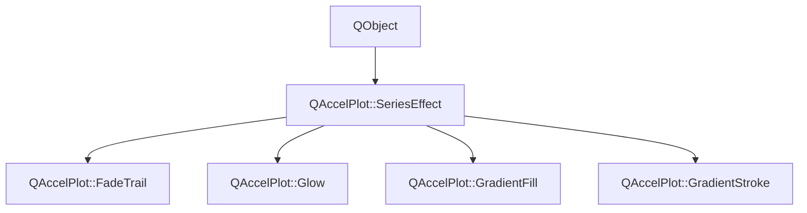

# Class QAccelPlot::SeriesEffect


[**ClassList**](annotated.md) **>** [**QAccelPlot**](namespaceQAccelPlot.md) **>** [**SeriesEffect**](classQAccelPlot_1_1SeriesEffect.md)


_Abstract base class for visual effects applied to a series._ [More...](#detailed-description)

* `#include <SeriesEffect.hpp>`


Inherits the following classes: QObject


Inherited by the following classes: [QAccelPlot::FadeTrail](classQAccelPlot_1_1FadeTrail.md),  [QAccelPlot::Glow](classQAccelPlot_1_1Glow.md),  [QAccelPlot::GradientFill](classQAccelPlot_1_1GradientFill.md),  [QAccelPlot::GradientStroke](classQAccelPlot_1_1GradientStroke.md)


## Inheritance diagram




## Public Properties

| Type | Name |
| ---: | :--- |
| property QML\_ANONYMOUSbool | [**enabled**](classQAccelPlot_1_1SeriesEffect.md#property-enabled-12)  <br>_Whether this effect is active. Disabled effects are ignored during rendering._  |


## Public Signals

| Type | Name |
| ---: | :--- |
| signal void | [**effectChanged**](classQAccelPlot_1_1SeriesEffect.md#signal-effectchanged)  <br>_Emitted when any effect property changes, requesting a redraw of the series._  |
| signal void | [**enabledChanged**](classQAccelPlot_1_1SeriesEffect.md#signal-enabledchanged)  <br>_Emitted when the enabled property changes._  |


## Public Functions

| Type | Name |
| ---: | :--- |
|   | [**SeriesEffect**](#function-serieseffect) (QObject \* parent=nullptr) <br>_Constructs a_ [_**SeriesEffect**_](classQAccelPlot_1_1SeriesEffect.md) _with the given__parent_ _._ |
|  bool | [**enabled**](#function-enabled-22) () const<br>_Returns_ `true` _if the effect is active._ |
| virtual void | [**refresh**](#function-refresh) () <br>_Re-reads inputs that can change without a notification and emits_ `effectChanged()` _if they did._ |
|  void | [**setEnabled**](#function-setenabled) (bool enabled) <br>_Sets the effect's enabled state to_ _enabled_ _._ |


## Detailed Description


Effects are attached through the `PlotSeries::effects` list and evaluated when the series renders. Each series supports some effects; assigning another logs a warning and the effect is ignored. Of several effects of one type, the first enabled one applies.


|Effect  |Series  |
|-----|-----|
|`GradientFill`, `GradientStroke`  |`LineCurve`  |
|`Glow`  |`LineCurve`, `PointCloud`, `BarSeries`, `ErrorBarSeries`  |
|`FadeTrail`  |`LineCurve`, `PointCloud`  |


**See also:** [**GradientFill**](classQAccelPlot_1_1GradientFill.md), [**GradientStroke**](classQAccelPlot_1_1GradientStroke.md), [**Glow**](classQAccelPlot_1_1Glow.md), [**FadeTrail**](classQAccelPlot_1_1FadeTrail.md), [**PlotSeries**](classQAccelPlot_1_1PlotSeries.md) 


    
## Public Properties Documentation


### property enabled {#property-enabled-12}

_Whether this effect is active. Disabled effects are ignored during rendering._ 
```C++
QML_ANONYMOUSbool QAccelPlot::SeriesEffect::enabled;
```


<hr>
## Public Signals Documentation


### signal effectChanged {#signal-effectchanged}

_Emitted when any effect property changes, requesting a redraw of the series._ 
```C++
void QAccelPlot::SeriesEffect::effectChanged;
```


<hr>


### signal enabledChanged {#signal-enabledchanged}

_Emitted when the enabled property changes._ 
```C++
void QAccelPlot::SeriesEffect::enabledChanged;
```


<hr>
## Public Functions Documentation


### function SeriesEffect {#function-serieseffect}

_Constructs a_ [_**SeriesEffect**_](classQAccelPlot_1_1SeriesEffect.md) _with the given__parent_ _._
```C++
explicit QAccelPlot::SeriesEffect::SeriesEffect (
    QObject * parent=nullptr
) 
```


<hr>


### function enabled {#function-enabled-22}

_Returns_ `true` _if the effect is active._
```C++
bool QAccelPlot::SeriesEffect::enabled () const
```


<hr>


### function refresh {#function-refresh}

_Re-reads inputs that can change without a notification and emits_ `effectChanged()` _if they did._
```C++
virtual void QAccelPlot::SeriesEffect::refresh () 
```


The series calls this on the GUI thread once per frame. The default implementation does nothing. 


        

<hr>


### function setEnabled {#function-setenabled}

_Sets the effect's enabled state to_ _enabled_ _._
```C++
void QAccelPlot::SeriesEffect::setEnabled (
    bool enabled
) 
```


<hr>

------------------------------
The documentation for this class was generated from the following file `QAccelPlot/src/QAccelPlot/effects/SeriesEffect.hpp`

