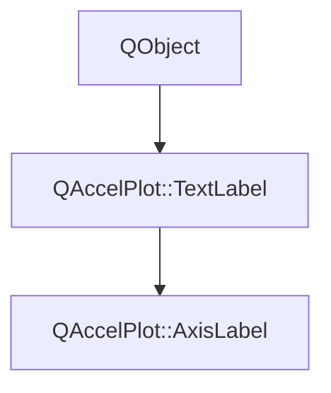

# Class QAccelPlot::TextLabel


[**ClassList**](annotated.md) **>** [**QAccelPlot**](namespaceQAccelPlot.md) **>** [**TextLabel**](classQAccelPlot_1_1TextLabel.md)


_Text, font, color, and padding of an axis label, grouped as the_ `label` _property of_[_**ColorBar**_](classQAccelPlot_1_1ColorBar.md) _and_[_**Axis**_](classQAccelPlot_1_1Axis.md) _._[More...](#detailed-description)

* `#include <TextLabel.hpp>`


Inherits the following classes: QObject


Inherited by the following classes: [QAccelPlot::AxisLabel](classQAccelPlot_1_1AxisLabel.md)


## Inheritance diagram




## Public Properties

| Type | Name |
| ---: | :--- |
| property QColor | [**color**](classQAccelPlot_1_1TextLabel.md#property-color-12)  <br>[_**Axis**_](classQAccelPlot_1_1Axis.md) _label color. Default:_`Colors.dark.axisLine` _on a_[_**ColorBar**_](classQAccelPlot_1_1ColorBar.md) _, the axis_`baselineColor` _on an_[_**Axis**_](classQAccelPlot_1_1Axis.md) _. Assign_`undefined` _to return to it._ |
| property QFont | [**font**](classQAccelPlot_1_1TextLabel.md#property-font-12)  <br>[_**Axis**_](classQAccelPlot_1_1Axis.md) _label font. Default: application default font._ |
| property qreal | [**padding**](classQAccelPlot_1_1TextLabel.md#property-padding-12)  <br>_Gap in pixels between the axis label and the axis or color strip. Default: 30 on an_ [_**Axis**_](classQAccelPlot_1_1Axis.md) _, 6 on a_[_**ColorBar**_](classQAccelPlot_1_1ColorBar.md) _._ |
| property QML\_ANONYMOUSQString | [**text**](classQAccelPlot_1_1TextLabel.md#property-text-12)  <br>[_**Axis**_](classQAccelPlot_1_1Axis.md) _label text. Default: empty, which draws_`unitText` _alone, or no axis label without unit text._ |
| property QString | [**unitFormat**](classQAccelPlot_1_1TextLabel.md#property-unitformat-12)  <br>_How the painted axis label combines_ `text` _(_`%1` _) and_`unitText` _(_`%2` _). Default: "%1 (%2)"._ |
| property QString | [**unitText**](classQAccelPlot_1_1TextLabel.md#property-unittext-12)  <br>_Prefixed unit the tick label formatter chose for the current ticks, such as "mm". Read-only._  |


## Public Signals

| Type | Name |
| ---: | :--- |
| signal void | [**colorChanged**](classQAccelPlot_1_1TextLabel.md#signal-colorchanged)  <br>_Emitted when the color property changes._  |
| signal void | [**fontChanged**](classQAccelPlot_1_1TextLabel.md#signal-fontchanged)  <br>_Emitted when the font property changes._  |
| signal void | [**paddingChanged**](classQAccelPlot_1_1TextLabel.md#signal-paddingchanged)  <br>_Emitted when the padding property changes._  |
| signal void | [**textChanged**](classQAccelPlot_1_1TextLabel.md#signal-textchanged)  <br>_Emitted when the text property changes._  |
| signal void | [**unitFormatChanged**](classQAccelPlot_1_1TextLabel.md#signal-unitformatchanged)  <br>_Emitted when the unitFormat property changes._  |
| signal void | [**unitTextChanged**](classQAccelPlot_1_1TextLabel.md#signal-unittextchanged)  <br>_Emitted when the unitText property changes._  |


## Public Functions

| Type | Name |
| ---: | :--- |
|   | [**TextLabel**](#function-textlabel) (const QColor & color={}, qreal padding=0.0, QObject \* parent=nullptr) <br>_Constructs a label with the default_ _color_ _and__padding_ _, owned by__parent_ _._ |
|  QColor | [**color**](#function-color-22) () const<br>_Returns the axis label color in effect._  |
|  QFont | [**font**](#function-font-22) () const<br>_Returns the axis label font._  |
|  qreal | [**padding**](#function-padding-22) () const<br>_Returns the gap between the axis label and the axis or color strip in pixels._  |
|  QString | [**paintedText**](#function-paintedtext) () const<br>_Returns the axis label text combined with the unit text by_ [_**unitFormat()**_](classQAccelPlot_1_1TextLabel.md#property-unitformat-12) _, such as "Distance (mm)"._ |
|  void | [**resetColor**](#function-resetcolor) () <br>_Restores the default axis label color._  |
|  void | [**resetUnitFormat**](#function-resetunitformat) () <br>_Restores the default unit format "%1 (%2)"._  |
|  void | [**setColor**](#function-setcolor) (const QColor & color) <br>_Sets the axis label color to_ _color_ _. An invalid color restores the default._ |
|  void | [**setDefaultColor**](#function-setdefaultcolor) (const QColor & color) <br>_Sets the color used while none is set to_ _color_ _. Called by the owning_[_**Axis**_](classQAccelPlot_1_1Axis.md) _or_[_**ColorBar**_](classQAccelPlot_1_1ColorBar.md) _._ |
|  void | [**setFont**](#function-setfont) (const QFont & font) <br>_Sets the axis label font to_ _font_ _._ |
|  void | [**setPadding**](#function-setpadding) (qreal padding) <br>_Sets the gap between the axis label and the axis or color strip to_ _padding_ _pixels._ |
|  void | [**setText**](#function-settext) (const QString & text) <br>_Sets the axis label text to_ _text_ _._ |
|  void | [**setUnitFormat**](#function-setunitformat) (const QString & format) <br>_Sets how the painted axis label combines the text (_ `%1` _) and the unit text (_`%2` _) to__format_ _._ |
|  void | [**setUnitText**](#function-setunittext) (const QString & unitText) <br>_Sets the prefixed unit to_ _unitText_ _. Called by the owning_[_**Axis**_](classQAccelPlot_1_1Axis.md) _or_[_**ColorBar**_](classQAccelPlot_1_1ColorBar.md) _when its ticks change._ |
|  QString | [**text**](#function-text-22) () const<br>_Returns the axis label text._  |
|  QString | [**unitFormat**](#function-unitformat-22) () const<br>_Returns how the painted axis label combines the text and the unit text._  |
|  QString | [**unitText**](#function-unittext-22) () const<br>_Returns the prefixed unit chosen for the current ticks, or an empty string for none._  |


## Detailed Description


**See also:** [**AxisLabel**](classQAccelPlot_1_1AxisLabel.md) 


    
## Public Properties Documentation


### property color {#property-color-12}

[_**Axis**_](classQAccelPlot_1_1Axis.md) _label color. Default:_`Colors.dark.axisLine` _on a_[_**ColorBar**_](classQAccelPlot_1_1ColorBar.md) _, the axis_`baselineColor` _on an_[_**Axis**_](classQAccelPlot_1_1Axis.md) _. Assign_`undefined` _to return to it._
```C++
QColor QAccelPlot::TextLabel::color;
```


<hr>


### property font {#property-font-12}

[_**Axis**_](classQAccelPlot_1_1Axis.md) _label font. Default: application default font._
```C++
QFont QAccelPlot::TextLabel::font;
```


<hr>


### property padding {#property-padding-12}

_Gap in pixels between the axis label and the axis or color strip. Default: 30 on an_ [_**Axis**_](classQAccelPlot_1_1Axis.md) _, 6 on a_[_**ColorBar**_](classQAccelPlot_1_1ColorBar.md) _._
```C++
qreal QAccelPlot::TextLabel::padding;
```


<hr>


### property text {#property-text-12}

[_**Axis**_](classQAccelPlot_1_1Axis.md) _label text. Default: empty, which draws_`unitText` _alone, or no axis label without unit text._
```C++
QML_ANONYMOUSQString QAccelPlot::TextLabel::text;
```


<hr>


### property unitFormat {#property-unitformat-12}

_How the painted axis label combines_ `text` _(_`%1` _) and_`unitText` _(_`%2` _). Default: "%1 (%2)"._
```C++
QString QAccelPlot::TextLabel::unitFormat;
```


For example, "%1 [%2]" paints "Distance [mm]" and "%1 / %2" paints "Distance / mm". It applies only while both `text` and `unitText` are set: an empty `text` paints `unitText` alone, and an empty `unitText` paints `text` alone. Assign `undefined` to return to the default. 


        

<hr>


### property unitText {#property-unittext-12}

_Prefixed unit the tick label formatter chose for the current ticks, such as "mm". Read-only._ 
```C++
QString QAccelPlot::TextLabel::unitText;
```


The owning [**Axis**](classQAccelPlot_1_1Axis.md) or [**ColorBar**](classQAccelPlot_1_1ColorBar.md) updates it whenever it computes its ticks. It is empty when the formatter shows no unit, as with every built-in formatter except `UnitTickLabelFormatter`. While it is set, the owner paints its axis label with `unitFormat`, such as "Distance (mm)". An [**Axis**](classQAccelPlot_1_1Axis.md) `delegate` can bind to it. 


        

<hr>
## Public Signals Documentation


### signal colorChanged {#signal-colorchanged}

_Emitted when the color property changes._ 
```C++
void QAccelPlot::TextLabel::colorChanged;
```


<hr>


### signal fontChanged {#signal-fontchanged}

_Emitted when the font property changes._ 
```C++
void QAccelPlot::TextLabel::fontChanged;
```


<hr>


### signal paddingChanged {#signal-paddingchanged}

_Emitted when the padding property changes._ 
```C++
void QAccelPlot::TextLabel::paddingChanged;
```


<hr>


### signal textChanged {#signal-textchanged}

_Emitted when the text property changes._ 
```C++
void QAccelPlot::TextLabel::textChanged;
```


<hr>


### signal unitFormatChanged {#signal-unitformatchanged}

_Emitted when the unitFormat property changes._ 
```C++
void QAccelPlot::TextLabel::unitFormatChanged;
```


<hr>


### signal unitTextChanged {#signal-unittextchanged}

_Emitted when the unitText property changes._ 
```C++
void QAccelPlot::TextLabel::unitTextChanged;
```


<hr>
## Public Functions Documentation


### function TextLabel {#function-textlabel}

_Constructs a label with the default_ _color_ _and__padding_ _, owned by__parent_ _._
```C++
explicit QAccelPlot::TextLabel::TextLabel (
    const QColor & color={},
    qreal padding=0.0,
    QObject * parent=nullptr
) 
```


<hr>


### function color {#function-color-22}

_Returns the axis label color in effect._ 
```C++
QColor QAccelPlot::TextLabel::color () const
```


<hr>


### function font {#function-font-22}

_Returns the axis label font._ 
```C++
QFont QAccelPlot::TextLabel::font () const
```


<hr>


### function padding {#function-padding-22}

_Returns the gap between the axis label and the axis or color strip in pixels._ 
```C++
qreal QAccelPlot::TextLabel::padding () const
```


<hr>


### function paintedText {#function-paintedtext}

_Returns the axis label text combined with the unit text by_ [_**unitFormat()**_](classQAccelPlot_1_1TextLabel.md#property-unitformat-12) _, such as "Distance (mm)"._
```C++
QString QAccelPlot::TextLabel::paintedText () const
```


Returns the unit text alone for an empty text, and the text alone without unit text. 


        

<hr>


### function resetColor {#function-resetcolor}

_Restores the default axis label color._ 
```C++
void QAccelPlot::TextLabel::resetColor () 
```


<hr>


### function resetUnitFormat {#function-resetunitformat}

_Restores the default unit format "%1 (%2)"._ 
```C++
void QAccelPlot::TextLabel::resetUnitFormat () 
```


<hr>


### function setColor {#function-setcolor}

_Sets the axis label color to_ _color_ _. An invalid color restores the default._
```C++
void QAccelPlot::TextLabel::setColor (
    const QColor & color
) 
```


<hr>


### function setDefaultColor {#function-setdefaultcolor}

_Sets the color used while none is set to_ _color_ _. Called by the owning_[_**Axis**_](classQAccelPlot_1_1Axis.md) _or_[_**ColorBar**_](classQAccelPlot_1_1ColorBar.md) _._
```C++
void QAccelPlot::TextLabel::setDefaultColor (
    const QColor & color
) 
```


<hr>


### function setFont {#function-setfont}

_Sets the axis label font to_ _font_ _._
```C++
void QAccelPlot::TextLabel::setFont (
    const QFont & font
) 
```


<hr>


### function setPadding {#function-setpadding}

_Sets the gap between the axis label and the axis or color strip to_ _padding_ _pixels._
```C++
void QAccelPlot::TextLabel::setPadding (
    qreal padding
) 
```


<hr>


### function setText {#function-settext}

_Sets the axis label text to_ _text_ _._
```C++
void QAccelPlot::TextLabel::setText (
    const QString & text
) 
```


<hr>


### function setUnitFormat {#function-setunitformat}

_Sets how the painted axis label combines the text (_ `%1` _) and the unit text (_`%2` _) to__format_ _._
```C++
void QAccelPlot::TextLabel::setUnitFormat (
    const QString & format
) 
```


<hr>


### function setUnitText {#function-setunittext}

_Sets the prefixed unit to_ _unitText_ _. Called by the owning_[_**Axis**_](classQAccelPlot_1_1Axis.md) _or_[_**ColorBar**_](classQAccelPlot_1_1ColorBar.md) _when its ticks change._
```C++
void QAccelPlot::TextLabel::setUnitText (
    const QString & unitText
) 
```


<hr>


### function text {#function-text-22}

_Returns the axis label text._ 
```C++
QString QAccelPlot::TextLabel::text () const
```


<hr>


### function unitFormat {#function-unitformat-22}

_Returns how the painted axis label combines the text and the unit text._ 
```C++
QString QAccelPlot::TextLabel::unitFormat () const
```


<hr>


### function unitText {#function-unittext-22}

_Returns the prefixed unit chosen for the current ticks, or an empty string for none._ 
```C++
QString QAccelPlot::TextLabel::unitText () const
```


<hr>

------------------------------
The documentation for this class was generated from the following file `QAccelPlot/src/QAccelPlot/axis/TextLabel.hpp`

