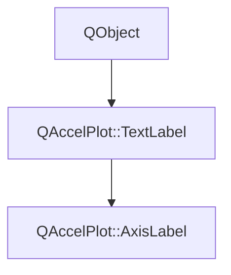

# Class QAccelPlot::TextLabel


[**ClassList**](annotated.md) **>** [**QAccelPlot**](namespaceQAccelPlot.md) **>** [**TextLabel**](classQAccelPlot_1_1TextLabel.md)


_Text, font, color, and padding of a title, grouped as the_ `label` _property of_[_**ColorBar**_](classQAccelPlot_1_1ColorBar.md) _and_[_**Axis**_](classQAccelPlot_1_1Axis.md) _._[More...](#detailed-description)

* `#include <TextLabel.hpp>`


Inherits the following classes: QObject


Inherited by the following classes: [QAccelPlot::AxisLabel](classQAccelPlot_1_1AxisLabel.md)


## Inheritance diagram




## Public Properties

| Type | Name |
| ---: | :--- |
| property QColor | [**color**](classQAccelPlot_1_1TextLabel.md#property-color-12)  <br>_Title color. Default:_ `Colors.dark.axisLine` _on a_[_**ColorBar**_](classQAccelPlot_1_1ColorBar.md) _; on an_[_**Axis**_](classQAccelPlot_1_1Axis.md) _, an invalid color that follows_`baselineColor` _._ |
| property QFont | [**font**](classQAccelPlot_1_1TextLabel.md#property-font-12)  <br>_Title font. Default: application default font._  |
| property qreal | [**padding**](classQAccelPlot_1_1TextLabel.md#property-padding-12)  <br>_Gap in pixels between the title and the axis or color strip. Default: 30 on an_ [_**Axis**_](classQAccelPlot_1_1Axis.md) _, 6 on a_[_**ColorBar**_](classQAccelPlot_1_1ColorBar.md) _._ |
| property QML\_ANONYMOUSQString | [**text**](classQAccelPlot_1_1TextLabel.md#property-text-12)  <br>_Title text. Default: empty, which draws no title._  |


## Public Signals

| Type | Name |
| ---: | :--- |
| signal void | [**colorChanged**](classQAccelPlot_1_1TextLabel.md#signal-colorchanged)  <br>_Emitted when the color property changes._  |
| signal void | [**fontChanged**](classQAccelPlot_1_1TextLabel.md#signal-fontchanged)  <br>_Emitted when the font property changes._  |
| signal void | [**paddingChanged**](classQAccelPlot_1_1TextLabel.md#signal-paddingchanged)  <br>_Emitted when the padding property changes._  |
| signal void | [**textChanged**](classQAccelPlot_1_1TextLabel.md#signal-textchanged)  <br>_Emitted when the text property changes._  |


## Public Functions

| Type | Name |
| ---: | :--- |
|   | [**TextLabel**](#function-textlabel) (const QColor & color={}, qreal padding=0.0, QObject \* parent=nullptr) <br>_Constructs a label with the default_ _color_ _and__padding_ _, owned by__parent_ _._ |
|  QColor | [**color**](#function-color-22) () const<br>_Returns the title color._  |
|  QFont | [**font**](#function-font-22) () const<br>_Returns the title font._  |
|  qreal | [**padding**](#function-padding-22) () const<br>_Returns the gap between the title and the axis or color strip in pixels._  |
|  void | [**setColor**](#function-setcolor) (const QColor & color) <br>_Sets the title color to_ _color_ _._ |
|  void | [**setFont**](#function-setfont) (const QFont & font) <br>_Sets the title font to_ _font_ _._ |
|  void | [**setPadding**](#function-setpadding) (qreal padding) <br>_Sets the gap between the title and the axis or color strip to_ _padding_ _pixels._ |
|  void | [**setText**](#function-settext) (const QString & text) <br>_Sets the title text to_ _text_ _._ |
|  QString | [**text**](#function-text-22) () const<br>_Returns the title text._  |


## Detailed Description


**See also:** [**AxisLabel**](classQAccelPlot_1_1AxisLabel.md) 


    
## Public Properties Documentation


### property color {#property-color-12}

_Title color. Default:_ `Colors.dark.axisLine` _on a_[_**ColorBar**_](classQAccelPlot_1_1ColorBar.md) _; on an_[_**Axis**_](classQAccelPlot_1_1Axis.md) _, an invalid color that follows_`baselineColor` _._
```C++
QColor QAccelPlot::TextLabel::color;
```


<hr>


### property font {#property-font-12}

_Title font. Default: application default font._ 
```C++
QFont QAccelPlot::TextLabel::font;
```


<hr>


### property padding {#property-padding-12}

_Gap in pixels between the title and the axis or color strip. Default: 30 on an_ [_**Axis**_](classQAccelPlot_1_1Axis.md) _, 6 on a_[_**ColorBar**_](classQAccelPlot_1_1ColorBar.md) _._
```C++
qreal QAccelPlot::TextLabel::padding;
```


<hr>


### property text {#property-text-12}

_Title text. Default: empty, which draws no title._ 
```C++
QML_ANONYMOUSQString QAccelPlot::TextLabel::text;
```


<hr>
## Public Signals Documentation


### signal colorChanged {#signal-colorchanged}

_Emitted when the color property changes._ 
```C++
void QAccelPlot::TextLabel::colorChanged;
```


<hr>


### signal fontChanged {#signal-fontchanged}

_Emitted when the font property changes._ 
```C++
void QAccelPlot::TextLabel::fontChanged;
```


<hr>


### signal paddingChanged {#signal-paddingchanged}

_Emitted when the padding property changes._ 
```C++
void QAccelPlot::TextLabel::paddingChanged;
```


<hr>


### signal textChanged {#signal-textchanged}

_Emitted when the text property changes._ 
```C++
void QAccelPlot::TextLabel::textChanged;
```


<hr>
## Public Functions Documentation


### function TextLabel {#function-textlabel}

_Constructs a label with the default_ _color_ _and__padding_ _, owned by__parent_ _._
```C++
explicit QAccelPlot::TextLabel::TextLabel (
    const QColor & color={},
    qreal padding=0.0,
    QObject * parent=nullptr
) 
```


<hr>


### function color {#function-color-22}

_Returns the title color._ 
```C++
QColor QAccelPlot::TextLabel::color () const
```


<hr>


### function font {#function-font-22}

_Returns the title font._ 
```C++
QFont QAccelPlot::TextLabel::font () const
```


<hr>


### function padding {#function-padding-22}

_Returns the gap between the title and the axis or color strip in pixels._ 
```C++
qreal QAccelPlot::TextLabel::padding () const
```


<hr>


### function setColor {#function-setcolor}

_Sets the title color to_ _color_ _._
```C++
void QAccelPlot::TextLabel::setColor (
    const QColor & color
) 
```


<hr>


### function setFont {#function-setfont}

_Sets the title font to_ _font_ _._
```C++
void QAccelPlot::TextLabel::setFont (
    const QFont & font
) 
```


<hr>


### function setPadding {#function-setpadding}

_Sets the gap between the title and the axis or color strip to_ _padding_ _pixels._
```C++
void QAccelPlot::TextLabel::setPadding (
    qreal padding
) 
```


<hr>


### function setText {#function-settext}

_Sets the title text to_ _text_ _._
```C++
void QAccelPlot::TextLabel::setText (
    const QString & text
) 
```


<hr>


### function text {#function-text-22}

_Returns the title text._ 
```C++
QString QAccelPlot::TextLabel::text () const
```


<hr>

------------------------------
The documentation for this class was generated from the following file `QAccelPlot/src/QAccelPlot/axis/TextLabel.hpp`

