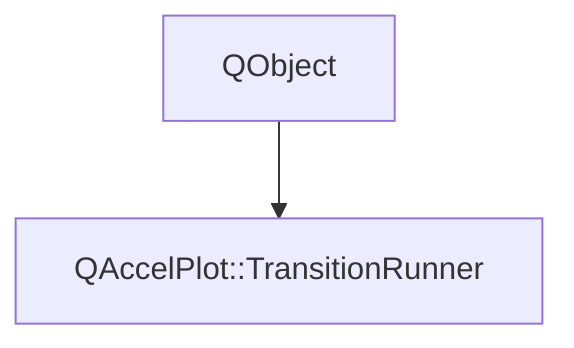

# Class QAccelPlot::TransitionRunner


[**ClassList**](annotated.md) **>** [**QAccelPlot**](namespaceQAccelPlot.md) **>** [**TransitionRunner**](classQAccelPlot_1_1TransitionRunner.md)


_Runs the enter, update, and exit transitions of one item, such as a custom series._ [More...](#detailed-description)

* `#include <TransitionRunner.hpp>`


Inherits the following classes: QObject


## Inheritance diagram




## Public Types

| Type | Name |
| ---: | :--- |
| typedef [**Internal::TransitionLayout**](structQAccelPlot_1_1Internal_1_1TransitionLayout.md) | [**Layout**](#typedef-layout)  <br>_How the items of the item animate._  |
| enum  | [**Slot**](#enum-slot)  <br>_A transition slot of the item._  |


## Public Signals

| Type | Name |
| ---: | :--- |
| signal void | [**activeChanged**](classQAccelPlot_1_1TransitionRunner.md#signal-activechanged)  <br>_Emitted when_ `active()` _changes._ |
| signal void | [**frameDue**](classQAccelPlot_1_1TransitionRunner.md#signal-framedue)  <br>_Emitted once per rendered frame while the run is active._  |
| signal void | [**interrupted**](classQAccelPlot_1_1TransitionRunner.md#signal-interrupted)  <br>_Emitted when the run stopped before its end: a transition was replaced, cancelled, or destroyed._  |
| signal void | [**transitionChanged**](classQAccelPlot_1_1TransitionRunner.md#signal-transitionchanged) ([**TransitionRunner::Slot**](classQAccelPlot_1_1TransitionRunner.md#enum-slot) slot) <br>_Emitted when the transition of_ _slot_ _changes:_`setTransition()` _assigned another, or it was destroyed._ |


## Public Functions

| Type | Name |
| ---: | :--- |
|   | [**TransitionRunner**](#function-transitionrunner) (QQuickItem \* item) <br>_Constructs the runner for_ _item_ _, which must outlive it._ |
|  bool | [**active**](#function-active) () const<br>_Returns_ `true` _while a transition advances the run._ |
|  bool | [**advance**](#function-advance) (std::vector&lt; double &gt; & outData, int & outPointCount) <br>_Writes the frame of the run into_ _outData_ _and__outPointCount_ _, or the target data when the run ends._ |
|  bool | [**animates**](#function-animates) (int currentPointCount, int newPointCount) const<br>_Returns_ `true` _when a change from__currentPointCount_ _drawn items to__newPointCount_ _items may start a run._ |
|  void | [**cancel**](#function-cancel) () <br>_Ends the run and discards its data._  |
|  bool | [**enabled**](#function-enabled) () const<br>_Returns_ `true` _when some slot has an enabled transition._ |
|  bool | [**finish**](#function-finish) (std::vector&lt; double &gt; & outData, int & outPointCount) <br>_Ends the run and moves its target data into_ _outData_ _and__outPointCount_ _._ |
|  int | [**frameCapacity**](#function-framecapacity) () const<br>_Returns the most items a frame of the run holds: the larger of the start and target counts._  |
|  void | [**notifyTransitionChanges**](#function-notifytransitionchanges) (Item \* item) <br>_Emits_ _item's_ __`enterTransitionChanged()` _,_`updateTransitionChanged()` _, or_`exitTransitionChanged()` _signal when the transition of that slot changes._ |
|  bool | [**pending**](#function-pending) () const<br>_Returns_ `true` _while the run holds target data that_`finish()` _has not taken._ |
|  bool | [**setTransition**](#function-settransition) ([**Slot**](classQAccelPlot_1_1TransitionRunner.md#enum-slot) slot, [**DataTransition**](classQAccelPlot_1_1DataTransition.md) \* transition) <br>_Assigns_ _transition_ _to__slot_ _, interrupting a pending run first. The runner does not own it._ |
|  bool | [**start**](#function-start) (const std::vector&lt; double &gt; & currentData, int currentPointCount, std::vector&lt; double &gt; && newData, int newPointCount, const [**Layout**](classQAccelPlot_1_1TransitionRunner.md#typedef-layout) & layout) <br>_Starts a run from_ _currentData_ _to__newData_ _and requests a frame._ |
|  const std::vector&lt; double &gt; & | [**targetData**](#function-targetdata) () const<br>_Returns the target data. Valid while_ `pending()` _is_`true` _._ |
|  int | [**targetPointCount**](#function-targetpointcount) () const<br>_Returns the number of items in_ `targetData()` _._ |
|  [**DataTransition**](classQAccelPlot_1_1DataTransition.md) \* | [**transition**](#function-transition) ([**Slot**](classQAccelPlot_1_1TransitionRunner.md#enum-slot) slot) const<br>_Returns the transition of_ _slot_ _, or_`nullptr` _._ |
|   | [**~TransitionRunner**](#function-transitionrunner) () override<br>_Ends the run without emitting_ `interrupted()` _._ |


## Detailed Description


A data change splits the items by index: with _m_ items before and _n_ after, items below both counts are kept, items from _m_ on are added, and items from _n_ on are removed. Each group runs the transition of its slot; a group without one changes instantly. Kept items run the update transition only when one of them changes. A `DrawTransition` or `GrowTransition` in the update slot then redraws all new items instead.


The runner asks for a frame once per rendered frame while it is active. The request comes on the GUI thread from `QQuickWindow::afterAnimating`, before the scene graph syncs, so `DataTransition::runningChanged` reaches QML there and the frame renders the new step. `LineCurve`, `BarSeries`, `PointCloud`, and `ErrorBarSeries` animate through it.


**
**


* Forward the item's transition properties to the slot getters and setters, and their change signals through `notifyTransitionChanges()`.
* When data arrives and `animates()` is `true`, call `start()`. When it returns `false`, or when `animates()` is `false`, call `cancel()` and show the data.
* After `start()` and on `frameDue()`, call `advance()` and show the frame.
* On `interrupted()`, call `finish()` and show the target data.


Use it on the item's thread only.


**See also:** [**DataTransition**](classQAccelPlot_1_1DataTransition.md) 


    
## Public Types Documentation


### typedef Layout {#typedef-layout}

_How the items of the item animate._ 
```C++
using QAccelPlot::TransitionRunner::Layout =  Internal::TransitionLayout;
```


<hr>


### enum Slot {#enum-slot}

_A transition slot of the item._ 
```C++
enum QAccelPlot::TransitionRunner::Slot {
    Enter,
    Update,
    Exit
};
```


<hr>
## Public Signals Documentation


### signal activeChanged {#signal-activechanged}

_Emitted when_ `active()` _changes._
```C++
void QAccelPlot::TransitionRunner::activeChanged;
```


<hr>


### signal frameDue {#signal-framedue}

_Emitted once per rendered frame while the run is active._ 
```C++
void QAccelPlot::TransitionRunner::frameDue;
```


<hr>


### signal interrupted {#signal-interrupted}

_Emitted when the run stopped before its end: a transition was replaced, cancelled, or destroyed._ 
```C++
void QAccelPlot::TransitionRunner::interrupted;
```


The run still holds the target data. A run still pending after the signal is cancelled. 


        

<hr>


### signal transitionChanged {#signal-transitionchanged}

_Emitted when the transition of_ _slot_ _changes:_`setTransition()` _assigned another, or it was destroyed._
```C++
void QAccelPlot::TransitionRunner::transitionChanged;
```


<hr>
## Public Functions Documentation


### function TransitionRunner {#function-transitionrunner}

_Constructs the runner for_ _item_ _, which must outlive it._
```C++
explicit QAccelPlot::TransitionRunner::TransitionRunner (
    QQuickItem * item
) 
```


<hr>


### function active {#function-active}

_Returns_ `true` _while a transition advances the run._
```C++
bool QAccelPlot::TransitionRunner::active () const
```


<hr>


### function advance {#function-advance}

_Writes the frame of the run into_ _outData_ _and__outPointCount_ _, or the target data when the run ends._
```C++
bool QAccelPlot::TransitionRunner::advance (
    std::vector< double > & outData,
    int & outPointCount
) 
```


**Returns:**

`true` if the run is still active after this call. 


        

<hr>


### function animates {#function-animates}

_Returns_ `true` _when a change from__currentPointCount_ _drawn items to__newPointCount_ _items may start a run._
```C++
bool QAccelPlot::TransitionRunner::animates (
    int currentPointCount,
    int newPointCount
) const
```


Without a pending run, `false` means that `start()` would return `false`, so the item can show the data without copying it for a run. 


        

<hr>


### function cancel {#function-cancel}

_Ends the run and discards its data._ 
```C++
void QAccelPlot::TransitionRunner::cancel () 
```


<hr>


### function enabled {#function-enabled}

_Returns_ `true` _when some slot has an enabled transition._
```C++
bool QAccelPlot::TransitionRunner::enabled () const
```


<hr>


### function finish {#function-finish}

_Ends the run and moves its target data into_ _outData_ _and__outPointCount_ _._
```C++
bool QAccelPlot::TransitionRunner::finish (
    std::vector< double > & outData,
    int & outPointCount
) 
```


**Returns:**

`false`, leaving the outputs unchanged, when the run is not pending. 


        

<hr>


### function frameCapacity {#function-framecapacity}

_Returns the most items a frame of the run holds: the larger of the start and target counts._ 
```C++
int QAccelPlot::TransitionRunner::frameCapacity () const
```


<hr>


### function notifyTransitionChanges {#function-notifytransitionchanges}

_Emits_ _item's_ __`enterTransitionChanged()` _,_`updateTransitionChanged()` _, or_`exitTransitionChanged()` _signal when the transition of that slot changes._
```C++
template<typename Item>
inline void QAccelPlot::TransitionRunner::notifyTransitionChanges (
    Item * item
) 
```


<hr>


### function pending {#function-pending}

_Returns_ `true` _while the run holds target data that_`finish()` _has not taken._
```C++
bool QAccelPlot::TransitionRunner::pending () const
```


<hr>


### function setTransition {#function-settransition}

_Assigns_ _transition_ _to__slot_ _, interrupting a pending run first. The runner does not own it._
```C++
bool QAccelPlot::TransitionRunner::setTransition (
    Slot slot,
    DataTransition * transition
) 
```


The enter and exit slots take only an `EnterExitTransition`. 

**Returns:**

`false` when _transition_ is already assigned to _slot_, or does not fit it. 


        

<hr>


### function start {#function-start}

_Starts a run from_ _currentData_ _to__newData_ _and requests a frame._
```C++
bool QAccelPlot::TransitionRunner::start (
    const std::vector< double > & currentData,
    int currentPointCount,
    std::vector< double > && newData,
    int newPointCount,
    const Layout & layout
) 
```


**Parameters:**


* `currentData` Items drawn now, copied as the _from_ side. Items of a previous run that its last frame has not shown yet, or shows leaving, are left out. 
* `currentPointCount` Number of items in _currentData_. 
* `newData` Target items, moved as the _to_ side. 
* `newPointCount` Number of items in _newData_. 
* `layout` How the items animate; its stride applies to both buffers. 


**Returns:**

`false`, ending any run, when no slot animates this change. 


        

<hr>


### function targetData {#function-targetdata}

_Returns the target data. Valid while_ `pending()` _is_`true` _._
```C++
const std::vector< double > & QAccelPlot::TransitionRunner::targetData () const
```


<hr>


### function targetPointCount {#function-targetpointcount}

_Returns the number of items in_ `targetData()` _._
```C++
int QAccelPlot::TransitionRunner::targetPointCount () const
```


<hr>


### function transition {#function-transition}

_Returns the transition of_ _slot_ _, or_`nullptr` _._
```C++
DataTransition * QAccelPlot::TransitionRunner::transition (
    Slot slot
) const
```


<hr>


### function ~TransitionRunner {#function-transitionrunner}

_Ends the run without emitting_ `interrupted()` _._
```C++
QAccelPlot::TransitionRunner::~TransitionRunner () override
```


<hr>

------------------------------
The documentation for this class was generated from the following file `QAccelPlot/src/QAccelPlot/transitions/TransitionRunner.hpp`

