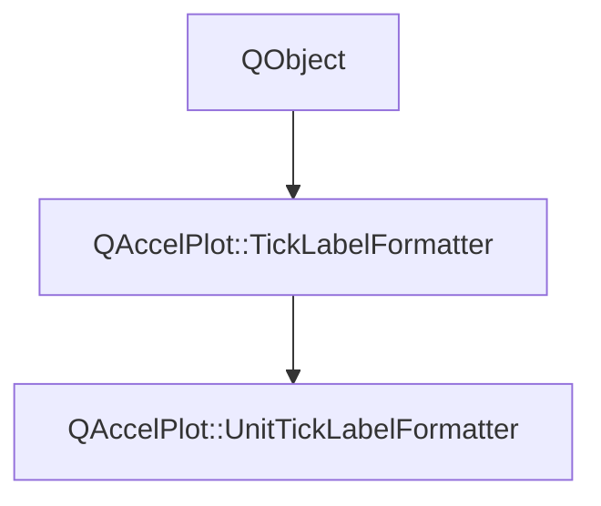

# Class QAccelPlot::UnitTickLabelFormatter


[**ClassList**](annotated.md) **>** [**QAccelPlot**](namespaceQAccelPlot.md) **>** [**UnitTickLabelFormatter**](classQAccelPlot_1_1UnitTickLabelFormatter.md)


_Numeric tick label formatter that writes the tick labels in a unit with an automatic SI unit prefix._ [More...](#detailed-description)

* `#include <UnitTickLabelFormatter.hpp>`


Inherits the following classes: [QAccelPlot::TickLabelFormatter](classQAccelPlot_1_1TickLabelFormatter.md)


## Inheritance diagram




## Public Types

| Type | Name |
| ---: | :--- |
| enum  | [**PrefixMode**](#enum-prefixmode)  <br>_Rule that picks the unit prefix._  |
| enum  | [**UnitPosition**](#enum-unitposition)  <br>_Where the prefixed unit is written._  |


## Public Properties

| Type | Name |
| ---: | :--- |
| property QStringList | [**allowedPrefixes**](classQAccelPlot_1_1UnitTickLabelFormatter.md#property-allowedprefixes-12)  <br>_Unit prefix symbols the tick labels may use, with "" for the bare unit. Default: every power-of-1000 prefix from quecto ("q") to quetta ("Q"), and ""._  |
| property QJSValue | [**customPrefix**](classQAccelPlot_1_1UnitTickLabelFormatter.md#property-customprefix-12)  <br>_JavaScript callback_ `function(min, max, ticks)` _that returns the unit prefix symbol with_`prefixMode` __`Custom` _. Default:_`undefined` _._ |
| property QString | [**fixedPrefix**](classQAccelPlot_1_1UnitTickLabelFormatter.md#property-fixedprefix-12)  <br>_Unit prefix symbol the tick labels use with_ `prefixMode` __`Fixed` _, such as "m". Default: "", the bare unit._ |
| property [**PrefixMode**](classQAccelPlot_1_1UnitTickLabelFormatter.md#enum-prefixmode) | [**prefixMode**](classQAccelPlot_1_1UnitTickLabelFormatter.md#property-prefixmode-12)  <br>_Rule that picks the unit prefix from the visible range. Default:_ `LargestMagnitude` _._ |
| property QString | [**unit**](classQAccelPlot_1_1UnitTickLabelFormatter.md#property-unit-12)  <br>_Base unit symbol of the axis values, such as "m". Default: empty._  |
| property [**UnitPosition**](classQAccelPlot_1_1UnitTickLabelFormatter.md#enum-unitposition) | [**unitPosition**](classQAccelPlot_1_1UnitTickLabelFormatter.md#property-unitposition-12)  <br>_Where the prefixed unit is written. Default:_ `AxisLabel` _._ |


## Public Properties inherited from QAccelPlot::TickLabelFormatter

See [QAccelPlot::TickLabelFormatter](classQAccelPlot_1_1TickLabelFormatter.md)

| Type | Name |
| ---: | :--- |
| property QML\_ANONYMOUSQJSValue | [**tickLabel**](classQAccelPlot_1_1TickLabelFormatter.md#property-ticklabel-12)  <br>_Optional JavaScript callback_ `function(value, tickStep)` _that overrides_`doFormat()` _._ |


## Public Signals

| Type | Name |
| ---: | :--- |
| signal void | [**allowedPrefixesChanged**](classQAccelPlot_1_1UnitTickLabelFormatter.md#signal-allowedprefixeschanged)  <br>_Emitted when the allowedPrefixes property changes._  |
| signal void | [**customPrefixChanged**](classQAccelPlot_1_1UnitTickLabelFormatter.md#signal-customprefixchanged)  <br>_Emitted when the customPrefix property changes._  |
| signal void | [**fixedPrefixChanged**](classQAccelPlot_1_1UnitTickLabelFormatter.md#signal-fixedprefixchanged)  <br>_Emitted when the fixedPrefix property changes._  |
| signal void | [**prefixModeChanged**](classQAccelPlot_1_1UnitTickLabelFormatter.md#signal-prefixmodechanged)  <br>_Emitted when the prefixMode property changes._  |
| signal void | [**unitChanged**](classQAccelPlot_1_1UnitTickLabelFormatter.md#signal-unitchanged)  <br>_Emitted when the unit property changes._  |
| signal void | [**unitPositionChanged**](classQAccelPlot_1_1UnitTickLabelFormatter.md#signal-unitpositionchanged)  <br>_Emitted when the unitPosition property changes._  |


## Public Signals inherited from QAccelPlot::TickLabelFormatter

See [QAccelPlot::TickLabelFormatter](classQAccelPlot_1_1TickLabelFormatter.md)

| Type | Name |
| ---: | :--- |
| signal void | [**formatChanged**](classQAccelPlot_1_1TickLabelFormatter.md#signal-formatchanged)  <br>_Emitted whenever a property that affects formatted output changes._  |
| signal void | [**tickLabelChanged**](classQAccelPlot_1_1TickLabelFormatter.md#signal-ticklabelchanged)  <br>_Emitted when the tickLabel property changes._  |


## Public Functions

| Type | Name |
| ---: | :--- |
|   | [**UnitTickLabelFormatter**](#function-unitticklabelformatter) (QObject \* parent=nullptr) <br>_Constructs a_ [_**UnitTickLabelFormatter**_](classQAccelPlot_1_1UnitTickLabelFormatter.md) _with the given__parent_ _._ |
|  QStringList | [**allowedPrefixes**](#function-allowedprefixes-22) () const<br>_Returns the allowed unit prefix symbols in effect, sorted by ascending power of ten._  |
|  QJSValue | [**customPrefix**](#function-customprefix-22) () const<br>_Returns the JavaScript callback that picks the unit prefix with_ `prefixMode` __`Custom` _._ |
|  QString | [**fixedPrefix**](#function-fixedprefix-22) () const<br>_Returns the unit prefix symbol used with_ `prefixMode` __`Fixed` _._ |
|  [**PrefixMode**](classQAccelPlot_1_1UnitTickLabelFormatter.md#enum-prefixmode) | [**prefixMode**](#function-prefixmode-22) () const<br>_Returns the rule that picks the unit prefix._  |
|  void | [**resetAllowedPrefixes**](#function-resetallowedprefixes) () <br>_Restores every power-of-1000 prefix from quecto to quetta, and the bare unit._  |
|  void | [**setAllowedPrefixes**](#function-setallowedprefixes) (const QStringList & symbols) <br>_Sets the allowed unit prefix symbols to_ _symbols_ _; unknown symbols are ignored with a warning._ |
|  void | [**setCustomPrefix**](#function-setcustomprefix) (const QJSValue & callback) <br>_Sets the JavaScript callback that picks the unit prefix with_ `prefixMode` __`Custom` _to__callback_ _._ |
|  void | [**setFixedPrefix**](#function-setfixedprefix) (const QString & symbol) <br>_Sets the unit prefix symbol used with_ `prefixMode` __`Fixed` _to__symbol_ _; an unknown symbol is ignored with a warning._ |
|  void | [**setPrefixMode**](#function-setprefixmode) ([**PrefixMode**](classQAccelPlot_1_1UnitTickLabelFormatter.md#enum-prefixmode) mode) <br>_Sets the rule that picks the unit prefix to_ _mode_ _._ |
|  void | [**setUnit**](#function-setunit) (const QString & unit) <br>_Sets the base unit symbol to_ _unit_ _._ |
|  void | [**setUnitPosition**](#function-setunitposition) ([**UnitPosition**](classQAccelPlot_1_1UnitTickLabelFormatter.md#enum-unitposition) position) <br>_Sets where the prefixed unit is written to_ _position_ _._ |
|  QString | [**unit**](#function-unit-22) () const<br>_Returns the base unit symbol._  |
|  [**UnitPosition**](classQAccelPlot_1_1UnitTickLabelFormatter.md#enum-unitposition) | [**unitPosition**](#function-unitposition-22) () const<br>_Returns where the prefixed unit is written._  |


## Public Functions inherited from QAccelPlot::TickLabelFormatter

See [QAccelPlot::TickLabelFormatter](classQAccelPlot_1_1TickLabelFormatter.md)

| Type | Name |
| ---: | :--- |
|   | [**TickLabelFormatter**](classQAccelPlot_1_1TickLabelFormatter.md#function-ticklabelformatter) (QObject \* parent=nullptr) <br>_Constructs an_ [_**TickLabelFormatter**_](classQAccelPlot_1_1TickLabelFormatter.md) _with the given__parent_ _._ |
|  QString | [**format**](classQAccelPlot_1_1TickLabelFormatter.md#function-format) (qreal value, qreal tickStep) const<br>_Returns the display string for_ _value_ _at the given__tickStep_ _._ |
|  QString | [**formatLogTick**](classQAccelPlot_1_1TickLabelFormatter.md#function-formatlogtick) (qreal value) const<br>_Returns the display string for a major tick at_ _value_ _on a logarithmic axis._ |
|  [**TickSetLabels**](structQAccelPlot_1_1TickSetLabels.md) | [**formatTicks**](classQAccelPlot_1_1TickLabelFormatter.md#function-formatticks) (const [**TickSet**](structQAccelPlot_1_1TickSet.md) & tickSet) const<br>_Returns the tick labels and unit text for the visible major ticks in_ _tickSet_ _._ |
|  QString | [**formatValue**](classQAccelPlot_1_1TickLabelFormatter.md#function-formatvalue) (qreal value, qreal resolution, const [**TickSetFormat**](structQAccelPlot_1_1TickSetFormat.md) & tickSetFormat) const<br>_Returns the readout text for_ _value_ _, resolved to__resolution_ _, following__tickSetFormat_ _._ |
| virtual qreal | [**minimumTickStep**](classQAccelPlot_1_1TickLabelFormatter.md#function-minimumtickstep) () const<br>_Returns the smallest major tick step a linear axis may use with this formatter._  |
|  void | [**setTickLabel**](classQAccelPlot_1_1TickLabelFormatter.md#function-setticklabel) (const QJSValue & tickLabel) <br>_Sets the JavaScript override callback to_ _tickLabel_ _._ |
|  QJSValue | [**tickLabel**](classQAccelPlot_1_1TickLabelFormatter.md#function-ticklabel-22) () const<br>_Returns the optional JavaScript override callback._  |


## Protected Functions

| Type | Name |
| ---: | :--- |
| virtual QString | [**doFormat**](#function-doformat) (qreal value, qreal tickStep) override const<br>_Returns a numeric string for_ _value_ _, precision matched to__tickStep_ _._ |
| virtual QString | [**doFormatLogTick**](#function-doformatlogtick) (qreal value) override const<br>_Returns a decade tick as a superscript power of ten, for example "10²" for 100._  |
| virtual [**TickSetLabels**](structQAccelPlot_1_1TickSetLabels.md) | [**doFormatTicks**](#function-doformatticks) (const [**TickSet**](structQAccelPlot_1_1TickSet.md) & tickSet) override const<br>_Returns the tick labels in the shared unit prefix of_ _tickSet_ _, with the prefixed unit as unit text or on each tick label, as_`unitPosition` _says, or each in its own prefix with_`prefixMode` __`PerTick` _._ |
| virtual QString | [**doFormatValue**](#function-doformatvalue) (qreal value, qreal resolution, const [**TickSetFormat**](structQAccelPlot_1_1TickSetFormat.md) & tickSetFormat) override const<br>_Returns_ _value_ _in the unit prefix of__tickSetFormat_ _, or in its own prefix with_`prefixMode` __`PerTick` _, followed by a space and the prefixed unit, such as "12.3 mm"._ |


## Protected Functions inherited from QAccelPlot::TickLabelFormatter

See [QAccelPlot::TickLabelFormatter](classQAccelPlot_1_1TickLabelFormatter.md)

| Type | Name |
| ---: | :--- |
| virtual QString | [**doFormat**](classQAccelPlot_1_1TickLabelFormatter.md#function-doformat) (qreal value, qreal tickStep) const = 0<br>_Subclass entry point — returns the formatted label for_ _value_ _._ |
| virtual QString | [**doFormatLogTick**](classQAccelPlot_1_1TickLabelFormatter.md#function-doformatlogtick) (qreal value) const<br>_Subclass entry point for log-scale major ticks — returns the label for_ _value_ _._ |
| virtual [**TickSetLabels**](structQAccelPlot_1_1TickSetLabels.md) | [**doFormatTicks**](classQAccelPlot_1_1TickLabelFormatter.md#function-doformatticks) (const [**TickSet**](structQAccelPlot_1_1TickSet.md) & tickSet) const<br>_Subclass entry point for a whole tick set — returns its tick labels and unit text._  |
| virtual QString | [**doFormatValue**](classQAccelPlot_1_1TickLabelFormatter.md#function-doformatvalue) (qreal value, qreal resolution, const [**TickSetFormat**](structQAccelPlot_1_1TickSetFormat.md) & tickSetFormat) const<br>_Subclass entry point for readouts — returns the text for_ _value_ _at__resolution_ _._ |


## Detailed Description


The data stays in the base `unit`. All tick labels share one unit prefix chosen from the visible major ticks, and the axis label shows the prefixed unit: `unit` "m" over 0–0.004 gives the tick labels 0, 1, 2, 3, 4 and the axis label "Distance (mm)". Decimals follow the tick step in the prefixed unit, as with `NumericTickLabelFormatter`. On a logarithmic axis the tick labels stay powers of ten in the prefixed unit: 0.000001–0.001 gives 10⁻³ to 10⁰ with "Distance (mm)". The prefix depends only on the visible range, so each axis sharing one formatter picks its own.


With `unitPosition` `TickLabels`, each tick label carries the prefixed unit instead ("0 mm", "1 mm") and the axis label shows only its text. With `prefixMode` `PerTick`, each tick label picks its own prefix and carries it: "500 mm, 1.0 m, 1.5 m".


A `tickLabel` callback receives the value and the tick step in the prefixed unit; on a logarithmic axis the tick step is the value itself. Its result replaces only the number: with `unitPosition` `TickLabels` the prefixed unit is still appended, as in `formatValue()`.


**See also:** [**NumericTickLabelFormatter**](classQAccelPlot_1_1NumericTickLabelFormatter.md), [**TickLabelFormatter**](classQAccelPlot_1_1TickLabelFormatter.md) 


    
## Public Types Documentation


### enum PrefixMode {#enum-prefixmode}

_Rule that picks the unit prefix._ 
```C++
enum QAccelPlot::UnitTickLabelFormatter::PrefixMode {
    LargestMagnitude,
    Fixed,
    Custom,
    PerTick
};
```


<hr>


### enum UnitPosition {#enum-unitposition}

_Where the prefixed unit is written._ 
```C++
enum QAccelPlot::UnitTickLabelFormatter::UnitPosition {
    AxisLabel,
    TickLabels
};
```


<hr>
## Public Properties Documentation


### property allowedPrefixes {#property-allowedprefixes-12}

_Unit prefix symbols the tick labels may use, with "" for the bare unit. Default: every power-of-1000 prefix from quecto ("q") to quetta ("Q"), and ""._ 
```C++
QStringList QAccelPlot::UnitTickLabelFormatter::allowedPrefixes;
```


Any SI prefix may be listed, including "c", "d", "da", and "h". "µ" (U+00B5), "μ" (U+03BC), and "u" all mean micro, written as "µ" (U+00B5). An unknown symbol is ignored with a warning. An empty list turns prefixing off: values are written unscaled in the bare unit.


Reads back the prefixes in effect, sorted by ascending power of ten, without duplicates or unknown symbols, and with micro as "µ" (U+00B5). Assign `undefined` to restore the default. 


        

<hr>


### property customPrefix {#property-customprefix-12}

_JavaScript callback_ `function(min, max, ticks)` _that returns the unit prefix symbol with_`prefixMode` __`Custom` _. Default:_`undefined` _._
```C++
QJSValue QAccelPlot::UnitTickLabelFormatter::customPrefix;
```


Receives the visible range and an array of the visible major tick values, all in the base unit. Called on the GUI thread once per tick computation. A result outside `allowedPrefixes` snaps as with `fixedPrefix`. An exception, a result that is not a string, or an unknown symbol falls back to `LargestMagnitude` with a warning. 


        

<hr>


### property fixedPrefix {#property-fixedprefix-12}

_Unit prefix symbol the tick labels use with_ `prefixMode` __`Fixed` _, such as "m". Default: "", the bare unit._
```C++
QString QAccelPlot::UnitTickLabelFormatter::fixedPrefix;
```


A prefix outside `allowedPrefixes` snaps to the allowed prefix with the largest power of ten not above it, or to the smallest allowed prefix. "µ" (U+00B5), "μ" (U+03BC), and "u" all mean micro and read back as "µ" (U+00B5). An unknown symbol is ignored with a warning. 


        

<hr>


### property prefixMode {#property-prefixmode-12}

_Rule that picks the unit prefix from the visible range. Default:_ `LargestMagnitude` _._
```C++
PrefixMode QAccelPlot::UnitTickLabelFormatter::prefixMode;
```


<hr>


### property unit {#property-unit-12}

_Base unit symbol of the axis values, such as "m". Default: empty._ 
```C++
QString QAccelPlot::UnitTickLabelFormatter::unit;
```


<hr>


### property unitPosition {#property-unitposition-12}

_Where the prefixed unit is written. Default:_ `AxisLabel` _._
```C++
UnitPosition QAccelPlot::UnitTickLabelFormatter::unitPosition;
```


Ignored with `prefixMode` `PerTick`, which always writes the unit on the tick labels. 


        

<hr>
## Public Signals Documentation


### signal allowedPrefixesChanged {#signal-allowedprefixeschanged}

_Emitted when the allowedPrefixes property changes._ 
```C++
void QAccelPlot::UnitTickLabelFormatter::allowedPrefixesChanged;
```


<hr>


### signal customPrefixChanged {#signal-customprefixchanged}

_Emitted when the customPrefix property changes._ 
```C++
void QAccelPlot::UnitTickLabelFormatter::customPrefixChanged;
```


<hr>


### signal fixedPrefixChanged {#signal-fixedprefixchanged}

_Emitted when the fixedPrefix property changes._ 
```C++
void QAccelPlot::UnitTickLabelFormatter::fixedPrefixChanged;
```


<hr>


### signal prefixModeChanged {#signal-prefixmodechanged}

_Emitted when the prefixMode property changes._ 
```C++
void QAccelPlot::UnitTickLabelFormatter::prefixModeChanged;
```


<hr>


### signal unitChanged {#signal-unitchanged}

_Emitted when the unit property changes._ 
```C++
void QAccelPlot::UnitTickLabelFormatter::unitChanged;
```


<hr>


### signal unitPositionChanged {#signal-unitpositionchanged}

_Emitted when the unitPosition property changes._ 
```C++
void QAccelPlot::UnitTickLabelFormatter::unitPositionChanged;
```


<hr>
## Public Functions Documentation


### function UnitTickLabelFormatter {#function-unitticklabelformatter}

_Constructs a_ [_**UnitTickLabelFormatter**_](classQAccelPlot_1_1UnitTickLabelFormatter.md) _with the given__parent_ _._
```C++
explicit QAccelPlot::UnitTickLabelFormatter::UnitTickLabelFormatter (
    QObject * parent=nullptr
) 
```


<hr>


### function allowedPrefixes {#function-allowedprefixes-22}

_Returns the allowed unit prefix symbols in effect, sorted by ascending power of ten._ 
```C++
QStringList QAccelPlot::UnitTickLabelFormatter::allowedPrefixes () const
```


<hr>


### function customPrefix {#function-customprefix-22}

_Returns the JavaScript callback that picks the unit prefix with_ `prefixMode` __`Custom` _._
```C++
QJSValue QAccelPlot::UnitTickLabelFormatter::customPrefix () const
```


<hr>


### function fixedPrefix {#function-fixedprefix-22}

_Returns the unit prefix symbol used with_ `prefixMode` __`Fixed` _._
```C++
QString QAccelPlot::UnitTickLabelFormatter::fixedPrefix () const
```


<hr>


### function prefixMode {#function-prefixmode-22}

_Returns the rule that picks the unit prefix._ 
```C++
PrefixMode QAccelPlot::UnitTickLabelFormatter::prefixMode () const
```


<hr>


### function resetAllowedPrefixes {#function-resetallowedprefixes}

_Restores every power-of-1000 prefix from quecto to quetta, and the bare unit._ 
```C++
void QAccelPlot::UnitTickLabelFormatter::resetAllowedPrefixes () 
```


<hr>


### function setAllowedPrefixes {#function-setallowedprefixes}

_Sets the allowed unit prefix symbols to_ _symbols_ _; unknown symbols are ignored with a warning._
```C++
void QAccelPlot::UnitTickLabelFormatter::setAllowedPrefixes (
    const QStringList & symbols
) 
```


<hr>


### function setCustomPrefix {#function-setcustomprefix}

_Sets the JavaScript callback that picks the unit prefix with_ `prefixMode` __`Custom` _to__callback_ _._
```C++
void QAccelPlot::UnitTickLabelFormatter::setCustomPrefix (
    const QJSValue & callback
) 
```


<hr>


### function setFixedPrefix {#function-setfixedprefix}

_Sets the unit prefix symbol used with_ `prefixMode` __`Fixed` _to__symbol_ _; an unknown symbol is ignored with a warning._
```C++
void QAccelPlot::UnitTickLabelFormatter::setFixedPrefix (
    const QString & symbol
) 
```


<hr>


### function setPrefixMode {#function-setprefixmode}

_Sets the rule that picks the unit prefix to_ _mode_ _._
```C++
void QAccelPlot::UnitTickLabelFormatter::setPrefixMode (
    PrefixMode mode
) 
```


<hr>


### function setUnit {#function-setunit}

_Sets the base unit symbol to_ _unit_ _._
```C++
void QAccelPlot::UnitTickLabelFormatter::setUnit (
    const QString & unit
) 
```


<hr>


### function setUnitPosition {#function-setunitposition}

_Sets where the prefixed unit is written to_ _position_ _._
```C++
void QAccelPlot::UnitTickLabelFormatter::setUnitPosition (
    UnitPosition position
) 
```


<hr>


### function unit {#function-unit-22}

_Returns the base unit symbol._ 
```C++
QString QAccelPlot::UnitTickLabelFormatter::unit () const
```


<hr>


### function unitPosition {#function-unitposition-22}

_Returns where the prefixed unit is written._ 
```C++
UnitPosition QAccelPlot::UnitTickLabelFormatter::unitPosition () const
```


<hr>
## Protected Functions Documentation


### function doFormat {#function-doformat}

_Returns a numeric string for_ _value_ _, precision matched to__tickStep_ _._
```C++
virtual QString QAccelPlot::UnitTickLabelFormatter::doFormat (
    qreal value,
    qreal tickStep
) override const
```


Implements [*QAccelPlot::TickLabelFormatter::doFormat*](classQAccelPlot_1_1TickLabelFormatter.md#function-doformat)


<hr>


### function doFormatLogTick {#function-doformatlogtick}

_Returns a decade tick as a superscript power of ten, for example "10²" for 100._ 
```C++
virtual QString QAccelPlot::UnitTickLabelFormatter::doFormatLogTick (
    qreal value
) override const
```


Implements [*QAccelPlot::TickLabelFormatter::doFormatLogTick*](classQAccelPlot_1_1TickLabelFormatter.md#function-doformatlogtick)


<hr>


### function doFormatTicks {#function-doformatticks}

_Returns the tick labels in the shared unit prefix of_ _tickSet_ _, with the prefixed unit as unit text or on each tick label, as_`unitPosition` _says, or each in its own prefix with_`prefixMode` __`PerTick` _._
```C++
virtual TickSetLabels QAccelPlot::UnitTickLabelFormatter::doFormatTicks (
    const TickSet & tickSet
) override const
```


Implements [*QAccelPlot::TickLabelFormatter::doFormatTicks*](classQAccelPlot_1_1TickLabelFormatter.md#function-doformatticks)


<hr>


### function doFormatValue {#function-doformatvalue}

_Returns_ _value_ _in the unit prefix of__tickSetFormat_ _, or in its own prefix with_`prefixMode` __`PerTick` _, followed by a space and the prefixed unit, such as "12.3 mm"._
```C++
virtual QString QAccelPlot::UnitTickLabelFormatter::doFormatValue (
    qreal value,
    qreal resolution,
    const TickSetFormat & tickSetFormat
) override const
```


Implements [*QAccelPlot::TickLabelFormatter::doFormatValue*](classQAccelPlot_1_1TickLabelFormatter.md#function-doformatvalue)


<hr>

------------------------------
The documentation for this class was generated from the following file `QAccelPlot/src/QAccelPlot/formatters/UnitTickLabelFormatter.hpp`

